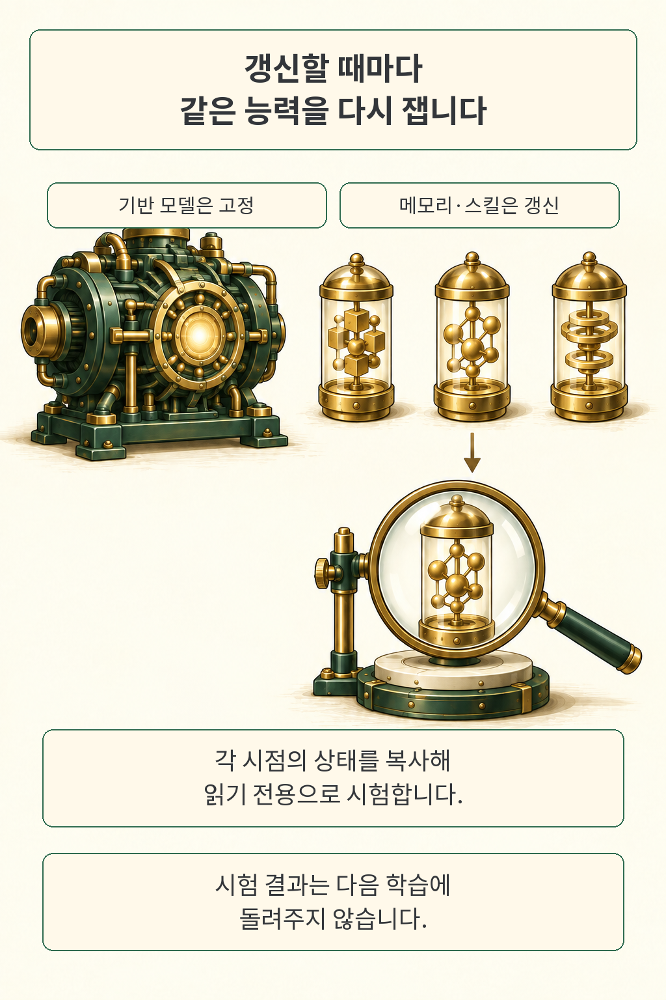
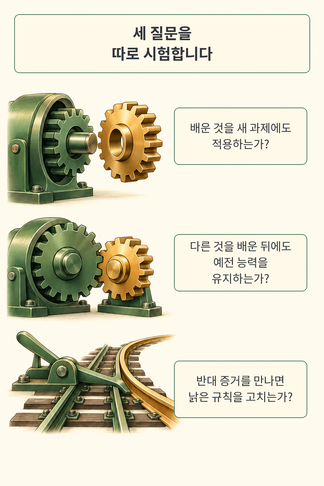
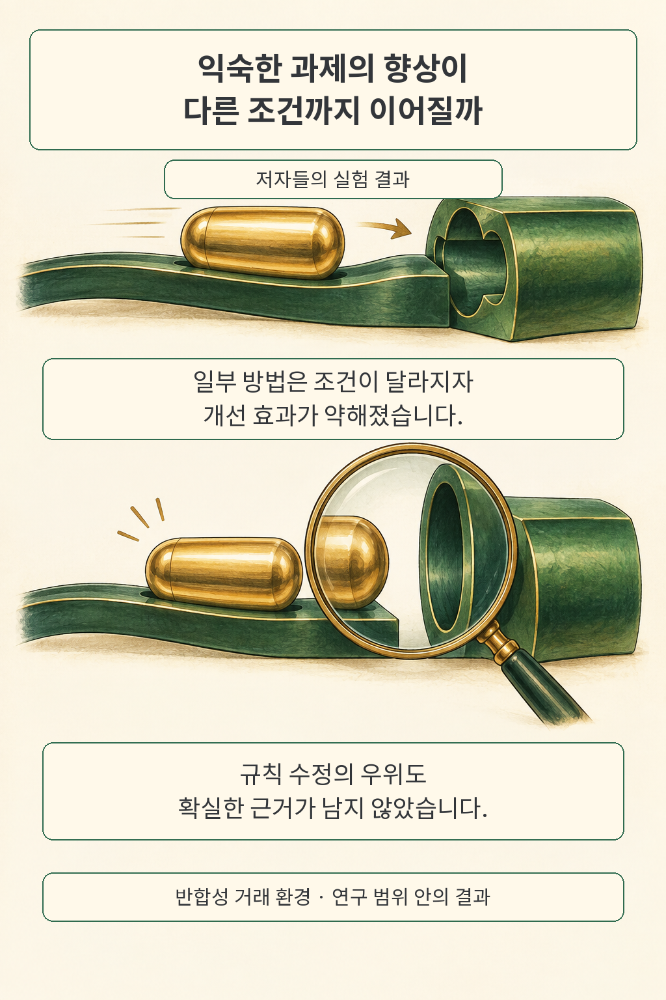

에이전트가 작업을 마칠 때마다 스스로 메모리와 스킬 문서를 고치도록 만들었다면, 한 번 배포한 뒤에도 프로그램의 행동은 매일 달라집니다. 가장 최근 과제의 성공률만 보고 메모리 업데이트를 승인하기에는 어제까지 잘 처리하던 업무가 조용히 망가질 위험이 마음에 걸리는데, **EvoPathBench는 메모리 갱신 시점마다 에이전트의 상태를 얼려 두고 새로 배운 능력·유지해야 할 능력·고쳐야 할 낡은 규칙을 각각 시험하는 평가 벤치마크**입니다.

글·해설: 다메카솔

## 핵심 내용

- **메모리 스냅샷 고정 평가**: 기반 모델 가중치와 도구·실행기를 고정한 채 매 갱신 시점의 메모리·스킬 복사본을 읽기 전용으로 떼어 내어, 평가 도중 일어나는 추가 학습과 그 시점의 실력을 분리해 측정합니다.
- **축적·간섭·반전의 세 가지 경로**: 총 1,800개 평가 흐름(갱신 5회·평가 시점 6개, 과제 사양 4,800개)을 통해 같은 계열 지식 축적, 다른 과제 학습 후 기존 능력 유지(간섭), 반대 증거 등장 시 기존 규칙 수정(반전)을 나누어 시험합니다.
- **근접 분포 향상과 조건 전이 시의 역전**: 반합성 거래 시뮬레이션(Qwen3.8-Max, Kimi-K3 기반)에서 SkillOpt는 익숙한 조건에서 대조군 대비 위험 조정 점수 **+0.763**을 기록했으나 조건이 달라진 전이 평가에서는 **−0.273**으로 뒤집혔고, 반전(규칙 수정)에서는 다중비교(Holm) 보정 후 유의한 우위를 보인 방법이 없었습니다.

## 기억이 바뀐 순간을 붙잡는다

기반 모델 버전이 똑같아도 매 실행 전에 읽어 들이는 메모리나 스킬 문서, 작업 규칙이 바뀌면 에이전트의 판단은 달라집니다. 연구팀은 무엇이 성능을 바꿨는지 명확히 좁히기 위해 모델 가중치와 실행기는 고정하고, 매 갱신 시점의 메모리 상태를 읽기 전용 복사본으로 떠서 별도 평가 과제에 적용했습니다. ([원문 3절](https://arxiv.org/html/2609.24663v1#S3))

이때 평가 과제에서의 시험 결과는 다음 학습 단계로 돌려주지 않으며, 메모리를 전혀 갱신하지 않는 대조군 및 학습된 메모리에 접근하지 못하게 막은 조건과 짝지어 비교합니다. 평가 도중에 기억까지 함께 바뀌어 버리면 방금 갱신한 메모리의 효과인지 시험 문제를 풀면서 새로 적응한 효과인지 구분할 수 없기 때문입니다.

## 새로 배우기, 유지하기, 고쳐 배우기

에이전트가 경험을 쌓는 순서는 세 가지 흐름(각 흐름당 갱신 기회 5회·초기 상태 포함 평가 시점 6개, 전체 생성 과제 사양 4,800개·흐름 1,800개)으로 나뉩니다. ([고정한 공식 데이터와 설명](https://github.com/HQ-Lin/EvoPathBench/tree/a0a596237d888304c25be2828d30c99e2f66b3b7))

| 시험 흐름 | 경험을 주는 순서 | 핵심 평가 질문 |
| --- | --- | --- |
| **축적 (Accumulation)** | 같은 계열의 학습 과제를 연속 제공 | 새로 배운 규칙을 처음 보는 과제와 조금 달라진 조건에도 일반화하는가 |
| **간섭 (Interference)** | 한 능력을 익힌 뒤 다른 계열 과제를 학습 | 새 과제를 배운 뒤에도 이전에 잘하던 일을 잊지 않고 유지하는가 |
| **반전 (Reversal)** | 유효했던 규칙을 배운 뒤 반대 증거를 제시 | 환경이 바뀌었을 때 낡은 기억을 고집하지 않고 규칙을 수정하는가 |

실무 운영에서도 어제까지의 정상 절차를 그대로 지켜야 하는 상황(간섭 방어)과, API 사양 변경처럼 예전 규칙을 버리고 새 규칙으로 갈아타야 하는 상황(반전 적응)은 요구하는 능력이 정반대이므로 분리해 측정해야 합니다.

## 익숙한 조건에서의 향상은 어디까지 갔나

반합성 거래 시뮬레이션 환경에서 Qwen3.8-Max와 Kimi-K3를 기반으로 여러 메모리·스킬 갱신 기법을 비교한 결과, 익숙한 분포에서의 점수 상승이 낯선 조건까지 그대로 이어지지는 않았습니다(원문 표 2, 아래 수치는 갱신하지 않는 대조군 대비 위험 조정 과제 점수의 차이이며 퍼센트 수익률이 아닙니다). ([원문 표 2와 4.2~4.5절](https://arxiv.org/html/2609.24663v1#S4))

- **근접 분포 vs 전이 조건의 역전**: 예를 들어 `SkillOpt`는 학습과 비슷한 근접 분포에서 **+0.763**으로 가장 높은 개선을 보였으나, 조건이 달라진 전이 평가에서는 **−0.273**으로 대조군보다 오히려 낮아졌습니다.
- **낡은 규칙 수정(반전)의 한계**: 반전 흐름에서는 평균 점수가 양수인 기법들이 있었지만, Holm 다중비교 보정을 거친 뒤에는 통계적으로 유의한 개선을 보인 방법이 남지 않았습니다.
- **후보 생성과 선택의 괴리**: 일부 경로에 큰 손실이 집중됐으며, 에이전트가 더 나은 메모리 갱신 후보를 생성하고도 정작 최종 저장 단계에서 그 후보를 제대로 골라내지 못하는 병목이 관찰됐습니다.

이 글을 준비하며 2026년 9월 22일 공식 저장소의 고정 커밋(`a0a59623`)에서 오프라인 데이터 검증기(`validate_dataset.py`)를 직접 실행해 파일 9개 해시와 과제 4,800개·흐름 1,800개의 무결성, 그리고 모든 흐름에서 학습 과제 ID와 평가 과제 ID가 겹치지 않음을 확인했습니다(모델을 호출해 점수를 재현하는 실험은 수행하지 않았으며, 반합성 시뮬레이션 결과를 실제 코드 수정이나 투자 성과로 일반화할 수는 없습니다). ([공식 검증 코드](https://github.com/HQ-Lin/EvoPathBench/blob/a0a596237d888304c25be2828d30c99e2f66b3b7/scripts/validate_dataset.py))

## 다메카솔의 해석: 메모리도 배포 이력을 갖게 하기

애플리케이션 코드는 Git 커밋으로 엄격히 버전 관리하면서, 정작 에이전트의 행동을 좌우하는 메모리·스킬 파일은 최신 상태 하나만 덮어쓰고 있다면 장애 원인을 추적하기 어렵습니다. [Workflow as Knowledge의 지식 계보 논의](/posts/workflow-as-knowledge/)처럼 **메모리·스킬 버전마다 어떤 근거로 규칙이 추가·수정됐고, 그때의 읽기 전용 스냅샷이 기존 회귀 과제를 통과했는지**를 함께 배포 이력으로 남겨야 합니다.

매 갱신마다 전체 벤치마크를 다 돌리기 부담스럽다면 바뀐 규칙과 관련된 과제와 핵심 회귀 과제 묶음을 먼저 실행하되, 메모리 선택기가 특정 시험 문제에만 과적합되지 않도록 승인에 쓰지 않는 별도 보류(holdout) 평가셋을 함께 두는 구성을 권합니다.

## 출처

- Hongqiang Lin 외, [Beyond Endpoint Performance: Process-Level Evaluation of Self-Evolving Agents](https://arxiv.org/abs/2609.24663v1). arXiv v1, 2026년 9월 21일 제출.
- [원문 PDF](https://arxiv.org/pdf/2609.24663v1): 평가 설계 3절, 결과 표 2·4.2절, 환경과 실행 조건 부록 A·B.
- [공식 코드·데이터 고정 버전 (`a0a59623`)](https://github.com/HQ-Lin/EvoPathBench/tree/a0a596237d888304c25be2828d30c99e2f66b3b7): 공개 데이터셋 무결성 및 학습·평가 ID 분리 검증 실행.

출처 확인·작성: 2026년 9월 22일.

이 글의 본문과 이미지는 생성형 AI로 제작했습니다. 기획과 편집 기준은 다메카솔이 정했습니다.
