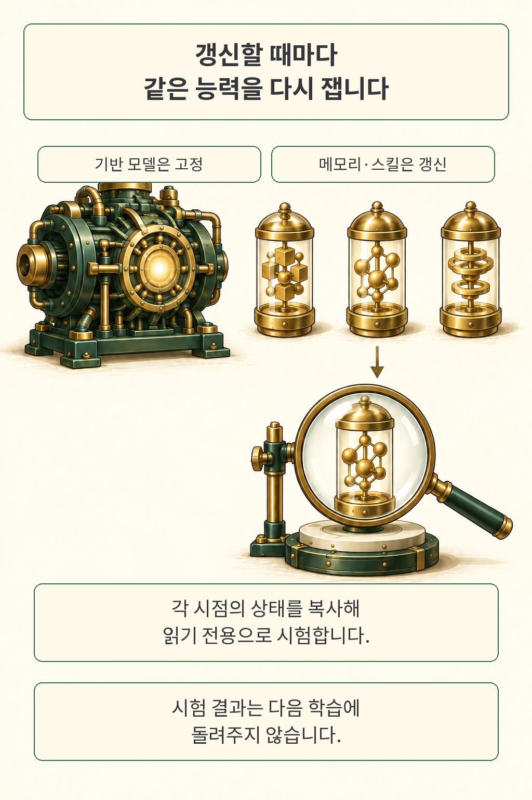
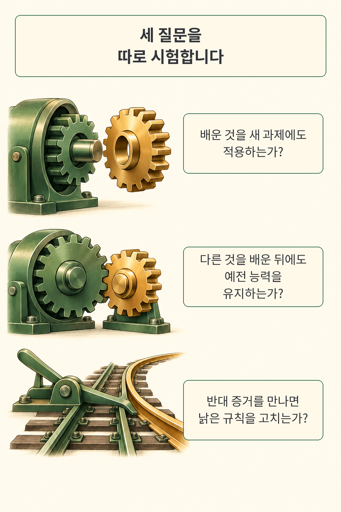
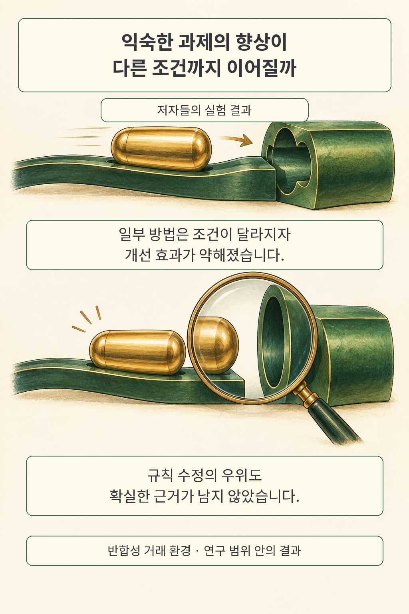

에이전트가 작업을 마칠 때마다 스스로 메모리와 스킬 문서를 고치도록 만들었다면, 기반 모델 버전이 같아도 프로그램의 행동은 매일 달라집니다. 가장 최근 과제 하나가 통과했다고 업데이트를 승인하면, 어제까지 잘 처리하던 업무가 조용히 망가지는 부작용을 놓치기 쉽거든요. **EvoPathBench**는 메모리가 바뀔 때마다 에이전트 상태를 얼려 두고, 새로 배운 능력과 지켜야 할 기존 능력, 고쳐야 할 낡은 규칙을 과정 단위로 떼어 내 평가하는 벤치마크입니다.

글·해설: 다메카솔

## 핵심 내용

- **읽기 전용 스냅샷 평가**: 기반 모델 가중치와 도구·실행기를 고정한 채 매 갱신 시점의 메모리·스킬 복사본을 떼어 내어, 평가 중 일어나는 추가 학습과 분리해 측정합니다.
- **세 가지 평가 경로(축적·간섭·반전)**: 총 1,800개 평가 흐름(갱신 5회·평가 시점 6개, 과제 사양 4,800개)으로 새 지식 일반화, 기존 능력 유지, 반대 증거에 따른 규칙 수정을 나누어 시험합니다.
- **익숙한 조건과 달라진 조건의 역전**: 반합성 거래 시뮬레이션에서 `SkillOpt`는 근접 분포 기준 대조군 대비 위험 조정 점수 **+0.763**을 기록했지만, 조건이 바뀐 전이 평가에서는 **−0.273**으로 뒤집혔습니다.

## 기억이 바뀐 순간을 붙잡는다

기반 모델이 똑같아도 매 실행 전에 읽어 들이는 메모리나 스킬 문서, 작업 규칙이 달라지면 에이전트의 판단은 금세 바뀝니다. 예를 들어 고객 문의 응답 봇이 환불 예외 규정을 메모리에 추가한 뒤 환불 응대는 매끄러워졌는데, 정작 예전부터 잘 처리하던 배송 지연 안내에 엉뚱한 조건을 섞어 쓰기 시작하는 상황을 떠올려 볼까요?

연구팀은 이처럼 성능 변화의 원인을 메모리로 좁히기 위해 모델 가중치와 실행기는 고정하고, 매 갱신 시점의 상태를 읽기 전용 복사본으로 떠서 별도 평가 과제에 투입했습니다([원문 3절](https://arxiv.org/html/2609.24663v1#S3)). 이때 시험 결과는 다음 학습 단계로 돌려주지 않으며, 메모리를 전혀 갱신하지 않는 대조군이나 학습된 상태 접근을 끈 조건과 짝지어 비교합니다. 평가 문제를 풀면서 기억까지 함께 바뀌어 버리면, 방금 저장한 메모리의 효과인지 시험 도중 새로 적응한 효과인지 가려내기 어렵기 때문이죠.

## 새로 배우기, 유지하기, 고쳐 배우기

에이전트가 경험을 쌓는 순서는 세 가지 흐름으로 나뉘며, 공개 데이터셋 역시 학습 과제와 평가 과제가 겹치지 않도록 설계됐습니다.

| 시험 흐름 | 경험을 주는 순서 | 핵심 평가 질문 |
| --- | --- | --- |
| **축적 (Accumulation)** | 같은 계열의 학습 과제를 연속 제공 | 새로 배운 규칙을 처음 보는 과제와 조금 달라진 조건에도 일반화하는가 |
| **간섭 (Interference)** | 한 능력을 익힌 뒤 다른 계열 과제를 학습 | 새 과제를 배운 뒤에도 이전에 잘하던 일을 잊지 않고 유지하는가 |
| **반전 (Reversal)** | 유효했던 규칙을 배운 뒤 반대 증거를 제시 | 환경이 바뀌었을 때 낡은 기억을 고집하지 않고 규칙을 수정하는가 |

공개 데이터 구성과 실험 기본 조건을 함께 보면 평가 규모를 가늠하기 수월합니다.

- **데이터 규모**: 생성 과제 사양 4,800개와 순서 있는 평가 흐름 1,800개로 이루어지며, 각 흐름마다 갱신 기회 5회와 초기 상태를 포함한 평가 시점 6개가 배치됩니다([공식 저장소](https://github.com/HQ-Lin/EvoPathBench/tree/a0a596237d888304c25be2828d30c99e2f66b3b7)).
- **학습·평가 분리**: 모든 평가 흐름에서 학습용 과제 ID와 평가용 과제 ID의 겹침은 0건으로 분리되어 있습니다.
- **평가 환경과 기반 모델**: 공개 시장 통계를 이용한 반합성 거래 시뮬레이션(6개 과제 계열·2개 환경 층) 위에서 `Qwen3.8-Max`와 `Kimi-K3`를 사용하며, 한 실험 안에서는 의사결정과 상태 갱신에 같은 모델을 씁니다.

실무 운영에서도 어제까지의 정상 절차를 지켜야 하는 상황(간섭 방어)과 API 사양 변경처럼 예전 규칙을 버리고 새 규칙으로 갈아타야 하는 상황(반전 적응)은 요구하는 능력이 정반대입니다. 한 묶음의 평균 점수만 바라보면 두 능력이 서로 상쇄되어 문제를 놓치기 쉬운 편이죠.

## 익숙한 조건에서의 향상은 어디까지 갔나

여러 메모리·스킬 갱신 기법을 비교한 결과, 익숙한 분포에서 얻은 점수 상승이 낯선 조건까지 온전히 이어지기는 어려웠습니다([원문 4절](https://arxiv.org/html/2609.24663v1#S4)). 아래 수치는 퍼센트 수익률이 아니라, 메모리를 갱신하지 않은 대조군 대비 위험 조정 과제 점수의 차이를 나타냅니다.

- **근접 분포와 전이 조건의 역전**: `SkillOpt`는 학습과 비슷한 근접 분포에서 **+0.763**으로 가장 높은 개선을 보였지만, 조건이 달라진 전이 평가에서는 **−0.273**으로 대조군보다 낮아졌습니다.
- **낡은 규칙 수정(반전)의 한계**: 반전 흐름에서는 평균 점수가 양수인 기법들도 일부 있었으나, 다중비교(Holm) 보정을 적용한 뒤에는 통계적으로 유의한 우위를 보인 방법이 남지 않았습니다.
- **후보 생성과 선택의 괴리**: 일부 경로에 큰 성능 하락이 집중됐으며, 에이전트가 더 나은 메모리 갱신 후보를 만들어 내고도 최종 저장 단계에서 이를 골라내지 못하는 병목이 관찰됐습니다.

물론 이 결과는 공개 시장 통계 기반의 반합성 시뮬레이션에서 나온 수치이므로, 실제 코드 수정 작업이나 투자 성과로 곧바로 일반화하기는 어렵습니다. 또 반전 평가에서 유의한 우위가 남지 않았다는 점을 규칙 수정 자체가 불가능하다는 증명으로 보기보다, 현재 기법들이 조건 변화 앞에서 아직 불안정하다는 신호로 읽어야 정확합니다. 그럼에도 "새 규칙을 생성하는 능력"과 "검증된 규칙만 골라 저장하는 능력"이 따로 놀 수 있다는 점은 분명히 짚고 넘어갈 만한 대목입니다.

## 다메카솔의 해석: 메모리도 배포 이력을 갖게 하기

애플리케이션 코드는 Git 커밋으로 엄격히 버전 관리하면서, 정작 에이전트의 행동을 좌우하는 메모리·스킬 파일은 최신 상태 하나만 덮어쓰고 있다면 장애 원인을 되짚기 어렵습니다. [Workflow as Knowledge의 지식 계보 논의](/posts/workflow-as-knowledge/)처럼 메모리와 스킬에도 버전마다 어떤 근거로 규칙이 추가·수정됐고, 그때의 읽기 전용 스냅샷이 기존 회귀 과제를 통과했는지 배포 이력을 함께 남겨야 하죠.

매 갱신마다 전체 벤치마크를 다 돌리기 부담스럽다면, 바뀐 규칙과 맞닿은 과제와 핵심 회귀 과제를 묶어 먼저 실행하는 구성이 현실적입니다. 이때 기존 절차를 지켜야 하는 유지 시험과 새 증거에 맞춰 규칙을 고쳐야 하는 반전 시험을 따로 분리해 두면, 어느 기준에서 승인 충돌이 나는지 훨씬 선명하게 드러납니다. 여기에 메모리 선택기가 특정 시험 문제에만 과적합되지 않도록 승인 판단에 쓰지 않는 별도 보류(holdout) 평가셋을 곁들여 두면 운영 안정성을 한층 높일 수 있습니다.

## 출처

- Hongqiang Lin 외, [Beyond Endpoint Performance: Process-Level Evaluation of Self-Evolving Agents](https://arxiv.org/abs/2609.24663v1). arXiv v1, 2026년 9월 21일 제출.
- [원문 PDF](https://arxiv.org/pdf/2609.24663v1): 평가 설계 3절, 결과 표 2·4.2절, 환경과 실행 조건 부록 A·B.
- [공식 코드·데이터 저장소](https://github.com/HQ-Lin/EvoPathBench/tree/a0a596237d888304c25be2828d30c99e2f66b3b7) 및 [데이터셋 무결성 검증 스크립트](https://github.com/HQ-Lin/EvoPathBench/blob/a0a596237d888304c25be2828d30c99e2f66b3b7/scripts/validate_dataset.py): 공개 데이터셋 사양과 학습·평가 ID 분리 구조 확인.

출처 확인·작성: 2026년 9월 22일. 논문 원문과 공개 코드·데이터 구조를 바탕으로 정리했으며, 모델 호출을 통한 실험 재현은 포함하지 않았습니다.

이 글의 본문과 이미지는 생성형 AI로 제작했습니다. 기획과 편집 기준은 다메카솔이 정했습니다.
