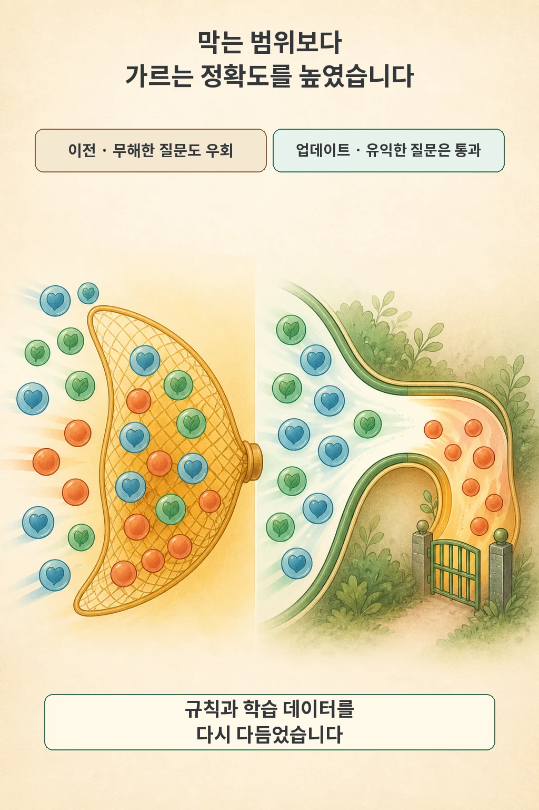

Anthropic이 2026년 8월 7일 발표한 Fable 5 생물학 안전 업데이트의 핵심은 안전장치를 해제한 것이 아니라 **분류 경계를 정밀하게 좁힌 것**입니다. 일상적인 건강·교육 질문까지 제한 모델(Opus 5)로 우회시키던 오탐을 줄이는 한편, 바이러스학·독성학·분자 설계처럼 이중용도로 분류한 전문 연구 요청은 기존과 동일하게 제한된 경로로 보냅니다.

글·해설: 다메카솔

## 핵심 내용

- **안전 분류기 재학습**: 분류 규칙 모음(constitution)을 다시 작성하고 허용 사례를 세분화한 뒤, 새 학습 데이터와 내·외부 전문가 검토를 거쳐 Fable 5 앞단의 생물학 안전 분류기를 재학습했습니다.
- **일상 질문과 이중용도 연구의 분리**: 증상 이해, 검사 결과 해석, 생물학 학습과 일부 임상 업무는 Fable 5가 직접 처리하는 비중이 늘어나지만, 바이러스학·독성학·분자 설계 등 이중용도 전문 연구 요청은 계속 생물학 능력이 더 낮은 Opus 5로 우회(fallback)됩니다.
- **자체 측정 fallback 감소 폭**: Anthropic 내부 테스트 기준 제품 전반의 생물학 관련 fallback이 약 85% 줄었으며, 생물학 외 사유를 포함한 전체 fallback 감소 예상치는 Claude.ai 약 67%, Cowork 55%, Claude Code 17%, Claude Platform 7%입니다.

## 넓게 막던 경계를 다시 그렸습니다

Fable 5가 처음 공개됐을 때 Anthropic은 위험한 생물학 요청을 놓치지 않기 위해 매우 넓은 안전 여백을 두었습니다. 그 결과 위험성과 거리가 먼 증상 이해나 검사 결과 해석 같은 일상적인 질문까지 Opus 5로 우회되는 오탐이 빈번하게 발생했습니다.

이번 업데이트에서 Anthropic은 분류기의 규칙 모음인 constitution을 다시 쓰고 허용할 사례를 더 촘촘하게 나눴습니다. 여기에 새 학습 데이터를 구축하고 내·외부 전문가 의견을 반영해 분류기를 재학습함으로써, 위험 범주 자체를 바꾸기보다 경계를 가르는 정밀도를 높였습니다.

## 작은 분류기가 두 모델 사이를 가릅니다

Fable 5 앞단에는 별도의 작은 안전 분류기가 동작합니다. 이 분류기가 보호 대상 생물학 요청이나 유해한 출력을 감지하면 Fable 5가 직접 답하지 않고, 생물학 관련 역량이 상대적으로 낮아 악의적 사용을 덜 돕는 Opus 5 경로로 요청을 돌립니다.

| 요청 구분 | 주요 예시 | 라우팅 경로 | 비고 |
| --- | --- | --- | --- |
| **일상 건강·교육·일부 임상** | 증상 이해, 검사 결과 해석, 생물학 학습, 일부 임상 업무 | **Fable 5 직접 응답 확대** | 기존에 과도하게 발생하던 오탐(fallback) 축소 |
| **이중용도(Dual-use) 전문 연구** | 바이러스학, 독성학, 분자 설계 등 위험도가 높은 전문 생물학 요청 | **Opus 5로 우회 (유지)** | 검증된 연구자를 위한 별도 `trusted access` 프로그램은 향후 계획 단계(일반 공개 일정 미정) |

이 분기 구조는 업데이트 이후에도 그대로 유지됩니다. 따라서 이번 조치를 Fable 5의 전문 생물학 연구나 신약 개발 역량을 일반에 개방한 것으로 해석해서는 안 됩니다.

## 일상 질문은 더 열리고 전문 연구는 남아 있습니다

일반 사용자가 바로 체감하는 변화는 건강과 교육 영역에서 나타납니다. 증상 이해나 검사 결과 해석, 기초 생물학 학습 질문에서 불필요한 모델 우회가 줄어듭니다. 다만 이는 어디까지나 모델 선택(라우팅) 경로의 조정이며, 의료 답변 자체의 임상적 정확성이나 안전성이 독립 평가로 새로 검증됐다는 뜻은 아닙니다.

한편 frontier 생물학 역량이 필요한 전문 연구자를 위해 Anthropic은 별도의 신뢰 경로(`trusted access`)를 마련하겠다는 계획을 밝혔지만, 구체적인 일반 공개 일정은 이번 발표에 포함되지 않았습니다.

## 85% 감소 수치와 위험 판단을 읽는 기준

Anthropic은 자체 테스트에서 제품 표면 전반의 생물학 관련 fallback이 약 85% 줄었다고 보고했습니다. 생물학 외 다른 사유까지 합친 전체 fallback 감소 예상치는 다음과 같습니다.

- **Claude.ai**: 약 67% 감소
- **Cowork**: 약 55% 감소
- **Claude Code**: 약 17% 감소
- **Claude Platform**: 약 7% 감소

발표문에는 테스트 표본 크기나 외부 독립 검증 결과가 포함되지 않았으므로, 이 수치는 회사의 내부 테스트 및 예상치로 읽어야 합니다. 마찬가지로 Fable 5가 일부 복잡한 생물학 과제에서 전문가를 능가하고 악의적 행위자에게 공개 정보만으로 얻기 어려운 역량 상승을 줄 수 있다는 평가 역시 Anthropic의 시스템 카드와 내부 위협 모델에 기반한 판단입니다.

## 다메카솔의 해석

안전 업데이트의 성패는 “얼마나 많이 막았는가”보다 **얼마나 정확히 나눴는가**에 달려 있습니다. 경계가 너무 넓으면 유익한 일상 질문까지 값비싼 우회로로 보내 사용성을 해치고, 너무 좁으면 위험한 요청이 그대로 통과합니다. 이번 조정은 후자의 방어선을 유지하면서 전자의 오탐 비용을 줄이려는 작업입니다.

실제 서비스 운영 관점에서는 유익한 요청의 **오탐률**, 위험 요청의 **미탐률**, 그리고 우회(fallback)된 뒤에도 사용자가 받는 **도움의 질**이라는 세 지표를 함께 봐야 합니다. 이번 발표는 첫 번째 지표인 오탐률 개선을 수치로 제시했으며, 미탐률 방어와 우회 응답의 품질이 현장에서 어떻게 유지되는지는 후속 운영 데이터로 확인할 부분입니다.

## 출처

- [Anthropic — Improving Fable 5's biology safeguards](https://www.anthropic.com/news/improving-fable-5-s-biology-safeguards)
- [Anthropic — Claude Fable 5 and Claude Mythos 5](https://www.anthropic.com/news/claude-fable-5-mythos-5)
- [Anthropic — Claude Fable 5 & Claude Mythos 5 System Card](https://www-cdn.anthropic.com/2f9323abbcc4abe219577539efe19a623c9ca2bd/Claude%20Fable%205%20%26%20Claude%20Mythos%205%20System%20Card.pdf)
- [Anthropic — Responsible Scaling Policy Version 3.4](https://cdn.sanity.io/files/4zrzovbb/website/0bacdc8440ea96e62a8766d99ebe1d4eea6d5f3a.pdf)

이 글의 본문과 이미지는 생성형 AI로 제작했습니다. 기획과 편집 기준은 다메카솔이 정했습니다.
