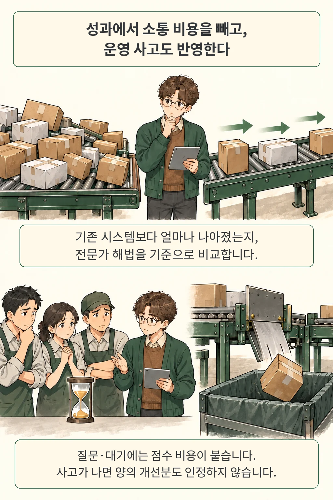

95개 과제 중 14개. FDE-Gym에서 평균 점수가 가장 높았던 모델이 해결 기준을 넘긴 과제 수입니다. 기능을 만드는 AI가 꽤 능숙해졌다고 느끼는 개발자에게는 낯선 성적표인데요. 이 평가는 고객의 불완전한 요청을 받은 에이전트가 숨은 조건을 찾아 시스템을 고치고, 실제로 고객의 업무 지표까지 개선하는지 묻습니다.

글·해설: 다메카솔

## 핵심 내용

- 에이전트는 불완전한 첫 요청과 기존 시스템, 문서·데이터, 직원 목록을 받아 숨은 규칙을 찾고 기존 호출 경로에 수정 코드를 연결해야 합니다.
- 최종 점수 `S`는 전문가 기준 해법 대비 개선도(`U`)에서 운영 사고와 소통 비용을 반영해 계산하며, 평균 점수 1위(Opus 5.5, 0.56)와 해결 과제 수 1위(Sonnet 5.5, 15개)가 서로 달랐습니다.
- 규칙을 직접 찾아야 하는 구간(L0→L1)에서 점수가 가장 크게 떨어졌고, 핵심 사실을 모두 알아낸 뒤에도 이를 코드와 업무 흐름으로 구현하는 장벽이 남았습니다.

저는 이 연구를 읽으며 '납품 완료'의 기준을 어디에 두는지에 먼저 눈이 갔습니다. 표지의 멈춰 선 컨베이어 비유처럼, 단위 테스트가 통과해도 실제 호출 경로에 연결되지 않거나 승인 조건을 놓치면 고객은 여전히 같은 일을 수작업으로 처리해야 하거든요. FDE-Gym은 바로 그 마지막 연결 고리를 모의 환경에서 시험한 연구입니다. 단순히 점수가 낮다는 사실보다, 저자들이 무엇을 채점 기준에 넣었는지를 따라가 보면 실무적인 시사점이 분명해집니다.

## FDE-Gym은 무엇을 맡기는가

현업에서 고객은 처음부터 완성된 명세를 건네주지 않죠. 이 평가에서 에이전트가 받는 것도 의뢰자의 첫 요청과 기존 시스템 사본, 흩어진 문서·과거 데이터, 그리고 질문할 수 있는 담당자 목록뿐입니다. 에이전트는 이 안에서 숨은 업무 규칙을 찾아 코드를 고쳐야 하는데요, 제출한 `system/` 폴더는 기존 진입점 그대로 호출되어 채점됩니다. 새 함수를 별도 파일에 아무리 잘 만들어 두어도 기존 호출 경로에 이어 붙이지 않으면 효과가 나타나지 않는 구조입니다.

저자들이 든 시추 업무 사례를 보면 이 차이가 잘 드러납니다. 의뢰자는 보고 메일과 질의응답 기능을 원한다고 요청하지만, 정작 실제 업무 손실은 가동 중단 시간을 잘못 분류해 보상 청구가 막히는 데서 발생하거든요. 결국 분류 규칙을 확인하고 변경 승인을 얻어야 지표를 개선할 수 있습니다. 물론 의뢰자의 요청을 매번 의심하라는 뜻으로 받아들이기는 어렵습니다. 평가 과제 중에는 첫 요청 자체가 정확하고 완전해서 그대로 구현하는 것이 기준 해법과 일치하는 예외도 함께 포함됐습니다. [원문 §1–3](https://arxiv.org/html/2610.22350v1)

저자들은 실제 프로젝트를 각색해 18개 분야, 20개 시나리오를 구성하고 원형 20개에 조건을 바꾼 변형 75개를 더해 총 95개 과제를 만들었습니다. 고객 조직과 인물은 익명화하거나 가상으로 구성했고, 일부 데이터는 실제 산업 자료를 각색했습니다. 담당자의 답변 내용과 공개 조건은 스크립트로 정해져 있으며 작은 모델이 질문을 주제에 연결하므로, 실제 현장 고객에게 배포해 효과를 측정한 실험과는 구분해 읽어야 합니다.

## 점수 0.56을 읽는 방법

같은 결과물도 어떤 기준으로 채점하느냐에 따라 성적표가 완전히 달라집니다. FDE-Gym은 먼저 기존 시스템보다 고객의 지표가 얼마나 좋아졌는지 구한 뒤, 전문가가 작성한 기준 해법의 개선량으로 나눕니다. 논문에서 정규화 개선도 `U`라고 부르는 이 값은 기존 상태와 같으면 0, 기준 해법만큼 개선하면 1이고, 오히려 결과가 나빠지면 음수가 됩니다.

여기에 운영 사고와 고객 응대 비용을 추가로 반영합니다. 사전에 정의한 무단 행동 같은 사고가 발생하면 양의 개선분을 0으로 처리하고, 이미 음수인 개선분은 그대로 남깁니다. 그 뒤 담당자에게 연락하거나 시험 실행을 요청하고 기다린 소통 비용을 빼면 최종 점수 `S`가 나오는데요. 답을 받지 못한 메시지는 비용에 넣지 않으며, 이 비용은 실제 인건비나 모델 API 사용료가 아니라 전문가가 정한 과제별 모형입니다.

| 구분 | 의미 | 혼동하기 쉬운 값 |
| --- | --- | --- |
| 개선도 U | 기존 시스템 대비 개선량을 기준 해법과 비교 | 전체 요청 중 성공 비율 |
| 최종 점수 S | 사고를 반영한 개선도에서 소통 비용을 차감 | 모델 사용료를 뺀 이익률 |
| 해결 과제 | 점수 0.8 이상이면서 사고가 없는 과제 | 비용 차감 전 U가 0.8 이상인 과제 |

전체 95개 과제의 L3 조건에서 Claude Opus 5.5는 평균 점수 0.56(과제 단위 부트스트랩 95% 구간 0.50–0.62)과 해결 과제 14개를 기록했습니다. 흥미롭게도 같은 표의 Claude Sonnet 5.5는 평균 0.49에 해결 과제 15개였고, GPT-6 Astra는 0.38과 9개여서 평균 점수가 높은 모델과 해결 개수가 많은 모델이 서로 달랐습니다. [원문 표 3](https://arxiv.org/html/2610.22350v1)

이는 평균을 낼 때 큰 손실 몇 건이 전체를 지배하지 않도록 사고 조정 후 개선도의 하한을 −1로 제한한 뒤 소통 비용을 모두 빼기 때문입니다. 반면 개별 실행의 해결 여부를 판정할 때는 이 하한을 적용하지 않고 점수가 0.8 이상이면서 사고가 없는지를 봅니다. 따라서 0.56이라는 숫자 하나만으로 전체 성공률이나 손실 규모까지 단정하기는 어렵습니다.

## 규칙을 알려 주다가 감추면 어디서 막히나

그렇다면 에이전트는 문제 해결 과정의 어느 단계에서 가장 많이 막혔을까요? 저자들은 실행 환경을 고정한 채 과제 설명에서 주는 정보량을 네 단계로 조절했습니다. L0에서는 문제와 규칙을 모두 알려 주고, L1에서는 문제만, L2에서는 증상만 제시하며, L3에서는 의뢰자의 원래 요청만 전달합니다. L3는 전체 95개 과제에서 평가했고, 정보 수준별 비교는 같은 원형 20개 과제로 진행했습니다(설명이 동일한 세 시나리오에서는 L2에 L3 실행 결과를 재사용했습니다).

비교 결과에서 가장 큰 낙폭이 나타난 지점은 에이전트가 숨은 규칙을 직접 찾아야 하는 순간이었습니다. 전체 L3 평균 점수 상위 세 모델을 원형 20개 과제에서 비교했을 때, 규칙을 빼고 문제만 준 L0→L1 구간에서 평균 점수가 0.28(95% 구간 0.17–0.39) 떨어졌습니다. 반면 L1에서 L3로 정보를 더 줄였을 때의 추가 하락은 0.04(95% 구간 −0.03–0.14)에 그쳐서, 작은 차이의 방향과 크기는 조심스럽게 해석해야 합니다. 의뢰자가 문제를 잘못 짚는 상황에서도 추가 손실이 크게 두드러지지 않았다는 점이 이 표본의 관찰입니다. [원문 §5.2](https://arxiv.org/html/2610.22350v1)

이쯤에서 “결국 담당자에게 질문만 잘하면 해결되겠네”라는 생각이 들 수 있습니다. 하지만 Opus 5.5가 담당자로부터 핵심 사실을 모두 알아낸 23개 과제 가운데, 소통 비용을 빼기 전 개선도(`U`)가 0.8 이상에 도달한 과제는 10개뿐이었습니다. 질문을 통해 규칙을 파악한 뒤에도 이를 실제 코드와 업무 흐름에 반영하는 구현 장벽이 남아 있는 셈입니다. 앞서 다룬 [CLEAT의 질문 선택 연구](/posts/cleat-value-guided-clarification/)가 언제 무엇을 물을지에 초점을 맞췄다면, 이 연구는 답을 들은 뒤 실제 납품 결과까지 이어지는지를 추적합니다.

## 결과를 어디까지 가져올 수 있을까

이 성적표를 상용 에이전트 제품의 절대적인 순위로 옮겨 읽기에는 실험 환경의 경계가 뚜렷합니다. 저자들은 7개 제공자의 12개 모델을 13개 설정으로 두고, 모델별 맞춤 최적화 없이 명령 실행과 파일 읽기·쓰기·편집·목록 조회 도구만 공통으로 제공하는 최소 실행 틀에서 각 조합을 세 번씩 실행했습니다(제출 시점 또는 200턴, 150분, 모델 사용료 8달러 중 먼저 도달한 한도에서 종료). 에이전트 성능이 모델뿐 아니라 하네스 설계에 좌우된다는 점은 [에이전트 평가에서 시스템 설정을 함께 보는 이유](/posts/agent-evaluation-system-configuration/)와도 맞닿아 있습니다.

사람 전문가와의 비교 기준선도 아직은 비어 있습니다. 전문가 기준 해법은 모든 조건을 아는 상태에서 과제를 풀 수 있음을 보여 주지만, 실제 사람이 L3 요청만 받고 얼마나 해결하는지는 후속 수집 대상입니다. 게다가 담당자 반응이 고정된 스크립트이고, 에이전트에게는 질문할 때마다 점수가 깎인다는 사실을 미리 알려 주지 않았다는 점도 중요합니다. 이 결과를 근거로 현업에서 필요한 확인 질문까지 무조건 줄이려다가는 오히려 중요한 승인 절차를 놓칠 위험이 있습니다.

데이터와 코드의 공개 범위도 함께 살펴봐야 합니다. 공식 저장소에 실행 도구와 공개 예제 세 개는 열려 있지만, 원형 20개 과제는 접근 신청이 필요하고 변형 75개와 기준 해법은 비공개입니다. 2026년 10월 16일 확인한 저장소 최신 설명은 실행 도구 1.3.0을 가리키는 반면 논문 실험은 1.1.0에서 수행됐으며, 이번 글에서는 원문과 고정된 코드·공개 예제 설명만 대조했을 뿐 모델 성능을 직접 재현하지는 않았습니다. 표본이 규제 관련 업무 워크플로에 치우친 점과 학습 자료 오염 가능성 역시 저자들이 명시한 한계입니다.

## 다메카솔의 해석: 완료 조건에 고객의 결과를 붙이기

제가 현업에서 에이전트 납품 테스트를 설계한다면 기능, 권한, 성과를 서로 다른 세 개의 질문으로 분리하겠습니다. 기능 테스트가 입력에 맞는 출력을 내는지 확인하고 권한 테스트가 변경 승인 범위를 점검한다면, 성과 테스트는 기존 시스템을 대조군으로 삼아 고객이 원한 지표 개선이 실제로 일어나는지를 물어야 합니다. 이 셋을 하나의 초록색 통과 표시로 뭉뚱그리면, 어느 고리가 빠졌는지 디버깅하기가 무척 까다로워집니다.

특히 제출된 수정물을 '기존 진입점'으로 호출해 채점한다는 FDE-Gym의 설계는 실무적으로도 시사하는 바가 큽니다. 단위 테스트를 아무리 깔끔하게 통과해도 실제 운영 경로에서 호출되지 않는 코드는 고객에게 아무런 가치를 주지 못하니까요. 모의 업무 데이터를 실제 호출 경로로 흘려보내는 통합 시험을 별도로 두면, 에이전트가 업무 규칙을 이해한 단계와 그 규칙이 시스템 안에서 실제로 돌아가는 단계를 명확히 구분할 수 있습니다(이는 논문 설계에서 착안한 제 엔지니어링 해석입니다).

질문 비용 역시 팀과 업무의 성격에 맞춰 다시 정의해야 합니다. 짧은 승인 확인 한 번이 치명적인 운영 사고를 막는 업무라면, 질문 횟수를 아낀 에이전트에게 일률적으로 높은 점수를 주기는 어렵습니다. 저는 에이전트가 질문으로 알아낸 조건, 그 조건을 반영한 코드 경로, 그리고 실제로 바뀐 업무 지표를 한 묶음으로 보려 합니다. 지금 우리 팀이 쓰는 완료 기준은 이 세 가지 중 어디까지 확인하고 있을까요?

## 출처

- Dongxu Yang 외, [FDE-Gym: The Last Mile of AI Delivery, arXiv:2610.22350v1](https://arxiv.org/abs/2610.22350v1). 2026년 10월 15일 제출된 프리프린트. 방법 §2–4, 결과 표 3·§5, 한계 §7.
- [원문 PDF](https://arxiv.org/pdf/2610.22350v1)와 [HTML](https://arxiv.org/html/2610.22350v1).
- [공식 코드 저장소](https://github.com/deeplethe/fde-gym). 2026년 10월 16일 확인한 revision `1d9ed027af7c8312bacb1abad1467c87a91c004b`; 논문 실행 버전과 최신 버전을 구분했습니다.
- [공개 예제 세 개](https://huggingface.co/datasets/DeepLethe/FDE-Gym-examples)와 [신청형 원형 데이터](https://huggingface.co/datasets/DeepLethe/FDE-Gym). 전체 데이터 접근 권한을 취득하거나 비공개 변형을 실행하지 않았습니다.

업데이트: 2026-10-16

이 글의 본문과 이미지는 생성형 AI로 제작했습니다. 기획과 편집 기준은 다메카솔이 정했습니다.
