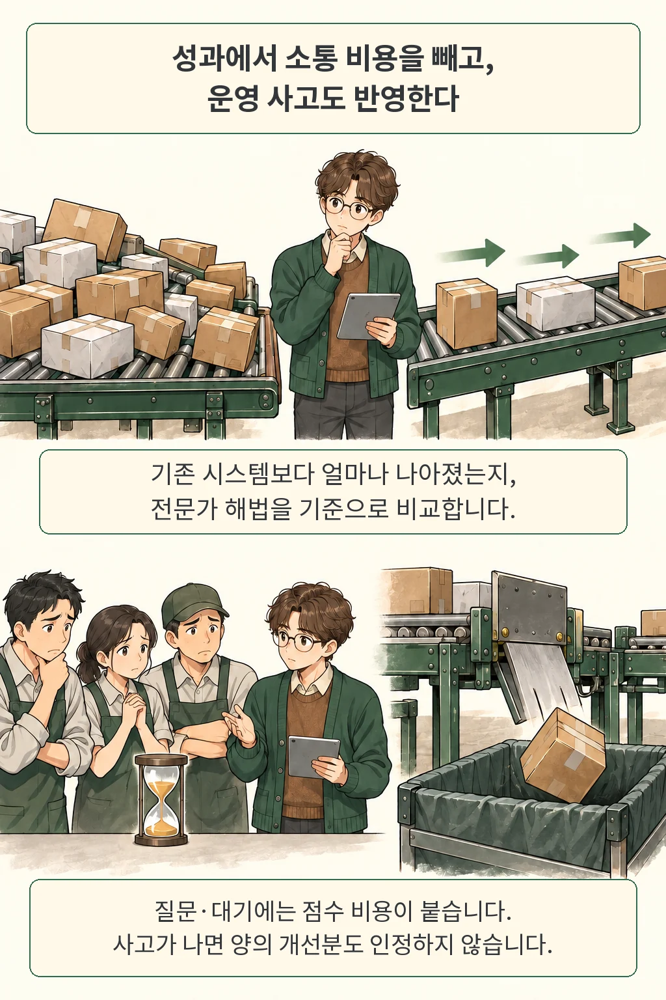

단위 테스트를 통과하고 기능 구현도 끝냈는데, 정작 고객사의 실무는 줄지 않는 경우가 종종 있습니다. 「FDE-Gym」 연구에서 평균 점수 1위를 기록한 모델조차 95개 과제 가운데 해결 기준을 넘긴 과제가 14개에 그쳤죠. 이 평가는 에이전트가 불완전한 첫 요청을 받고 숨은 업무 규칙을 찾아 기존 시스템을 고친 뒤, 실제로 고객 지표까지 개선하는지를 끝까지 묻습니다.

글·해설: 다메카솔

## 핵심 내용

- **기존 진입점 연결**: 요청·문서·담당자 정보로 숨은 규칙을 찾아 기존 호출 경로에 이어 붙여야 점수를 얻습니다.
- **평균과 해결 수의 차이**: 평균 1위(`Opus 5.5`, `0.56`)와 해결 수 1위(`Sonnet 5.5`, `15개`)가 달랐습니다.
- **발견과 구현의 이중 장벽**: 규칙 탐색에서 점수가 가장 크게 떨어졌고, 사실을 다 알아내도 구현 문턱이 남았습니다.

## 불완전한 요청에서 실제 호출 경로까지

현업에서 고객이 처음부터 완벽한 명세서를 건네주는 일은 드뭅니다. FDE-Gym에서도 에이전트는 불완전한 첫 요청과 기존 시스템 사본(`system/`), 흩어진 문서·과거 데이터, 담당자 목록을 넘겨받습니다.

제출한 `system/` 폴더는 **기존 진입점 그대로 호출되어 채점**됩니다. 별도 파일에 새 함수를 아무리 잘 만들어 두어도 실제 실행 경로에 이어 붙이지 않으면 개선 효과가 0으로 남거든요.

예를 들어 저자들이 든 시추 업무 사례를 살펴보겠습니다. 의뢰자는 보고 메일과 질의응답 기능을 요청하지만, 실제 손실은 가동 중단 시간 오분류로 보상 청구가 막히는 데서 생깁니다. 담당자에게 물어 분류 규칙을 찾고 변경 승인을 얻어야 지표가 움직입니다. 물론 첫 요청 자체가 정확해 그대로 구현하면 되는 예외 과제도 함께 포함했습니다. [원문 §1–3](https://arxiv.org/html/2610.22350v1)

이 평가는 실제 납품 사례를 각색한 18개 분야 95개 모의 과제로 이루어집니다(원형 20개·변형 75개). 조직·인물을 가상화하고 일부 산업 자료만 각색한 모의 환경이라, 실제 현장 배포와는 구분해 읽어야 합니다.

## 점수 0.56을 성공률로 읽으면 안 되는 이유

FDE-Gym은 아래 세 단계를 거쳐 최종 점수 `S`와 해결 여부를 가립니다.

| 항목 | 산출·판정 기준 | 혼동하기 쉬운 점 |
| --- | --- | --- |
| 개선도 `U` | 비공개 평가의 기존 대비 개선량 ÷ 전문가 해법 개선량(`0` 무변화, `1` 기준 해법, 악화 음수) | 전체 요청 중 성공 비율 |
| 최종 점수 `S` | 사고 시 양의 `U=0`(음수 유지) 후 질문·시험·대기 비용 차감(미응답 제외, 과제별 모형) | 모델 API 요금·실제 인건비 |
| 해결 과제 | 단일 실행 `S ≥ 0.8`이면서 운영 사고가 없는 과제 | 비용 차감 전 `U ≥ 0.8` 과제 |

- **실행 조건(`L3`, 95개 과제)**: 7개 제공자 12개 모델(13개 설정)에 명령·파일 도구만 공통 제공해 각 3회 실행(제출 또는 200턴·150분·8달러 도달 시 종료). [원문 표 3](https://arxiv.org/html/2610.22350v1)

| 모델 (`L3`, 95개 과제) | 평균 점수 `S` (95% 구간) | 해결 과제 수 (`S ≥ 0.8`, 무사고) |
| --- | --- | --- |
| Claude Opus 5.5 | 0.56 (0.50–0.62) | 14개 |
| Claude Sonnet 5.5 | 0.49 | 15개 |
| GPT-6 Astra | 0.38 | 9개 |

흥미롭게도 평균 최상위 모델과 해결 과제가 가장 많은 모델이 서로 달랐습니다. 평균은 큰 손실 몇 건이 전체를 지배하지 않도록 사고 조정 후 개선도의 하한을 `−1`로 막은 뒤 소통 비용을 빼지만, 해결 판정은 하한 없이 단일 실행의 무사고 기준점만 따지기 때문이죠. 그러니 평균 `0.56`을 곧바로 과제 성공률이나 손실 규모로 읽기는 어렵습니다.

## 규칙을 감출수록 꺾이고, 알아내도 구현이 남는다

에이전트는 문제 해결 과정의 어느 고리에서 가장 많이 멈췄을까요? 저자들은 실행 환경을 고정한 채 과제 설명의 정보량만 네 단계로 줄여 비교했습니다.

- **비교 범위**: 원형 20개 과제를 기준으로 비교했고, 설명이 같은 세 시나리오는 `L2`에 `L3` 결과를 재사용했습니다. [원문 §5.2](https://arxiv.org/html/2610.22350v1)

| 단계 | 에이전트에게 주는 정보 | 상위 3모델 비교 (원형 20개 과제) |
| --- | --- | --- |
| `L0` | 문제 정의 + 숨은 규칙 | 기준선 |
| `L1` | 문제 정의만 제시 (규칙 비공개) | `L0 → L1` 평균 **0.28** 하락 (95% 구간 0.17–0.39) |
| `L2` | 겉으로 드러난 증상만 제시 | - |
| `L3` | 의뢰자의 원래 요청만 전달 | `L1 → L3` 추가 하락 **0.04** (95% 구간 −0.03–0.14) |

점수가 가장 크게 꺾인 구간은 숨은 규칙을 직접 찾아야 하는 순간이었습니다. 반면 증상이나 원래 요청 수준으로 정보를 더 줄였을 때의 추가 하락은 작고 신뢰구간도 0에 걸쳐 있어, 이 표본에서 차이는 조심스럽게 해석해야 합니다.

질문만 잘 던진다고 저절로 풀리지는 않습니다. `Opus 5.5`가 담당자에게 핵심 사실을 모두 알아낸 23개 과제 가운데, 비용 차감 전 개선도가 `0.8` 이상에 닿은 과제는 10개뿐이었거든요. [CLEAT의 질문 선택 연구](/posts/cleat-value-guided-clarification/)가 무엇을 물을지 다뤘다면, 이 연구는 답을 들은 뒤 실제 코드와 업무 흐름으로 연결하는 장벽이 남는다는 점을 보여 줍니다.

## 모의 환경의 경계를 어디까지 둘까

이 결과를 상용 에이전트의 절대 순위로 읽기에는 실험 경계가 뚜렷합니다. 현업에 참고할 한계는 세 가지입니다.

- **단일 최소 하네스**: 맞춤 최적화 없이 명령 실행과 파일 읽기·쓰기·편집·목록 조회 도구만 공통 제공했습니다. [에이전트 평가에서 시스템 설정을 함께 보는 이유](/posts/agent-evaluation-system-configuration/)처럼 실제 성능은 하네스 설계에 좌우됩니다.
- **스크립트 응답과 비용 미고지**: 담당자 답변은 고정 스크립트에 작은 모델이 질문을 매핑하며, 사람 전문가의 `L3` 기준선은 아직 수집 중입니다. 질문 시 감점 사실도 알리지 않아 필요한 확인 질문까지 줄이면 위험합니다.
- **공개 범위와 버전 차이**: 실행 도구와 공개 예제 3개는 열려 있으나 원형 20개는 신청형이고 변형 75개·기준 해법은 비공개입니다. 논문 실험은 `1.1.0`, 저장소 최신 설명은 `1.3.0`을 가리키며, 규제 업무 중심 표본과 데이터 오염 가능성도 한계입니다.

## 다메카솔의 해석: 완료 기준에 고객 지표를 붙이려면

납품 테스트를 설계한다면 완료 조건을 하나의 통과 표시로 합치지 않고 **기능·권한·성과** 세 질문으로 나누는 편이 좋습니다.

- **기능 검증**: 새 코드가 입력 조건에 맞는 출력을 내는가
- **권한 검증**: 변경 승인 범위와 운영 안전 경계를 지켰는가
- **성과 검증**: 기존 시스템을 대조군으로 두었을 때 고객 지표가 개선됐는가

기존 진입점으로 수정물을 호출해 채점하는 설계는 실무에 응용할 만합니다. 단위 테스트가 통과해도 운영 경로가 새 로직을 부르지 않으면 고객 일은 그대로니까요. 모의 데이터를 기존 진입점으로 흘려보는 통합 시험을 두면 규칙 이해와 실제 동작을 구분하기 좋습니다.

소통 비용 역시 업무 위험도에 맞게 다시 정해야 합니다. 짧은 승인 확인이 치명적 사고를 막는 업무라면 질문 횟수를 줄였다고 높은 점수를 주기는 어렵습니다. 알아낸 조건과 코드 경로, 달라진 업무 지표를 함께 볼 때 납품 완료를 말할 수 있습니다. 지금 우리 팀의 완료 기준은 어디까지 확인하고 있을까요?

## 출처

- Dongxu Yang 외, [FDE-Gym: The Last Mile of AI Delivery, arXiv:2610.22350v1](https://arxiv.org/abs/2610.22350v1). 2026년 10월 15일 제출된 프리프린트. 방법 §2–4, 결과 표 3·§5, 한계 §7.
- [원문 PDF](https://arxiv.org/pdf/2610.22350v1)와 [HTML](https://arxiv.org/html/2610.22350v1).
- [FDE-Gym 공식 코드 저장소](https://github.com/deeplethe/fde-gym/tree/1d9ed027af7c8312bacb1abad1467c87a91c004b): 논문 실행 버전(`1.1.0`)과 저장소 최신 설명(`1.3.0`)을 구분해 참고했습니다.
- [공개 예제 세 개](https://huggingface.co/datasets/DeepLethe/FDE-Gym-examples)와 [신청형 원형 데이터](https://huggingface.co/datasets/DeepLethe/FDE-Gym).

이 글은 논문 원문과 공개 코드·예제 설명을 바탕으로 정리했으며 모델 성능을 독립 재현하거나 비공개 과제를 실행하지 않았고, 만화는 논문 그림을 복제하지 않고 개념을 새로 구성했습니다.
이 글의 본문과 이미지는 생성형 AI로 제작했습니다. 기획과 편집 기준은 다메카솔이 정했습니다.
