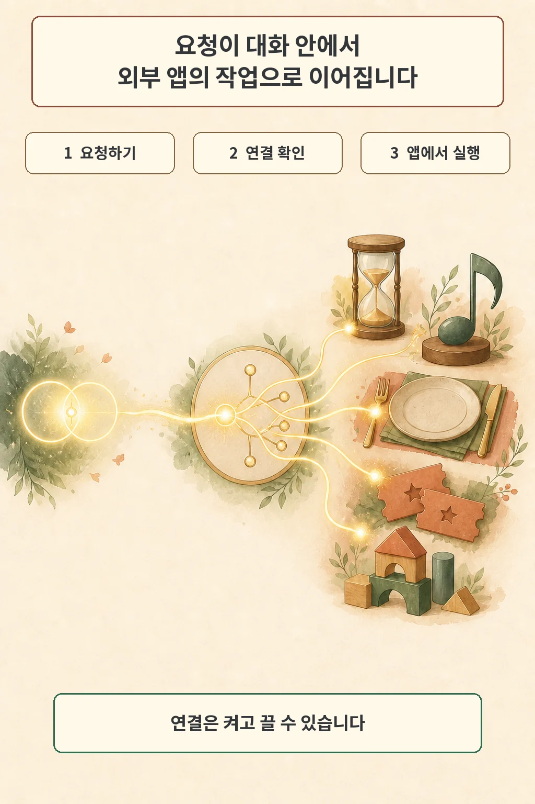

Google은 2026년 8월 12일 Gemini에 새로운 `Connected Apps` 묶음을 추가한다고 발표했습니다. 회의 요약부터 웹사이트 편집, 식당·병원 예약, 티켓 검색, 음악 재생까지 대화창 안에서 외부 서비스의 작업으로 이어지는 범위를 넓히는 변화이지만, 발표 시점과 내 계정에서 실제로 쓸 수 있는 조건은 나누어 확인해야 합니다.

글·해설: 다메카솔

## 핵심 내용

- **신규 파트너 확대와 순차 롤아웃**: 생산성·창작(Granola, Otter.ai, Wix), 예약·엔터테인먼트(OpenTable, Zocdoc 등), 음악·생활 서비스 파트너가 발표됐으며 향후 몇 주에 걸쳐 순차 적용됩니다.
- **대화형 호출과 연결 관리**: 프롬프트에서 앱 이름을 부르거나 `@앱이름`으로 작업을 요청할 수 있고, `Connected Apps` 설정 화면에서 지원 작업 확인 및 계정 연결 해제를 관리합니다.
- **세부 가용성 조건**: 위치, 언어, 기기, Gemini 모드(chat·Spark·Live), 계정 유형(개인·업무·학교), 최소 연령, 구독 조건에 따라 실제 지원 여부가 달라집니다.

## 새 파트너는 앞으로 몇 주에 걸쳐 열립니다

Google이 이번에 발표한 파트너는 생산성·창작, 지역·엔터테인먼트, 음악, 주거·건강·생활 서비스 전반에 걸쳐 있습니다. Granola와 Otter.ai로 회의를 요약하고 Wix로 웹사이트를 편집하며 OpenTable과 Zocdoc 같은 서비스에서 예약 작업을 처리하는 식입니다. 다만 당일 전 세계 일괄 적용이 아니라 **앞으로 몇 주에 걸친 순차 롤아웃**이므로, 파트너 이름이 발표된 시점과 개별 계정에 기능이 열리는 시점은 다를 수 있습니다.

사용자는 대화 중에 앱 이름을 말하거나 `@앱이름`을 프롬프트에 넣어 외부 작업을 요청할 수 있으며, 아직 연결되지 않은 앱이라도 사용 조건을 충족하면 Gemini가 연결 옵션을 안내합니다. 연결된 외부 앱의 지원 작업 목록을 확인하거나 Google 계정과의 연동을 해제하는 통제는 `Connected Apps` 설정 화면에서 이루어집니다.

## 실제 가용성은 앱마다 다릅니다

Google의 공식 지원표는 `Connected Apps`의 가용성이 위치, 언어, 기기, Gemini 앱과 모드에 따라 달라진다고 명시합니다. 앱마다 개인·업무·학교 계정 지원 여부, 최소 연령, 국가, 언어, 외부 서비스 구독 조건이 따로 붙어 있어서, 같은 파트너라도 웹과 모바일, 혹은 Gemini chat·Spark·Live 모드에서 지원 범위가 같다고 가정할 수 없습니다.

특히 한국에서 Gemini를 쓰는 사용자라면 블로그 발표 목록만 보고 기능을 찾기보다 공식 지원표의 국가·언어 제한부터 확인하는 편이 빠릅니다. 목록에 이름이 올랐다는 사실은 생태계 합류를 뜻할 뿐, 지금 내 계정에서 곧바로 동작한다는 뜻은 아니기 때문입니다.

## 다메카솔의 해석

이번 발표에서 주목할 지점은 연동 앱의 개수보다 Gemini가 단순 답변 도구에서 외부 서비스의 실제 작업을 중계하는 허브로 넓어지고 있다는 방향성입니다. 회의 요약, 웹 편집, 예약과 티켓 검색이 한 대화창 안에 모일수록 사용자는 앱 사이를 오가는 대신 의도를 직접 말하게 됩니다.

대화가 외부 서비스의 실제 행동으로 이어질수록 권한 확인의 중요성도 함께 커집니다. 새 앱이 추가될 때마다 내 계정의 지역·모드별 지원 범위는 어디까지인지, 그리고 설정 화면에서 계정 연결 해제와 권한 범위가 얼마나 투명하게 관리되는지 먼저 점검하는 습관이 필요합니다.

## 출처

- [Google — New connected apps are coming to Gemini](https://blog.google/innovation-and-ai/products/gemini-app/new-connected-apps-services-gemini-august-2026/)
- [Gemini Apps Help — Check the availability & requirements of Connected Apps in Gemini Apps](https://support.google.com/gemini/table/17434654)

이 글의 본문과 이미지는 생성형 AI로 제작했습니다. 기획과 편집 기준은 다메카솔이 정했습니다.
