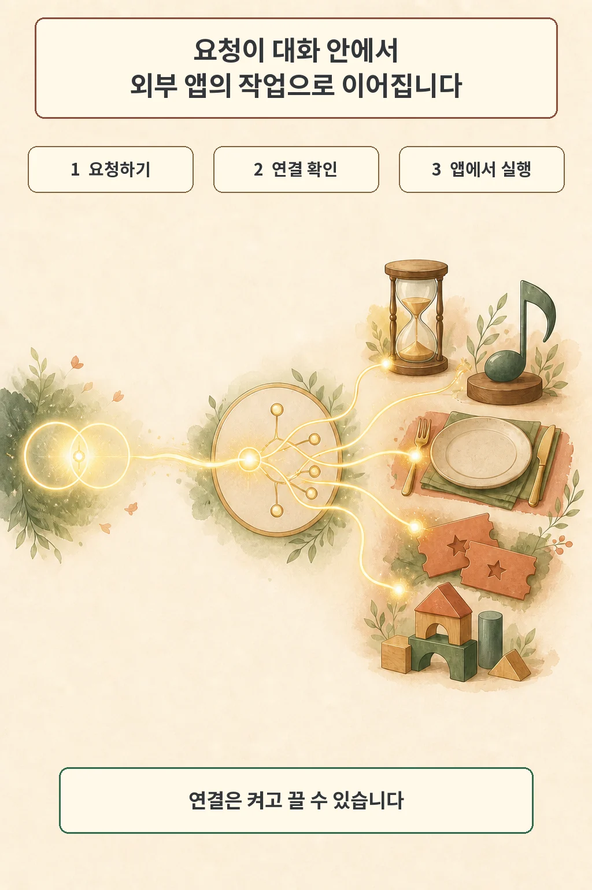

Google이 Gemini에 새로운 외부 앱 연동을 추가했다고 발표하면, 당장 채팅창에서 `@앱이름`을 입력해 보고 싶기 마련입니다. 실제로 Google은 2026년 8월 12일 회의 요약부터 웹사이트 편집, 예약, 음악 재생까지 아우르는 새 `Connected Apps` 묶음을 공개했습니다. 다만 발표 목록에 파트너 이름이 올랐다고 해서 내 계정에서도 곧바로 동작하는지는 별개의 문제라, 롤아웃 일정과 앱별 가용성 조건을 나누어 살펴볼 필요가 있습니다.

글·해설: 다메카솔

## 핵심 내용

- **파트너 분야 확대와 순차 롤아웃**: 생산성·창작(Granola, Otter.ai, Wix), 예약·엔터테인먼트(OpenTable, Zocdoc 등), 음악 및 주거·건강·생활 서비스 파트너가 추가됐으며 앞으로 몇 주에 걸쳐 순차 적용됩니다.
- **대화형 호출과 연결 제어**: 대화 중 앱 이름을 말하거나 `@앱이름`을 입력해 외부 작업을 요청할 수 있고, `Connected Apps` 설정 화면에서 지원 작업 확인과 Google 계정 연결 해제를 관리합니다.
- **앱별 가용성 조건**: 실제 지원 여부는 계정 유형(개인·업무·학교), 최소 연령, 지역, 언어, 기기, Gemini 모드(chat·Spark·Live)와 외부 서비스 구독 조건에 따라 달라집니다.

## 새 파트너는 앞으로 몇 주에 걸쳐 열립니다

이번 발표의 핵심은 Gemini 대화창 안에서 외부 서비스의 실제 작업을 호출하는 범위가 생활과 업무 전반으로 넓어졌다는 점입니다. 생산성·창작 분야에서는 Granola와 Otter.ai로 회의를 요약하고 Wix로 웹사이트를 편집할 수 있으며, 지역·엔터테인먼트 분야에서는 OpenTable과 Zocdoc 같은 파트너로 식당이나 병원 예약을 처리하는 흐름이 포함됐거든요. 이 밖에도 티켓 검색, 음악 재생, 주거·건강·생활 서비스까지 연동 범주가 함께 확장됐습니다.

하지만 새 기능은 발표 당일 전 세계 계정에 한꺼번에 열리는 방식이 아니라 앞으로 몇 주에 걸친 순차 롤아웃으로 제공됩니다. 예를 들어 사용자가 회의 내용을 정리하거나 식당을 예약하려고 대화창에서 Granola나 OpenTable 같은 앱 이름을 부르거나 `@앱이름`을 입력하면, 아직 연결되지 않은 상태라도 조건을 충족한 계정에는 Gemini가 연결 옵션을 바로 안내해 주는 식이죠. 연결을 마친 뒤에도 지원되는 작업 목록을 확인하거나 Google 계정과의 연동을 끊고 싶다면, `Connected Apps` 설정 화면에서 언제든 연결 상태를 조정할 수 있습니다.

## 실제 가용성은 앱마다 다릅니다

발표 소식을 보고 곧바로 연동 흐름을 써 보려는 분이라면 Google의 공식 지원표를 먼저 짚고 넘어가는 편이 좋습니다. 지원표에는 `Connected Apps`의 가용성이 위치와 언어, 기기, 그리고 사용하는 Gemini 앱과 모드에 따라 달라진다고 명시돼 있거든요. 같은 파트너라도 웹과 모바일, 또는 Gemini의 `chat`·`Spark`·`Live` 모드 사이에서 지원 범위가 다를 수 있어, 한 환경의 동작만으로 다른 환경까지 동일하게 열렸다고 보기는 어렵습니다.

| 확인 항목 | 공식 지원표의 세부 기준 | 사용 전 먼저 점검할 점 |
| --- | --- | --- |
| 계정 유형 | 개인, 업무, 학교 계정별 지원 여부 분리 | 사용 중인 계정 유형이 해당 앱 지원 대상인지 확인 |
| 최소 연령 | 연결 앱마다 요구하는 연령 기준 상이 | 계정이 앱별 최소 연령 요건을 충족하는지 확인 |
| 지역·언어 | 지원 국가 및 언어 조건을 앱별로 적용 | 한국 지역과 현재 사용 언어가 지원 대상인지 확인 |
| 기기·모드 | 웹·모바일 기기 및 chat·Spark·Live 모드 구분 | 사용 중인 기기와 Gemini 모드에서 지원되는지 확인 |
| 구독 조건 | 외부 서비스의 구독 요건을 앱별로 적용 | 연결할 외부 서비스의 구독 조건 충족 여부 확인 |

특히 한국에서 Gemini를 쓰는 사용자나 팀 단위 활용을 검토하는 담당자라면, 블로그 발표 목록보다 공식 지원표의 국가·언어 제한과 계정 유형 칸을 먼저 확인하는 편이 빠릅니다. 파트너 목록에 이름이 실렸다는 사실은 생태계 합류와 순차 제공 계획을 뜻할 뿐, 지금 내 계정과 언어 설정에서 즉시 실행된다는 보장은 별개이기 때문이죠.

## 다메카솔의 해석

이번 발표에서 눈여겨볼 대목은 연동 파트너의 숫자 자체보다 Gemini가 단순 질의응답 도구를 넘어 외부 서비스의 실제 작업을 중계하는 허브로 자리 잡으려 한다는 방향성입니다. 회의 요약과 웹 편집, 식당·병원 예약처럼 성격이 다른 작업이 하나의 대화창으로 모일수록 사용자는 여러 앱을 오가는 대신 의도를 직접 말로 전달하는 흐름에 익숙해지게 됩니다.

대화가 외부 서비스의 실제 행동으로 이어지는 구조에서는 편리함만큼이나 권한과 범위 관리가 중요해집니다. 새로운 연결 앱이 추가될 때마다 내 계정의 지역·언어·모드 조건을 먼저 확인하고, `Connected Apps` 설정에서 어떤 작업이 허용되고 언제든 연결을 해제할 수 있는지 점검하는 습관을 들이는 편이 안전합니다.

## 출처

- [Google — New connected apps are coming to Gemini](https://blog.google/innovation-and-ai/products/gemini-app/new-connected-apps-services-gemini-august-2026/)
- [Gemini Apps Help — Check the availability & requirements of Connected Apps in Gemini Apps](https://support.google.com/gemini/table/17434654)

Google 공식 발표 자료와 지원표를 바탕으로 정리했으며, 별도 실행 검증은 포함하지 않았습니다.

이 글의 본문과 이미지는 생성형 AI로 제작했습니다. 기획과 편집 기준은 다메카솔이 정했습니다.
