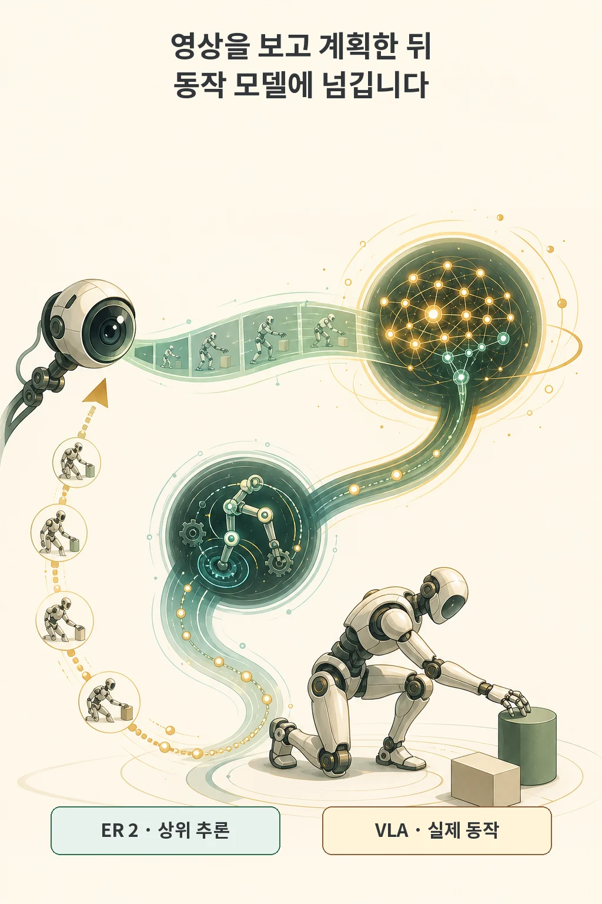
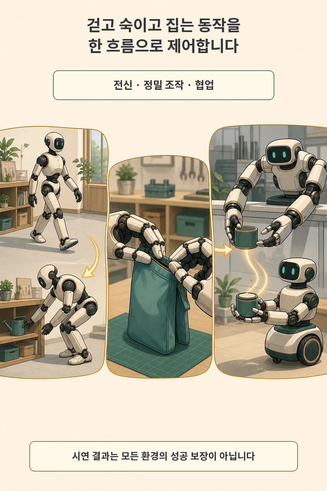
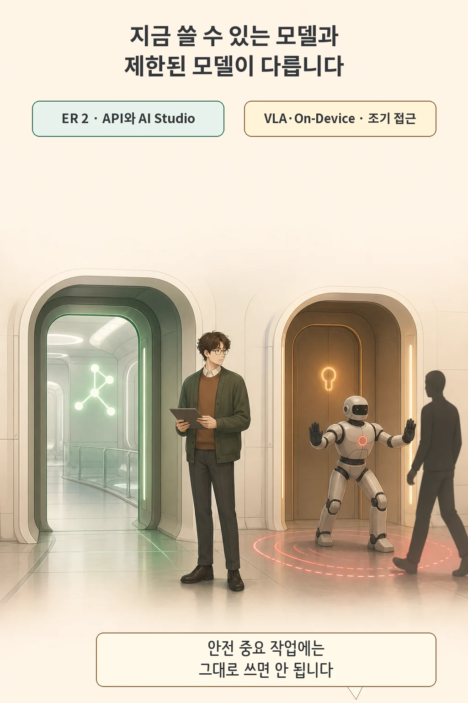

로봇에 언어·시각 모델을 붙이려 할 때 가장 먼저 부딪히는 질문은 "당장 API로 호출할 수 있는 범위와 실제 모터 제어를 누가 맡는가"입니다. Google DeepMind가 2026년 7월 30일 발표한 **Gemini Robotics 2** 모델군은 이 역할을 세 층으로 나눴는데요. 영상 기반 상위 추론(ER 2), 관절을 움직이는 하위 제어(VLA), 기기 내 온디바이스 실행(On-Device 2)을 분리하고 휴머노이드 전신 제어와 다중 로봇 협업까지 확장했습니다.

글·해설: 다메카솔

## 핵심 내용

- **역할·접근 범위 분리**: 상위 추론 모델 `ER 2`는 Gemini API·Google AI Studio에 공개(Enterprise는 private preview)되었고, `VLA`와 `On-Device 2`는 조기 접근 파트너 전용입니다.
- **전신 제어·협업 시연**: 걷기·숙이기·뻗기·집기를 잇는 전신 제어와 양손 정밀 조작, 이기종 로봇 간 작업 인계를 공개했습니다.
- **안전 평가와 물리 전제**: `ASIMOV-Agentic`으로 보호 정지와 도움 요청을 평가하며, 모델 카드는 안전 중요 영역 사용 금지와 물리 안전장치 유지를 요구합니다.

## 생각과 동작을 두 층으로 나눕니다

Gemini Robotics 2는 '생각하는 두뇌'와 '몸을 움직이는 제어기'를 역할별로 나눕니다.

| 모델 구성 | 담당 역할 | 입력 및 동작 방식 | 제공 범위 |
| --- | --- | --- | --- |
| **Gemini Robotics ER 2** | 상위 추론·계획·오케스트레이션 | 연속 영상·이미지·음성·텍스트로 상태를 추적하고 하위 VLA나 제어 API 호출(수 분간 수백 번 결정 조율) | **일반 개발자 공개** (Gemini API·AI Studio / Enterprise private preview) |
| **Gemini Robotics 2 VLA** | 하위 시각-언어-행동(VLA) 제어 | 상위 계획을 휴머노이드 전신 관절과 그리퍼의 연속 동작으로 변환 | **조기 접근 파트너 전용** |
| **Gemini Robotics On-Device 2** | 지연·단절 환경용 기기 내 실행 | 온보드 연산으로 동작하며 새 양팔 로봇 형태에 수 시간 분량(대체로 200개 미만 예시) 적응 | **조기 접근 파트너 전용** |

연속 영상 입력은 작업 단계를 확인하고 실패 시 다음 행동을 수정하는 데 쓰입니다. 앞서 소개한 [긴 시각·행동 이력을 다루는 RobotTT 연구](/posts/robottt-long-context-policies/)가 정책 내부 기억을 다뤘다면, 이번 발표는 상위 추론기가 하위 동작 모델을 조율하는 시스템 계층을 보여 줍니다.

## 전신과 손, 여러 로봇을 한 흐름에 묶습니다

시연에서 두드러지는 변화는 **전신 제어(whole-body control)**와 **다중 로봇 협업**입니다. 상체 조작을 넘어 휴머노이드가 걸어가 몸을 숙이고 팔을 뻗어 물건을 집는 과정을 한 흐름으로 이어 가죠. 양손 그리퍼 정밀 조작과 함께, 양팔 조작 로봇이 이동 로봇에게 물건을 넘겨 작업을 인계하는 시나리오도 공개됐습니다.

다만 전신 동작과 200개 미만 예시 적응 수치는 통제된 조건의 회사 평가 결과이므로, 비정형 현장이나 다른 하드웨어에서는 적응 비용과 성공률이 달라질 수 있습니다.

## 공개된 ER 2와 제한된 동작 모델을 구분합니다

개발자 입장에서는 당장 쓸 수 있는 모델 범위부터 가려 보는 편이 좋습니다. 현재 Gemini API와 Google AI Studio, 공식 GitHub 예제로 공개된 것은 상위 추론과 도구 호출을 맡는 **ER 2**거든요. 예를 들어 기존 로봇 제어 API를 갖춘 팀이라면, 파트너 전용 **VLA**나 **On-Device 2**를 기다리기보다 ER 2로 작업 상태를 추적해 다음 동작을 호출하는 오케스트레이션 계층부터 시험해 볼 수 있습니다.

## 안전 정지는 모델만의 일이 아닙니다

Google DeepMind는 상위 오케스트레이터 안전성을 검증하는 **ASIMOV-Agentic** 벤치마크와 평가 보고서도 함께 냈습니다. 작업 구역에 사람이 접근하면 보호 정지(protective stop)를 호출하는지, 실행 불가능하거나 모호한 지시에 임의로 강행하지 않고 사람에게 도움을 요청하는지를 살핍니다.

동시에 모델 카드와 보고서는 소프트웨어 추론이 하드웨어 비상 정지 버튼, 물리적 안전 장벽, 관절 속도·힘 제한을 대신하기 어렵다고 선을 긋습니다. 의료나 교통처럼 오작동이 사망·부상·재산 피해로 이어질 수 있는 안전 중요(safety-critical) 영역에는 해당 모델을 사용하지 말라고 명시하고 있습니다.

## 다메카솔의 해석

이번 발표의 핵심은 하나의 만능 모델보다 **상위 추론과 하위 제어를 계층으로 나누고 공개·안전 경계를 함께 밝힌 점**입니다. 로봇에 언어·시각 모델을 붙이려는 팀이라면 아래 네 가지부터 점검해 볼까요?

1. **접근 범위**: 지금 쓸 수 있는 것이 공개된 `ER 2` API인지, 파트너 전용 `VLA·On-Device 2`까지인지 확인합니다.
2. **하위 API 제약**: ER 2가 호출할 로봇 제어 API에 하드웨어 수준의 속도·힘·작업 공간 제한이 걸려 있는지 점검합니다.
3. **보호 정지와 사람 이관**: 사람 접근, 센서 오류, 실행 불가능한 명령이 들어왔을 때 즉시 멈추고 사람에게 판단을 넘기는 경로가 필요합니다.
4. **현장 조건 격차**: 시연 환경의 하드웨어와 작업 조건이 실제 비정형 현장과 얼마나 가까운지 따져 봅니다.

## 출처

- [Google DeepMind — Gemini Robotics 2 brings whole body intelligence to robots](https://deepmind.google/blog/gemini-robotics-2-brings-whole-body-intelligence-to-robots/)
- [Google — Introducing Gemini Robotics ER 2](https://blog.google/innovation-and-ai/models-and-research/google-deepmind/gemini-robotics-er-2/)
- [Google DeepMind — Gemini Robotics ER 2 Model Card](https://deepmind.google/models/model-cards/gemini-robotics-er-2/)
- [Google DeepMind — Gemini Robotics 2: Safety Evaluations](https://storage.googleapis.com/deepmind-media/gemini-robotics/Gemini-Robotics-2-Safety.pdf)

발표 자료와 공식 문서를 바탕으로 정리했으며, 별도 실행 측정은 포함하지 않았습니다.

이 글의 본문과 이미지는 생성형 AI로 제작했습니다. 기획과 편집 기준은 다메카솔이 정했습니다.
