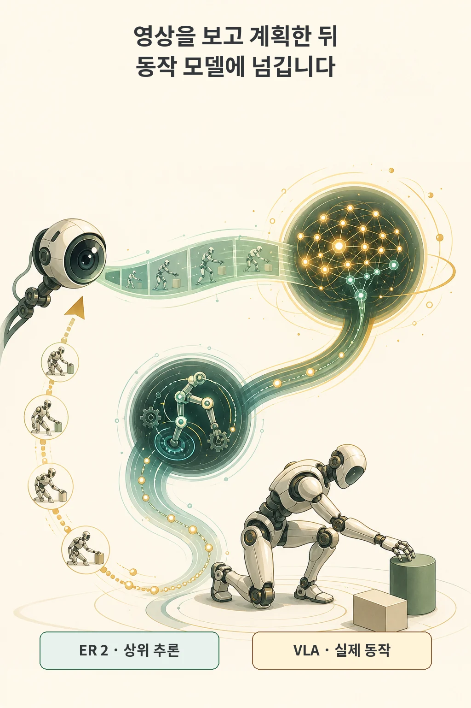
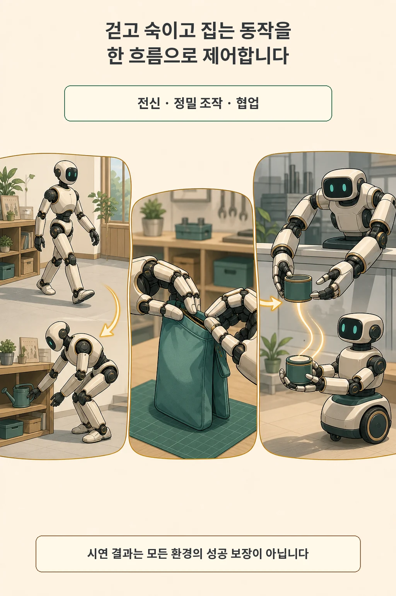
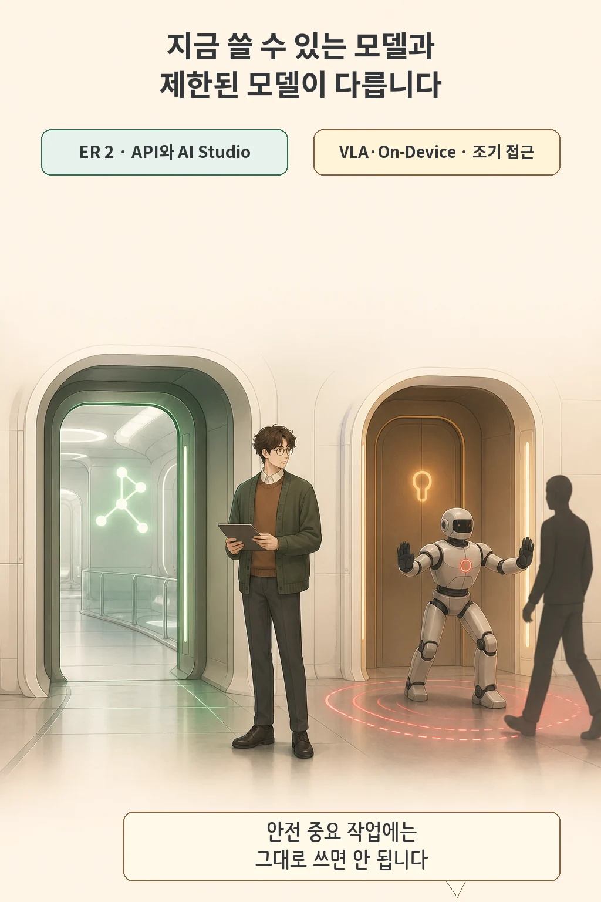

Google DeepMind는 2026년 7월 30일 **Gemini Robotics 2** 모델군을 발표했습니다. 이번 업데이트의 핵심은 로봇이 영상을 보고 작업을 계획하는 **상위 추론(ER 2)**, 실제 관절과 손을 움직이는 **하위 제어(VLA)**, 그리고 네트워크 없이 기기 내부에서 도는 **온디바이스 실행(On-Device 2)**을 역할별로 명확히 분리하고 휴머노이드 전신 제어와 다중 로봇 협업까지 확장한 점입니다.

글·해설: 다메카솔

## 핵심 내용

- **3종 모델 역할과 접근 범위 분리**: 상위 공간·작업 추론을 맡는 `Gemini Robotics ER 2`는 Gemini API와 Google AI Studio에 공개(Enterprise는 private preview)되었고, 실제 관절 동작을 생성하는 `VLA`와 로컬 실행용 `On-Device 2`는 조기 접근(early access) 파트너 대상으로 제공됩니다.
- **휴머노이드 전신 제어와 다중 로봇 협업**: 상체 위주의 조작을 넘어 걷기·숙이기·뻗기·집기를 한 흐름으로 묶는 전신 제어와 양손 정밀 조작, 이기종 로봇 간 작업 인계를 시연했습니다. `On-Device 2`는 새로운 양팔 로봇 형태에 몇 시간 분량(대체로 200개 미만 예시)으로 적응할 수 있다고 보고되었습니다.
- **에이전트 안전 벤치마크와 물리적 제약**: 새롭게 공개된 `ASIMOV-Agentic` 벤치마크를 통해 사람 접근 시 보호 정지 호출과 불확실한 상황에서의 도움 요청을 평가하며, 모델 카드는 의료·교통 등 생명·안전 직결 영역의 사용 금지와 물리적 비상 정지·장벽의 필수 유지를 명시합니다.

## 생각과 동작을 두 층으로 나눕니다

Gemini Robotics 2는 ‘생각하는 두뇌’와 ‘몸을 움직이는 제어기’를 두 층으로 나눕니다.

| 모델 구성 | 담당 역할 | 입력 및 동작 방식 | 현재 제공 범위 |
| --- | --- | --- | --- |
| **Gemini Robotics ER 2** | 상위 수준 추론·계획·오케스트레이션 | 연속 영상·이미지·음성·텍스트를 받아 작업 진행 상태를 추적하고, 하위 VLA나 로봇 제어 API를 도구처럼 호출(수백 번의 결정이 이어지는 수 분 단위 작업 조율) | **일반 개발자 공개** (Gemini API, Google AI Studio / Enterprise는 private preview) |
| **Gemini Robotics 2 VLA** | 하위 수준 시각-언어-행동(Vision-Language-Action) 제어 | 상위 계획을 받아 실제 휴머노이드 전신 관절과 그리퍼의 연속 동작으로 변환 | **조기 접근 파트너 전용** |
| **Gemini Robotics On-Device 2** | 네트워크 지연·단절 환경을 위한 기기 내 실행 | 온보드 연산으로 동작하며, 새로운 양팔 로봇 형태에 수 시간 분량(대체로 200개 미만 시연 예시)으로 적응 | **조기 접근 파트너 전용** |

연속 영상 입력은 작업이 어디까지 진행됐는지 확인하고 실패를 감지해 다음 단계를 수정하는 데 쓰입니다. 앞서 소개한 [긴 시각·행동 이력을 다루는 RobotTT 연구](/posts/robottt-long-context-policies/)가 정책 내부의 기억 구조를 다뤘다면, 이번 발표는 상위 추론기가 하위 동작 모델을 어떻게 조율하는지 시스템 계층을 보여 줍니다.

## 전신과 손, 여러 로봇을 한 흐름에 묶습니다

시연에서 가장 눈에 띄는 변화는 **전신 제어(whole-body control)**와 **다중 로봇 협업**입니다. 기존 상체 중심 조작을 넘어 휴머노이드가 걸어가서 몸을 숙이고 팔을 뻗어 물건을 집는 동작을 하나의 작업 흐름 안에서 이어 갑니다. 또한 양손 그리퍼를 쓰는 정밀 조작과, 양팔 조작 로봇이 이동 로봇에게 물건을 건네며 작업을 인계하는 협업 시나리오도 함께 공개됐습니다.

다만 이러한 전신 동작과 200개 미만 예시 적응 수치는 회사가 통제된 시연 조건에서 보고한 결과이므로, 모든 하드웨어와 비정형 현장에서 동일한 학습 비용과 성공률이 곧바로 보장된다는 뜻은 아닙니다.

## 공개된 ER 2와 제한된 동작 모델을 구분합니다

“Gemini Robotics 2가 공개됐다”는 소식을 읽을 때는 개발자가 당장 만져 볼 수 있는 범위를 정확히 가려야 합니다. 현재 Gemini API와 Google AI Studio, 공식 GitHub 예제로 열려 있는 것은 상위 추론과 도구 호출을 담당하는 **ER 2**입니다. 실제 모터와 관절을 구동하는 **VLA**와 **On-Device 2**는 조기 접근 파트너에게만 열려 있으므로, 일반 개발자가 지금 바로 시험할 수 있는 영역은 기존 로봇 제어 API 위에 ER 2의 계획·상태 추적 능력을 결합하는 오케스트레이션 계층입니다.

## 안전 정지는 모델만의 일이 아닙니다

Google DeepMind는 이번 발표와 함께 상위 오케스트레이터의 안전성을 평가하는 **ASIMOV-Agentic** 벤치마크와 안전 평가 보고서를 공개했습니다. 작업 구역에 사람이 가까워졌을 때 즉시 보호 정지(protective stop)를 호출하는지, 실행 불가능하거나 모호한 지시를 받았을 때 임의로 강행하지 않고 사람에게 도움을 요청하는지를 중점적으로 살핍니다.

동시에 보고서와 모델 카드는 소프트웨어 추론이 물리적 안전장치를 대체할 수 없음을 분명히 못 박습니다. 하드웨어 비상 정지 버튼, 물리적 안전 장벽, 관절 속도 및 힘 제한이 기본 전제이며, 의료나 교통처럼 오작동이 사망·부상·심각한 재산 피해로 이어질 수 있는 안전 중요(safety-critical) 영역에는 해당 모델을 사용하지 말라고 명시하고 있습니다.

## 다메카솔의 해석

이번 발표에서 화려한 휴머노이드 데모보다 먼저 챙겨야 할 부분은 **상위 추론(ER 2)과 하위 제어(VLA·로봇 API)의 역할 분리**입니다. 로봇 시스템에 언어·시각 모델을 붙이려는 팀이라면 다음 네 가지 질문으로 도입 가능성을 바로 점검해 볼 수 있습니다.

1. **접근 범위**: 우리 팀이 지금 쓸 수 있는 것이 공개된 `ER 2` API인가, 파트너 전용인 `VLA·On-Device 2`까지인가?
2. **하위 인터페이스 제약**: 상위 추론기가 호출하는 로봇 제어 API에 하드웨어 수준의 속도·힘·작업 공간 제한이 걸려 있는가?
3. **보호 정지와 사람 이관**: 작업 중 사람 접근, 센서 오류, 실행 불가능한 명령이 들어왔을 때 즉시 정지하고 사람에게 판단을 넘기는 경로가 있는가?
4. **환경 격차**: 공개 시연의 로봇 하드웨어와 작업 조건이 실제 우리 현장의 비정형 환경과 얼마나 가까운가?

## 출처

- [Google DeepMind — Gemini Robotics 2 brings whole body intelligence to robots](https://deepmind.google/blog/gemini-robotics-2-brings-whole-body-intelligence-to-robots/)
- [Google — Introducing Gemini Robotics ER 2](https://blog.google/innovation-and-ai/models-and-research/google-deepmind/gemini-robotics-er-2/)
- [Google DeepMind — Gemini Robotics ER 2 Model Card](https://deepmind.google/models/model-cards/gemini-robotics-er-2/)
- [Google DeepMind — Gemini Robotics 2: Safety Evaluations](https://storage.googleapis.com/deepmind-media/gemini-robotics/Gemini-Robotics-2-Safety.pdf)

이 글의 본문과 이미지는 생성형 AI로 제작했습니다. 기획과 편집 기준은 다메카솔이 정했습니다.
