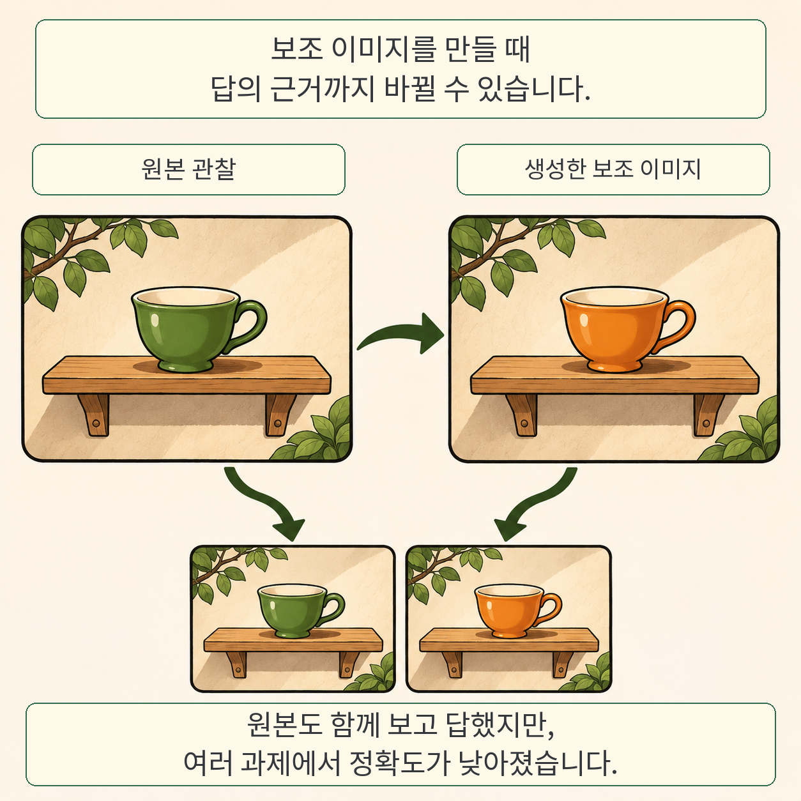
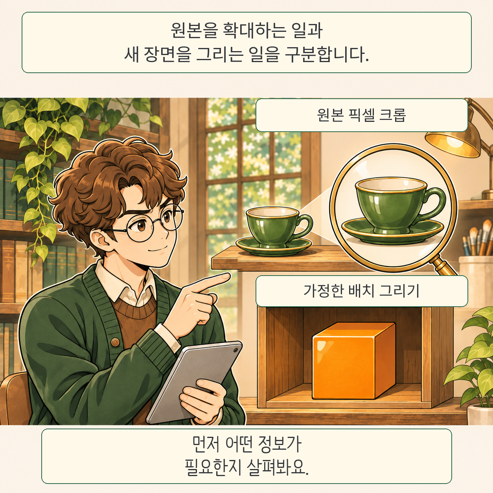

사진 속 작은 물건이 잘 안 보이면 AI에게 확대해서 다시 그리게 하면 될까요? 원본을 잘라 크게 보는 것과 새 이미지를 생성하는 것은 서로 다른 작업입니다. 최근 연구는 이 차이가 시각 질문의 답까지 바꿀 수 있음을 보여 줍니다.

글·해설: 다메카솔

## 더 잘 보려는 계획부터 확인합니다

이미지와 언어를 함께 이해하는 비전 언어 모델(VLM)에 이미지 생성기를 붙이면, 생각에 필요한 그림을 스스로 준비할 수 있을 듯합니다. 예를 들어 방 사진에서 선반 위 찻잔의 색을 묻는다면, 모델이 먼저 선반을 확대하자는 계획을 세우고 그에 맞는 보조 이미지를 만드는 식이죠. 하지만 다시 그린 찻잔의 색이 바뀌었다면, 더 선명해진 화면이 오히려 잘못된 근거가 됩니다.

저자들은 이 과정을 ‘Reasoning with Imagination’이라는 절차로 시험했습니다. 모델이 원본과 질문을 받아 필요한 그림을 짧은 문장으로 요청하고, 생성기가 보조 이미지를 만듭니다. 마지막에는 **원본도 그대로 둔 채** 계획과 생성 이미지를 함께 보고 답합니다. 원본을 버렸기 때문에 생긴 문제로만 해석할 수 없는 구성입니다.

비교 기준인 논문의 ‘text-only’도 원본 이미지를 봅니다. 이 이름은 이미지 입력이 없다는 뜻이 아니라, 답하는 도중에 새로운 그림을 만들지 않는다는 뜻입니다. 용어를 이렇게 풀어 두어야 이미지 이해 능력과 이미지 생성의 추가 효과를 구별할 수 있습니다.

## 전체 경향과 같은 계획의 비교를 나눠 봅니다

연구는 분리형 모델 조합을 여러 시각 과제에 적용했습니다. 차트 읽기, 작은 물체 찾기, 공간 관계, 수학 문제 등 서로 요구하는 정보가 다른 과제들입니다. 원본을 보고 바로 답하는 기준과 비교했을 때 생성 이미지를 추가하는 방식은 대체로 정확도가 낮아졌습니다.

| 본 실험의 범위 | 저자들이 보고한 결과 |
| --- | --- |
| 비전 언어 모델·생성기 조합 | 13개 분리형 파이프라인 |
| 평가 단위 | 9개 벤치마크의 10개 과제 |
| 정확도가 내려간 비교 | 모델 조합×과제 130건 중 106건 |
| 평균 정확도 변화 | 기준 대비 −3.7%p |

여기서 106건은 오답 문항 수가 아니라 **모델 조합과 과제를 짝지은 비교 건수**입니다. 또한 이 기본 실험은 별도 추론 모드를 켜지 않은 설정을 중심으로 합니다. 숫자를 전체 시각 AI의 능력으로 넓히기보다, 평가한 절차와 모델 조건에 묶어 읽는 편이 정확합니다.

그런데 계획을 한 번 더 세웠다는 사실 자체도 답에 영향을 줄 수 있습니다. 그래서 저자들은 원본, 계획 문장, 대화 구조를 고정하고 마지막에 어떤 이미지를 덧붙이는지만 바꿨습니다. 다음은 Qwen3-VL 8B와 FLUX.1-Kontext를 사용한 VSTAR 비교입니다.

| 같은 질문·계획을 고정한 조건 | 정확도 |
| --- | --- |
| 191문항: 계획만 사용 | 60.21% |
| 같은 191문항: 생성 보조 이미지 추가 | 49.74% |
| 크롭·확대를 명시한 43문항: 원본 픽셀 크롭 | 72.09% |
| 같은 43문항: 생성 보조 이미지 | 51.16% |

앞의 두 행은 생성 이미지 추가 후 10.47%p 하락한 결과이며, 짝지은 문항으로 추정한 차이의 95% 신뢰구간은 −16.75~−4.71%p였습니다. 뒤의 두 행은 확대를 요청한 **부분집합**만 비교하므로 앞 행과 표본이 다릅니다. 이 부분집합에서는 원본을 잘라 확대하는 쪽이 생성보다 높았지만, 모든 시각 과제에서 같은 우위를 보장하는 결과로 읽어서는 안 됩니다.

## 무엇을 상상하게 하느냐에 따라 달랐습니다

예외도 있습니다. 물건을 특정 공간에 놓을 수 있을지 묻는 RoboSpatial-Compatibility에서는 대부분의 분리형 조합이 개선되었습니다. 저자들은 가상의 배치를 실제로 그려 보는 일이 질문에 맞는 도움을 주었을 가능성을 제시합니다. 반면 이미 존재하는 물건의 배치를 묻는 같은 벤치마크의 다른 과제는 대체로 나빠졌습니다. 관찰해야 할 사실과 새로 구성할 장면의 차이가 드러나는 대목이죠.

실패 사례 검토에서는 필요한 부분을 잘못 짚는 계획과, 생성 과정에서 작은 물체나 글자 같은 세부 정보가 달라지는 문제가 함께 나타났습니다. 이 연구의 범위는 정지 이미지에 관한 질문·답변입니다. 동영상 생성, 세계모델, 장기 계획에서 시각 자료가 어떤 역할을 하는지는 별도 평가가 필요합니다.

## 다메카솔의 해석

이미지 도구를 붙일 때 먼저 정할 것은 ‘원본에서 무엇을 더 볼 것인가’와 ‘어떤 새 상황을 그릴 것인가’입니다. 전자라면 원본 픽셀을 보존하는 크롭을 비교 기준에 넣고, 후자라면 생성 결과가 가정한 배치를 제대로 표현하는지 검사할 수 있겠습니다. 한 파이프라인 안에서도 관찰 자료와 생성한 가설을 구분해 두는 편이 좋겠죠.

평가에서도 직접 답변, 계획만 사용, 원본 크롭, 생성 보조를 같은 문항으로 비교하면 어느 단계가 도움이 되었는지 더 잘 드러납니다. [실행 근거의 표현을 바꿔 검증자 판단을 살핀 연구](/posts/verification-transport-evidence/)와 함께 읽으면, 중간 자료를 추가했다는 사실보다 **판단에 필요한 정보가 보존되었는지**가 먼저라는 질문으로 이어집니다.

## 출처

- Xueyang Yu 외 7인, [Can image generation help visual reasoning? An empirical study](https://arxiv.org/abs/2611.34935v1), arXiv v1, 2026-11-25 공개. 방법 §2–3, 결과 §4–5, 같은 계획 비교 부록 C.8, 한계 부록 D.
- [논문 PDF](https://arxiv.org/pdf/2611.34935v1), [전체 HTML](https://arxiv.org/html/2611.34935v1).
- 논문에 연결된 [공식 코드 저장소](https://github.com/zlab-princeton/visual-reasoning)는 2026-11-27 확인 시 404로 열리지 않았습니다.

논문 원문을 해설했으며 실험을 독립 재현하지 않았습니다. 만화는 별도 예시로 새로 구성했고 논문 그림을 복제하지 않았습니다.

이 글의 본문과 이미지는 생성형 AI로 제작했습니다. 기획과 편집 기준은 다메카솔이 정했습니다.
