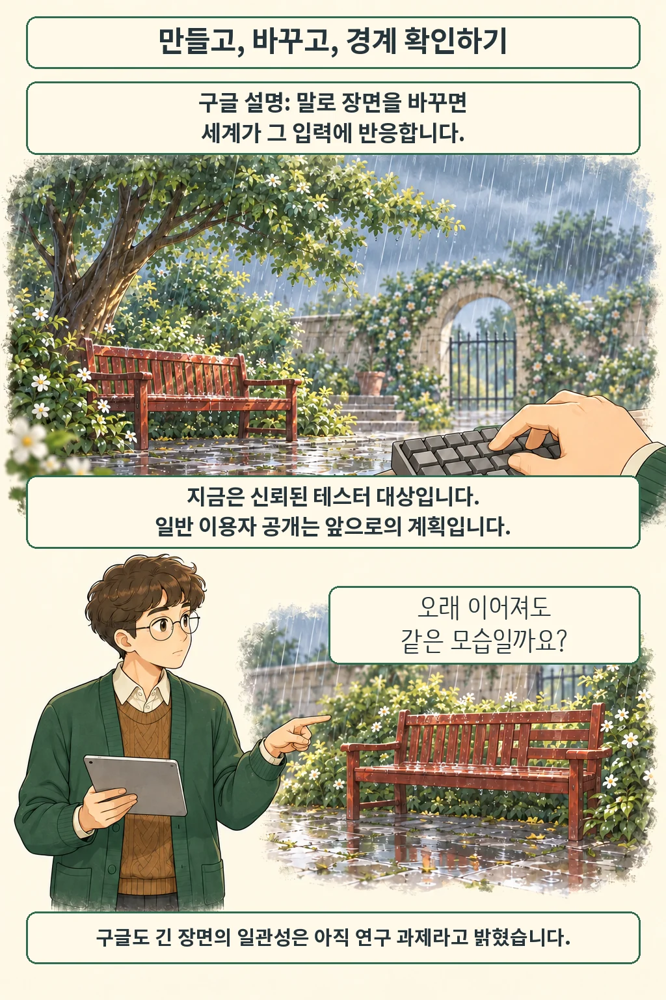

Google DeepMind는 2026년 10월 27일 Genie 4를 발표했습니다. 구글은 사용자의 입력에 반응하는 가상 세계에 소리와 대화를 함께 생성한다고 설명합니다. 10월 28일 확인 기준, 현재 제공 단계는 신뢰된 테스터 대상 연구 미리보기입니다.

글·해설: 다메카솔

## 장면을 말로 바꾸는 세계 모델

구글 설명에 따르면 자연어로 날씨나 사물을 바꾸면 진행 중인 장면이 그 입력에 반응합니다. 아래 만화의 맑은 마당이 비 오는 마당으로 바뀌는 모습은 이해를 위한 가상 예시입니다. 실제 제품 화면이나 직접 실행한 결과가 아닙니다.

## 지금 쓸 수 있는 범위

발표가 곧 전체 이용자 공개를 뜻하지는 않습니다. Google AI Ultra 구독자의 Project Genie 이용과 Gemini API·Google AI Studio 초기 접근 파트너 제공은 앞으로의 계획으로 구분돼 있습니다. 발표문의 대기 명단을 통해 후속 접근 안내를 확인할 수 있습니다.

## 오래 이어지는 장면은 아직 과제

구글은 장면이 길어지면 사물이나 시각적 세부가 달라질 수 있다고 밝힙니다. 물리적 상호작용, 소리의 정확성, 공간과 장기 일관성도 연구 과제입니다. 발표 영상의 사실적인 모습만으로 시뮬레이션의 정확성을 판단하기는 어렵습니다. 이 글에서는 별도 성능 시험을 수행하지 않았습니다.

## 출처

- [Google DeepMind의 Genie 4 공식 발표](https://deepmind.google/blog/genie-4-a-new-generation-of-world-simulation/) — 2026년 10월 27일. 기능 설명과 한계는 발표 주체의 설명입니다.

이 글의 본문과 이미지는 생성형 AI로 제작했습니다. 기획과 편집 기준은 다메카솔이 정했습니다.
