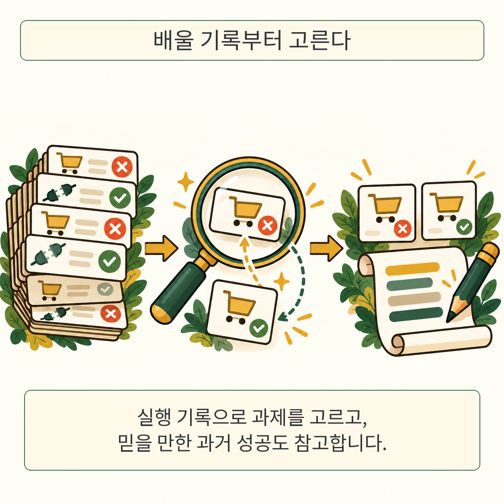

글·해설: 다메카솔

GEPA-Curator는 AI 에이전트가 겪은 실패를 무조건 프롬프트 수정에 쓰지 않고, 학습에 도움이 될 과제를 골라내는 연구입니다. 같은 과제에서 믿을 만한 과거 성공이 있다면 비교 자료도 함께 줍니다. 핵심은 더 많은 실패를 모으는 양보다 실패 원인을 구별하는 데 있습니다.

## 지시가 나빠서 실패한 걸까

쇼핑 에이전트가 필수 옵션을 빠뜨렸다면 다음에는 옵션을 확인하도록 프롬프트를 고칠 수 있습니다. 반면 필요한 도구 자체가 없다면 지시문을 계속 늘려도 그 도구가 생기지는 않습니다. 실행 환경의 문제나 불안정한 평가 결과까지 지시문의 결함으로 받아들이면, 불필요한 규칙이 쌓일 수 있다는 것이 저자들의 출발점입니다.

이 논문은 2026년 10월 27일 제출된 arXiv v1이며, PDF에는 심사 중이라고 표시되어 있습니다. 아래 수치는 저자들이 보고한 실험 결과입니다. 이 글에서는 모델 실험을 독립 재현하지 않았습니다.

## 과제를 고르고 과거 성공과 비교한다

기존 GEPA는 실행 기록과 평가 피드백을 반성 과정에 제공하고 프롬프트를 수정합니다. GEPA-Curator는 그 바깥에 기록을 살펴보는 선별 단계를 더합니다. 과제별로 이전 시도와 평가를 보고, 다시 실행하면 유용한 학습 신호를 얻을지를 판단합니다. 당장 도움이 적은 과제는 건너뛸 수 있지만, 프롬프트가 바뀐 뒤 다시 검토할 수도 있습니다.

두 번째 기능은 같은 과제의 과거 성공을 찾는 것입니다. 지금 실패한 경로와 믿을 만한 성공 경로를 비교할 수 있으면, 무엇을 고쳐야 하는지 추측할 부담이 줄어듭니다. 성공 판정이 애매하거나 일관되지 않으면 참고 자료로 쓰지 않고, 적절한 사례가 없을 때도 억지로 채우지 않습니다.

여기서 고르는 것은 최적화에 사용할 과제와 참고 실행입니다. 실패를 전부 버리거나, 현재 입력에서 악성 문장을 걸러내는 보안 기능은 아닙니다. 외부 자료가 지시를 덮어쓰는 문제는 [Heads of Security의 신뢰 경계 설명](/posts/heads-of-security-attention-gates/)에서 따로 다뤘습니다.

## 성공률이 오른 조건을 함께 읽는다

GoBrowse의 GitLab·Shopping·Shopping Admin·Reddit 과제로 WebArena 환경을 평가했습니다. 각 사이트를 학습·검증·테스트에 3:1:1로 나누고, 웹사이트와 방법별 실행 예산을 5,000회로 맞췄습니다. 실제 과제를 수행한 모델은 gpt-oss-120b입니다. 프롬프트를 수정하는 쪽에는 Gemini 3.1 Pro Preview 또는 Claude Opus 5를 사용했습니다.

표 1의 전체 성공률은 다음과 같습니다. ±는 5회 반복의 표준편차이며, 신뢰구간이나 표준오차가 아닙니다.

| 최적화 모델 | GEPA | GEPA-Curator | 평균 차이 |
| --- | ---: | ---: | ---: |
| Gemini 3.1 Pro Preview | 78.7±0.6% | 82.1±1.7% | 3.4퍼센트포인트 |
| Claude Opus 5 | 79.5±1.2% | 84.5±1.0% | 5.0퍼센트포인트 |

같은 실험 조건에서 평균 성공률이 높아졌다는 결과입니다. 실행 모델까지 Gemini나 Opus로 바뀐 실험으로 읽으면 역할을 혼동하게 됩니다. 또한 GEPA-Curator는 후보 집합에서 Pareto 방식으로 선택하는 부분을 뺀 단일 계보 변형 위에 구현되어 있습니다. 저자들은 별도의 제거 실험으로 이 선택의 영향을 살폈습니다.

## 다른 벤치마크에서도 평가 방식이 달라진다

ALFWorld, AppWorld, tau-bench 추가 평가도 있지만, 이름이 같다고 원래 평가 절차가 그대로 유지되는 것은 아닙니다. 특히 tau-bench는 retail 테스트의 상호작용 시나리오 115개를 단일 요청으로 펼친 뒤 학습 48개, 검증 32개, 테스트 35개로 나눴습니다. 따라서 이 결과를 사용자와 여러 번 대화하는 원래 환경 전체의 성능으로 확대하면 안 됩니다.

선별 과정에는 별도 모델 호출과 긴 실행 기록을 읽는 비용도 듭니다. 논문의 효율화 변형과 비용 분석은 별도 조건이므로, 위 성공률 표에서 곧바로 비용 절감까지 결론내릴 수 없습니다. 공개 코드의 현재 이용 가능 여부도 이 글에서는 확인하지 못했습니다.

## 다메카솔의 해석: 수정 전에 원인을 분리하기

이 연구에서 가져갈 질문은 “프롬프트를 더 길게 쓸까?”보다 “이번 실패에서 프롬프트가 고칠 수 있는 부분은 무엇일까?”입니다. 필요한 도구가 있었는지, 평가가 일관됐는지, 같은 과제에서 실제 성공 경로가 있었는지를 함께 읽는 습관이 도움이 됩니다.

다만 선별기의 판단 자체가 정답으로 보장되지는 않습니다. 보고된 모델과 과제에서의 개선을 모든 실제 서비스에 적용되는 법칙으로 바꿀 근거도 없습니다. 내 환경에 적용하려면 선별하지 않은 경우와 같은 테스트 조건에서 비교하고, 성공률과 추가 비용을 함께 확인해야 합니다. 이는 논문의 자동 보장이 아니라 다메카솔의 적용 해석입니다.

## 출처

- [GEPA-Curator v1 원문과 제출 이력](https://arxiv.org/abs/2610.37651v1)
- [논문 PDF: 3절 방법, 4절 평가, 표 1](https://arxiv.org/pdf/2610.37651v1)

출처 확인: 2026년 10월 30일. 원본 논문 그림을 복제하지 않고 설명 장면을 새로 구성했습니다.

이 글의 본문과 이미지는 생성형 AI로 제작했습니다. 기획과 편집 기준은 다메카솔이 정했습니다.
