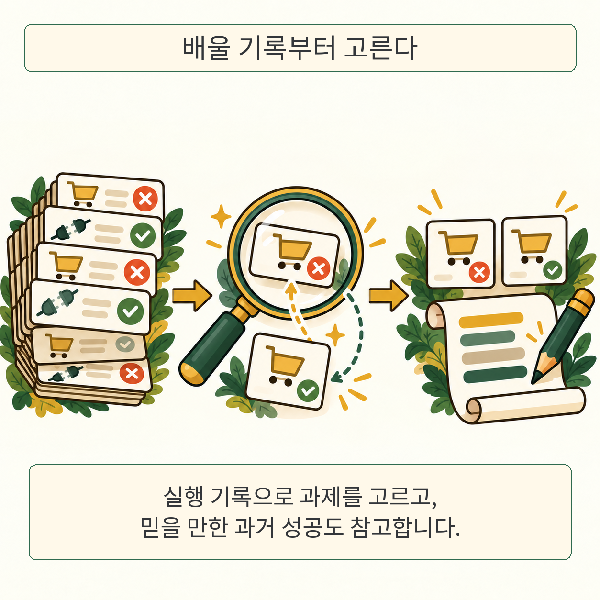

AI 에이전트가 작업에 실패할 때마다 프롬프트에 새 규칙을 덧붙이다 보면, 어느 순간 지시문만 길어지고 성능은 제자리인 상황을 마주하게 됩니다. 로그를 열어 보면 모델의 판단 실수뿐 아니라 도구 연결 누락이나 평가 채점의 잡음이 섞여 있는 경우가 적지 않거든요. 최근 공개된 **GEPA-Curator** 연구는 모든 실패를 무작정 학습에 쓰지 않고, 실제로 배울 가치가 큰 과제와 참고 기록부터 골라내는 방법을 제안했습니다.

글·해설: 다메카솔

## 지시가 나빠서 실패한 걸까

예를 들어 쇼핑 에이전트가 주문 과정에서 필수 옵션을 빠뜨려 실패했다면, 다음에는 옵션을 먼저 확인하도록 프롬프트를 손봐 개선할 수 있습니다. 반면 필요한 도구 자체가 연결되지 않았거나 실행 환경이 멈춰 생긴 실패라면, 지시문을 아무리 늘려도 없는 도구가 생겨나지는 않죠.

실패 기록에는 이처럼 프롬프트의 약점뿐 아니라 도구 부재, 실행 환경 문제, 평가자의 잡음까지 뒤섞여 들어갑니다. 저자들은 이런 환경·평가 오류까지 지시문의 결함으로 받아들이면 불필요한 규칙만 쌓일 수 있다고 지적합니다. 결국 실패 로그를 무조건 많이 모으기보다, 프롬프트로 고칠 수 있는 실패 원인부터 구별해야 하는 셈입니다.

## 배울 과제와 과거 성공을 함께 고르는 구조

기존 GEPA는 실행 기록과 평가 피드백을 반성 과정에 넘겨 프롬프트를 수정하는 방식입니다. GEPA-Curator는 그 바깥 단계에 이전 기록을 훑고 골라내는 선별 계층을 더해 두 가지 역할을 수행합니다.

- **학습할 과제 선별**: 과제별로 이전 시도와 평가를 살펴 다시 실행했을 때 유용한 학습 신호를 얻을지 판단합니다. 당장 개선 여지가 적은 과제는 건너뛰되, 프롬프트가 바뀐 뒤에는 다시 검토 대상으로 불러올 수 있습니다.
- **같은 과제의 과거 성공 참조**: 실패 경로만 보며 무엇을 고칠지 추측하는 부담을 줄이려고, 같은 과제에서 믿을 만한 과거 성공 사례가 확인되면 비교 자료로 함께 제공합니다. 성공 판정이 애매하거나 일관되지 않으면 쓰지 않고, 마땅한 사례가 없을 때도 억지로 채우지 않습니다.

여기서 선별기가 고르는 대상은 최적화에 투입할 과제와 참고 실행 기록으로 한정됩니다. 실패를 전부 폐기하거나 현재 입력에서 악성 문장을 걸러 내는 보안 기능과는 성격이 다릅니다. 외부 자료가 지시를 덮어쓰는 신뢰 경계 문제는 이전 글인 [Heads of Security의 신뢰 경계 설명](/posts/heads-of-security-attention-gates/)에서 따로 다뤘습니다.

## GoBrowse 실험 조건과 표 1의 성공률 변화

저자들은 선별 방식이 실제 프롬프트 최적화 성능을 끌어올리는지 확인하려고 WebArena 기반의 GoBrowse 과제를 평가했습니다. 이 실험을 읽을 때 가장 먼저 짚을 점은 과제를 직접 푸는 **실행 모델**과 프롬프트를 다듬는 **최적화 모델**의 역할이 분리돼 있다는 사실입니다.

- **평가 대상과 분할**: GoBrowse의 GitLab·Shopping·Shopping Admin·Reddit 네 웹사이트 과제를 사이트마다 학습·검증·테스트 3:1:1 비율로 나눴습니다.
- **예산과 구현 변형**: 웹사이트와 방법별 실행 예산을 5,000회 rollout으로 맞췄습니다. 또한 GEPA-Curator는 후보 집합에서 Pareto 방식으로 선택하는 부분을 뺀 단일 계보 변형 위에 구현되었고, 저자들은 별도의 제거 실험으로 이 영향을 살폈습니다.
- **모델 역할 분리**: 과제를 수행하는 실행 모델은 `gpt-oss-120b`로 고정했고, 프롬프트를 수정하는 최적화 모델에는 `Gemini 3.1 Pro Preview` 또는 `Claude Opus 5`를 배치했습니다.

다섯 차례 반복 실험으로 집계한 표 1의 전체 성공률은 아래와 같습니다(± 뒤 수치는 신뢰구간이나 표준오차가 아니라 5회 반복의 표준편차입니다).

| 최적화 모델 | GEPA | GEPA-Curator |
| --- | ---: | ---: |
| Gemini 3.1 Pro Preview | 78.7±0.6% | 82.1±1.7% |
| Claude Opus 5 | 79.5±1.2% | 84.5±1.0% |

평균 성공률 차이는 최적화 모델에 Gemini를 썼을 때 3.4퍼센트포인트, Claude Opus 5를 썼을 때 5.0퍼센트포인트로 나타났는데, 이는 같은 실험 조건에서 `gpt-oss-120b` 실행 모델의 프롬프트를 더 잘 다듬었다는 결과입니다. 실행 모델까지 Gemini나 Opus로 교체해 얻은 성과로 읽으면 두 역할을 혼동하게 됩니다.

## 다른 벤치마크 조건과 운영 비용까지 함께 읽기

논문에는 GoBrowse 외에도 ALFWorld, AppWorld, tau-bench 추가 평가가 실려 있습니다. 다만 벤치마크 이름이 같다고 해서 원래 평가 절차가 그대로 유지되는 편은 아닙니다.

- **tau-bench의 단일 요청 변환**: retail 테스트의 상호작용 시나리오 115개를 단일 요청으로 펼친 뒤 학습 48개, 검증 32개, 테스트 35개로 나눴습니다. 사용자와 여러 차례 대화를 주고받는 원래 대화형 벤치마크 전체의 성능으로 확대 해석하기는 어려운 조건이죠.
- **선별 단계의 추가 비용**: 기록을 선별하려면 별도 모델 호출과 긴 실행 기록을 읽는 비용이 듭니다. 논문의 효율화 변형과 비용 분석은 표 1과 별도 조건에서 다뤘으므로, 성공률 상승 수치만으로 비용 절감까지 결론내리기는 이릅니다.
- **공개 코드 이용 여부**: 공개 코드의 현재 이용 가능 여부까지 확인되지는 않았으므로, 당장 파이프라인에 붙이기보다 연구 설계를 참고하는 출발점으로 삼는 편이 현실적입니다.

## 다메카솔의 해석: 수정 전에 원인부터 분리하기

실무에서 에이전트 품질을 손볼 때 흔히 프롬프트에 지시문을 얼마나 더 붙일지부터 고민하기 쉽습니다. 하지만 GEPA-Curator가 권하는 더 실용적인 순서는 이번 실패에서 프롬프트로 고칠 수 있는 부분이 무엇인지 먼저 가려내는 쪽이죠.

가령 사내 쇼핑 에이전트가 주문 과정에서 반복적으로 멈춘다면, 지시문을 늘리기 전에 로그를 세 가지로 먼저 나눠 볼 만합니다. 필수 옵션을 빠뜨렸다면 프롬프트 개선 대상이지만, 필요한 도구 연결이 빠졌거나 평가 기준 자체가 흔들린 실패라면 환경과 평가기부터 점검해야 하거든요. 같은 과제에서 실제로 성공한 과거 경로가 있는지도 함께 확인해 두면 수정 방향을 잡기가 한결 수월해집니다.

물론 선별기의 판단 역시 틀릴 수 있고, 제한된 모델과 과제에서 얻은 향상이 모든 실제 서비스로 그대로 이어진다고 보장하기는 어렵습니다. 내 환경에 적용해 보려면 선별기를 쓰지 않은 경우와 **같은 테스트 조건**에서 나란히 비교하면서, 성공률 변화와 추가 비용을 함께 따져 봐야 합니다.

## 출처

- [GEPA-Curator v1 원문과 제출 이력](https://arxiv.org/abs/2610.37651v1)
- [논문 PDF: 3절 방법, 4절 평가, 표 1](https://arxiv.org/pdf/2610.37651v1)

출처 확인: 2026년 10월 30일. 이 글은 2026년 10월 27일 제출된 arXiv v1 프리프린트(PDF 기준 심사 중 표기)와 저자들이 보고한 실험 결과를 바탕으로 정리했으며, 모델 실험을 독립 재현하지 않았고 만화 이미지는 설명을 위해 새로 구성했습니다.

이 글의 본문과 이미지는 생성형 AI로 제작했습니다. 기획과 편집 기준은 다메카솔이 정했습니다.
