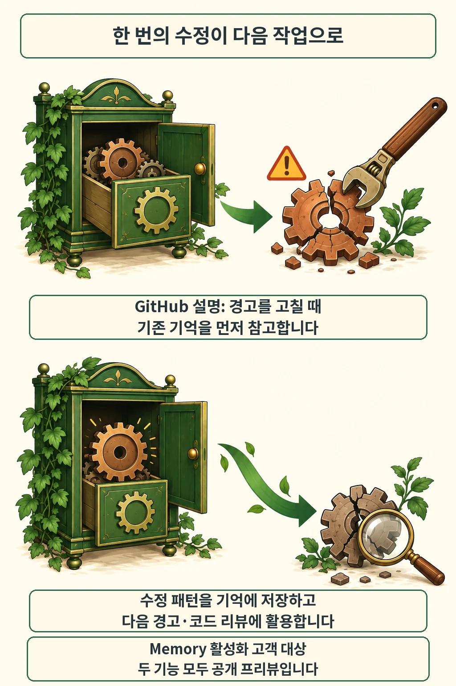

같은 저장소에서 비슷한 보안 경고가 반복해 뜨면, 에이전트가 매번 프로젝트의 입력 검증 방식이나 유틸리티 위치부터 다시 파악해야 하는 번거로움이 생깁니다. GitHub가 **2026년 9월 25일 Agentic autofix에 Copilot Memory를 연동했다**고 발표하면서, 이제 에이전트가 앞서 찾은 수정 패턴을 다음 경고 해결과 코드 리뷰에도 활용할 수 있게 됐습니다. Memory를 활성화한 고객이 대상이며, 발표 시점 기준으로 두 기능 모두 공개 프리뷰 상태입니다.

글·해설: 다메카솔

## 경고를 고치며 쌓인 패턴이 다음 작업으로 이어집니다

GitHub의 [공식 변경 공지](https://github.blog/changelog/2026-09-25-agentic-autofix-now-uses-copilot-memory/)에 따르면 에이전트는 보안 경고를 처리할 때 먼저 기존 Copilot Memory를 참고합니다. 이어서 수정안을 만들면 그때 적용한 패턴을 새로운 기억으로 저장해 두죠. 이렇게 쌓인 저장소 지식은 이후 다른 코드 스캐닝 경고를 고치거나 Copilot 코드 리뷰, 클라우드 에이전트 작업을 실행할 때도 함께 활용될 수 있습니다.

여기서 두 가지 자동 수정 기능의 역할을 구분해 두면 도입 그림이 선명해집니다.

- **일반 Copilot Autofix**: 개발자가 직접 검토하고 반영할 단일 수정 제안을 생성합니다.
- **Agentic autofix**: 에이전트가 저장소 코드를 탐색하며 수정과 검증을 반복한 뒤 풀 리퀘스트(PR)까지 엽니다.

예를 들어 여러 API 엔드포인트가 공통 입력 검증 유틸리티를 쓰는 프로젝트라면, 앞선 PR에서 그 함수의 위치와 호출 규약을 기억해 둔 덕분에 다음 경고 패치 때 불필요한 코드 탐색을 줄일 수 있습니다. 다만 패턴을 재사용한다고 해서 취약점 감소율이나 자동 병합의 안전성이 곧바로 입증되는 것은 아니거든요. [AI 코딩 도우미의 보안 API 사용 연구](/posts/copilot-security-api-study/)에서 살폈듯, 도구가 제안하는 편의성과 최종 코드의 보안 검증은 별개의 문제로 다루는 편이 안전합니다.

## 저장된 사실은 현재 브랜치에서 다시 확인합니다

코드는 계속 바뀌는데 옛날 기억을 그대로 쓰면 오히려 잘못된 패치를 만들 위험이 커집니다. 이를 막기 위해 [GitHub Copilot Memory 문서](https://docs.github.com/en/enterprise-cloud@latest/copilot/concepts/agents/copilot-memory)는 저장소 사실(repository fact)을 기록할 때 근거가 된 코드 위치 인용을 함께 붙인다고 설명합니다. 나중에 그 기억을 다시 꺼낼 때도 현재 브랜치에서 해당 코드 근거가 여전히 유효한지 먼저 검증한 사실만 반영하는 셈이죠.

권한 경계와 관리 방식도 분리해 두었습니다. 저장소 사실은 해당 저장소 안의 작업에만 한정해 공유되며, 사용자별 개인 선호 기억과는 따로 관리됩니다. 저장소 소유자라면 저장된 사실을 직접 검토하거나 필요할 때 삭제할 수도 있어, 한 프로젝트의 보안 수정 관행이 권한 없는 다른 저장소로 번질 걱정을 덜어 줍니다.

## 도입 전에 확인할 플랜 조건과 재검증 범위

실제 팀 저장소에 적용하기 전에는 플랜 권한과 과금, 그리고 에이전트가 자동으로 검증해 주는 범위를 먼저 짚어 보아야 합니다. [Agentic autofix 공식 문서](https://docs.github.com/en/enterprise-cloud@latest/code-security/concepts/code-scanning/autofix-for-code-scanning)에 안내된 조건을 세 가지로 정리해 볼까요?

| 확인 대상 | 공식 문서에서 안내하는 조건과 범위 |
| --- | --- |
| **Copilot Memory** | 유료 Copilot 플랜에서 제공 (개인 플랜은 기본 켜짐, 조직·엔터프라이즈 플랜은 관리자 정책 허용 후 개인 해제 가능) |
| **Agentic autofix** | 저장소에서 Copilot cloud agent와 Copilot Autofix가 모두 켜져 있어야 하며, 실행 세션마다 AI 크레딧 소비 |
| **자동 재검증 범위** | 기본 `code-scanning` 쿼리 모음으로만 CodeQL 재실행 (`custom`·`security-extended` 쿼리 해결 여부와 타사 도구 수정 품질은 자동 보장 범위 밖) |

특히 마지막 재검증 범위는 실무에서 놓치기 쉬운 대목입니다. 조직 내부 규칙을 담은 커스텀 CodeQL 쿼리나 외부 정적 분석 도구의 경고는 에이전트가 자동으로 해결 여부를 판별해 주지 못하거든요. 따라서 어떤 보안 규칙이 기본 쿼리 모음에 들어가는지부터 점검해 두는 편이 좋습니다.

## 다메카솔의 해석: 기억 검증과 수정 검증을 나누어 봅니다

실무에서 에이전트가 남긴 보안 PR을 검토할 때는 두 가지 확인 단계를 의식적으로 구분할 필요가 있습니다. **“저장해 둔 유틸리티 함수가 현재 브랜치에 여전히 존재한다”는 기억 검증**과 **“새로 고친 호출부가 올바른 인자를 넘겨 실제 취약점을 막고 기존 정상 요청까지 깨뜨리지 않는다”는 수정 검증**은 전혀 다른 문제이기 때문입니다.

가령 에이전트가 기억해 둔 검증 함수를 호출하더라도, 특정 경계값 처리나 예외 분기가 빠지면 기능 장애로 이어질 수 있습니다. 결국 Copilot Memory는 초안 작성과 탐색 속도를 높여 주는 보조 수단으로 활용하고, 병합 게이트에는 경고 재검사와 CI 회귀 테스트, 그리고 사람의 코드 리뷰를 그대로 유지하는 구성이 가장 현실적입니다.

## 출처

- [Agentic autofix now uses Copilot Memory](https://github.blog/changelog/2026-09-25-agentic-autofix-now-uses-copilot-memory/) — 2026-09-25 발표
- [About GitHub Copilot Memory](https://docs.github.com/en/enterprise-cloud@latest/copilot/concepts/agents/copilot-memory) — 2026-09-27 확인
- [About autofix for code scanning](https://docs.github.com/en/enterprise-cloud@latest/code-security/concepts/code-scanning/autofix-for-code-scanning) — 2026-09-27 확인

공개 프리뷰 발표와 공식 문서를 바탕으로 정리했으며, 실제 저장소에서의 수정 성공률 측정은 포함하지 않습니다.

이 글의 본문과 이미지는 생성형 AI로 제작했습니다. 기획과 편집 기준은 다메카솔이 정했습니다.
