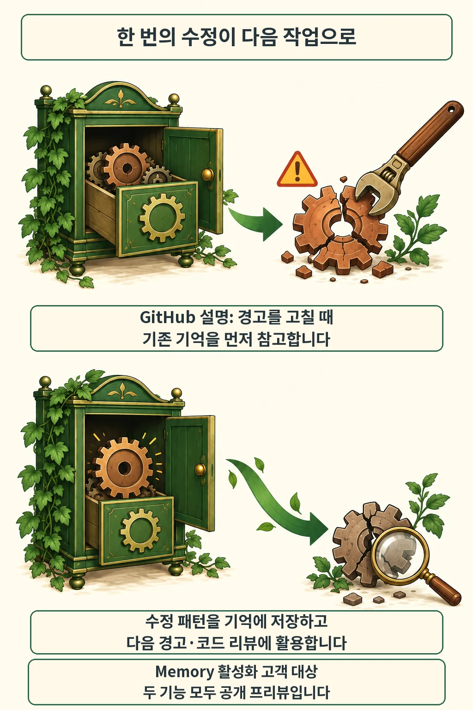

글·해설: 다메카솔

발행·확인: 2026-09-27

같은 저장소에서 비슷한 보안 경고를 반복해 고칠 때, 앞서 찾은 수정 방식을 다음 작업에서도 참고할 수 있게 됐습니다. GitHub는 **2026년 9월 25일 Agentic autofix에 Copilot Memory를 연결했다**고 발표했습니다(Memory를 활성화한 고객 대상, 두 기능 모두 공개 프리뷰). 보안 취약점을 고치며 파악한 저장소별 수정 패턴을 기억해 두었다가 다른 경고 수정이나 코드 리뷰에 재사용하는 흐름입니다. ([공식 변경 공지](https://github.blog/changelog/2026-09-25-agentic-autofix-now-uses-copilot-memory/))

## 경고를 고친 다음에 남는 것

GitHub의 설명에 따르면 에이전트는 보안 경고를 처리할 때 기존 Copilot Memory를 먼저 참고하고, 수정안을 만들면 그때 사용한 패턴을 새로운 기억으로 저장합니다. 이렇게 쌓인 저장소 지식은 이후 다른 코드 스캐닝 경고를 고치거나 Copilot 코드 리뷰·클라우드 에이전트를 실행할 때도 함께 활용됩니다.

여기서 두 가지 자동 수정 기능의 실행 방식을 구분해 두어야 합니다.

- **일반 Copilot Autofix**: 사람이 검토하고 직접 적용할 단일 수정 제안을 생성합니다.
- **Agentic autofix**: 에이전트가 저장소 코드를 탐색하며 수정과 검증을 반복한 뒤 풀 리퀘스트(PR)까지 여는 기능입니다.

물론 기억 연동이 곧바로 취약점 감소율이나 무검토 자동 병합의 안전성을 보장하는 것은 아니므로, [AI 코딩 도우미의 보안 API 사용 연구](/posts/copilot-security-api-study/)에서 살폈듯 도구가 제공하는 편의와 최종 결과물의 보안 검증은 나누어 다뤄야 합니다.

## 저장된 사실은 현재 브랜치에서 다시 확인합니다

오래된 기억이 바뀐 코드와 충돌하는 문제를 막기 위해, GitHub 문서는 저장소 사실(repository fact)을 저장할 때 **근거가 된 코드 위치 인용을 함께 붙이고, 나중에 그 기억을 사용할 때 현재 브랜치에서 해당 근거가 여전히 유효한지 먼저 검증**한다고 설명합니다. ([Memory 문서](https://docs.github.com/en/enterprise-cloud@latest/copilot/concepts/agents/copilot-memory))

또한 저장소 사실은 해당 저장소 안의 작업에서만 공유되며 저장소 소유자가 직접 검토·삭제할 수 있습니다. 사용자별 개인 선호 기억과는 분리되어 있어, 한 저장소의 보안 수정 패턴이 권한 없는 다른 저장소로 임의로 퍼지지 않도록 경계가 나뉘어 있습니다.

## 도입 조건과 검증 범위

실제 저장소에 켜기 전에 관리자가 확인해야 할 설정과 검증 한계는 세 가지입니다. ([Autofix 문서](https://docs.github.com/en/enterprise-cloud@latest/code-security/concepts/code-scanning/autofix-for-code-scanning))

| 확인 대상 | 공식 문서에서 안내하는 조건 |
| --- | --- |
| **Copilot Memory** | 유료 Copilot 플랜에서 제공(개인 플랜은 기본 켜짐, 조직·엔터프라이즈 플랜은 관리자 정책 허용 필요) |
| **Agentic autofix** | 해당 저장소에서 Copilot cloud agent와 Copilot Autofix가 모두 활성화돼 있어야 하며 AI 크레딧을 소비함 |
| **자동 재검증 범위** | 기본 `code-scanning` 쿼리 모음으로만 CodeQL을 다시 실행해 확인함 (`custom`·`security-extended` 쿼리 경고의 해결 여부나 타사 정적 분석 도구 경고의 수정 품질은 자동 보장 범위 밖) |

## 다메카솔의 해석: 기억 검증과 수정 검증을 나눕니다

여러 API 엔드포인트가 공통 입력 검증 유틸리티 함수를 쓰는 저장소라면, 에이전트가 앞선 PR에서 그 함수의 위치와 호출 규약을 기억해 두는 것만으로도 다음 보안 패치의 탐색 비용을 크게 줄일 수 있습니다.

다만 **“그 유틸리티 함수가 현재 브랜치에 존재한다”는 기억 검증**과 **“새로 고친 호출부가 그 함수를 올바른 인자로 호출해 실제 취약점을 막고 기존 정상 요청을 깨뜨리지 않는다”는 수정 검증**은 별개의 단계입니다. 특히 커스텀 CodeQL 쿼리나 타사 스캐너 경고는 에이전트의 자동 재검증 범위에 들어가지 않으므로, 저장된 기억은 초안 작성 속도를 높이는 보조 자료로 활용하고 병합 게이트에는 CI 회귀 테스트와 사람의 코드 리뷰를 그대로 유지하는 편이 안전합니다.

## 출처

- [Agentic autofix now uses Copilot Memory](https://github.blog/changelog/2026-09-25-agentic-autofix-now-uses-copilot-memory/) — 2026-09-25 발표
- [About GitHub Copilot Memory](https://docs.github.com/en/enterprise-cloud@latest/copilot/concepts/agents/copilot-memory) — 2026-09-27 확인
- [About autofix for code scanning](https://docs.github.com/en/enterprise-cloud@latest/code-security/concepts/code-scanning/autofix-for-code-scanning) — 2026-09-27 확인 (공개 프리뷰 문서를 대조해 정리했으며 실제 저장소에서의 수정 성공률 측정은 포함하지 않습니다).

이 글의 본문과 이미지는 생성형 AI로 제작했습니다. 기획과 편집 기준은 다메카솔이 정했습니다.
