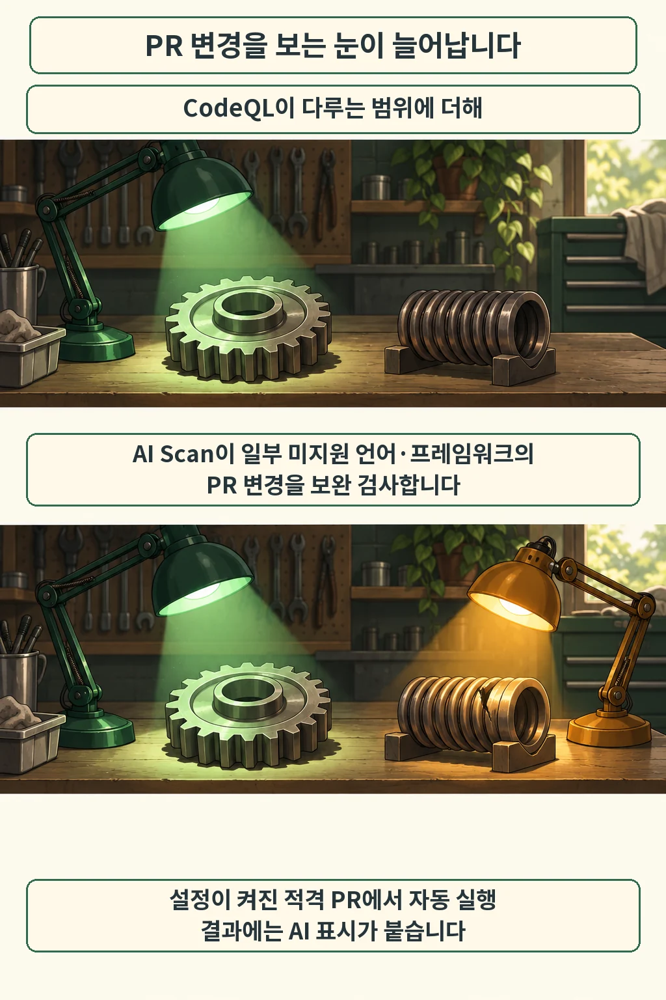
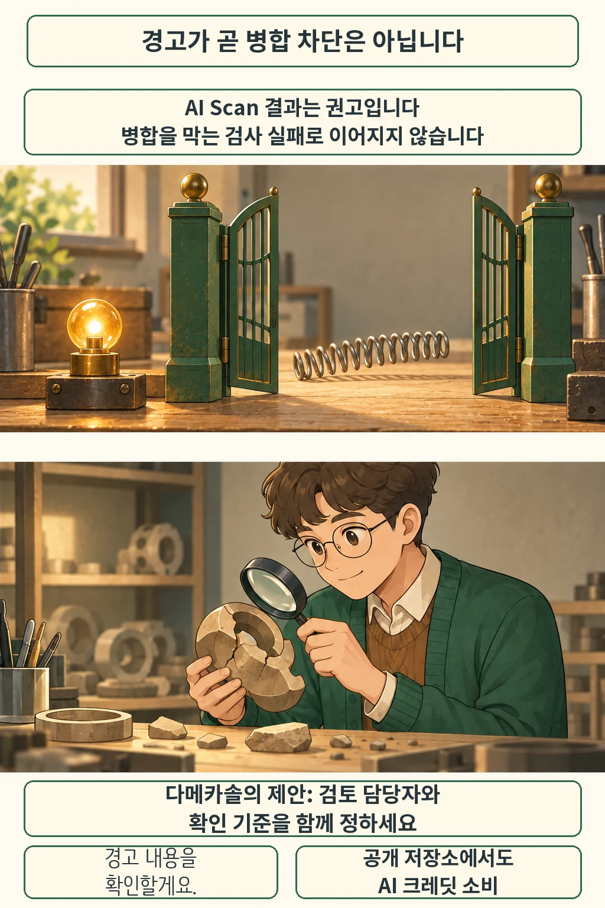

글·해설: 다메카솔

발행·확인: 2026-10-16

PR에 보안 경고가 달렸는데도 병합 버튼은 그대로 열려 있다면, 팀은 그 경고를 누가 확인할지 정해야 합니다. GitHub가 10월 15일 정식 출시한 **AI Scan for pull requests**에서 특히 살펴볼 지점입니다. CodeQL이 현재 다루지 않는 일부 언어·프레임워크의 변경을 보완 검사하지만, 발견 결과는 병합을 자동 차단하는 조건으로 쓰이지 않습니다. [공식 발표](https://github.blog/changelog/2026-10-15-ai-scan-for-pull-requests-generally-available/)

## CodeQL 옆에 더해지는 검사

GitHub는 PHP, Shell/Bash, Terraform 설정(HCL), Dockerfile 등을 보완 검사 대상으로 소개합니다. code scanning과 저장소에 적용되는 AI Scan 설정이 켜져 있으면 적격 PR에서 자동으로 실행됩니다. 결과는 PR의 Conversation·Files changed 화면에서 CodeQL 결과와 함께 나타나고, AI 표시로 구분됩니다. 위험 설명과 수정 제안도 제공될 수 있습니다. [작동 방식](https://github.blog/changelog/2026-10-15-ai-scan-for-pull-requests-generally-available/)

범위는 PR입니다. 공식 문서는 전체 저장소 검사를 지원하지 않으며, fork에서 온 PR과 Dependabot이 만든 PR은 검사 대상에서 제외한다고 설명합니다. 결과도 저장소 보안 화면에 쌓이는 기존 backlog alert와 구분됩니다. 그림의 두 조명은 검사 범위가 보완되는 모습을 표현한 비유이며, 탐지율을 비교한 실험은 아닙니다. [지원 범위와 한계](https://docs.github.com/en/enterprise-cloud@latest/code-security/concepts/code-scanning/ai-powered-security-detections)

## 경고를 읽는 일은 남습니다

추가된 결과는 **권고**로 취급됩니다. AI Scan의 발견만으로 Code scanning check가 실패하지 않으며, ruleset의 필수 병합 조건으로도 차단할 수 없습니다. GitHub는 오탐 가능성도 명시합니다. 따라서 결과가 보인다는 사실과 팀이 그 결과를 검토했다는 사실은 따로 확인해야 합니다. [결과의 의미](https://docs.github.com/en/enterprise-cloud@latest/code-security/concepts/code-scanning/ai-powered-security-detections#limitations)

저는 이 차이를 탐지와 실행 통제의 연결 문제로 봅니다. 예를 들어 배포 설정을 고치는 PR에 경고가 붙었다면, 담당자가 실제 위험인지 판단하고 수정 또는 수용의 근거를 남기는 과정이 필요합니다. 이 예시는 운영 제안입니다. 이번 발표를 직접 재현하거나 오탐률을 측정한 경험으로 제시하는 것은 아닙니다.

## 공개 저장소도 비용을 확인하세요

사용 가능 여부와 과금은 별도로 봐야 합니다. 일반 공개 저장소에는 제공되며, 조직 소유의 비공개·내부 저장소에는 GitHub Code Security 또는 Advanced Security가 필요합니다. Copilot 라이선스는 필수 요건이 아닙니다. 개인 계정의 비공개 저장소와 관리형 사용자 계정의 개인 공간은 지원 대상에서 제외됩니다. [저장소별 이용 조건](https://docs.github.com/en/enterprise-cloud@latest/code-security/concepts/code-scanning/ai-powered-security-detections#availability)

공개 저장소에서도 AI Scan은 **Code Security AI Credits**를 소비합니다. 청구 계정에 포함 크레딧이 있으면 먼저 사용하고, 이후에는 사용량 과금과 예산 설정이 적용됩니다. 포함 크레딧이 없는 계정은 사용량 기준으로 과금됩니다. 활성 커미터 라이선스가 필요 없는 것과 AI 사용 비용이 없는 것은 다른 조건입니다. [AI 기능 과금](https://docs.github.com/en/billing/concepts/product-billing/github-advanced-security#how-ai-feature-usage-is-billed)

## 다메카솔의 해석: 확인할 사람까지 연결하기

제가 도입 범위를 정한다면 기존 테스트와 병합 조건을 유지하면서, AI 경고의 검토 담당자와 확인 기준부터 정하겠습니다. 탐지 신호가 늘어도 실제 검토로 이어지지 않으면 팀이 얻는 효과는 제한적입니다. 반대로 모든 신호를 무조건 차단 조건으로 삼으면 잘못된 경고 때문에 필요한 변경이 밀릴 수 있으므로, 수용·수정의 판단 근거를 쌓는 편이 낫다고 봅니다.

앞서 다룬 [OSS Scanner의 유지관리자 검토](/posts/anthropic-oss-scanner-maintainer-review/)도 발견 보고서와 사람의 검증을 구분했습니다. 이번에는 그 경계가 PR 안에 놓입니다. 검사를 켠 팀이라면 다음 PR에서 **누가 경고를 읽고 어떤 근거로 처리했는지** 확인해 보세요.

## 출처

- [GitHub · AI Scan 정식 출시, 2026-10-15](https://github.blog/changelog/2026-10-15-ai-scan-for-pull-requests-generally-available/)
- [GitHub Docs · AI Scan, 2026-10-16 확인](https://docs.github.com/en/enterprise-cloud@latest/code-security/concepts/code-scanning/ai-powered-security-detections)
- [GitHub Docs · Advanced Security 과금, 2026-10-16 확인](https://docs.github.com/en/billing/concepts/product-billing/github-advanced-security)

이 글의 본문과 이미지는 생성형 AI로 제작했습니다. 기획과 편집 기준은 다메카솔이 정했습니다.
