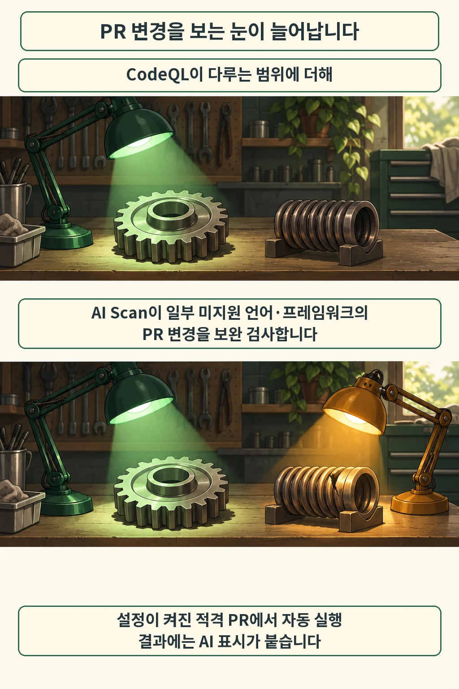
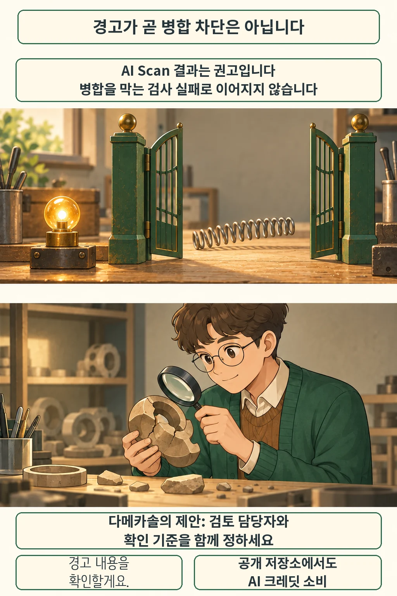

PR에 보안 경고가 달렸는데도 병합 버튼이 그대로 열려 있다면, 팀은 그 경고를 누가 확인할지부터 정해야 합니다. GitHub가 2026년 10월 15일 정식 출시한 **AI Scan for pull requests**에서 특히 짚어 볼 대목이죠. CodeQL이 현재 다루지 않는 일부 언어·프레임워크 변경을 보완 검사하지만, 탐지 결과가 병합을 자동으로 막지는 않는 구조입니다. ([공식 발표](https://github.blog/changelog/2026-10-15-ai-scan-for-pull-requests-generally-available/))

글·해설: 다메카솔

## CodeQL 옆에서 빈칸을 메우는 보완 검사

GitHub는 **PHP, Shell/Bash, Terraform 설정(HCL), Dockerfile** 등을 주요 보완 검사 대상으로 소개합니다. 저장소에 code scanning과 유효한 AI Scan 설정이 켜져 있고 지원 언어 변경이 포함되면 적격 PR에서 자동으로 실행됩니다. 탐지 결과는 PR의 Conversation·Files changed 화면에서 기존 CodeQL 결과와 나란히 보이며, AI 배지와 함께 위험 설명이나 수정 제안이 붙을 수 있습니다. ([작동 방식](https://github.blog/changelog/2026-10-15-ai-scan-for-pull-requests-generally-available/))

또한 검사 범위는 **PR 변경분**으로만 한정됩니다. GitHub [공식 문서](https://docs.github.com/en/enterprise-cloud@latest/code-security/concepts/code-scanning/ai-powered-security-detections)는 실행 제외 대상과 결과 관리 기준을 따로 안내하고 있습니다.

- **검사 제외 대상**: 전체 저장소 스캔, fork에서 올라온 PR, Dependabot이 만든 PR에서는 실행되지 않습니다.
- **결과 관리 구분**: 저장소 보안 화면에 쌓이는 기존 backlog alert와는 별도로 관리됩니다.

## 경고가 떠도 병합 통로는 열려 있습니다

실무에서 가장 중요한 차이는 AI Scan 결과가 **권고(advisory)**로만 취급된다는 점입니다. 새 경고가 나와도 Code scanning check가 실패로 바뀌지 않으며, ruleset의 필수 병합 조건으로 묶어 PR을 막을 수도 없습니다. 기존 테스트나 다른 필수 규칙은 그대로 유지되면서 AI 경고만 참고 신호로 더해지는 셈이죠.

GitHub 역시 [한계 안내 문서](https://docs.github.com/en/enterprise-cloud@latest/code-security/concepts/code-scanning/ai-powered-security-detections#limitations)에서 오탐 가능성을 명시하고 있습니다. 결국 화면에 경고가 떴다는 사실과 팀이 그 결과를 실제로 검토했다는 사실은 별개로 챙겨야 합니다.

예를 들어 배포용 `Dockerfile`이나 Terraform 설정(HCL)을 바꾼 PR에 AI Scan 경고가 붙었다고 생각해 볼까요? 자동 체크는 모두 통과 상태이므로 리뷰어가 경고를 지나치면 그대로 병합되기 쉽습니다. 반대로 리뷰어가 실제 위험 여부를 가려 수정하거나 수용 근거를 코멘트로 남기면, 병합 차단 없이도 검토 이력을 이어 갈 수 있습니다.

## 저장소 조건과 공개 저장소 AI 크레딧 비용

도입 전에는 저장소 유형별 이용 조건과 과금 기준을 나누어 살펴봐야 합니다. ([저장소별 이용 조건](https://docs.github.com/en/enterprise-cloud@latest/code-security/concepts/code-scanning/ai-powered-security-detections#availability))

| 저장소 유형 | 지원 조건 | 라이선스·비용 참고 |
| --- | --- | --- |
| **일반 공개 저장소** | 기능 기본 제공 | 실행 시 AI 크레딧 소비 |
| **조직 비공개·내부 저장소** | GitHub Code Security 또는 Advanced Security 필요 | Copilot 라이선스 필수 아님 |
| **개인 비공개·관리형 사용자 개인 공간** | 지원 제외 | 적용 대상 외 |

비용을 따질 때 가장 놓치기 쉬운 대목은 과금 기준입니다. 공개 저장소라도 AI Scan이 실행될 때는 **Code Security AI Credits**를 소비하거든요. 청구 계정에 기본 포함 크레딧이 있으면 먼저 차감되고 이후 사용량 과금과 예산 설정이 적용되며, 포함 크레딧이 없는 계정은 처음부터 사용량 기준으로 과금됩니다. 활성 커미터 라이선스가 필요 없다는 조건과 AI 크레딧 비용이 없다는 뜻은 엄연히 다릅니다. ([AI 기능 과금](https://docs.github.com/en/billing/concepts/product-billing/github-advanced-security#how-ai-feature-usage-is-billed))

## 다메카솔의 해석: 확인할 사람까지 연결하기

팀의 도입 범위를 정한다면 기존 테스트와 병합 차단 규칙은 그대로 두고, **AI 경고를 누가 어떤 기준으로 확인할지**부터 먼저 정하는 편이 좋습니다. 탐지 신호가 늘어도 코드 리뷰에서 읽히지 않으면 보안 개선 효과가 반감됩니다. 반대로 오탐 가능성이 있는 권고 신호를 무작정 차단 조건으로 묶으면 정상 배포까지 밀릴 수 있어, 수정이나 수용의 판단 근거를 리뷰 기록으로 남기는 방식이 현실적입니다.

- **병합 기준 유지**: 기존 테스트와 필수 체크는 유지하고, AI Scan은 보조 검토 신호로 둡니다.
- **검토 책임 지정**: 리뷰어가 AI 경고를 읽은 뒤 수정 또는 수용 판단을 코멘트로 남깁니다.
- **크레딧 예산 확인**: 공개 저장소를 포함해 AI 크레딧 소모와 예산 설정을 점검합니다.

앞서 다룬 [OSS Scanner의 유지관리자 검토](/posts/anthropic-oss-scanner-maintainer-review/)에서도 AI가 만든 발견 보고서와 사람의 검증 책임을 구분해 살펴봤는데요. 이번에는 그 경계가 일상적인 PR 화면 안으로 들어왔습니다. AI Scan을 켠 팀이라면 다음 PR에서 **누가 경고를 읽고 어떤 근거로 닫았는지**부터 확인해 보시기 바랍니다.

## 출처

- [GitHub · AI Scan 정식 출시, 2026-10-15](https://github.blog/changelog/2026-10-15-ai-scan-for-pull-requests-generally-available/)
- [GitHub Docs · AI Scan, 2026-10-16 확인](https://docs.github.com/en/enterprise-cloud@latest/code-security/concepts/code-scanning/ai-powered-security-detections)
- [GitHub Docs · Advanced Security 과금, 2026-10-16 확인](https://docs.github.com/en/billing/concepts/product-billing/github-advanced-security)

이 글은 GitHub 공식 발표와 문서를 바탕으로 정리했으며 별도 실행 테스트나 오탐률 측정은 포함하지 않았고, 만화 그림은 이해를 돕기 위해 새로 구성했습니다.
이 글의 본문과 이미지는 생성형 AI로 제작했습니다. 기획과 편집 기준은 다메카솔이 정했습니다.
