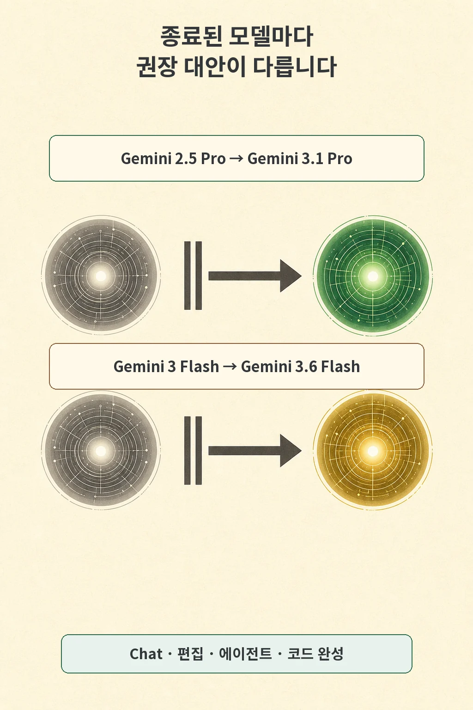

갑자기 GitHub Copilot의 프롬프트나 에이전트 워크플로에서 익숙한 Gemini 모델이 보이지 않는다면, 최근 단행된 모델 지원 종료의 영향일 가능성이 큽니다. GitHub가 Copilot 전반에서 **Gemini 2.5 Pro**와 **Gemini 3 Flash** 지원을 공식 종료하고 후속 모델로의 전환을 안내했거든요. 단순히 선택기 목록만 바뀌는 수준이 아니라서 개인 설정과 조직 정책을 함께 점검해 두는 편이 좋습니다.

글·해설: 다메카솔

## 핵심 내용

- **적용 범위와 종료일**: 2026년 7월 31일부로 Copilot Chat, 인라인 편집(inline edits), ask·agent 모드, 코드 자동완성(code completions) 등 모든 GitHub Copilot 표면에서 두 모델의 지원이 종료되었습니다.
- **권장 대체 모델과 출시 단계**: `Gemini 2.5 Pro`는 `Gemini 3.1 Pro`(Public preview)로, `Gemini 3 Flash`는 `Gemini 3.6 Flash`(GA)로 대체가 권장됩니다.
- **사용자 및 조직 조치 사항**: 자동 모델 선택을 쓰는 경우에는 별도 조치가 필요 없지만, 워크플로나 프롬프트 파일에 모델 이름을 고정해 두었다면 지원 모델로 수정해야 하며 Copilot Enterprise 조직은 관리자 모델 정책에서 신규 모델 허용 여부를 확인해야 합니다.

## Copilot 전반에서 두 모델 지원이 끝났습니다

이번 지원 종료는 웹이나 특정 IDE의 모델 선택기 한 곳에만 국한되지 않고 Copilot Chat, 인라인 편집, ask·agent 모드, 코드 자동완성을 포함한 모든 GitHub Copilot 경험에 일괄 반영됩니다. GitHub 공식 문서의 모델 종료 이력(model retirement history)에도 두 모델의 종료일이 2026년 7월 31일로 기록되어 있죠.

| 종료된 모델 (2026-07-31 부) | 권장 대체 모델 | GitHub Docs 기준 제공 상태 | 비고 |
| --- | --- | --- | --- |
| **Gemini 2.5 Pro** | **Gemini 3.1 Pro** | Public preview | 플랜 및 사용 표면(GitHub.com·IDE)별 가용성 확인 필요 |
| **Gemini 3 Flash** | **Gemini 3.6 Flash** | GA (정식 출시) | 〃 |

표에서 보듯 대체 모델 두 종은 제공 단계부터 Public preview와 GA로 서로 다릅니다. GitHub 문서에서도 모델 가용성이 플랜과 사용 표면에 따라 달라지고 시간이 지나며 모델이 교체될 수 있다고 설명하는 만큼, 이름만 바뀐 동일 모델로 여기기보다 내 환경의 실제 지원 범위를 먼저 확인하는 편이 안전합니다.

## 사용자 설정과 조직 관리자 정책을 함께 봅니다

GitHub는 종료된 모델을 수동으로 삭제하는 별도 동작은 필요 없다고 안내했습니다. 다만 실제로 손봐야 할 항목은 평소 모델을 호출하던 방식에 따라 갈립니다.

- **개인 개발자 및 워크플로 설정**: 기본 자동 선택만 써 왔다면 선택기에서 새 대체 모델을 바로 고를 수 있지만, 프롬프트 템플릿이나 에이전트 설정, 스크립트에 `Gemini 2.5 Pro` 또는 `Gemini 3 Flash` 이름을 하드코딩해 두었다면 권장 모델명으로 수정해야 합니다.
- **조직(Enterprise·Business) 관리자 정책**: Copilot Enterprise 관리자는 모델 정책(model policies) 설정에서 새 대체 모델 접근을 명시적으로 활성화해야 할 수 있습니다. 개인 플랜이 지원 대상이라도 소속 조직 정책에서 허용하지 않으면 선택기에 나타나지 않거든요.

예를 들어 팀 저장소의 에이전트 설정 파일에 `Gemini 2.5 Pro`를 고정해 두고 쓰던 개발자를 떠올려 보죠. 코드 속 모델명만 `Gemini 3.1 Pro`로 바꿨는데도 IDE 선택기에서 새 모델을 찾지 못한다면, 조직 관리자의 모델 정책에서 신규 모델이 허용되어 있는지부터 확인해야 합니다.

## 다메카솔의 해석, 외부 의존성 교체처럼 다루기

특정 모델을 프롬프트나 에이전트 워크플로에 고정해 두고 있었다면, 이번 변경은 단순한 메뉴 정리가 아니라 **외부 라이브러리 버전을 올리는 작업**과 같습니다. 권장 대안이 제시되었더라도 출력 형식이나 도구 호출 습관, 응답 속도, 토큰 비용 조건까지 동일하게 유지된다는 보장은 어렵거든요.

이름만 바꾸고 넘어가기보다 아래 다섯 단계로 짧은 회귀 점검을 거쳐 동작 차이를 남겨 두면 실무에서 훨씬 안전합니다.

1. 저장소 내 설정 파일과 자동화 스크립트에서 종료된 두 모델명(`Gemini 2.5 Pro`, `Gemini 3 Flash`)을 검색합니다.
2. 각 호출 지점을 권장 대안(`Gemini 3.1 Pro`, `Gemini 3.6 Flash`)으로 매핑해 수정합니다.
3. 사용 중인 IDE와 플랜에서 대체 모델이 정상 노출되는지 확인합니다.
4. Business·Enterprise 환경이라면 조직 관리자의 모델 허용 정책을 점검합니다.
5. 대표 프롬프트와 에이전트 작업을 다시 돌려 응답 품질과 도구 호출 동작의 차이를 기록합니다.

## 출처

- [GitHub Changelog — Gemini 2.5 Pro and Gemini 3 Flash deprecated](https://github.blog/changelog/2026-07-31-gemini-2-5-pro-and-gemini-3-flash-deprecated/)
- [GitHub Docs — Supported AI models in GitHub Copilot](https://docs.github.com/en/copilot/reference/ai-models/supported-models)

이 글의 본문과 이미지는 생성형 AI로 제작했습니다. 기획과 편집 기준은 다메카솔이 정했습니다.
