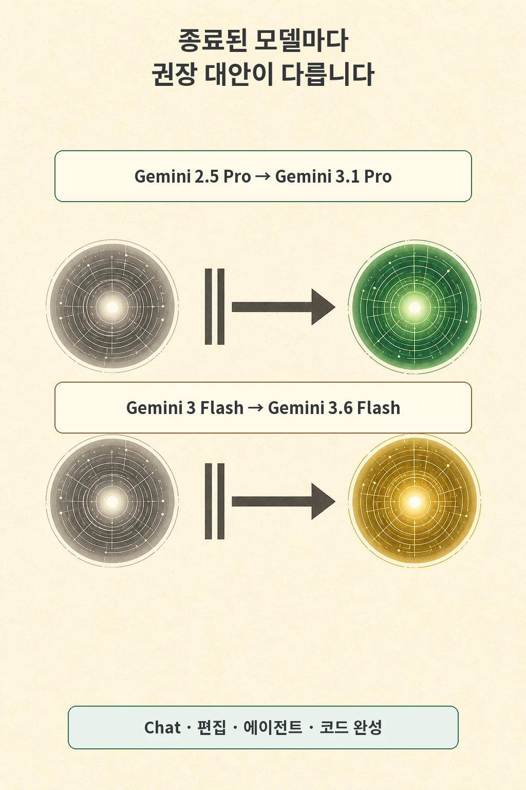

GitHub는 2026년 7월 31일부로 **GitHub Copilot에서 Gemini 2.5 Pro와 Gemini 3 Flash를 지원 종료(deprecated)**했습니다. GitHub가 안내한 권장 대체 모델은 각각 **Gemini 3.1 Pro**와 **Gemini 3.6 Flash**입니다.

글·해설: 다메카솔

## 핵심 내용

- **적용 범위와 종료일**: 2026년 7월 31일부로 Copilot Chat, 인라인 편집(inline edits), ask·agent 모드, 코드 자동완성(code completions) 등 모든 GitHub Copilot 표면에서 두 모델의 지원이 종료되었습니다.
- **권장 대체 모델과 출시 단계**: `Gemini 2.5 Pro`는 `Gemini 3.1 Pro`(Public preview)로, `Gemini 3 Flash`는 `Gemini 3.6 Flash`(GA)로 대체가 권장됩니다.
- **사용자 및 조직 조치 사항**: 자동 모델 선택을 쓰는 경우에는 별도 조치가 필요 없지만, 워크플로나 프롬프트 파일에 모델 이름을 직접 고정해 둔 경우 지원 모델로 수정해야 하며 Copilot Enterprise 조직은 관리자 모델 정책에서 신규 모델 허용 여부를 함께 확인해야 합니다.

## Copilot 전반에서 두 모델 지원이 끝났습니다

이번 변경은 웹이나 특정 IDE의 모델 선택기 한 곳에만 국한되지 않고 Copilot Chat, 인라인 편집, ask 및 agent 모드, 코드 자동완성을 포함한 모든 GitHub Copilot 경험에 일괄 적용됩니다. GitHub 공식 문서의 모델 종료 이력(model retirement history)에도 두 모델의 종료일이 2026년 7월 31일로 기록되었습니다.

| 종료된 모델 (2026-07-31 부) | 권장 대체 모델 | GitHub Docs 기준 제공 상태 | 비고 |
| --- | --- | --- | --- |
| **Gemini 2.5 Pro** | **Gemini 3.1 Pro** | Public preview | 플랜 및 사용 표면(GitHub.com·IDE)별 가용성 확인 필요 |
| **Gemini 3 Flash** | **Gemini 3.6 Flash** | GA (정식 출시) | 〃 |

대체 모델 두 종의 제공 단계(Public preview 대 GA)와 세부 조건이 서로 다르므로, 이름만 바꾼 동일 모델로 가정하기보다 플랜과 IDE 표면에서의 실제 지원 범위를 먼저 확인하는 편이 안전합니다.

## 사용자 설정과 조직 관리자 정책을 함께 봅니다

GitHub는 종료된 모델을 수동으로 삭제할 필요는 없다고 설명했습니다. 다만 대응 방식은 모델을 어떻게 호출하고 있었는지에 따라 갈립니다.

- **개인 개발자 및 워크플로 설정**: 평소 기본 자동 선택만 썼다면 바로 대체 모델을 고를 수 있지만, 프롬프트 템플릿이나 에이전트 설정, 스크립트에 `Gemini 2.5 Pro`나 `Gemini 3 Flash` 이름을 하드코딩해 두었다면 새 모델 이름으로 직접 수정해야 합니다.
- **조직(Enterprise/Business) 관리자 정책**: GitHub는 Copilot Enterprise 관리자가 모델 정책(model policies) 설정에서 새 대체 모델의 접근을 명시적으로 활성화해야 할 수 있다고 안내했습니다. 개인 플랜이 지원 대상이더라도 소속 조직 정책에서 허용하지 않으면 선택기에 나타나지 않습니다.

## 다메카솔의 해석: 선택기 변경이 아닌 외부 의존성 교체로 다루기

프롬프트나 에이전트 워크플로에 특정 모델을 고정해 쓰고 있었다면, 이번 변경은 단순한 메뉴 정리가 아니라 **외부 라이브러리 버전 교체**와 같습니다. 권장 대안이 제시되었더라도 출력 형식, 도구 호출 습관, 응답 속도, 토큰 비용 조건이 완전히 같다는 보장은 없기 때문입니다.

실무 점검은 다섯 단계로 간단히 끝낼 수 있습니다.

1. 저장소 내 설정 파일과 자동화 스크립트에서 종료된 두 모델명을 검색합니다.
2. 각 모델을 권장 대안(`Gemini 3.1 Pro`, `Gemini 3.6 Flash`)으로 매핑합니다.
3. 사용 중인 IDE와 플랜에서 대체 모델이 정상 노출되는지 확인합니다.
4. Business·Enterprise 환경이라면 조직 관리자의 모델 허용 정책을 확인합니다.
5. 대표 프롬프트와 에이전트 작업을 다시 돌려 응답 품질과 도구 호출 동작에 차이가 없는지 기록합니다.

## 출처

- [GitHub Changelog — Gemini 2.5 Pro and Gemini 3 Flash deprecated](https://github.blog/changelog/2026-07-31-gemini-2-5-pro-and-gemini-3-flash-deprecated/)
- [GitHub Docs — Supported AI models in GitHub Copilot](https://docs.github.com/en/copilot/reference/ai-models/supported-models)

이 글의 본문과 이미지는 생성형 AI로 제작했습니다. 기획과 편집 기준은 다메카솔이 정했습니다.
