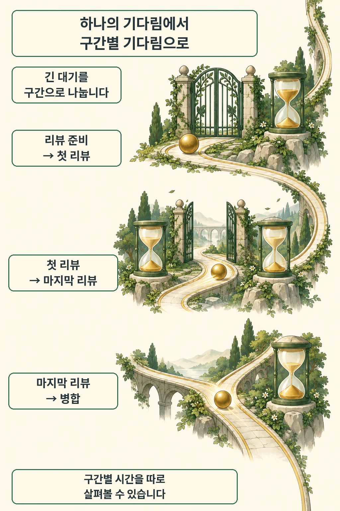

AI 코딩 도구를 도입하고 나면 코드 작성 속도는 빨라진 것 같은데, 정작 풀 리퀘스트(PR)가 병합되기까지 왜 여전히 오래 걸리는지 막막할 때가 많습니다. GitHub가 2026년 9월 25일 공개한 Copilot 사용량 지표 API 업데이트는 이 병합 대기 시간을 세 구간으로 쪼개어 보여주는데요. 다만 현재 집계 기준이 사람 리뷰에만 맞춰져 있어, 수치를 해석할 때 분모와 제외 조건을 먼저 따져 봐야 합니다.

글·해설: 다메카솔

## 병합까지 걸린 시간을 세 구간으로 나눕니다

이전에는 PR이 열리고 병합되기까지의 전체 흐름을 한 덩어리로만 보기 쉬웠지만, 이번 업데이트로 조직·엔터프라이즈의 `repos-1-day` 보고서에 `pull_request_review_times` 배열이 추가됐습니다. ([공식 발표](https://github.blog/changelog/2026-09-25-usage-metrics-api-adds-pull-request-review-stages/)) 각 구간의 시간은 분 단위 중앙값(median)과 상위 10% 지연을 뜻하는 p90으로 제공되죠.

| 구간 | 시작과 끝 기준 | 살펴볼 수 있는 병목 |
| --- | --- | --- |
| 첫 리뷰 전 | 리뷰 준비 완료 → 첫 번째 리뷰 | 첫 리뷰어 배정과 초기 응답 대기 |
| 리뷰 사이 | 첫 번째 리뷰 → 마지막 리뷰 | 리뷰 의견 반영과 재검토 왕복 시간 |
| 마지막 리뷰 후 | 마지막 리뷰 → PR 병합 | 최종 리뷰 이후 배포·병합 게이트 대기 |

가령 팀 지표를 열어봤는데 첫 리뷰 전 중앙값은 짧고 마지막 리뷰 후 p90만 유독 길게 나온다고 생각해 봅시다. 리뷰어는 제때 반응하고 있지만, 정작 최종 사람 리뷰가 끝난 뒤에도 CI 검사나 병합 게이트 앞에서 코드가 묶여 있다는 신호로 읽을 수 있습니다. 여기서 마지막 리뷰는 반드시 승인(Approve)만을 가리키지 않으며, 병합 직전에 남겨진 **마지막 사람 리뷰 시점**을 기준으로 계산합니다.

## 사람 리뷰만 집계되는 범위와 분모의 차이

수치를 팀 리포트에 올리기 전에 꼭 확인해야 할 대목은 집계 대상과 분모의 기준입니다. ([필드 정의](https://docs.github.com/en/copilot/reference/copilot-usage-metrics/copilot-usage-metrics)) Copilot이 리뷰에 참여하는 저장소라도 봇의 활동은 시간 계산에 들어가지 않거든요.

- **사람 작성과 동료 리뷰 한정**: 사람이 작성하고 다른 사람이 리뷰한 PR만 집계 대상에 포함됩니다. Copilot이나 다른 봇이 작성·리뷰한 내역, 작성자 본인의 셀프 리뷰는 빠지며, 사람과 Copilot이 함께 리뷰한 PR은 사람 리뷰 시각으로만 계산합니다.
- **전체 병합 수와 다른 분모**: 일일 보고서의 전체 병합 PR 수에 잡혔더라도 유효한 사람 리뷰가 빠졌거나, 리뷰 준비 시각과 시각 순서가 맞지 않는 PR은 시간 배열 계산에서 제외됩니다.
- **빈 배열(`[]`)과 `0`의 구분**: 조건에 맞는 병합 PR이 빠진 날에는 `[]`가 반환되고, 유효한 사람 리뷰가 딱 한 번만 달린 PR은 첫 리뷰와 마지막 리뷰 시각이 같아 '리뷰 사이' 구간에 `0`을 기여합니다.
- **병합일 귀속과 소급 제한**: 모든 시간은 PR이 **병합된 날짜**에 기록되며, 과거 이력을 소급해 채우지 않고 2026년 9월 21일 이전에 리뷰 준비 상태가 된 PR은 계산에서 제외됩니다.

예를 들어 하루에 PR 여러 건이 병합됐는데 일부는 봇이 올렸거나, 사람 리뷰 한 번만 받고 곧바로 머지됐다고 가정해 봅시다. 전체 병합 건수에는 모두 포함되더라도 봇 PR은 시간 통계 분모에서 빠지고, 단발성 리뷰만 거친 PR은 '리뷰 사이' 대기 시간을 `0`으로 낮추는 셈이죠.

조회 조건과 권한도 미리 챙겨 두어야 합니다. 조직 또는 엔터프라이즈의 `repos-1-day` 보고서에서 사용량 지표 정책이 켜져 있어야 하며, 조직 소유자·엔터프라이즈 소유자·청구 관리자 또는 Copilot 사용량 지표 조회 권한이 있어야 REST API가 반환하는 다운로드 링크로 저장소별 보고서를 내려받을 수 있습니다. ([API 문서](https://docs.github.com/en/rest/copilot/copilot-usage-metrics))

## 다메카솔의 해석: 병목 진단과 AI 효과를 나눠 읽기

앞서 다룬 [Copilot Memory를 보안 수정에 연결한 발표](/posts/github-agentic-autofix-copilot-memory/)가 에이전트 내부의 작업 방식을 보여줬다면, 이번 지표는 코드가 사람 손을 거쳐 병합되기까지의 흐름을 비추는 계기판에 가깝습니다. 실무에서 첫 리뷰 전 대기가 길다면 리뷰어 배정이나 알림 규칙을 손보고, 마지막 리뷰 후가 길다면 CI 시간이나 병합 정책부터 점검하는 편이 도움이 됩니다.

다만 이 지표의 숫자 변화만으로 AI 도구가 리뷰 속도를 줄였다는 인과 효과를 입증하기는 어렵습니다. [보안 API 과제에서 AI 코딩 도우미를 비교한 연구](/posts/copilot-security-api-study/)에서도 확인되듯 PR의 크기나 팀 인원 변화, 배포 주기 같은 변수를 함께 대조해야 전체 맥락이 보입니다. 게다가 `pull_request_review_times`는 **병합된 PR만 병합일 기준으로 집계**하므로, 아직 병합되지 못한 채 대기열에 쌓여 있는 미결 PR이 얼마나 남아 있는지도 별도로 함께 살펴야 실제 병목 해소 여부를 분명하게 가려낼 수 있습니다.

## 출처

- [GitHub 변경 공지](https://github.blog/changelog/2026-09-25-usage-metrics-api-adds-pull-request-review-stages/) — 2026-09-25
- [사용량 지표 필드 정의](https://docs.github.com/en/copilot/reference/copilot-usage-metrics/copilot-usage-metrics) — 2026-09-28 확인
- [사용량 지표 REST API](https://docs.github.com/en/rest/copilot/copilot-usage-metrics) — 2026-09-28 확인

공식 발표와 문서를 바탕으로 정리했으며, 별도 조직 계정 API 호출 시험은 포함하지 않았습니다.

이 글의 본문과 이미지는 생성형 AI로 제작했습니다. 기획과 편집 기준은 다메카솔이 정했습니다.
