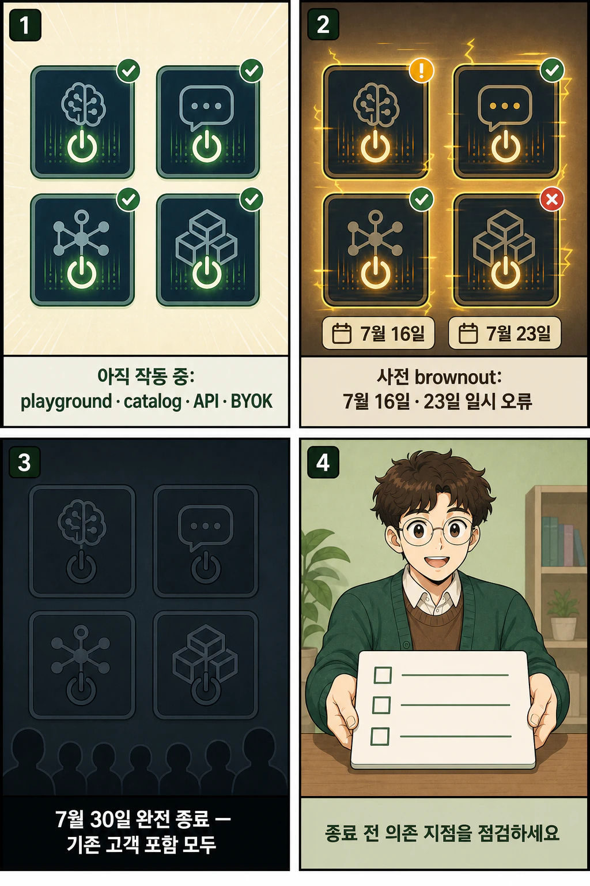

토이 프로젝트나 사내 데모에서 AI 모델을 빠르게 연결해 볼 때 GitHub Models를 써 본 분이 많으실 겁니다. 그런데 오는 **2026년 7월 30일**을 끝으로 GitHub Models 서비스가 완전히 문을 닫습니다. 웹에서 바로 만져보던 Playground는 물론 API와 BYOK(Bring Your Own Key) 엔드포인트까지 모두 종료 대상이라, 지금 연결된 코드나 데모가 있다면 일정을 미리 짚고 넘어갈 필요가 있죠.

글·해설: 다메카솔

## 한눈에 보는 종료 일정과 영향 범위

GitHub가 2026년 7월 1일 공식 Changelog를 통해 발표한 바에 따르면, 이번 종료는 기존에 신규 고객 유입만 제한했던 이전 단계에서 한 걸음 더 나아간 조치입니다. 이미 서비스를 쓰고 있던 **기존 활성 사용자를 포함한 모든 고객**에게 일괄 적용되거든요.

| 구분 | 일정·내용 | 비고 |
| --- | --- | --- |
| **1차 Brownout (일시 중단)** | 2026년 7월 16일 | 요청 시 일시적으로 오류 반환 후 복구 |
| **2차 Brownout (일시 중단)** | 2026년 7월 23일 | 최종 종료 전 마지막 사전 오류 테스트 |
| **완전 종료일** | 2026년 7월 30일 | 모든 환경에서 서비스 영구 중단 |
| **종료 대상 기능** | Playground, model catalog, inference API, BYOK endpoint, 관련 UI | 웹 화면과 API 호출 경로 모두 포함 |
| **적용 범위** | 기존 활성 사용자를 포함한 전체 고객 | 개인·조직 프로젝트 예외 없이 적용 |

이처럼 현재 정상 작동하는 모든 기능이 두 차례의 사전 중단을 거쳐 7월 30일에 한꺼번에 종료됩니다. 특히 웹 브라우저에서 프롬프트를 테스트하는 Playground와 model catalog UI뿐만 아니라, 코드에서 직접 호출하는 inference API와 본인의 키를 연결해 쓰던 BYOK endpoint까지 함께 중단된다는 점이 중요합니다.

## 7월 16일과 23일, 왜 Brownout을 먼저 거칠까요?

완전 종료에 앞서 GitHub는 2026년 7월 16일과 23일에 짧은 brownout(의도적 일시 중단)을 두 차례 진행합니다. 이 시간대에는 GitHub Models로 들어가는 요청이 일시적으로 오류를 반환했다가 다시 복구되는데요. 서비스가 아예 사라지기 전에 운영자나 개발자가 미처 파악하지 못한 의존 지점을 미리 발견하도록 돕는 예고편 성격의 조치인 셈이죠.

**예를 들어** 몇 달 전 해커톤에서 만든 사내 슬랙 요약 봇이나 GitHub Actions 기반 PR 보조 스크립트에 GitHub Models의 inference API를 붙여 둔 경우를 떠올려 볼 수 있습니다. 평소에는 조용히 잘 돌다가도 7월 16일 brownout 시간에 호출이 오류를 반환하면, 예외 처리가 부실한 스크립트는 그 자리에서 멈추거나 빈 응답을 그대로 내보내며 작업이 꼬이게 됩니다. 반대로 그때 오류 로그가 남고 대체 경로로 넘어간다면, 최소한 어디를 고쳐야 할지 7월 30일 전에 정확히 찾아낼 수 있습니다.

## 공식 공지가 안내한 대안과 점검 순서

GitHub는 이번 공지에서 프로젝트 성격에 따라 두 가지 대안을 함께 안내했습니다. 모델 접근 자체가 계속 필요한 신규·기존 프로젝트에는 **Microsoft Foundry**를, GitHub 환경 안에서 AI 워크플로를 구축하려는 경우에는 **GitHub Copilot**을 살펴보라고 권하고 있습니다.

참고로 두 선택지는 공식 공지가 제시한 방향일 뿐이며, 기존 GitHub Models와 기능·가격·이식성까지 똑같다고 보기는 어렵습니다. 특히 GitHub Copilot은 GitHub 내 AI 워크플로 도구이고 GitHub Models는 모델 추론·테스트용 서비스라는 점에서 역할이 다르기 때문에, 실제 이전 전에는 요금 체계와 지원 모델 범위를 따로 비교해 보는 편이 좋습니다.

7월 말 완전 종료 전까지 아래 순서대로 현재 프로젝트를 점검해 두면 갑작스러운 장애에 안전하게 대비할 수 있습니다.

- **의존 지점 전수 조사**: 저장소와 배포 환경 설정에서 GitHub Models의 inference API나 BYOK endpoint를 참조하는 코드·환경 변수를 모두 찾아냅니다.
- **오류 처리 동작 확인**: 7월 16일과 23일 brownout 이전에 호출 실패 시 재시도, 타임아웃, 알림 또는 대체 응답으로 안전하게 넘어가는지 점검합니다.
- **대안 서비스 이전 평가**: 모델 API 호출 중심이라면 Microsoft Foundry 등 다른 추론 플랫폼의 비용과 인증 방식을 비교하고, GitHub 내부 워크플로 중심이라면 GitHub Copilot으로 요구 사항을 충족할 수 있는지 검토합니다.
- **설정 분리 습관화**: 향후 특정 API가 종료되더라도 설정값 교체만으로 빠르게 전환할 수 있도록 모델 엔드포인트와 인증 키를 코드에 직접 적지 않고 환경 변수로 분리해 둡니다.

## 출처

- GitHub Changelog, [GitHub Models is being fully retired on July 30, 2026](https://github.blog/changelog/2026-07-01-github-models-is-being-fully-retired-on-july-30-2026/) (2026-07-01)

GitHub 공식 공지를 바탕으로 정리했으며, 대안 서비스의 실제 비용이나 성능 비교 측정은 포함하지 않았습니다.

이 글의 본문과 이미지는 생성형 AI로 제작했습니다. 기획과 편집 기준은 다메카솔이 정했습니다.
