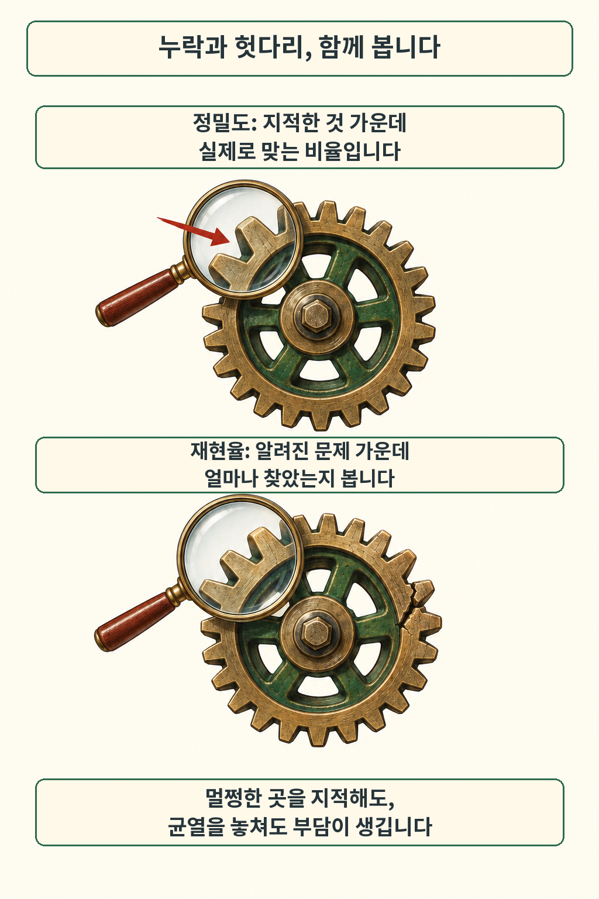
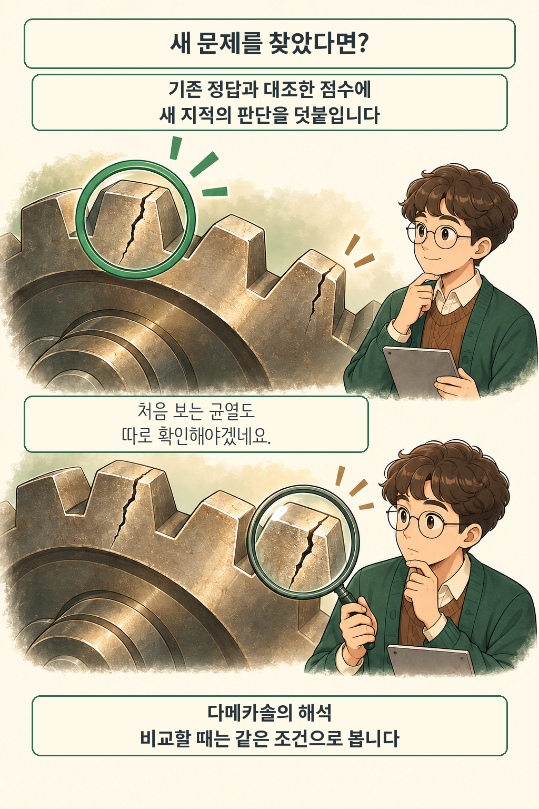

글·해설: 다메카솔

발행·확인: 2026-10-06

**GitHub은 2026년 10월 5일 AI 코드 리뷰 도구를 평가하는 ReviewBench를 연구 프리뷰로 공개했습니다.** 지적한 내용 중 실제 결함인 비율(정밀도)과 기존에 알려진 결함을 찾아낸 비율(재현율)을 함께 재고, 기존 정답 목록에 없던 새로운 지적도 별도로 심사하는 벤치마크입니다. ([GitHub 공식 발표](https://github.blog/ai-and-ml/github-copilot/reviewbench-an-open-benchmark-for-ai-code-review/))

## 멀쩡한 톱니를 지적하고, 균열은 놓친다면

그림 위쪽처럼 멀쩡한 톱니를 결함이라고 의심하는 실수와, 아래쪽처럼 시야 밖의 실제 균열을 놓치는 실수는 팀에 남기는 비용이 서로 다릅니다. 앞의 실수(낮은 정밀도)는 개발자가 헛된 지적을 읽고 닫는 데 시간을 쓰게 만들고, 뒤의 실수(낮은 재현율)는 고쳐야 할 버그를 그대로 배포로 흘려보냅니다.

GitHub은 실제 풀 리퀘스트(PR) 분포를 참고해 고른 공개 PR 219개에 사람·모델·정적 분석 도구가 찾은 지적 사항을 모으고, 중복 지적을 하나로 묶어 공통 평가 기준으로 구성했다고 설명합니다. ([구성 방법](https://github.blog/ai-and-ml/github-copilot/reviewbench-an-open-benchmark-for-ai-code-review/))

따라서 단순히 “리뷰 댓글을 많이 달아 준다”는 인상만으로는 도구의 우열을 가리기 어렵습니다. 무엇을 정답 결함으로 인정했는지, 그리고 놓친 결함과 잘못 짚은 지적의 비율이 각각 어떠한지를 나란히 봐야 합니다(리뷰 요청 자체를 사내 도구에 연결하는 방법은 [Copilot 코드 리뷰 API 안내](/posts/github-copilot-review-api-balanced/)에서 따로 다뤘습니다).

## 정답 목록에도 없던 균열을 찾았다면

코드 리뷰에서는 기존 정답 목록에 없던 타당한 결함을 에이전트가 새로 찾아내는 경우도 생깁니다. ReviewBench는 이 문제를 다루기 위해 평가 지표를 두 가지로 나누었습니다. ([지표의 차이](https://github.blog/ai-and-ml/github-copilot/reviewbench-an-open-benchmark-for-ai-code-review/))

- **Grounded 지표**: 사전에 구축된 기준 정답 집합과만 대조해 채점합니다. 모든 평가 대상에 동일한 분모가 적용되므로 시스템 간 대표 재현율 비교에 사용됩니다.
- **Augmented 지표**: 기존 정답 목록과 일치하지 않는 새로운 지적도 별도로 심사해 타당한 결함이면 반영합니다. 다만 에이전트가 새로 찾은 결함에 따라 재현율의 분모가 달라지므로 고정 분모 비교와는 구분해 읽어야 합니다.

기존 표시와 다르다는 이유만으로 새 발견을 오답 처리하거나, 반대로 검증 없이 새 지적을 모두 인정해 버리면 공정한 비교가 흔들리기 때문에 두 지표를 분리한 설계가 눈에 띕니다.

## 다메카솔의 해석: 점수 옆에 비교 조건을 둡니다

팀에 맞는 AI 코드 리뷰 도구를 고를 때는 같은 PR 묶음과 같은 판정 기준(Grounded vs Augmented)을 먼저 고정해 두고, **치명적인 결함 누락을 줄이는 것이 급선무인지, 자잘한 오탐 댓글로 인한 피로도를 줄이는 것이 급선무인지** 팀의 코드베이스 특성에 맞춰 가중치를 두는 편이 좋습니다.

아울러 벤치마크 점수와 별개로 실제 PR 과정에서 리뷰가 도착하기까지 걸리는 시간과 병합 흐름은 [PR 리뷰 단계별 지표](/posts/github-copilot-pr-review-stage-metrics/)처럼 운영 지표로 함께 살펴야 합니다. 새로운 결함을 발견할 여지를 열어 두면서도 비교의 기준선을 흔들지 않으려는 ReviewBench의 구분법은 사내 에이전트 평가셋을 만들 때도 좋은 참고가 됩니다.

## 출처

- [GitHub, ReviewBench 공개 발표 — 2026-10-05](https://github.blog/ai-and-ml/github-copilot/reviewbench-an-open-benchmark-for-ai-code-review/)
- [발표에서 연결한 ReviewBench 사이트](https://review-bench.ai/) — 공개 상태와 기능 설명은 GitHub 공식 발표를 기준으로 확인했으며, 벤치마크 직접 실행이나 도구 순위 재현은 수행하지 않았습니다.

이 글의 본문과 이미지는 생성형 AI로 제작했습니다. 기획과 편집 기준은 다메카솔이 정했습니다.
