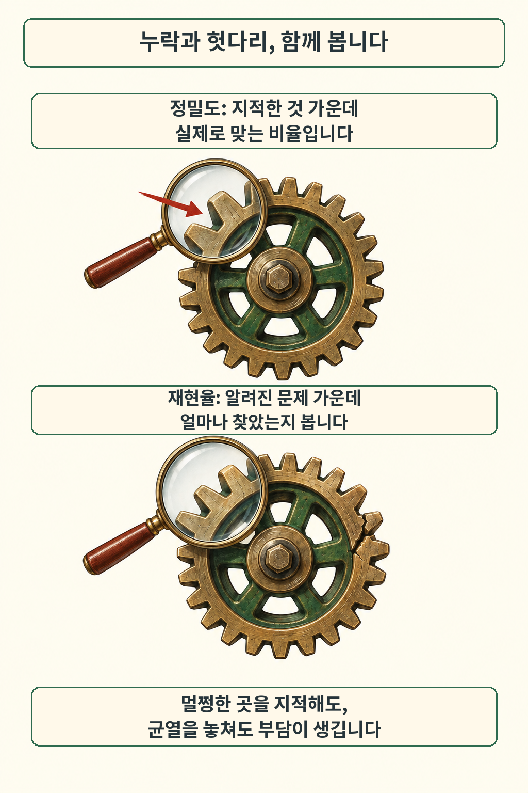
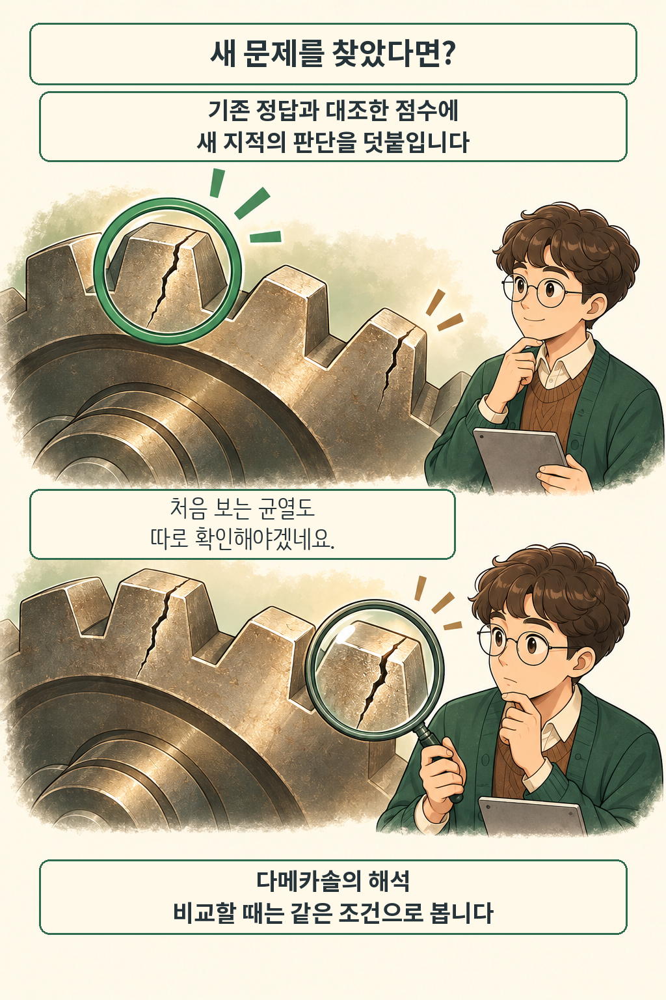

AI 코드 리뷰 도구가 PR마다 댓글을 수십 개씩 달아 주는데도, 팀 입장에서는 이 도구가 진짜 버그를 잘 잡는지 아니면 리뷰어 일감만 늘리는지 판단하기가 어렵습니다. 댓글 개수나 단편적인 탐지율만 봐서는 실제 결함 적중률과 오탐으로 인한 피로도를 함께 가늠하기 어렵거든요. 이런 평가 공백을 메우기 위해 GitHub이 2026년 10월 5일, 코드 리뷰의 누락과 헛다리를 나란히 재는 벤치마크인 **ReviewBench**를 연구 프리뷰로 공개했습니다.

글·해설: 다메카솔

## 멀쩡한 곳을 지적하고, 실제 균열은 놓친다면

그림처럼 멀쩡한 톱니를 결함으로 의심하는 실수와 시야 밖의 실제 균열을 놓치는 실수는 현장에 남기는 비용이 전혀 다릅니다. 코드 리뷰 평가에서도 도구가 지적한 내용 중 실제 결함인 비율(**정밀도**)과, 기존에 알려진 결함 중 실제로 찾아낸 비율(**재현율**)을 함께 따져 보아야 하죠. 정밀도가 낮으면 개발자가 헛된 지적을 읽고 닫는 데 시간을 쓰게 되고, 재현율이 낮으면 고쳐야 할 버그가 그대로 배포 단계로 넘어갑니다.

예를 들어 인증 토큰의 만료 검증을 수정한 PR을 AI 리뷰 도구에 맡겼다고 가정해 보겠습니다. 도구가 변수명 스타일이나 사소한 포맷팅을 문제 삼아 댓글 여러 개를 남기면 정밀도가 떨어져 리뷰어가 불필요한 알림을 정리하느라 시간을 허비합니다. 반대로 댓글 수는 적어도 예외 분기 누락 같은 치명적 버그를 지나쳤다면 재현율이 낮은 셈이죠. 이 경우에는 실제 결함이 걸러지지 않은 채 병합까지 이어질 위험이 커집니다.

GitHub은 이 두 가지 비용을 현실적인 코드베이스 맥락에서 재기 위해, 실제 PR 분포를 참고해 고른 공개 PR 219개로 평가셋을 꾸렸다고 설명합니다. 사람 리뷰어와 모델, 그리고 정적 분석 도구가 찾아낸 지적 사항을 모두 모은 뒤 중복 지적을 하나로 합쳐 공통 정답 기준을 구성했습니다([GitHub 공식 발표](https://github.blog/ai-and-ml/github-copilot/reviewbench-an-open-benchmark-for-ai-code-review/)). 덕분에 댓글을 많이 달아 주는 인상 대신, 무엇을 정답으로 인정했는지와 오탐·누락의 비율이 어떠한지를 나란히 비교할 수 있습니다. 참고로 리뷰 요청 자체를 사내 도구에 연결하는 방법은 [Copilot 코드 리뷰 API 안내](/posts/github-copilot-review-api-balanced/)에서 따로 다뤘습니다.

## 정답 목록에도 없던 새 결함을 찾았다면

실제 코드 리뷰에서는 기존 정답 목록에 미처 포함되지 않았던 타당한 결함을 에이전트가 새로 찾아내는 경우도 종종 생깁니다. 기존 표시와 다르다는 이유만으로 새 발견을 오답 처리하면 유능한 도구가 감점을 받고, 그렇다고 검증 없이 모든 새 지적을 정답으로 인정하면 공정한 비교가 흔들리거든요. ReviewBench는 이 문제를 다루기 위해 평가 지표를 **Grounded**와 **Augmented** 두 가지로 나누었습니다.

| 평가 지표 | 채점 기준 | 재현율 분모 | 주요 활용 목적 |
| --- | --- | --- | --- |
| **Grounded 지표** | 사전에 구축된 기준 정답 집합과만 대조해 채점 | 모든 평가 대상에 동일한 고정 분모 적용 | 서로 다른 시스템 간 대표 재현율 비교 |
| **Augmented 지표** | 기존 정답 외 새로운 지적도 별도 심사 후 타당한 결함만 반영 | 에이전트가 새로 찾은 결함에 따라 분모 변동 | 신규 결함 발굴 능력까지 포함한 평가 |

여기서 눈여겨볼 점은 두 지표의 **분모 차이**입니다. Augmented 지표는 에이전트가 새로운 결함을 추가로 발견할수록 재현율의 분모가 달라지는 구조라, 여러 도구의 점수를 같은 선상에서 단순 비교하기가 까다롭습니다. 그래서 GitHub도 시스템 간 대표 재현율을 겨룰 때는 동일한 고정 분모를 쓰는 Grounded 재현율을 기준선으로 삼고, 새로운 결함 발굴 능력은 Augmented 지표로 구분해 읽도록 설명합니다.

## 다메카솔의 해석: 점수 옆에 비교 조건을 함께 둡니다

벤치마크 점수를 실제 도구 선정에 옮겨 올 때는 숫자 하나만 보기보다 팀의 검증 조건을 먼저 고정해 두는 편이 좋습니다. ReviewBench의 설계 기준에 맞춰 AI 코드 리뷰 도구를 검토할 때는 다음 세 가지를 나란히 점검해 볼 만합니다.

- **비교 기준과 PR 묶음 고정**: 동일한 공개 PR 묶음과 같은 판정 기준(Grounded vs Augmented)을 맞춰 두어야 점수 차이를 정확히 해석할 수 있습니다.
- **팀 코드베이스에 맞는 지표 가중치**: 치명적인 결함 누락(낮은 재현율)을 줄이는 것이 급선무인지, 자잘한 오탐 댓글(낮은 정밀도)로 인한 피로도를 낮추는 편이 시급한지에 따라 우선순위가 달라집니다.
- **PR 운영 지표와 병행 관찰**: 벤치마크 점수와 별개로 실제 개발 흐름에서 리뷰가 도착하기까지 걸리는 시간과 병합 흐름은 [PR 리뷰 단계별 지표](/posts/github-copilot-pr-review-stage-metrics/)처럼 운영 데이터로 함께 살펴보아야 합니다.

새로운 결함을 발견할 여지를 열어 두면서도 비교의 기준선을 흔들지 않으려는 ReviewBench의 구분법은, 사내 코딩 에이전트 평가셋을 직접 만들 때도 좋은 참고가 됩니다.

## 출처

- [GitHub, ReviewBench 공개 발표 — 2026-10-05](https://github.blog/ai-and-ml/github-copilot/reviewbench-an-open-benchmark-for-ai-code-review/)
- [발표에서 연결한 ReviewBench 사이트](https://review-bench.ai/)

공개 상태와 기능 설명은 GitHub 공식 발표를 기준으로 확인했으며, 벤치마크 직접 실행이나 도구 순위 재현은 수행하지 않았습니다.

이 글의 본문과 이미지는 생성형 AI로 제작했습니다. 기획과 편집 기준은 다메카솔이 정했습니다.
