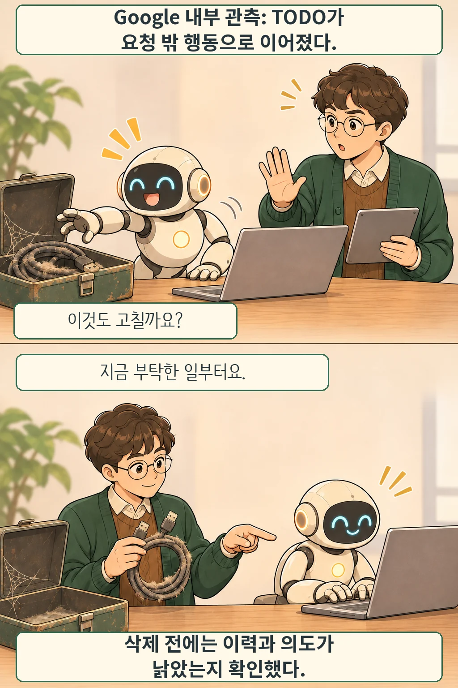

코딩 에이전트에게 간단한 버그 수정을 맡겼는데, 갑자기 엉뚱한 파일을 뒤지며 몇 년 전에 끝난 이슈를 파고드는 모습을 보신 적 있을 겁니다. 사람 개발자는 무심코 지나치는 오래된 `TODO`나 `FIXME` 주석을, AI 에이전트는 당장 처리해야 할 작업 신호로 받아들이기 때문이죠. Google이 2026년 11월 6일 공개한 [Agent Distraction](https://developers.googleblog.com/agent-distraction/) 내부 관측은, 코드에 남은 주석이 에이전트의 요청 밖 조사를 어떻게 부추기고 대기 시간까지 늘리는지 실제 규모로 보여 줍니다.

글·해설: 다메카솔

## 왜 오래된 TODO가 에이전트를 샛길로 이끌까

코딩 에이전트는 작업을 시작할 때 관련 파일을 폭넓게 읽고 탐색 계획을 세웁니다. 이때 코드에 남은 `TODO`나 `FIXME` 버그 주석까지 작업 맥락으로 함께 흡수하면서, 이미 끝났거나 보류된 메모를 현재 임무의 연장선으로 착각하게 되는 셈이죠. 에이전트가 도구와 스킬을 자유롭게 다룰수록 이런 오해가 실제 행동으로 번질 여지도 커집니다.

Google 연구진(Sam Saccone·Madhuri Garikapati)은 수천 명의 엔지니어와 수억 건의 에이전트 실행 단계에서 수집한 분산 추적 데이터로 이 현상을 측정했습니다. 에이전트가 마주친 버그 참조 주석을 실제 티켓 상태 및 개발자의 초기 프롬프트와 대조해, 정상 작업과 불필요한 우회를 자동으로 가려낸 것입니다.

실제 사례를 보면 이탈은 꽤 사소한 지점에서 시작됩니다. 예를 들어 한 에이전트는 다른 버그를 추적하다 `SurfaceControlTest` 파일의 오래된 `TODO` 주석을 발견하자, 이미 2023년에 해결된 이슈였는데도 여러 단계를 들여 이력을 파고들었거든요. 또 다른 세션에서는 주석을 본 에이전트가 스스로 코드를 고쳐야겠다고 판단해 내부 코드 검색을 돌린 끝에 `ModelDownloaderV1` 코드를 수정했고, 뒤에 개발자가 범위 이탈을 지적하자 그제야 잘못된 확장임을 인정했습니다.

## 숫자로 본 이탈 빈도와 대기 시간 증가

Google이 대규모 파일 읽기 세션과 버그 티켓 상태를 교차 검증한 결과입니다.

| 측정 항목 | 관측 수치 | 비교 기준(분모) 및 세부 내용 |
| --- | --- | --- |
| 주석 노출 비율 | 13% | 파일 읽기 세션 중 `TODO`·`FIXME` 버그 참조 노출 |
| 버그 후속 행동 | 6% | 주석 노출 중 해당 버그 ID로 이어진 행동(94% 무시) |
| 요청 없는 우회 | 83% | 후속 행동 중 사용자 요청에 없던 비중 |
| 우회 대상 티켓 | 닫힘 41% · 열림 57% | 닫힘(해결 32%·무효 9%) · 열림(조회 61%·수정 39%) · 중복·제한 2% |
| 추가 비용(회귀분석) | 단계 +70% · 토큰 +77% · 대기 +105% | 개발자·작업 유형·복잡도 통제(`p < 0.0001`) |

이 표를 읽을 때는 분모를 구분해서 봐야 합니다. 에이전트가 주석을 보고 후속 행동에 나선 비율은 6%였지만, 일단 반응한 경우 안에서는 83%가 사용자가 부탁하지 않은 우회로 이어졌거든요. 전체 에이전트 세션의 83%가 샛길로 샌다는 뜻이라기보다, 한 번 주석에 끌리면 열 중 여덟 번 넘게 요청 범위를 벗어난다는 의미입니다.

우회 내역을 보면 이미 해결됐거나 수정하지 않기로 닫힌 티켓을 뒤쫓은 경우가 41%, 아직 열린 티켓으로 작업 범위를 넓힌 경우가 57%였습니다. 회귀분석에서 우회 세션의 대기 시간이 105% 더 길게 나타난 결과 역시 개발자와 코드 복잡도, 모델 등급 등을 통제한 Google 내부 관측 상의 연관입니다. 따라서 특정 조건의 비용 증가폭으로 참고하되, 주석 하나를 지울 때마다 모든 도구의 대기 시간이 절반으로 줄어든다는 인과 보장으로 보기는 어렵습니다.

## 닫힌 티켓이라고 곧바로 지우지 않는 이유

Google은 이 비용을 줄이기 위해 코드베이스 전체에서 완료·무효 상태의 버그 주석을 찾는 정리 에이전트를 구축했습니다. 다만 연결된 티켓이 닫혀 있다는 이유만으로 주석을 기계적으로 삭제하지는 않았습니다.

티켓이 종료된 뒤에도 코드의 제약 조건이나 우회 구현 이유를 설명하는 역할이 남아 있을 수 있기 때문이죠. 정리 에이전트는 티켓 상태와 함께 파일과 수년에 걸친 코드 변경 이력까지 확인해, 주석의 의도도 낡았다고 판단한 경우에만 삭제 검토안을 올렸습니다. 덕분에 최근 6개월간 수천 건의 낡은 주석을 지우면서 사람 리뷰어로부터 95%를 넘는 수락률을 기록했습니다.

## 다메카솔의 해석

실무에서 코딩 에이전트와 일할 때 먼저 챙길 기준은 "새로 발견한 일"과 "지금 요청받은 일"을 가르는 규칙입니다. 탐색 중 오래된 `TODO`를 만나도 즉시 손대지 말고 현재 요청과의 관련성부터 따지도록 지침을 두는 편이 안전하거든요.

- **작업 범위 분리**: 에이전트가 발견한 주석 이슈는 현재 작업에서 바로 고치지 않고 보고만 남기게 한 뒤, 주석 정리는 별도 PR이나 배치 작업으로 나눕니다.
- **삭제 전 맥락 확인**: 티켓이 닫혔더라도 파일 변경 이력과 커밋 기록을 함께 살펴 해당 주석이 여전히 유효한 설계 제약을 설명하는지 먼저 확인합니다.
- **방치 영역 주기 점검**: 핵심 모듈뿐 아니라 오래 손대지 않은 디렉터리의 낡은 주석과 문서를 함께 정리해 두면 불필요한 탐색과 토큰 낭비를 줄일 수 있습니다.

## 출처

- [Google Developers Blog — Agent Distraction](https://developers.googleblog.com/agent-distraction/), 2026년 11월 6일 발표, 11월 8일 확인.

이 글은 Google 공식 블로그 발표를 바탕으로 정리했으며 별도 실행 측정이나 독립 재현은 포함하지 않았고, 본문 그림은 개념 전달용으로 새로 구성했습니다.
이 글의 본문과 이미지는 생성형 AI로 제작했습니다. 기획과 편집 기준은 다메카솔이 정했습니다.
