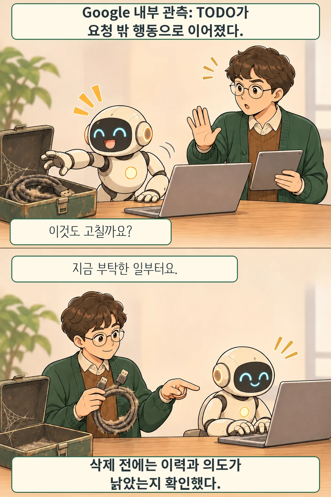

글·해설: 다메카솔

Google은 2026년 11월 6일 [Agent Distraction](https://developers.googleblog.com/agent-distraction/)에서 코드의 TODO·FIXME가 코딩 에이전트를 요청 밖 조사로 이끌 수 있다고 보고했습니다. 버그 티켓을 가리키는 주석과 실제 티켓 상태, 사용자 요청을 대조한 내부 관측입니다. 주석이 남아 있다는 사실과 지금 처리해야 할 일이라는 판단 사이에 틈이 있었습니다.

## 끝난 버그도 새 할 일처럼 보였다

Google은 주석을 접한 뒤 해당 버그를 대상으로 후속 행동한 경우가 6%였고, 그 행동의 83%는 사용자가 요청하지 않은 일이었다고 설명합니다. **모든 에이전트 세션의 83%**라는 뜻은 아닙니다. 요청하지 않은 우회 중에는 이미 닫힌 티켓을 뒤쫓는 경우와 아직 열린 티켓으로 작업 범위를 넓히는 경우가 함께 있었습니다.

그림의 로봇과 오래된 케이블은 동작을 설명하는 비유입니다. 실제 인터페이스나 관측 로그를 재현한 장면이 아닙니다.

## 시간이 늘었다는 관측의 범위

회사는 개발자·작업 종류·코드 복잡도 등을 통제한 회귀분석에서 이런 우회가 있는 세션의 대기 시간이 105% 더 길었다고 보고했습니다. Google 내부의 관측상 연관이며, TODO 하나를 지우면 모든 도구의 시간이 절반으로 줄어든다는 실험 결과는 아닙니다. 이 글에서도 독립 재현하지 않았습니다.

## 닫힌 티켓이라고 바로 지우지는 않았다

Google은 티켓뿐 아니라 파일과 코드 변경 이력까지 확인해 주석의 의도도 낡았다고 판단한 경우에만 삭제안을 검토에 보냈다고 밝혔습니다.

다메카솔의 해석: 에이전트가 새 TODO를 발견하면 현재 부탁과 관련 있는지부터 구분하는 편이 좋겠습니다. 주석 정리는 별도 작업으로 두고, 종료된 티켓이라도 남겨 둔 이유가 있는지 확인해야 합니다. 비유 속 먼지 낀 케이블도 쓰임을 확인하기 전에 버릴 수는 없습니다.

## 출처

- [Google Developers Blog — Agent Distraction](https://developers.googleblog.com/agent-distraction/), 2026년 11월 6일 발표, 11월 8일 확인.

이 글의 본문과 이미지는 생성형 AI로 제작했습니다. 기획과 편집 기준은 다메카솔이 정했습니다.
