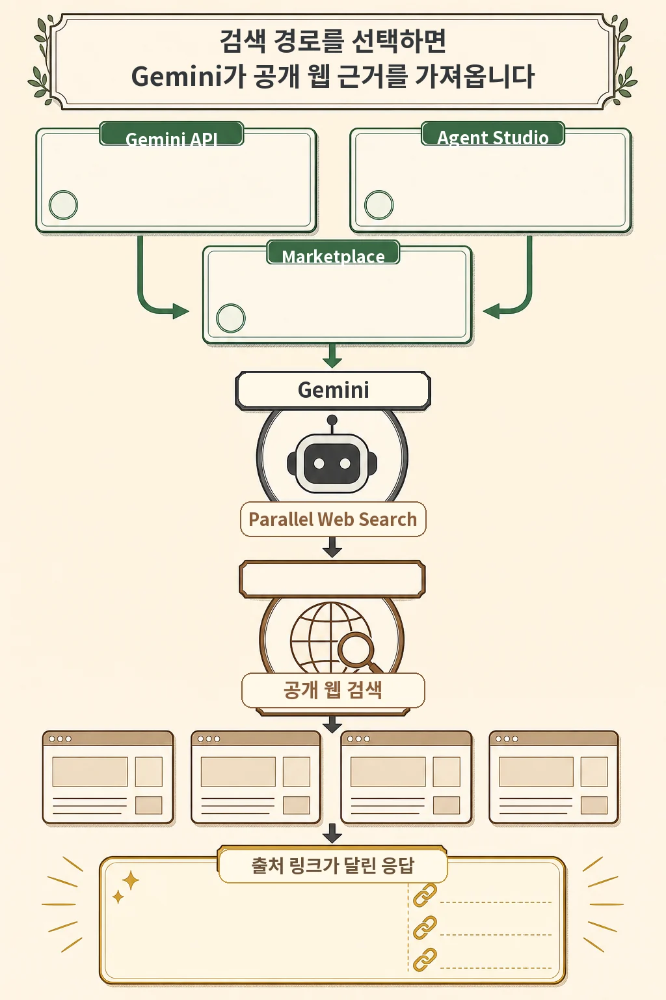
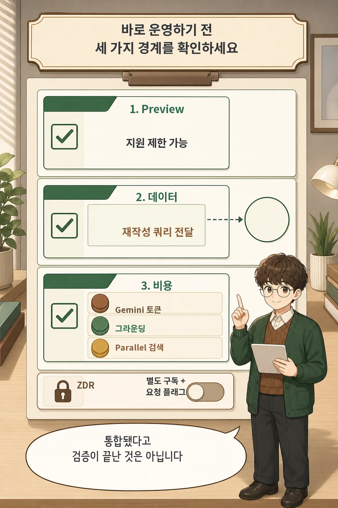

LLM 에이전트에게 최신 웹 정보를 검색해 근거 있는 답을 내놓게 하려면 모델 성능만큼이나 외부 검색 연동과 계약 조건이 중요합니다. Google은 2026년 7월 16일 **Parallel Web Search를 Gemini Enterprise Agent Platform의 네이티브 웹 그라운딩(Grounding) 옵션으로 추가**했다고 발표했는데요. 단순히 검색 기능이 하나 늘어난 것처럼 보이지만, Preview 지원 범위와 데이터 전달 경로, 복합 과금 구조까지 짚어봐야 실제 서비스에 무리 없이 적용할 수 있습니다.

글·해설: 다메카솔

## Gemini API·Agent Studio·Marketplace에서 연결하는 흐름

이번 업데이트는 Gemini 모델 자체가 바뀐 것이 아니라 에이전트가 참고할 **웹 검색 제공자 선택지가 넓어진 변화**입니다. Google 공식 발표와 문서가 안내하는 연동 경로는 두 가지입니다. Google Cloud Marketplace에서 `Grounding with Parallel Web Search`를 구독하거나 기존 Parallel API 키를 REST 요청에 실어 보낼 수 있고, 개발자는 Gemini API나 Agent Studio의 파트너 그라운딩 메뉴에서 바로 선택하면 됩니다.

예를 들어 최신 정책이나 시장 뉴스를 요약하는 리서치 에이전트를 만든다고 가정해 볼까요? 사용자가 최근 규제 발표를 물으면 Gemini가 질문에서 검색 키워드를 뽑아 Parallel Web Search로 보내고, 공개 웹 문서와 원문 URL 출처 인용을 응답에 묶어 돌려주는 셈입니다. Google은 이를 통해 더 최신이고 검증 가능한 응답을 만들 수 있으며, 검색 결과를 추출·캐시하거나 다른 LLM 후처리로 넘길 수 있다고 설명합니다. 다만 이는 제품 제공자의 설명일 뿐 검색을 붙였다고 해석 오류가 사라지는 것은 아니므로 반환된 출처의 사실성을 다시 검증해야 합니다.

## Preview 조건, 데이터 전달, 3중 과금 한눈에 보기

운영 환경에 연결하기 전에는 기능 성숙도와 데이터 처리 경계, 과금 체계를 먼저 구분해야 합니다. 공식 문서에서 이 기능은 현재 **Preview** 상태이며 Google Cloud 계약상 **별도 제공 상품(Separate Offering)**으로 분류되거든요. Pre-GA 기능은 지원 수준이 제한될 수 있으므로 핵심 서비스에 바로 연결하기보다 작은 트래픽으로 오류 대응과 대체 경로를 점검하는 편이 안전합니다.

| 점검 항목 | 공식 문서 기준 조건 | 실무 확인 포인트 |
| --- | --- | --- |
| **출시 상태** | Preview · Separate Offering | 지원 범위와 대체 경로 사전 점검 |
| **데이터 전달** | 파생·재작성된 검색 쿼리 전송 | 민감 정보·개인정보 포함 여부 분류 |
| **ZDR 설정** | 기본 비활성(전용 상품 + `enable_zero_data_retention=true`) | API 키 vs Marketplace 약관·청구 비교 |
| **과금 요소** | Gemini 토큰 + 그라운딩 + Parallel API | 모델·계약·호출량 기준 가격표 합산 |

특히 데이터 보안에서는 기본 설정을 꼼꼼히 봐야 합니다. 공식 문서는 원래 사용자 프롬프트에서 파생·재작성된 쿼리가 검색 처리를 위해 Parallel Web Search로 전달된다고 명시하고 있습니다. 외부 서버에 데이터가 남지 않아야 한다면 ZDR 전용 Marketplace 상품을 구독하고 요청에서 `enable_zero_data_retention`을 `true`로 켜야 합니다. 비용 역시 Gemini 입력·추론·출력 토큰과 데이터 그라운딩, Parallel Web Search API가 각각 청구될 수 있어 세 항목을 합산해 예산을 잡는 편이 좋습니다.

## 2026년 7월 17일 확인한 지원 모델

공식 문서가 열거하는 지원 모델은 여섯 가지이며, Preview 기간 중 바뀔 수 있어 코드 고정 전 최신 문서 재확인이 필요합니다.

- **Gemini 2.5 계열**: Gemini 2.5 Flash, Gemini 2.5 Flash-Lite, Gemini 2.5 Pro
- **Gemini 3.1·3.5 계열**: Gemini 3.1 Pro Preview, Gemini 3.1 Flash Lite, Gemini 3.5 Flash

## 다메카솔의 해석: 연결보다 검증 절차가 먼저다

네이티브 통합 덕분에 웹 근거를 붙이는 구현 단계는 한결 가벼워졌습니다. 하지만 연결이 쉬워진 것과 운영 준비가 끝난 것은 별개 문제죠. 가령 사내 보안 문서 질의와 외부 웹 질의가 섞여 들어오는 서비스라면 질문 유형을 먼저 가르고 아래 다섯 가지를 작은 테스트에서 확인해 두시기 바랍니다.

1. **지원 모델 확인**: 호출할 Gemini 모델이 지원 목록에 포함되는지 점검합니다.
2. **전달 쿼리 점검**: 어떤 사용자 입력이 재작성 검색 쿼리로 나가는지 확인합니다.
3. **ZDR 적용 여부**: 보안 요건상 ZDR 전용 구독과 요청 플래그가 필요한지 판단합니다.
4. **복합 과금 계산**: Gemini 토큰, 그라운딩 비용, Parallel 검색 API 요금을 합산합니다.
5. **출처 유효성 검증**: 인용 링크가 실제 검색 결과와 주장을 뒷받침하는지 검증합니다.

## 함께 읽을 AI 기술 글

- [AI 에이전트 경쟁과 개방형 표준의 중요성](/posts/ai-agent-competition-open-standards/)
- [LLM 에이전트 스킬 주입과 성능 회귀 방어 전략](/posts/llm-agent-skill-regression-tax/)

## 출처

- [Google Developers Blog — Expanding Choice in Gemini Enterprise Agent Platform: Introducing Grounding with Parallel Web Search](https://developers.googleblog.com/en/expanding-choice-in-gemini-enterprise-agent-platform-introducing-grounding-with-parallel-web-search/)
- [Google Cloud Documentation — Grounding with Parallel Web Search](https://docs.cloud.google.com/gemini-enterprise-agent-platform/models/grounding/grounding-with-parallel)
- [Google Cloud Documentation — Grounding overview](https://docs.cloud.google.com/gemini-enterprise-agent-platform/models/grounding/overview)

발표 자료와 공식 문서를 바탕으로 정리했으며, 별도 실행 측정은 포함하지 않았습니다.

이 글의 본문과 이미지는 생성형 AI로 제작했습니다. 기획과 편집 기준은 다메카솔이 정했습니다.
