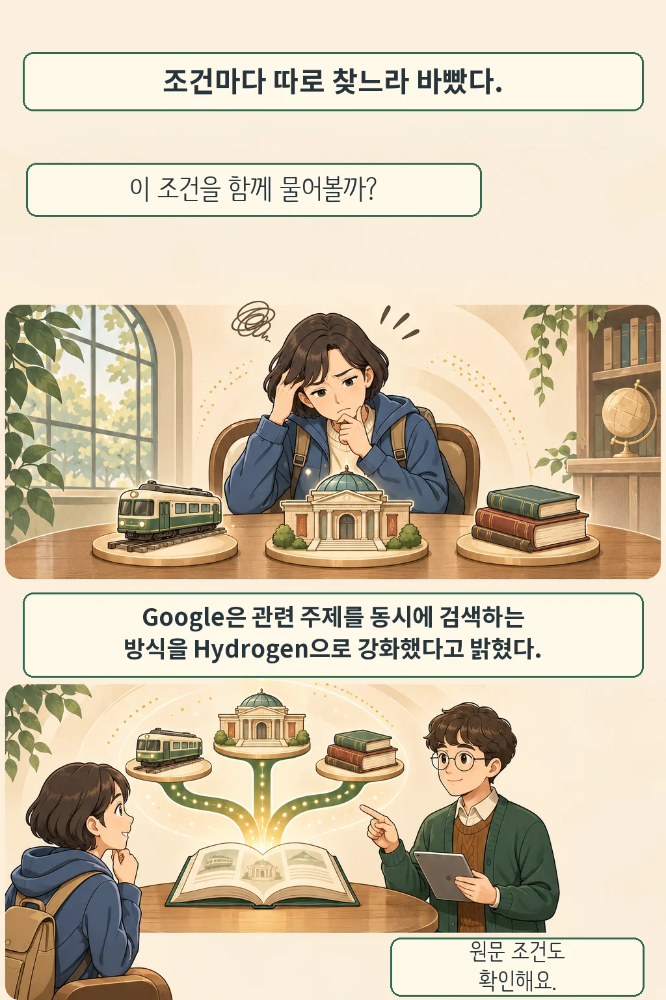

글·해설: 다메카솔

Google은 2026년 11월 12일 검색에 Gemini 4 Hydrogen을 적용했다고 발표했습니다. 회사는 전 세계 모든 사용자에게 제공한다고 안내하며, 복잡한 질문의 의도 파악·여러 하위 주제의 동시 검색·시각적 응답을 주요 변화로 꼽았습니다. 이 글은 11월 13일 확인한 공식 발표를 바탕으로 정리했습니다.

## 긴 질문을 여러 검색으로 펼치기

Google이 설명한 query fan-out은 한 질문과 관련된 여러 하위 주제를 동시에 검색하는 방식입니다. 이번 발표는 Hydrogen의 추론 능력으로 이 방식을 강화해 더 다양한 관련 사이트를 연결한다는 내용입니다. 검색을 나누는 방식 자체를 이번에 처음 만들었다는 뜻은 아닙니다.

예를 들어 여행지의 이동 시간과 실내 활동을 함께 묻는 상황을 떠올릴 수 있습니다. 서로 다른 조건을 여러 자료에서 찾아 연결해야 하는 질문입니다. 이 예시는 이해를 돕기 위한 재구성이며 실제 검색 결과를 재현한 것은 아닙니다.

## 무엇이 달라진다고 하나

Google은 여러 부분으로 나뉜 질문과 오타, 구체적인 요청을 더 잘 이해한다고 설명합니다. 또 이미지·구조화된 응답·비교표·맞춤 도구처럼 훑어보기 쉬운 결과를 늘린다고 밝혔습니다. 언어 개선 범위는 AI Mode가 지원하는 언어입니다. 모든 언어를 새로 지원한다는 발표로 읽으면 안 됩니다.

이것은 회사의 기능 설명입니다. 이 글에서는 한국 계정의 노출 여부나 응답 정확도를 직접 시험하지 않았습니다. 전 세계 제공 안내와 특정 계정에서 확인한 사용 경험은 구분합니다.

다메카솔의 해석: 조건을 한꺼번에 물을 수 있어도 중요한 결정에 쓸 정보는 연결된 원문에서 날짜와 조건을 확인하는 편이 좋습니다. 기업용 에이전트가 외부 웹 근거를 붙이는 구조는 [Parallel 웹 검색 연동 해설](/posts/google-gemini-parallel-web-search/)에서 별도로 다룹니다. 그 연동과 이번 일반 Google 검색 업데이트는 다른 기능입니다.

그림의 갈림길과 자료 묶음은 검색 흐름의 비유이며 실제 제품 화면이 아닙니다.

## 출처

- [Google 공식 발표](https://blog.google/products-and-platforms/products/search/gemini-4-hydrogen-search-upgrade/): 2026년 11월 12일. 기능과 제공 범위의 단일 출처.

이 글의 본문과 이미지는 생성형 AI로 제작했습니다. 기획과 편집 기준은 다메카솔이 정했습니다.
