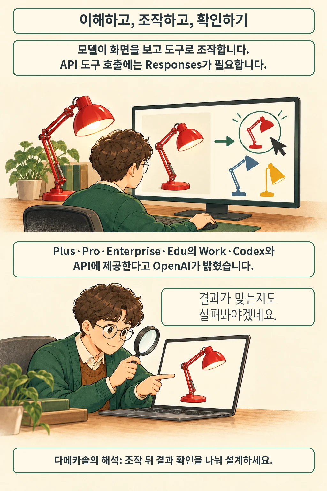

OpenAI는 2026년 10월 26일 GPT-6.1 Terra를 공개했습니다. 시각 추론과 컴퓨터 조작, 글쓰기를 겨냥한 모델입니다. 발표에 명시된 제공 대상은 ChatGPT Work·Codex의 Plus·Pro·Enterprise·Edu 사용자와 API 개발자입니다. 개별 계정의 표시 여부까지 확인한 것은 아닙니다.

글·해설: 다메카솔

## 화면을 읽은 뒤 도구로 행동합니다

상품 사진을 보고 카탈로그의 같은 물건을 찾는 일을 떠올려 보세요. 물건을 알아보는 판단에 화면 클릭 같은 행동이 이어져야 작업이 끝납니다. OpenAI는 이런 시각 작업과 컴퓨터 사용을 Terra의 용도로 소개합니다. 아래 만화는 이 흐름을 설명하는 가상 예시입니다.

API 모델 ID는 `gpt-6.1-terra`입니다. 공식 문서는 텍스트·이미지 입력과 텍스트 출력을 명시하며, 도구 호출에는 **Responses API**가 필요하다고 설명합니다. `computer_use`도 지원 도구에 포함됩니다. 앱 화면을 조작하는 능력과 모델이 직접 받는 입력 형식은 별개입니다. 문서상 오디오·비디오 입력은 지원하지 않습니다.

## 표준 토큰 가격과 한 번의 작업 비용은 다릅니다

2026년 10월 27일 확인한 표준 API 가격입니다. 토큰은 모델이 처리하는 텍스트 등의 계산 단위이며, 아래 값은 **각 100만 토큰당 달러 가격**입니다.

| 항목 | 표준 가격 |
| --- | ---: |
| 입력 | $1 |
| 캐시된 입력 읽기 | $0.05 |
| 출력 | $5 |

입력이 **272K 토큰을 넘으면 전체 요청**에 입력·캐시 요금 2배, 출력 요금 1.5배가 적용됩니다. 도구 이용료와 별도의 캐시 쓰기 요금도 총비용에 영향을 줍니다. 따라서 이 표만으로 화면 작업 한 건의 비용을 정할 수는 없습니다.

## 자체 평가를 읽을 때 남겨야 할 조건

OpenAI는 오류를 유도하는 내부 평가에서 낮은 추론 노력 설정의 오류율이 GPT-5.6 Terra 53.6%에서 GPT-6.1 Terra 16.7%로 낮아졌다고 보고했습니다. 이 수치는 해당 평가의 결과입니다. 모든 질문의 정확도나 한국어 업무 성공률로 바꿔 읽어서는 안 됩니다. 이번 글에서는 모델을 직접 실행하거나 결과를 독립 재현하지 않았습니다.

**다메카솔의 해석:** 사진 속 상품을 찾는 자동화를 만든다면 ‘대상을 알아보기 → 필요한 조작 수행 → 저장된 결과 확인’을 나눠 설계하는 편이 좋겠습니다. 화면을 잘 읽는다는 평가만으로 마지막 저장 결과까지 맞다고 가정할 수는 없기 때문입니다. 이전 모델군의 역할은 [GPT-5.6 출시 정리](/posts/gpt-5-6-launch/)와 이어서 볼 수 있습니다.

## 출처

- [OpenAI — Introducing GPT-6.1 Terra](https://openai.com/index/introducing-gpt-6-1-terra/) · 발표 및 자체 평가
- [OpenAI — GPT-6.1 Terra 모델 문서](https://developers.openai.com/api/docs/models/gpt-6.1-terra) · 입력·출력, 도구, 가격 조건
- [OpenAI 뉴스 RSS](https://openai.com/news/rss.xml) · 발표 날짜 확인

이 글의 본문과 이미지는 생성형 AI로 제작했습니다. 기획과 편집 기준은 다메카솔이 정했습니다.
