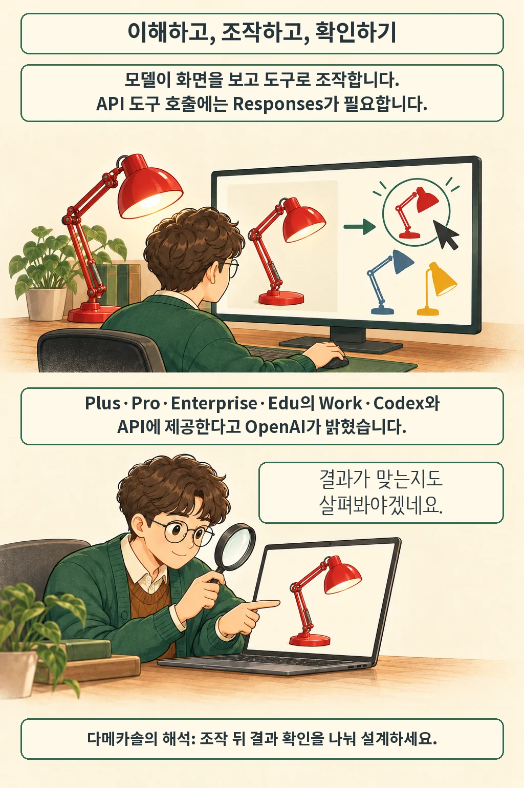

화면 속 상품 사진을 보고 카탈로그에서 같은 물건을 찾아 클릭까지 해 주는 자동화를 붙일 때, 가장 걸리는 대목은 속도와 토큰 비용입니다. 추론 능력이 좋은 최상위 모델은 매 턴 화면 이미지를 넘기기엔 단가가 높고, 반대로 가벼운 모델은 UI 조작 과정에서 엉뚱한 버튼을 누르기 쉽거든요. OpenAI가 2026년 10월 26일 공개한 **GPT-6.1 Terra**는 바로 이 지점을 겨냥해 시각 추론과 컴퓨터 조작, 글쓰기를 한데 묶어 내놓은 모델입니다.

글·해설: 다메카솔

## 화면 이해에서 도구 조작까지, 지원 범위와 API 조건

가령 인보이스를 읽어 회계 시스템에 입력하거나 상품 사진에 맞는 카탈로그 항목을 찾는 업무를 떠올려 보죠. OpenAI는 Terra가 이런 반복 화면 조작과 도면 해석, 양식 입력, 영상 편집 작업을 이어 갈 수 있다고 소개합니다. 발표와 동시에 **ChatGPT Work·Codex의 Plus·Pro·Enterprise·Edu 사용자**에게 열렸고, API에서는 `gpt-6.1-terra` 모델 ID를 통해 곧바로 호출할 수 있습니다.

API로 붙일 때는 모델이 화면을 다루는 능력과 직접 받는 입력 형식을 구분해야 합니다. 공식 모델 문서를 보면 Terra는 **텍스트·이미지 입력과 텍스트 출력**만 지원하며, 오디오와 비디오 모달리티는 지원 목록에서 빠져 있습니다. 따라서 영상 편집 작업 역시 앱 화면을 보고 도구를 조작하는 흐름이지, 동영상 파일을 모델에 직접 넘기는 구조와는 다릅니다. 여기에 `computer_use` 같은 도구를 호출하려면 일반 Chat Completions가 아니라 **Responses API**를 선택해야 하죠.

## 표준 토큰 단가와 실제 작업 비용의 차이

OpenAI는 Terra의 표준 API 가격을 이전 세대나 GPT-6.1 Sol 대비 절반 수준으로 낮췄다고 밝혔습니다. 2026년 10월 27일 확인한 공식 모델 문서의 표준 텍스트 토큰 가격은 **백만 토큰당 달러** 기준입니다.

| 과금 항목 | 표준 단가 (100만 토큰당) | 조건 및 비고 |
| --- | ---: | --- |
| 입력 (Input) | $1 | 272K 초과 시 요청 전체 2배 |
| 캐시된 입력 읽기 | $0.05 | 일반 입력의 5%, 272K 초과 시 2배 |
| 캐시 쓰기 (30분) | $1.25 | 12시간 보존은 $2.50 |
| 출력 (Output) | $5 | 272K 초과 시 요청 전체 1.5배 |

단가표만 보면 가볍게 느껴지지만 실제 작업 비용을 좌우하는 조건이 함께 붙습니다.

- **272K 토큰 경계 할증**: 입력이 **272K 토큰**을 넘으면 초과분만이 아니라 **요청 전체**에 입력·캐시 2배, 출력 1.5배 요금이 적용됩니다. 컨텍스트 창은 1,050,000 토큰(최대 입력 922,000, 최대 출력 128,000)까지 지원하지만, 스크린샷을 무작정 누적하면 비용이 금세 뛰어오릅니다.
- **도구 호출료와 처리 모드**: `computer_use` 같은 도구 이용료와 캐시 쓰기 요금은 별도로 붙고, 급하지 않은 작업은 Batch나 Flex 모드로 표준 가격보다 **50% 저렴**하게 돌릴 수 있습니다.

## 자체 평가 수치를 실무 기대치로 옮길 때

비용이 내려간 만큼 오류 억제력도 확인해야겠죠. OpenAI가 공개한 자체 평가 지표를 보면 이전 세대 대비 환각 억제와 코딩·컴퓨터 조작 점수가 크게 올라왔습니다.

| 평가 항목 | 추론 설정 | GPT-5.6 Terra | GPT-6.1 Terra | 비고 |
| --- | --- | ---: | ---: | --- |
| 내부 오류 유도 평가 (오류율) | `low` | 53.6% | 16.7% | `max` 설정 시 4.3%까지 하락 |
| Terminal-Bench 4.0 (해결률) | `max` | 21.5% | 50.3% | 고난도 코딩은 Sol·Astra 권장 |
| Agents' Last Exam (전문 작업) | `medium` | 비교 기준 | +15%p | 작업당 추정 비용 약 1/3 수준 |

다만 오류 유도 평가는 환각을 유발하도록 설계된 내부 기준이므로, 일반 질의나 한국어 업무 환경의 성공률과 동일시하기는 어렵습니다. 코딩 영역 역시 가장 복잡한 문제에서는 여전히 상위 라인업인 GPT-6.1 Sol과 GPT-6 Astra를 권장합니다. 이전 세대 모델의 역할 차이는 [GPT-5.6 출시 정리](/posts/gpt-5-6-launch/) 글에서 이어서 확인하실 수 있습니다.

### 다메카솔의 해석: 인식·조작·확인을 나눠 설계하세요

실무에서 카탈로그 매칭처럼 데이터 변경이 따르는 자동화를 만든다면 **① 대상 인식 → ② 도구 조작 → ③ 저장 결과 확인**을 분리해 두는 편이 좋습니다. 화면을 잘 읽고 오류율이 낮아졌더라도, UI 로딩 지연이나 화면 변화 때문에 엉뚱한 항목이 선택될 여지는 남기 때문이죠.

예를 들어 상품 사진과 일치하는 항목을 찾는 흐름에서도 `computer_use`가 클릭을 수행한 뒤 곧바로 완료 처리하기보다, 저장된 결과를 다시 검증하거나 확정 전 확인 절차를 한 단계 두는 쪽이 안전합니다. 추론 노력(reasoning effort) 역시 기본값(`medium`)에서 출발해 작업 난이도에 따라 `low`나 상위 설정으로 조절해 볼 만합니다.

## 출처

- [OpenAI — Introducing GPT-6.1 Terra](https://openai.com/index/introducing-gpt-6-1-terra/) · 발표 및 자체 평가
- [OpenAI — GPT-6.1 Terra 모델 문서](https://developers.openai.com/api/docs/models/gpt-6.1-terra) · 입력·출력, 도구, 가격 조건
- [OpenAI 뉴스 RSS](https://openai.com/news/rss.xml) · 발표 날짜 확인

이 글은 공개된 발표 자료와 공식 모델 문서를 바탕으로 정리했으며, 모델 실행이나 벤치마크 독립 재현은 포함하지 않았습니다.
이 글의 본문과 이미지는 생성형 AI로 제작했습니다. 기획과 편집 기준은 다메카솔이 정했습니다.
