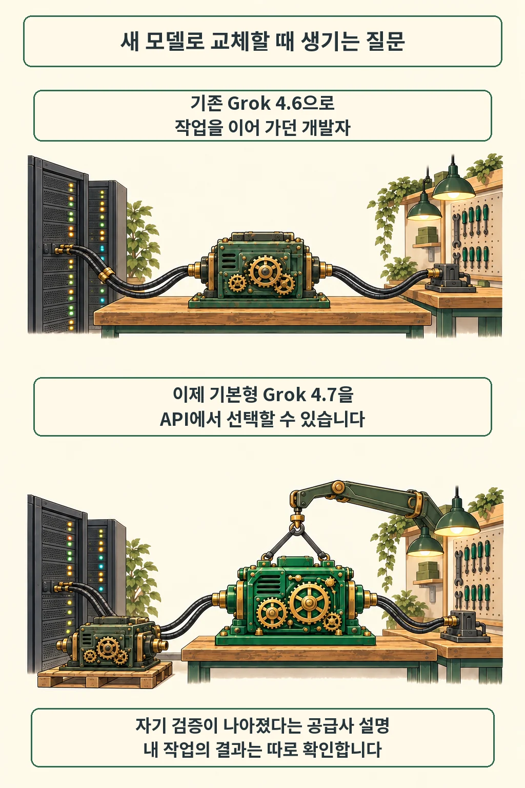
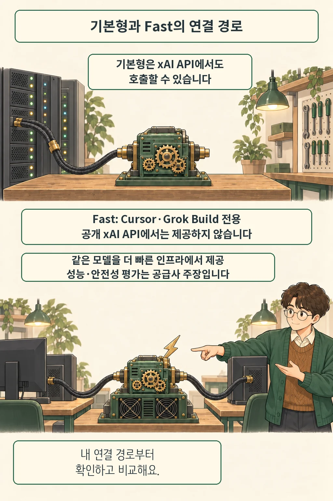

새 모델을 서비스에 붙이려면 모델 이름 다음으로 실제 호출 가능한 경로부터 확인해야 합니다. SpaceXAI는 2026년 9월 21일 [Grok 4.7](https://x.ai/news/grok-4-7)을 공개하면서 기본형(`grok-4.7`)을 xAI API에 출시했지만, 함께 소개한 고속 버전 **Fast**는 Cursor와 Grok Build 전용으로만 제공한다고 안내했습니다. 9월 22일 확인한 공식 발표와 개발자 문서를 바탕으로 제공 경로와 가격, 다중 턴 연동 조건을 정리합니다.

글·해설: 다메카솔

Updated: 2026-09-22

## API에서는 기본형, 코딩 도구에서는 Fast

[공식 개발자 문서](https://docs.x.ai/developers/grok-4-7)에 따르면 기본형 모델 식별자는 `grok-4.7`이며, 기존 모델 호출이 자동으로 전환되지는 않으므로 API 요청에서 모델명을 직접 지정해야 합니다. SpaceXAI는 더 큰 기반 모델과 강화학습을 통해 장시간 코딩 과제와 자기 검증, 문맥 관리 성능을 높였고 Grok 4.6과 동일한 가격·속도로 제공한다고 설명합니다(앞서 다룬 [Grok 4.6의 GitHub Copilot 합류](/posts/grok-4-6-github-copilot-availability/)는 별도 플랫폼 경로이므로 이번 출시에 그대로 대입할 수 없습니다).

반면 더 빠른 추론 인프라에서 같은 모델을 돌리는 **Grok 4.7 Fast**(토큰 단가는 기본형의 2배 안내)는 제공 경로가 제한돼 있습니다.

- **기본형 (`grok-4.7`)**: 공개 xAI API, Grok Build, Cursor 및 모델 게이트웨이에서 이용 가능
- **Grok 4.7 Fast**: **Cursor와 Grok Build(유료 등급) 전용**으로만 제공되며, 공개 xAI API나 Grok Build 무료 등급에서는 호출할 수 없음

따라서 자체 백엔드 서버에서 API로 직접 호출하려는 팀은 기본형 `grok-4.7`을 기준으로 검토해야 합니다.

## 50만 토큰 문맥 창과 구간별 단가표

[모델 사양 문서](https://docs.x.ai/developers/models/grok-4.7)에 기재된 `grok-4.7`의 최대 문맥 창은 **50만 토큰**이며, 텍스트·이미지를 입력받아 텍스트를 출력하고 추론 강도(`low`, `medium`, `high`, `xhigh`, 기본값 `high`) 설정을 지원합니다. [9월 21일 릴리스 노트](https://docs.x.ai/developers/release-notes)에 공지된 공개 API 기본형 단가(미국 달러, 100만 토큰당 기준)는 프롬프트 길이에 따라 두 구간으로 나뉩니다.

| 기본형 프롬프트 길이 구간 | 입력 단가 | 캐시 입력 단가 | 출력 단가 |
| --- | ---: | ---: | ---: |
| 20만 토큰 미만 | $2.00 | $0.50 | $6.00 |
| 20만 토큰 초과 | $4.00 | $1.00 | $12.00 |

*참고: 원문의 미만·초과 표기 기준이며, 별도 도구 호출 비용이나 리전별 엔드포인트 조건은 개발자 문서에서 추가로 확인해야 합니다.*

## 다메카솔의 해석: 다중 턴 추론 필드 보존과 작업 단위 비교

모델 교체를 검토할 때는 단일 응답 속도뿐 아니라 **하나의 코딩 과제가 테스트를 통과해 끝날 때까지 걸린 총시간과 재시도 횟수**를 함께 비교해야 합니다. 첫 응답이 빨라도 수정 재시도가 늘어나면 전체 작업 비용과 시간은 오히려 커질 수 있기 때문입니다.

특히 기존 어댑터 코드를 `grok-4.7`로 옮길 때 꼭 확인해야 할 API 동작 변경이 하나 있습니다. 공식 문서에 따르면 **Responses API**로 다중 턴 대화를 이어 갈 때 `grok-4.7`은 요청의 `include` 설정과 무관하게 `reasoning.encrypted_content`를 반환하며, 다음 턴 요청의 `input`에 이 추론 항목을 수정 없이 그대로 다시 전달해야 합니다(Chat Completions API는 기존 방식 유지). 이전 응답에서 일반 텍스트만 추려 다음 턴에 넘기던 래퍼 코드를 쓰고 있다면 이 필드가 누락되지 않는지 먼저 점검해 보기를 권합니다.

## 출처

- [SpaceXAI — Introducing Grok 4.7](https://x.ai/news/grok-4-7): 2026년 9월 21일 발표(성능·안전장치 개선 설명은 공급사 자체 발표 기준).
- [SpaceXAI Docs — Grok 4.7 overview](https://docs.x.ai/developers/grok-4-7): 기본형·Fast 제공 경로 및 Responses API 다중 턴 연동 안내.
- [SpaceXAI Docs — Grok 4.7 model](https://docs.x.ai/developers/models/grok-4.7) 및 [Release Notes](https://docs.x.ai/developers/release-notes): 2026년 9월 22일 확인, 문맥 창·추론 강도·가격 구간 확인(실제 API 호출 벤치마크는 수행하지 않음).

이 글의 본문과 이미지는 생성형 AI로 제작했습니다. 기획과 편집 기준은 다메카솔이 정했습니다.
