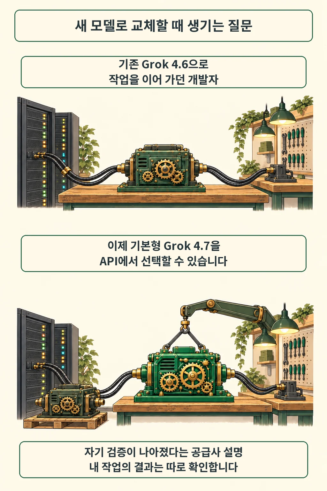
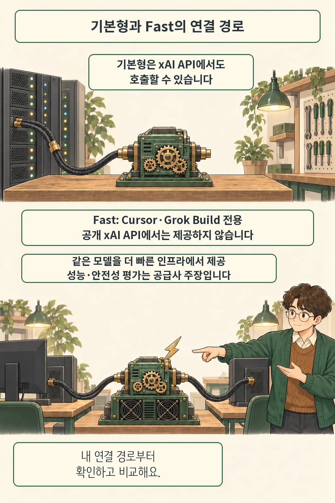

새 코딩 모델을 서비스에 붙일 때는 모델 이름보다 실제로 어디에서 호출할 수 있는지부터 따져 보게 됩니다. SpaceXAI가 2026년 9월 21일 공개한 [Grok 4.7](https://x.ai/news/grok-4-7)은 기본형을 공개 API로 내놓았지만, 고속 버전인 **Fast**는 전용 코딩 도구에만 묶어 두었거든요. 출시 이튿날 확인한 공식 문서와 릴리스 노트를 바탕으로 제공 경로와 과금 기준, 다중 턴 연동에서 놓치기 쉬운 변경점까지 짚어 보겠습니다.

글·해설: 다메카솔

Updated: 2026-09-22

## API에서는 기본형, 코딩 도구에서는 Fast

[공식 개발자 문서](https://docs.x.ai/developers/grok-4-7)에 따르면 기본형 모델 식별자는 `grok-4.7`이며, 기존 호출이 자동으로 새 모델로 넘어가지 않으므로 API 요청에서 모델명을 직접 지정해야 합니다. SpaceXAI는 더 큰 기반 모델과 긴 강화학습을 거쳐 장시간 코딩 과제, 자기 검증, 문맥 관리 성능과 안전장치를 높였고 기존 Grok 4.6과 같은 가격·속도로 제공한다고 설명합니다. 공급사가 밝힌 개선 주장이므로 실제 서비스에서의 체감 품질은 따로 확인하는 편이 안전합니다(앞서 다룬 [Grok 4.6의 GitHub Copilot 합류](/posts/grok-4-6-github-copilot-availability/)는 별도 플랫폼 경로라 이번 출시에 그대로 대입하기는 어렵습니다).

같은 모델이라도 어떤 경로로 연결하느냐에 따라 쓸 수 있는 변형이 갈립니다. 고속 추론 인프라에서 같은 모델을 돌리는 **Grok 4.7 Fast**는 토큰 단가가 기본형의 2배로 책정됐는데, 접근 경로가 특정 코딩 도구로 제한돼 있거든요.

예를 들어 개발자가 에디터에서 Cursor나 유료 Grok Build로 Fast의 빠른 응답을 경험한 뒤, 사내 자동 코드 리뷰 서버에서도 같은 속도를 내려면 공개 API 키로 Fast를 부르면 될 것이라 기대하기 쉽습니다. 하지만 공개 xAI API와 Grok Build 무료 등급에서는 Fast가 제공되지 않으므로, 자체 백엔드 파이프라인을 설계할 때는 처음부터 기본형 기준으로 지연 시간과 예산을 잡아야 하는 셈이죠.

- **기본형 (`grok-4.7`)**: 공개 xAI API, Grok Build, Cursor 및 모델 게이트웨이에서 이용 가능
- **Grok 4.7 Fast**: **Cursor와 Grok Build(유료 등급) 전용**으로만 제공되며, 공개 xAI API와 Grok Build 무료 등급에서는 미제공(토큰 단가는 기본형의 2배 안내)

## 50만 토큰 문맥 창과 구간별 단가표

[모델 사양 문서](https://docs.x.ai/developers/models/grok-4.7)와 [릴리스 노트](https://docs.x.ai/developers/release-notes)를 보면 기본형 모델은 긴 코드베이스를 다루기 위한 넉넉한 문맥 창과 단계별 추론 강도 조절을 지원합니다. 특히 프롬프트 길이에 따라 단가가 두 배로 달라지는 경계가 있어서, 긴 저장소 문맥을 한꺼번에 넘기는 워크플로라면 2026년 9월 22일 확인 기준 과금 구간을 미리 짚고 넘어가야 하죠.

- **최대 문맥 창 및 입출력**: 최대 50만 토큰 지원, 텍스트·이미지 입력 및 텍스트 출력
- **추론 강도 설정**: `low`, `medium`, `high`, `xhigh` 4단계 지원(기본값 `high`)
- **단가 산정 기준**: 미국 달러 기준 100만 토큰당 과금(Fast는 Cursor·Grok Build 전용으로 기본형의 2배 단가 안내)

| 기본형 프롬프트 길이 구간 | 입력 단가 | 캐시 입력 단가 | 출력 단가 |
| --- | ---: | ---: | ---: |
| 20만 토큰 미만 | $2.00 | $0.50 | $6.00 |
| 20만 토큰 초과 | $4.00 | $1.00 | $12.00 |

프롬프트가 20만 토큰을 넘어서는 순간 입력·캐시·출력 단가가 일제히 두 배로 올라가므로, 반복 참조하는 규칙이나 파일 묶음은 캐시 입력으로 처리되도록 프롬프트 구조를 다듬는 편이 유리합니다. 위 표는 원문의 미만·초과 표기 기준이며, 별도 도구 호출 비용이나 리전별 엔드포인트 조건은 개발자 문서에서 추가로 확인해야 합니다.

## 다메카솔의 해석: 다중 턴 추론 필드 보존과 작업 단위 비교

기존 에이전트 어댑터를 새 모델로 옮길 때 코드 레벨에서 꼭 챙겨야 할 동작 변경이 있습니다. 공식 문서에 따르면 `grok-4.7`을 **Responses API**로 호출해 다중 턴 대화를 이어 갈 때는 요청의 `include` 설정과 관계없이 `reasoning.encrypted_content`가 반환되며, 다음 턴 요청의 `input`에 이 추론 항목을 수정 없이 그대로 다시 전달해야 합니다.

가령 이전 모델에서 쓰던 래퍼 코드가 응답에서 일반 텍스트만 추려 다음 턴 문맥으로 조립한다면, `reasoning.encrypted_content`가 중간에 빠지면서 모델이 직전 턴의 추론 맥락을 이어 가기 어려워집니다. 반면 **Chat Completions API**는 기존 방식을 유지하므로, 어떤 엔드포인트를 쓰느냐에 따라 상태 전달 로직부터 먼저 점검할 필요가 있죠.

결국 모델 교체를 검토할 때는 단일 응답 속도보다 **하나의 코딩 과제가 테스트를 통과해 끝날 때까지 걸린 총시간(지연)과 재시도 횟수, 총비용**을 함께 비교해야 합니다. 첫 응답이 빨라도 수정 재시도가 늘어나면 전체 작업 비용과 시간은 오히려 커지기 마련이거든요. 따라서 기본형 `grok-4.7`과 기존 모델을 비교할 때는 동일한 과제와 도구 권한, 문맥 길이를 고정해 회귀 검증을 수행한 뒤 테스트 결과와 작업 단위 비용으로 전환 여부를 판단하기를 권합니다.

## 출처

- [SpaceXAI — Introducing Grok 4.7](https://x.ai/news/grok-4-7): 2026년 9월 21일 발표(성능·자기 검증·안전장치 개선 설명은 공급사 자체 발표 기준).
- [SpaceXAI Docs — Grok 4.7 overview](https://docs.x.ai/developers/grok-4-7): 기본형·Fast 제공 경로 및 Responses API 다중 턴 연동 안내.
- [SpaceXAI Docs — Grok 4.7 model](https://docs.x.ai/developers/models/grok-4.7) 및 [Release Notes](https://docs.x.ai/developers/release-notes): 2026년 9월 22일 확인, 문맥 창·추론 강도·가격 구간 확인.

공급사 발표 자료와 공식 개발자 문서를 대조해 정리했으며, 별도 API 호출 벤치마크나 독립 성능·안전성 검증은 수행하지 않았습니다.

이 글의 본문과 이미지는 생성형 AI로 제작했습니다. 기획과 편집 기준은 다메카솔이 정했습니다.
