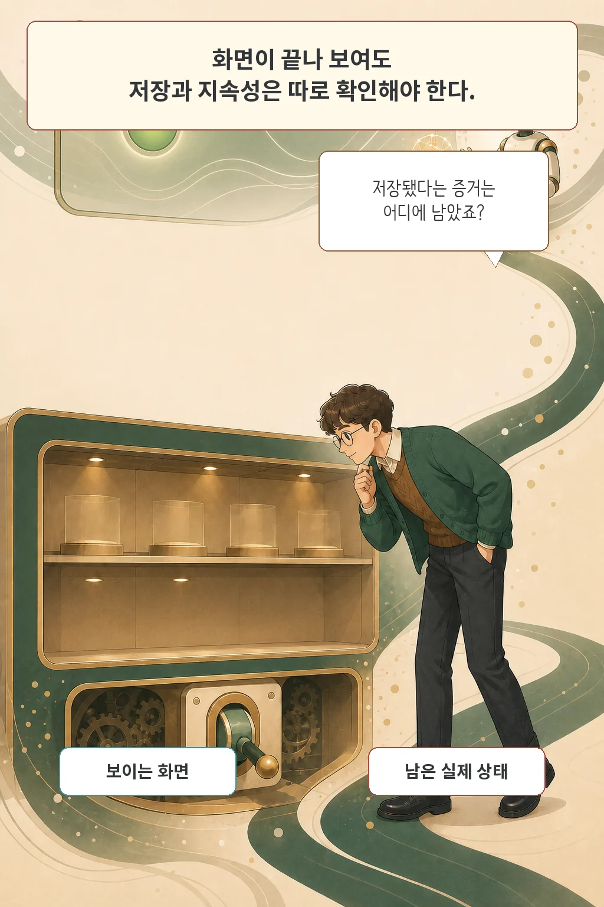
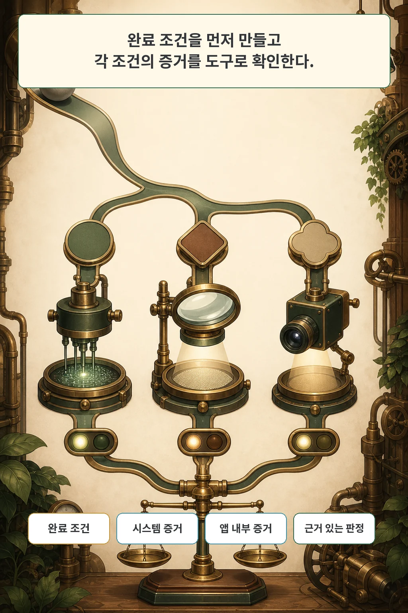
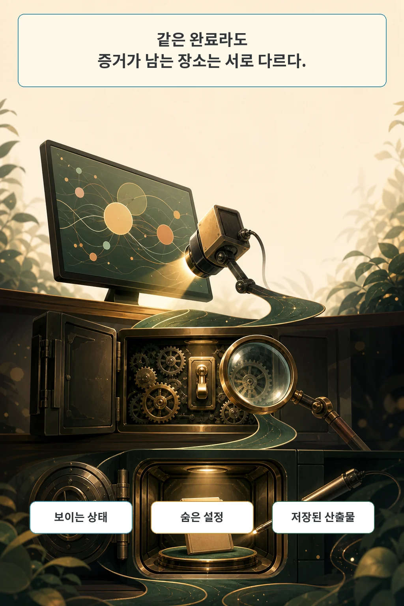
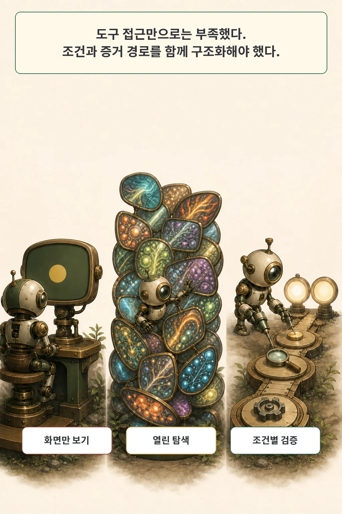

완료 화면이 떴다는 사실이 곧 작업이 끝났다는 증거는 아닙니다. 2026년 7월 28일 공개된 **Interactive Reward Agent: GUI Task Evaluation via Environment-State Verification**은 데스크톱 GUI 에이전트가 작업을 마쳤는지 평가할 때 마지막 스크린샷 한 장만 보지 말고, 저장된 파일·지속 설정·애플리케이션 내부 상태를 직접 확인하자고 제안합니다.

저자들이 설계한 **Interactive Reward Agent(IRA)**는 먼저 작업 지시를 세부 완료 조건으로 분해한 뒤, 시스템·애플리케이션·GUI 도구 가운데 가장 적합한 수단을 골라 실제 환경 상태에서 증거를 수집합니다.

글·해설: 다메카솔

## 핵심 내용

- **화면(Visible) 너머의 상태 검증**: 10개 Ubuntu 데스크톱 앱 범주의 안정적인 작업 궤적 321개로 구성된 `GUI-RewardBench`에서, 화면만으로 판정 가능한 과제는 40개에 불과했고 산출물 내부 검증(`artifact verification`, 192개)과 숨은 설정 검증(`hidden state`, 89개)이 대다수를 차지했습니다.
- **완료 조건 분해와 정확도 향상**: 가장 성능이 높았던 수동형(passive) 기준선 DistRL(정확도 78.8%, F1 76.7%) 대비 GPT-5.5 기반 IRA는 평균 약 3.3회의 검증 단계를 거쳐 **정확도 86.9%, F1 84.9%**를 기록했습니다(동일 백본 비교 시 정확도 6.2~9.1%포인트 상승).
- **강화학습 보상 및 인간 판정 일치도**: OSWorld 과제에서 IRA를 강화학습 보상으로 썼을 때 성공률 34.0%(자동 생성 과제 결합 시 33.5%)를 기록해 정답 스크립트 보상(34.9%)에 근접했으며, 100개 표본에 대한 인간 평가자와의 일치도는 94.0%(Cohen's kappa 0.84)였습니다.

## 화면이 멀쩡해도 저장은 실패할 수 있다

최종 스크린샷 한 장이 증명하는 것은 그 순간 모니터에 그려진 픽셀뿐입니다. 파일이 지정한 경로에 제대로 저장됐는지, 설정 변경이 앱을 껐다 켜도 유지되는지, 혹은 백그라운드 명령으로 바뀐 값이 화면에 아직 갱신되지 않았는지는 스크린샷만으로 알 수 없습니다.

실제로 논문의 스프레드시트 사례에서는 에이전트가 명령줄로 파일 값을 올바르게 고쳤지만 화면이 갱신되지 않아 화면 기반 평가기가 실패로 오판한 반면, IRA는 파일을 직접 열어 정답임을 확인했습니다. 반대로 VLC 미디어 플레이어 사례에서는 현재 창 모양만으로는 설정의 영구 반영 여부를 알 수 없어 설정(config) 파일을 직접 읽어 판정했습니다.

## 완료 조건을 먼저 쪼개고 세 갈래 증거를 모은다

IRA는 곧바로 성공·실패를 찍지 않고, 작업 지시와 초기·최종 화면을 분석해 **반드시 충족해야 할 완료 조건(completion conditions)**을 먼저 나눕니다. 예를 들어 “프레젠테이션을 이미지로 내보내 바탕화면에 저장하라”는 지시라면 파일 존재 여부, 이미지 형식, 실제 내용이 각각의 완료 조건이 됩니다.

저자들은 검증에 필요한 증거를 세 유형으로 분류하고 각 조건마다 독립적인 검증 루프(verification loop)를 붙였습니다.

| 증거 유형 | GUI-RewardBench 비중 (총 321개) | 확인 대상 및 활용 도구 |
| --- | --- | --- |
| **산출물 검증 (Artifact verification)** | **192개 (59.8%)** | 문서, 스프레드시트, 프레젠테이션, 이미지, PDF 등 저장된 파일의 실제 내용과 내부 구조를 시스템·애플리케이션 도구로 직접 열람 |
| **숨은 상태 (Hidden state)** | **89개 (27.7%)** | 시스템 환경 설정, 기본 앱 지정, preference 파일 등 UI 뒤에 남는 지속 상태를 시스템 명령·설정 파일로 확인 |
| **보이는 상태 (Visible state)** | **40개 (12.5%)** | 화면에서 직접 확인 가능한 UI 요소를 GUI 도구와 스크린샷으로 확인 |

충족된 조건의 비율은 연속적인 보상 점수(scalar reward)가 되며, 벤치마크의 이진 분류에서는 이 비율이 `0.8`을 넘을 때 최종 성공으로 판정했습니다.

## 재생 환경의 흔들림을 보정한 벤치마크와 절제 실험

연구진은 327개 후보 궤적을 여러 가상머신(VM)에서 3회씩 재생해 최종 상태가 흔들리는 6개를 걸러내고, 10개 Ubuntu 데스크톱 앱 범주의 321개 궤적(짧은 작업부터 80단계 이상 장기 작업 포함)을 남겼습니다. 특히 실시간 재생 중 비동기 동작이나 네트워크 변동으로 상태가 미세하게 달라질 수 있으므로, 각 평가기가 조사를 마친 직후 과제별 정답 스크립트(task-specific script)를 돌려 **그 평가기가 실제로 마주한 최종 상태 기준의 정답 라벨**을 다시 계산해 공정성을 맞췄습니다.

실험 결과는 단순히 도구만 쥐여준다고 평가가 정확해지지 않는다는 점을 잘 보여줍니다.

- **수동형 평가기 대비 우위**: 가장 강한 수동형 기준선인 DistRL(정확도 78.8%, F1 76.7%) 대비 GPT-5.5 기반 IRA는 정확도 86.9%, F1 84.9%를 달성했습니다(평균 약 3.3 검증 단계 소요, 동일 백본 대비 정확도 6.2~9.1%포인트 향상).
- **구조 없는 상호작용의 한계 (Ablation)**: Qwen3.6 평가기에 완료 조건 분해 없이 GUI 조작만 허용했을 때는 정밀도(precision)만 오르고 재현율(recall)이 크게 떨어졌습니다. 완료 조건을 먼저 쪼개고 도구 선택 순서를 구조화한 IRA만이 세 백본 모델 모두에서 정밀도-재현율 균형을 개선했습니다.
- **강화학습(RL) 보상과 인간 판정 대조**: OSWorld 과제에서 정답 스크립트 보상으로 학습한 에이전트 성공률(34.9%)과 IRA 보상으로 학습한 성공률(34.0%, 자동 생성 과제 결합 시 33.5%)이 거의 대등했고, 9개 앱 범주 100개 표본(단일 클래스만 나온 Chrome 제외)에서 인간 주석자와의 합의도는 94.0%(Cohen's kappa 0.84)에 달했습니다.

## 조건 해석 오류와 운영 시 주의할 경계

IRA가 틀리는 경우는 증거 수집 도구가 부족해서보다 **완료 조건을 잘못 정의하거나 기계적으로 해석할 때** 주로 발생했습니다. 보호 설정의 세부 등급을 잘못 잡거나, 기능적으로는 어두운 테마가 적용됐는데도 색상 이름만 문자 그대로 대조해 실패로 판정하거나, 이미지를 뒤집은 화면만 보고 파일 저장 여부를 놓치는 식입니다.

또한 실무 적용 시에는 세 가지 운영 비용과 제약을 고려해야 합니다.

1. **조사 과정의 상태 변경 위험**: 읽기 전용 도구와 달리 GUI 클릭이나 시스템 명령 실행은 평가 과정에서 원래 환경을 바꿀 위험이 있습니다.
2. **토큰 사용량과 긴 꼬리(Long-tail) 지연**: 여러 단계에 걸쳐 파일과 설정을 읽으므로 정적 화면 평가기보다 토큰 소모가 크고 일부 과제에서 실행 시간이 길어집니다.
3. **코드 라이선스 미지정**: 공식 저장소(`a67e7569...`, 2026년 7월 29일 확인)에 IRA 구현과 321개 벤치마크 JSON이 공개돼 있지만(대용량 리플레이 캐시 등은 제외), 저장소에 아직 오픈소스 라이선스가 명시되지 않았으므로 상용 코드에 그대로 복사해 쓰기 전에 라이선스 조건을 확인해야 합니다.

## 다메카솔의 해석: 완료 보고를 상태 증거로 바꾼다

실무 자동화 파이프라인에서 에이전트의 “완료했습니다”라는 보고를 검증할 때는 세 줄짜리 명세부터 세우는 편이 확실합니다.

1. **무엇이 참이어야 하는가**: 파일 존재 여부, 저장된 설정값, DB 레코드 상태처럼 완료 기준을 원자적 조건으로 쪼갭니다.
2. **어디서 확인하는가**: 화면 픽셀에 기대지 않고 파일 시스템, API, 데이터베이스, 설정 파일 중 가장 직접적인 읽기 전용 증거원을 연결합니다.
3. **실행 실패와 관찰 실패의 분리**: 평가기가 경로를 못 찾아 확인에 실패한 경우를 에이전트의 작업 실패와 뒤섞지 않고 별도 상태로 기록합니다.

## 논문 정보

| 항목 | 내용 |
| --- | --- |
| 제목 | Interactive Reward Agent: GUI Task Evaluation via Environment-State Verification |
| 저자 | Chenrui Shi 외 7명 |
| arXiv v1 제출 | 2026-07-28 16:01:38 UTC |
| 분야 | cs.AI |
| 벤치마크 | GUI-RewardBench (10개 Ubuntu 데스크톱 앱 범주, 321개 안정 궤적) |
| 공식 저장소 | `Kendrick-Stein/InteractiveRewardAgent-OfficialRepo` (commit `a67e7569...`) |

## 출처

- [논문 초록과 메타데이터, arXiv:2607.25904](https://arxiv.org/abs/2607.25904)
- [논문 원문 PDF](https://arxiv.org/pdf/2607.25904)
- [arXiv HTML 원문](https://arxiv.org/html/2607.25904v1)
- [저자 공식 프로젝트 페이지](https://kendrick-stein.github.io/InteractiveRewardAgent-OfficialRepo/)
- [공식 코드·벤치마크 저장소](https://github.com/Kendrick-Stein/InteractiveRewardAgent-OfficialRepo)
- [관련 글: 컴퓨터 사용 AI 에이전트가 화면 좌표 대신 의미를 누르는 법](/posts/tactile-computer-use-agents/)

이 글의 본문과 이미지는 생성형 AI로 제작했습니다. 기획과 편집 기준은 다메카솔이 정했습니다.
