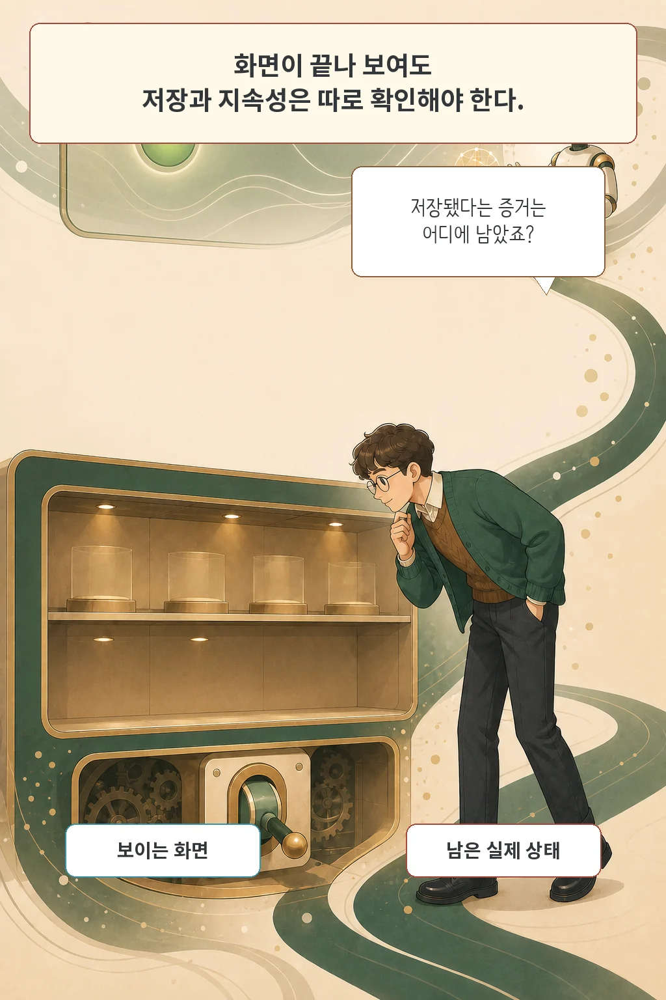
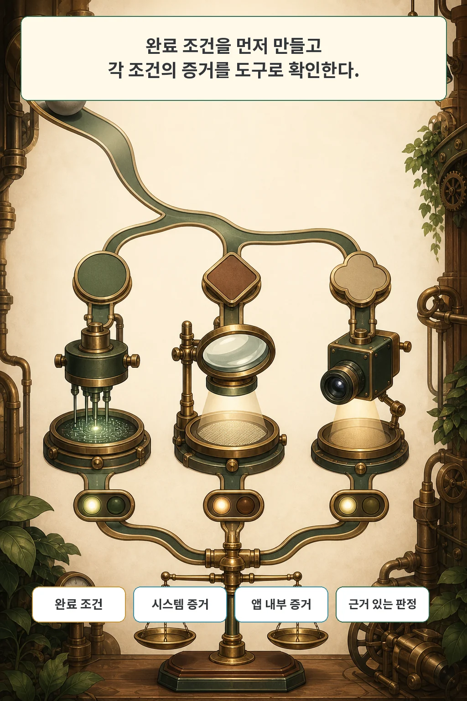
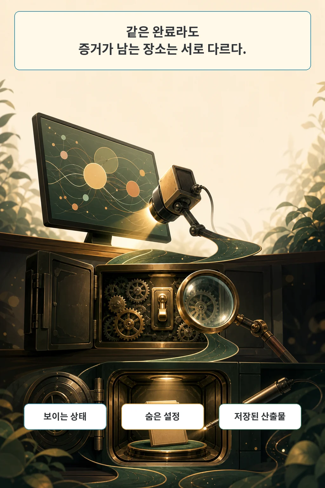
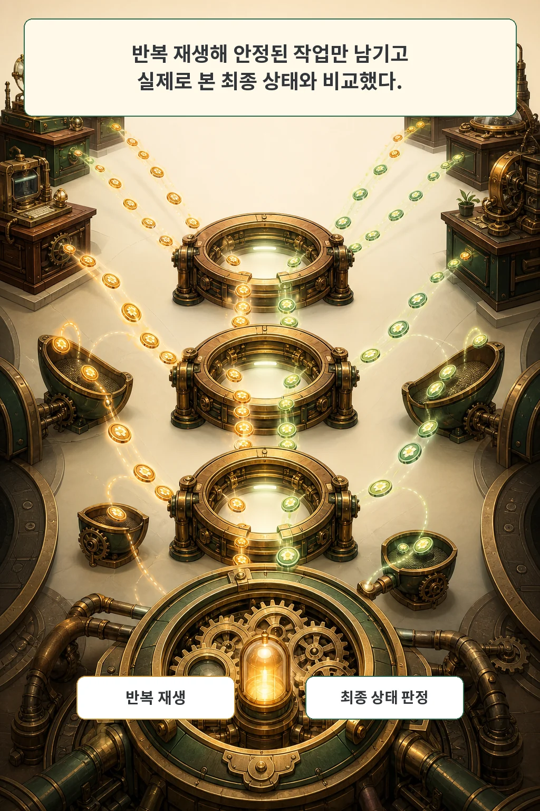
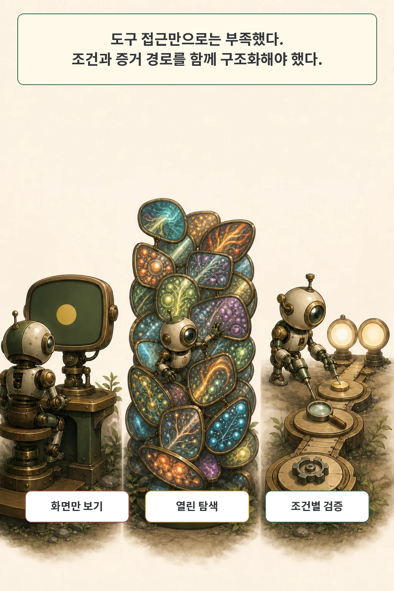
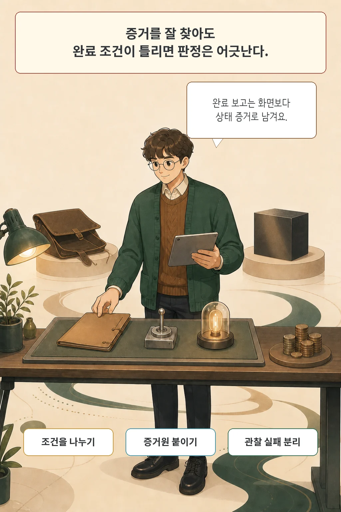

데스크톱 AI 에이전트가 "작업을 마쳤습니다"라고 보고하고 화면에도 완료 창이 떴는데, 정작 저장 폴더를 열어 보면 파일이 비어 있는 경우가 있습니다. 이런 함정을 줄이기 위해 제안된 **Interactive Reward Agent(IRA)**는 마지막 스크린샷 한 장에 기대지 않고, 저장된 파일·지속 설정·애플리케이션 내부 상태를 직접 확인해 작업 성공 여부를 판정합니다. 작업 지시를 세부 완료 조건으로 쪼갠 뒤 시스템·애플리케이션·GUI 도구 가운데 가장 알맞은 수단을 골라 증거를 수집하는 구조죠.

글·해설: 다메카솔

## 핵심 내용

- **화면 밖 검증 비중**: 10개 Ubuntu 데스크톱 앱 범주의 321개 궤적으로 구성된 `GUI-RewardBench`에서 화면만으로 판정 가능한 과제는 40개(12.5%)에 그쳤고, 산출물(192개)과 숨은 상태(89개) 검증이 87.5%를 차지했습니다.
- **조건 분해 기반 정확도**: 수동형 기준선 DistRL(정확도 78.8%, F1 76.7%) 대비 GPT-5.5 기반 IRA는 **정확도 86.9%, F1 84.9%**를 달성했습니다(동일 백본 +6.2~9.1%포인트, GPT 계열 평균 약 3.3단계 검증).
- **보상 신호와 인간 일치도**: OSWorld 강화학습 보상으로 썼을 때 정답 스크립트 보상(34.9%)에 근접한 34.0% 성공률(자동 생성 결합 33.5%)을 냈고, 100개 표본의 인간 일치도는 94.0%(kappa 0.84)였습니다.

## 화면이 멀쩡해도 저장은 실패할 수 있다

최종 스크린샷 한 장이 보여 주는 정보는 그 순간 모니터에 그려진 픽셀로 한정됩니다. 파일이 지정 경로에 기록됐는지, 바꾼 설정이 앱을 껐다 켜도 유지되는지, 혹은 백그라운드 명령으로 수정된 값이 화면에 아직 반영되지 않았는지는 정지 화면만으로 판별하기 어렵거든요.

예를 들어 논문의 스프레드시트 사례에서는 에이전트가 명령줄로 파일 값을 올바르게 고쳤지만 화면이 갱신되지 않아 스크린샷 기반 평가기가 실패로 오판한 반면, IRA는 파일을 직접 열어 정답임을 확인했습니다. 반대로 VLC 미디어 플레이어 사례에서는 현재 창 모양만으로는 설정의 영구 반영 여부를 알 수 없어 설정(config) 파일을 직접 읽어 판정했습니다.

## 완료 조건을 먼저 쪼개고 세 갈래 증거를 모은다

2026년 7월 28일 arXiv에 공개된 이 연구(Chenrui Shi 외 7명, *Interactive Reward Agent: GUI Task Evaluation via Environment-State Verification*)에서 IRA는 작업 지시와 초기·최종 화면을 분석해 **완료 조건(completion conditions)**부터 나눕니다. 가령 "프레젠테이션을 이미지로 내보내 바탕화면에 저장하라"는 지시라면 파일 존재 여부, 이미지 형식, 실제 내용이 각각 독립된 검증 조건이 되는 셈이죠.

저자들은 검증에 필요한 환경 증거를 세 가지로 나누고, 조건마다 독립된 검증 루프를 붙여 명시적 증거가 확인된 조건의 비율을 연속 보상 점수로 합산하며 벤치마크 이진 분류에서는 이 비율이 `0.8`을 넘을 때 최종 성공으로 판정합니다.

| 증거 유형 | 비중 (총 321개) | 확인 대상 및 활용 도구 |
| --- | --- | --- |
| **산출물 검증 (Artifact verification)** | **192개 (59.8%)** | 문서, 스프레드시트, 프레젠테이션, 이미지, PDF 등 저장 파일 내용·구조를 시스템·앱 도구로 열람 |
| **숨은 상태 (Hidden state)** | **89개 (27.7%)** | 환경 설정, 기본 앱 지정, preference 파일 등 UI 뒤의 지속 상태를 시스템 명령·설정 파일로 확인 |
| **보이는 상태 (Visible state)** | **40개 (12.5%)** | 화면에서 직접 보이는 UI 요소를 GUI 도구와 스크린샷으로 확인 |

## 재생 변동을 통제한 벤치마크와 실험 결과

연구진은 공정한 비교를 위해 후보 궤적 327개를 가상머신(VM)에서 세 번씩 재생해 최종 상태가 흔들리는 6개를 걸러내고, 80단계 이상 장기 작업까지 포함한 321개 안정 궤적을 추렸습니다. 모든 평가기가 같은 지시와 궤적을 받아 조사를 마친 직후에는 과제별 정답 스크립트를 돌려, 비동기 동작이나 네트워크 변동이 반영된 **실제 최종 상태 기준 정답 라벨**을 다시 계산해 공정성을 맞췄습니다.

절제 실험과 추가 검증은 단순히 도구를 열어 둔다고 평가 정확도가 따라오지 않는다는 점을 보여 줍니다.

- **구조 없는 상호작용의 한계**: Qwen3.6에 완료 조건 분해 없이 GUI 조작만 허용했을 때는 정밀도만 오르고 재현율이 크게 떨어졌지만, `propose-then-verify` 구조를 모두 쓴 IRA는 세 백본 모두에서 균형을 개선했습니다.
- **인간 판정 대조**: 자동 생성한 855개 지시 중 9개 앱 범주(단일 클래스만 나온 Chrome 제외) 100개 표본에서 GPT-5.5 기반 IRA와 인간 라벨 일치도는 **94.0%**(Cohen's kappa **0.84**)였습니다.
- **강화학습 보상 비교**: 같은 OSWorld 과제로 학습했을 때 정답 스크립트 보상은 **34.9%**, IRA 보상은 **34.0%**(자동 생성 과제 결합 시 **33.5%**) 성공률을 기록했습니다.

## 조건 해석 오류와 운영 시 살필 경계

IRA가 틀리는 경우는 도구 부족보다 **완료 조건의 세분화 수준 오류, 지나치게 문자적인 해석, 저장·지속성 요구 누락 같은 조건 정렬 실패**에서 주로 나왔습니다. 보호 설정 세부 등급을 잘못 짚거나, 어두운 테마가 기능적으로 적용됐는데도 색상 이름만 대조해 실패 처리하거나, 뒤집힌 이미지 화면만 보고 파일 저장 여부를 빠뜨리는 식이죠.

실무 자동화 파이프라인에 적용할 때는 세 가지 운영 제약도 함께 살펴야 합니다.

1. **조사 과정의 상태 변경 위험**: 읽기 전용 도구와 달리 GUI 클릭이나 시스템 명령 실행은 평가 도중 원래 환경을 건드릴 수 있습니다.
2. **토큰 비용과 지연**: 여러 단계에 걸쳐 파일과 설정을 탐색하므로 정적 화면 평가기보다 토큰 소모가 크고 일부 과제에서 실행 시간이 길어집니다.
3. **적용 범위와 라이선스**: 실험은 Ubuntu 데스크톱과 선정된 모델·도구 세트 기준이며, 공식 저장소(`Kendrick-Stein/InteractiveRewardAgent-OfficialRepo`)는 구현과 321개 벤치마크 JSON을 공개하지만(리플레이 캐시·대형 출력·실험 결과 디렉터리 등 제외) 라이선스가 명시되지 않아 상용 도입 전 확인이 필요합니다.

## 다메카솔의 해석: 완료 보고를 상태 증거로 바꾼다

에이전트의 완료 보고를 검증하는 파이프라인을 설계한다면, 화면 캡처 대신 세 단계 검증 명세부터 세우는 편이 확실합니다.

1. **원자적 완료 조건 정의**: 파일 경로·내용, 저장된 설정값, DB 레코드 상태처럼 참·거짓이 갈리는 최소 조건으로 요구사항을 나눕니다.
2. **결정적 읽기 전용 증거 연결**: 픽셀 해석보다 파일 시스템, 설정 파일, API, 데이터베이스 등 상태를 직접 읽는 도구부터 연결합니다.
3. **관찰 실패와 작업 실패 분리**: 검증기가 경로를 못 찾거나 타임아웃이 난 경우는 에이전트의 작업 실패와 섞지 않고 별도 상태로 기록합니다.

## 출처

- [논문 초록과 메타데이터, arXiv:2607.25904](https://arxiv.org/abs/2607.25904)
- [논문 원문 PDF](https://arxiv.org/pdf/2607.25904)
- [arXiv HTML 원문](https://arxiv.org/html/2607.25904v1)
- [저자 공식 프로젝트 페이지](https://kendrick-stein.github.io/InteractiveRewardAgent-OfficialRepo/)
- [공식 코드·벤치마크 저장소](https://github.com/Kendrick-Stein/InteractiveRewardAgent-OfficialRepo)
- [관련 글: 컴퓨터 사용 AI 에이전트가 화면 좌표 대신 의미를 누르는 법](/posts/tactile-computer-use-agents/)

이 글은 논문 원문과 공식 저장소 자료를 바탕으로 정리했으며, 별도 실험 재현이나 논문 그림 복제 없이 본문 이미지를 새로 구성했습니다.

이 글의 본문과 이미지는 생성형 AI로 제작했습니다. 기획과 편집 기준은 다메카솔이 정했습니다.
