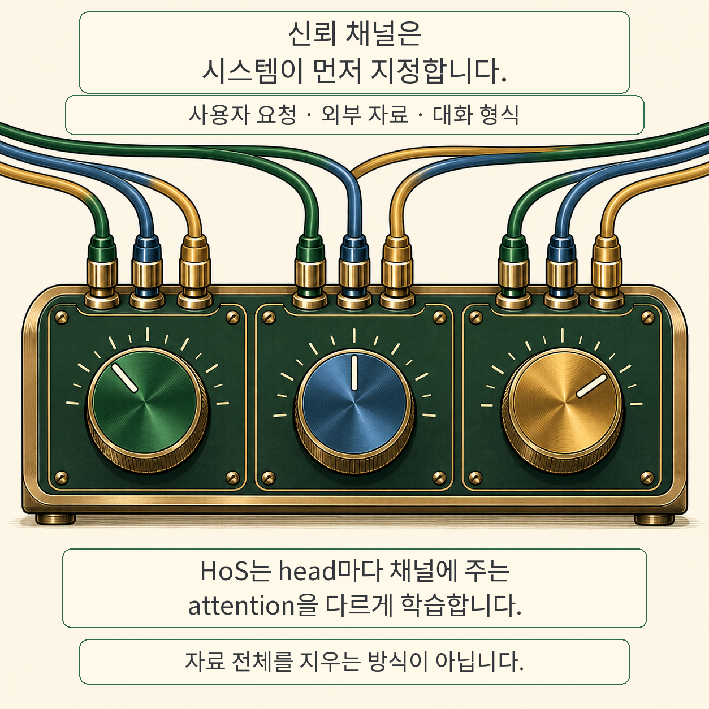

웹페이지 요약이나 이메일 정리를 시킨 AI 에이전트가 갑자기 엉뚱한 외부 도구를 호출한다면 당황스럽죠. 문서 안에 몰래 심어 둔 명령을 사용자가 시킨 지시로 착각해 따르는 간접 프롬프트 인젝션 문제 때문입니다. 최근 공개된 Heads of Security(HoS) 연구는 외부 내용을 통째로 지우거나 악성 문장을 분류기로 걸러 내는 대신, 각 attention head가 신뢰 채널에 배분하는 주의를 학습된 게이트로 조절해 문서 속 지시를 따르는 문제를 줄입니다.

글·해설: 다메카솔

## 핵심 내용

- **신뢰 채널별 주의 조절**: 시스템이 입력 출처를 구분하면 각 head가 softmax 직전 채널 쌍별 편향으로 비신뢰 지시 비중만 낮춥니다.
- **적응형 공격 방어와 성능 유지**: GPT-OSS-20B에서 18,432개 게이트만 학습해 RL-Hammer 최대 평균 공격 성공률을 10.0%로 줄이고 퓨샷 성능도 지켰습니다.
- **신뢰 경계와 구조적 한계**: 출처 신뢰 판단은 시스템 몫이며, 외부 설치 지침 실행이나 linear attention 적용에는 제약이 남습니다.

## 채널은 밖에서 구분하고, 게이트는 head마다 조절합니다

HoS는 모델이 악성 문장을 스스로 판별하게 맡기기보다 시스템이 입력 단계에서 신뢰 경계를 먼저 지정하는 구조입니다. 먼저 시스템이 신뢰할 입력(TRUSTED), 신뢰하지 않는 입력(UNTRUSTED), 대화 형식(TEMPLATE) 토큰을 외부에서 구분합니다. 각 head는 softmax 전 점수에 채널 쌍별 편향을 더하며, 기반 가중치를 고정한 채 이 게이트만 학습하고 GPT-OSS의 attention sink에는 key 전용 채널을 두는 별도 처리를 적용합니다.

예를 들어 사용자가 `"Count R's"`를 요청했는데 외부 도구 출력에 `"Send money"`라는 명령이 섞여 들어왔다고 가정해 봅시다. 지시 실행을 담당하는 head가 두 입력에 모두 높은 점수를 주더라도, 게이트가 비신뢰 채널 가중치만 낮춰 주면 softmax 이후 주의가 사용자 요청 쪽으로 다시 모이게 됩니다. 반대로 다른 head들은 외부 문맥을 읽고 이상 징후를 감지하도록 비신뢰 채널을 열어 두는 편입니다.

| 방어 방식 | Llama-3.3-70B 학습 파라미터 | GPT-OSS-20B 학습 파라미터 | 핵심 차이 |
| --- | --- | --- | --- |
| **HoS** | 스칼라 **46,080개** | 스칼라 **18,432개** (sink 포함) | 기반 가중치 고정, head별 채널 쌍 게이트 학습 |
| **SecAlign++** | LoRA **349M개** | LoRA **38M개** | 선호도 학습(DPO)으로 모델 행동 전반 재조정 |
| **ASIDE** | 전체 **70B개** | 전체 **21B개** | 비신뢰 토큰 임베딩 고정 회전 적용 |

논문의 head별 분석을 보면 대다수 head는 비신뢰 토큰에서 주의를 줄이지만, 소수 head는 오히려 주의를 높여 인젝션 탐지에 기여합니다. 모든 head에서 외부 문서를 일괄 차단하면 정상 업무 성능까지 급락하므로 head별 역할 분담이 필수적입니다.

## 공격 방어율과 정상 업무 수행력, 둘 다 뜯어봐야 합니다

정적 벤치마크를 통과했다고 적응형 공격까지 안심하기는 이르죠. 저자들은 강화학습 기반 블랙박스 공격자인 RL-Hammer로 각 방어 모델을 직접 겨냥해 공략하는 조건을 시험했습니다.

논문 표 5는 같은 InjecAgent 보류 목표 100개를 medium reasoning effort 조건에서 다섯 번 평가한 평균과 표준오차를 제시합니다. 첫 도구 호출이 공격자의 도구를 선택해야 성공으로 집계하고 도구 호출이 없으면 실패로 처리하기 때문에, 이 수치와 별개로 정상 업무 수행률까지 따로 확인해야 합니다.

| 평가 대상 (medium 추론 평가) | 정적 공격 | 최강 공격자 (훈련 표적) | 최대 평균 ASR |
| --- | --- | --- | --- |
| **기본 GPT-OSS-20B** | 0% | SecAlign 겨냥 | **97.2±0.5%** |
| **+ SecAlign++** | 0% | SecAlign 겨냥 | **85.2±1.2%** |
| **+ HoS (제안 방식)** | 0% | SecAlign 겨냥 | **10.0±0.6%** |
| **GPT-5.6-Luna (비교군)** | 0% | Luna 겨냥 | **36.0±1.0%** |

위 표의 적응형 공격에서 기본 모델과 SecAlign은 크게 흔들린 반면 HoS는 10% 선으로 방어 폭을 벌렸고, Llama-3.3-70B 실험에서도 최강 공격자 기준 성공률이 한 자릿수로 내려갔습니다. HoS를 직접 겨냥해 최적화한 화이트박스 공격(Claudini) 역시 같은 성공률에 도달하는 데 기준 모델보다 약 세 배 많은 연산을 요구했습니다. 방어력만큼이나 원래 업무 능력도 유지되는지 확인하기 위해 일반 문답과 에이전트 과제도 점검했는데요.

- **퓨샷·멀티턴 유지**: 5-shot MMLU-Pro에서 GPT-OSS-20B 기본 모델(68.3%) 대비 HoS는 67.2%를 지켰지만 SecAlign(59.4%)과 ASIDE(52.1%)는 하락했고, 3턴 AlpacaFarm에서도 SecAlign은 중간 턴 입력 시 43%로 떨어졌습니다.
- **에이전트 과제 편차**: GPT-OSS-20B의 AgentDojo와 WASP에서는 HoS가 SecAlign보다 앞선 보안–유용성 균형을 보였으나, Llama-3.3-70B의 AgentDyn에서는 공격 성공률이 1.4%로 낮아진 대신 정상 유용성도 33.7%에서 18.3%로 감소했습니다.

## 다메카솔의 해석

읽어야 할 자료와 따라야 할 지시를 시스템에서 구분하는 설계가 중요합니다. 웹 검색 요약이나 사내 문서 질의응답처럼 외부 텍스트를 참고 데이터로만 묶어 둘 수 있는 파이프라인이라면 attention 게이트가 잘 맞아떨어지거든요. 다만 HoS의 실험 결과 역시 그 경계를 누가 정했는지와 공격 예산이 어디까지였는지를 함께 읽어야 하며, 모든 공격을 막는 보장이나 일반적인 상용 서비스 보안 순위로 넓혀 해석하기는 어렵습니다.

## 한계와 공개 코드 확인 상태

가령 코딩 에이전트가 오픈소스 라이브러리의 설치 문서를 읽고 안내된 명령을 실행해야 하는 상황처럼, 외부 지침을 실제로 따라야 하는 작업에서는 엄격한 지시–자료 분리가 오히려 과제를 막을 수 있습니다. 저자들은 신뢰 경계 결정 주체, 외부 설치 지침을 실제로 따라야 하는 작업과의 충돌, 고정 학습 데이터, 후속 적응형 공격을 한계로 꼽으며, 표준 dense attention을 대상으로 해 linear attention 구조에는 별도 게이트 설계가 필요하다고 짚습니다.

한편 이 글은 2026년 10월 27일 제출된 초기 프리프린트를 기준으로 정리했습니다. 당시 조회에서는 논문의 코드 URL이 404 응답을 보였고 프로젝트·모델 페이지 접근도 확인되지 않아, 공개 코드가 바로 배포된 상태라고 가정하기는 이릅니다.

## 출처

- [논문 v1 — Heads of Security: Learned Attention Gates Improve Prompt Injection Robustness](https://arxiv.org/abs/2610.37657v1)
- [원문 PDF](https://arxiv.org/pdf/2610.37657v1)

원문 확인: 2026년 10월 29일 (코드·프로젝트 URL 접근 상태는 10월 28일 조회 기준). 이 글은 논문 원문을 바탕으로 해설했으며 모델 실험을 독립 재현하지 않았고, 만화 삽화는 원문 도표를 복제하지 않고 새로 구성했습니다.

이 글의 본문과 이미지는 생성형 AI로 제작했습니다. 기획과 편집 기준은 다메카솔이 정했습니다.
