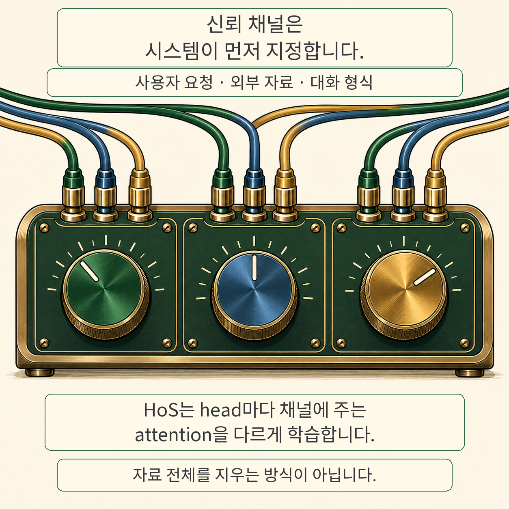
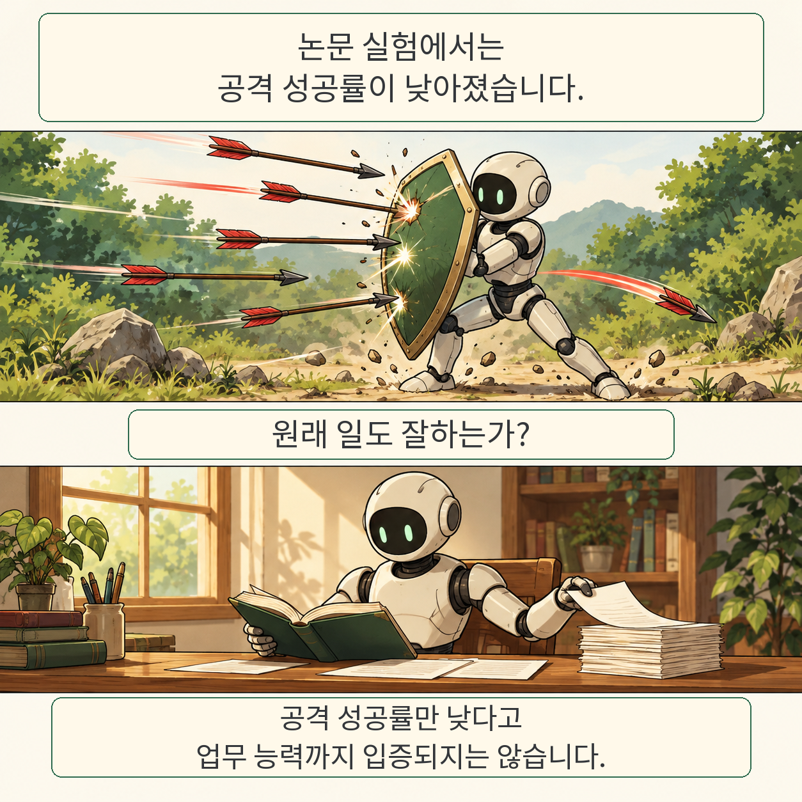

글·해설: 다메카솔

Heads of Security(HoS)는 외부 문서를 읽는 AI가 문서 속 지시까지 따르는 문제를 줄이려는 연구입니다. 각 attention head가 신뢰 채널에 배분하는 주의를 학습된 게이트로 조절합니다. 외부 내용 전체를 지우거나 악성 문장을 자동 분류하는 방식으로 이해하면 곤란합니다.

## 무엇을 바꾸나

신뢰할 입력, 신뢰하지 않는 입력, 대화 형식 토큰을 외부에서 구분합니다. 각 head는 채널 쌍별 편향을 softmax 전 점수에 더합니다. 기반 가중치 대신 이 게이트를 학습합니다. GPT-OSS의 attention sink에는 별도 처리가 필요합니다.

다이얼 그림은 채널별 비중 조절을 위한 비유입니다. 실제 구현은 각 head 안의 query 채널과 key 채널 쌍마다 편향을 두며, 다이얼 하나가 특정 인지 기능 하나라는 뜻은 아닙니다.

## 어느 실험에서 나아졌나

논문 표 5는 같은 InjecAgent 보류 목표 100개에서 적응형 공격을 다섯 번 평가한 평균과 표준오차를 제시합니다. 표시된 공격자 중 최대 평균 공격 성공률은 GPT-OSS-20B 97.2±0.5%, SecAlign 85.2±1.2%, HoS 10.0±0.6%입니다. 평가 reasoning effort는 medium입니다. 첫 도구 호출이 공격자의 도구를 선택하면 성공으로 집계하며, 도구 호출이 없으면 공격 실패로 셉니다. 따라서 이 수치만으로 정상 업무 수행률까지 알 수는 없습니다.

## 다메카솔의 해석

읽어야 할 자료와 따라야 할 지시를 시스템에서 구분하는 설계가 중요합니다. HoS의 결과도 그 경계를 누가 정했는지와 공격 예산을 함께 읽어야 합니다. 모든 공격에 대한 보장이나 일반적인 상용 서비스 보안 순위로 확대할 근거는 아닙니다.

## 한계와 공개 상태

저자들은 신뢰 경계 결정, 외부 설치 지침을 실제로 따라야 하는 작업, 고정 학습 데이터, 후속 적응형 공격을 한계로 설명합니다. 표준 dense attention을 대상으로 하며 linear attention에 그대로 적용되지 않습니다. 이 글은 모델 실험을 독립 재현하지 않았습니다.

2026년 10월 27일 제출된 v1 프리프린트를 확인했습니다. 코드 URL은 이번 조회에서 404였고 프로젝트·모델 페이지의 접근도 확인하지 못했습니다. 공개 코드가 준비됐다고 단정하지 않습니다.

원문 확인: 2026년 10월 29일. 코드·프로젝트 접근에 관한 위 기록은 10월 28일 조회 기준입니다.

## 출처

- [논문 v1](https://arxiv.org/abs/2610.37657v1)
- [원문 PDF](https://arxiv.org/pdf/2610.37657v1)

이 글의 본문과 이미지는 생성형 AI로 제작했습니다. 기획과 편집 기준은 다메카솔이 정했습니다.
