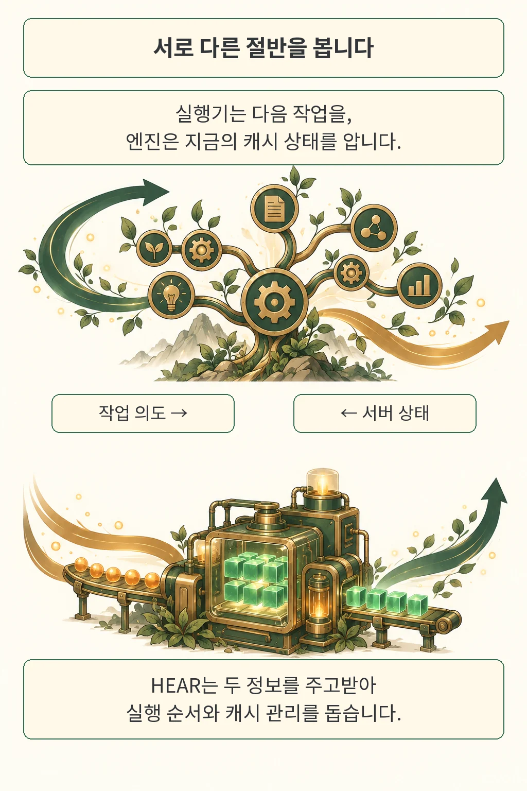
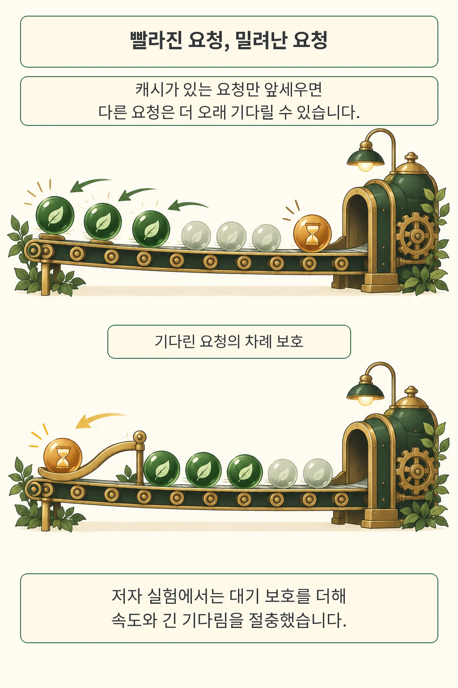
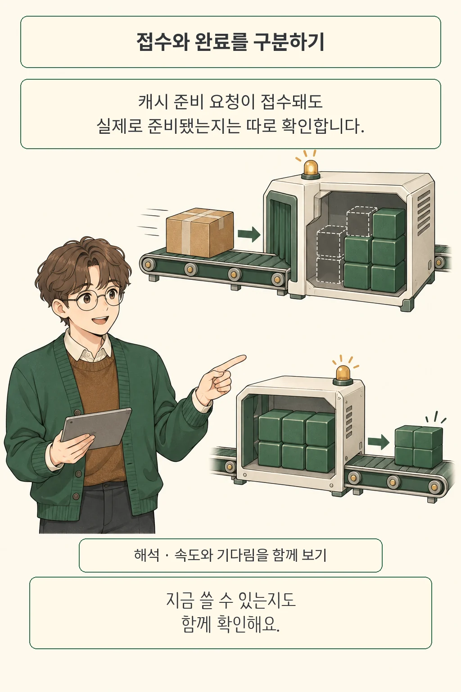

검색 도구의 응답을 기다렸다가 AI 에이전트가 다시 말을 이어 가려는데, 방금 읽은 문맥인데도 첫 글자가 나오기까지 한참 걸릴 때가 있습니다. 도구를 기다리는 사이 추론 서버가 계산해 둔 KV 캐시를 비웠기 때문이죠. HEAR 연구진은 에이전트 실행기(하네스)의 작업 계획과 추론 엔진의 현재 상태를 양방향으로 주고받아 요청 순서와 캐시 관리를 함께 조율하는 프로토콜을 제안합니다.

글·해설: 다메카솔

## 핵심 내용

- **양방향 의미 계약**: 하네스의 작업 준비·재사용 의도와 엔진의 KV 캐시·대기열 상태 및 처리 결과를 교환합니다.
- **캐시 우선과 대기 보호의 절충**: SCBench에서 캐시 우선은 완료 시간을 절반 넘게 줄였으나 최대 대기를 늘렸고, Guard-40으로 균형을 잡았습니다.
- **부하·역할별 맞춤 선택**: 고부하 Mooncake 재생에서는 전체 결합 정책이 FCFS보다 느렸고, 역할별 엔진 분리는 실행 시간을 단축했습니다.

하얼빈공업대 선전의 Jiaqi Zhao 등이 2026년 10월 5일 arXiv에 제출한 논문 **「Can Agent Harnesses and Inference Engines Hear Each Other? The HEAR Protocol for Agentic LLM Serving」(v1)**을 통해 핵심 설계와 실험 결과를 살펴봅니다.

## 다음 작업을 아는 쪽과 캐시를 보는 쪽

에이전트 워크플로에서 작업을 이어 붙이는 **하네스**와 모델을 계산하는 **추론 엔진**은 각자 보는 정보가 다릅니다. 하네스는 어떤 도구 호출 뒤에 어떤 문맥을 다시 쓸지 알고, 추론 엔진은 요청 대기열과 모델의 중간 계산 상태인 **KV 캐시**를 관리하거든요.

예를 들어 에이전트가 긴 문서를 읽고 웹 검색 API를 몇 초간 기다리는 상황을 떠올려 보겠습니다. 하네스는 응답 직후 같은 문맥을 이어 쓸 계획이지만, 엔진은 그사이 메모리가 모자라면 해당 캐시를 지우고 다른 요청을 먼저 처리해 버립니다. 스케줄러와 메모리 관리자가 상태를 몰라 재계산이 생기는 셈이죠.

HEAR는 두 계층 사이의 정보 의미를 **설명·제어·상태·결과** 네 가지로 정의한 양방향 계약이며, 특정 알고리즘이나 패킷 형식을 고정하지 않습니다. 특히 **설명과 명령, 선호와 필수 조건, 관측과 보장, 접수와 완료**를 엄격히 나누어, 캐시 관측을 예약으로 보거나 접수된 준비 요청이 곧바로 완료됐다고 가정하지 않도록 설계했습니다. 앞서 다룬 [ContextRender](/posts/contextrender-execution-reuse/)가 재사용할 문맥 조각을 고르는 문제라면, HEAR는 그 계획을 실시간 서버 상태와 맞물리는 계약에 집중합니다.

## 캐시를 잘 쓰면 모두가 덜 기다릴까요?

캐시가 남은 요청부터 처리하면 전체 속도는 빨라지지만, 캐시가 없는 요청은 차례가 계속 밀려 기아(starvation) 상태에 빠집니다. 저자들은 이를 막기 위해 **대기 보호(Guard-40)**를 결합해, 임계 시간을 넘긴 요청을 후속 캐시 우선 요청이 앞지르지 못하게 했습니다. 이는 40초 이내 응답을 보장하는 SLA가 아니라 작업 의존성을 지키며 추월만 막는 규칙입니다.

- **SCBench 재생 조건**: Qwen3-8B, RTX PRO 6000 1대, 96 GiB L2 KV 캐시 환경에서 포아송(Poisson) 도착과 평균 5초(표준편차 1초) 생각 시간을 합성해 한 번 기록한 경로를 동일하게 재생했습니다(Table 3).

| SCBench 재생 방식 | 전체 배치 완료 | 첫 토큰 대기 중앙값 | 첫 토큰 최대 대기 |
| --- | ---: | ---: | ---: |
| 도착 순서대로 처리 (FCFS) | 481초 | 63.1초 | 79.0초 |
| 캐시 우선 처리 | 224초 | 4.6초 | 93.9초 |
| 캐시 우선 + Guard-40 | 299초 | 28.3초 | 65.0초 |

*원문 Table 3 요약. 전체 배치 완료는 모든 다회차 대화 종료 시간, 첫 토큰 대기는 첫 응답 토큰 출력까지의 대기 시간입니다.*

캐시 우선만 켜면 배치 완료 시간은 절반 이하로 줄지만 최대 대기가 93.9초까지 튀어 꼬리 지연이 나빠집니다. Guard-40을 더하자 배치 완료는 FCFS 대비 **1.61배** 빠르게 유지하면서 최대 대기를 가장 낮게 억제할 수 있었죠.

- **Mooncake 재생 결과**: 실제 운영 유래 경로(Qwen3-8B, H100 1대, 96 GiB L2)의 같은 15분 구간 세션을 50%·75%·100% 선택해 재생했을 때, 100% 부하에서는 전체 결합 정책의 처리량이 분당 **108.9회**로 단순 FCFS(**122.7회**)보다 낮았습니다.

부하가 꽉 찬 구간에서는 예측과 우선순위 조정 비용이 오히려 처리량 손실로 이어질 수 있는 만큼, 트래픽 밀도별 검증을 거쳐 제어 기능을 켜는 편이 안전합니다.

## 역할별 엔진 배치와 해석의 경계

상태 교환 계약은 개발 단계에서 역할별 추론 엔진을 나누어 고정 배치할 때도 쓰입니다. 요청마다 실시간 탐색을 도는 것이 아니라 사전 측정으로 정한 조합을 별도 H100 GPU에 띄우는 방식이거든요. GLM-4.7-Flash 모델에서 양쪽 모두 기본 vLLM을 쓴 기준선과 비교해 실행 시간을 단축했습니다.

- **BrowseComp-Plus (208문제)**: 주 역할 `vLLM` + 읽기 역할 `H2O` 조합으로 **5.69시간 → 4.62시간** 단축
- **DeepResearchBench (100개 과제)**: `OmniKV` + `H2O` 조합으로 **5.93시간 → 2.42시간** 단축

두 실험 모두 대응 비교 신뢰구간이 품질 차이 0을 포함해 평균 품질 하락은 관찰되지 않았습니다. 다만 이는 품질 동등성 보장이 아니며, DeepResearchBench는 공통 유효 89개 과제 기준이고 BrowseComp-Plus는 심사 GPU 구성에 차이가 있어 모든 작업의 무손실로 일반화하기는 어렵습니다. 실서비스 적용 시 권한 관리와 테넌트 격리, 대기 보호를 함께 갖춰야 하며 모델 출력 안전성은 연구 범위 밖입니다.

## 다메카솔의 해석: 접수와 완료를 구분해 기록하기

실무에서 가장 눈여겨볼 원칙은 **캐시 준비 요청의 ‘접수’와 ‘준비 완료’를 분리하는 계약**입니다. 프리페치 요청이 수락됐더라도 다음 턴 직전까지 아직 적재 중이거나 다른 요청에 밀려 축출됐을 수 있거든요.

실제 서빙 환경이라면 요청 ID와 문맥 버전을 묶어 **상태 관측 시각, 준비 요청 수락 여부, 실제 추론 시점의 캐시 적중 결과**를 함께 로그로 남기는 편이 좋습니다. 그래야 지연이 튀었을 때 에이전트 계획이 바뀐 탓인지 캐시가 축출된 탓인지 바로 분리할 수 있으니까요. [에이전트 평가에서 설정을 함께 기록해야 하는 이유](/posts/agent-evaluation-system-configuration/)처럼 처리량 옆에 꼬리 지연과 테넌트 격리 조건을 함께 두어야 낡은 상태에 기대지 않는 최적화가 됩니다.

## 출처

- [HEAR 논문 정보와 제출 이력](https://arxiv.org/abs/2610.06597v1): 2026년 10월 5일 제출된 arXiv v1 기준
- [HEAR 원문 PDF](https://arxiv.org/pdf/2610.06597v1): 프로토콜 3절, 캐시 실험 4.2절, 역할별 구성 4.3절, 재생 조건 부록 A, 품질 분석 부록 B.4 참고
- [저자가 연결한 코드 저장소](https://anonymous.4open.science/r/hear-3D1E/): 2026년 10월 6일 확인 시 HTTP 403 접근 제한 응답을 반환해 코드·데이터 확인 및 실험 재현은 수행하지 않았습니다.

이 글은 2026년 10월 5일 공개된 논문 원문 PDF·HTML을 바탕으로 해설했으며 별도의 독립 재현 실험은 진행하지 않았습니다.

이 글의 본문과 이미지는 생성형 AI로 제작했습니다. 기획과 편집 기준은 다메카솔이 정했습니다.
