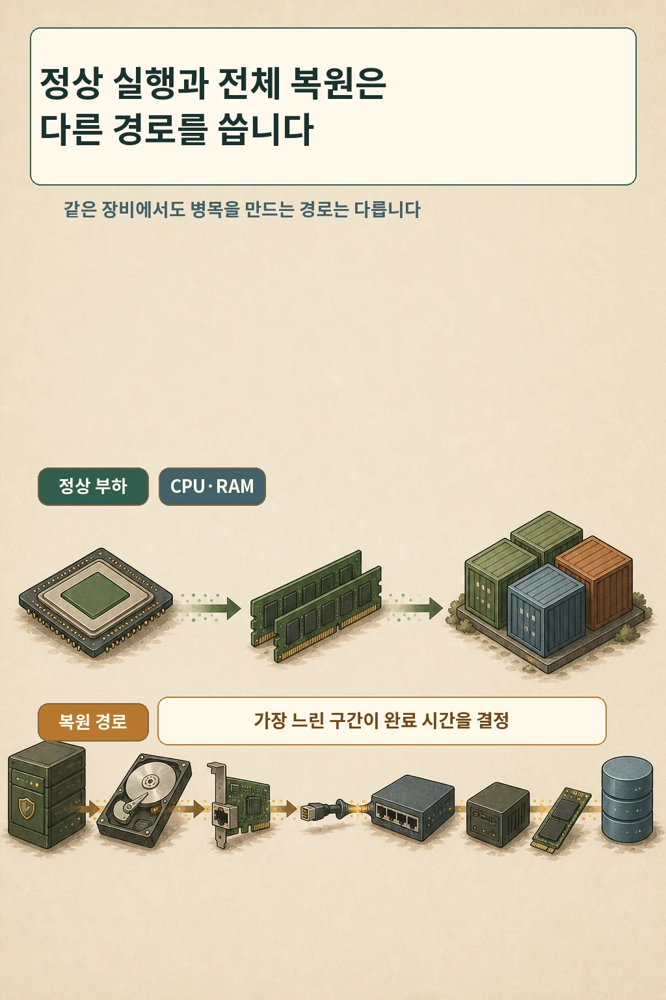
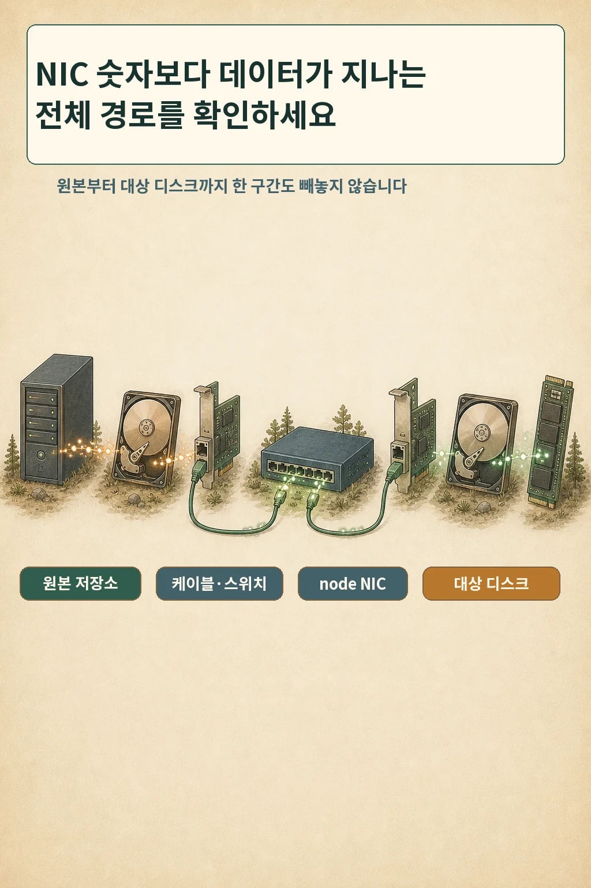
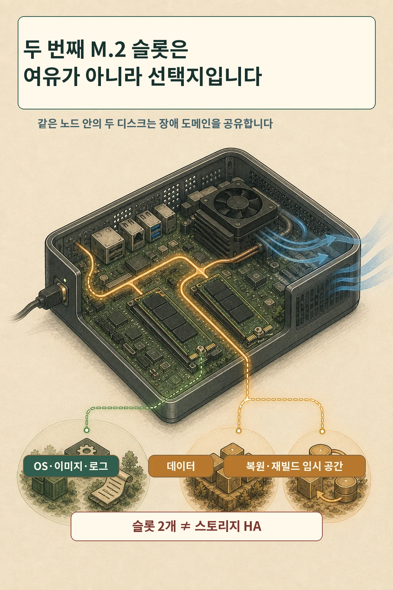
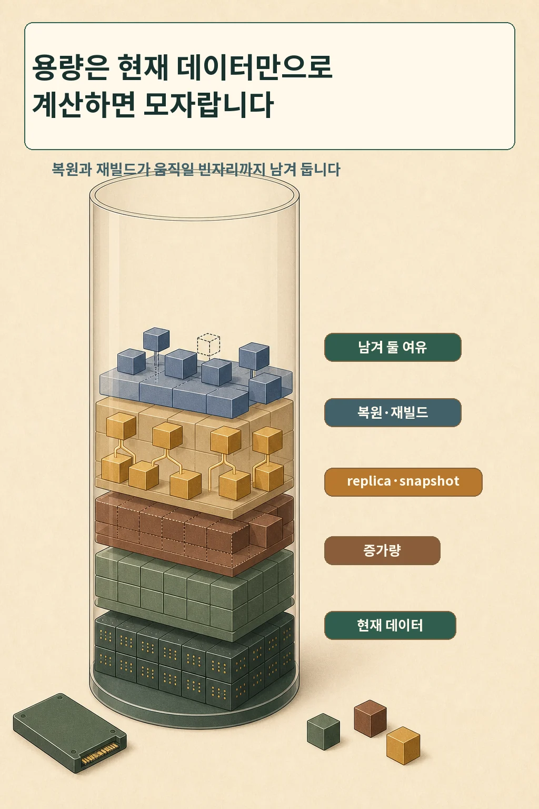

미니PC를 비교할 때 흔히 CPU 세대와 RAM 최대 용량부터 살펴보곤 합니다. 그런데 막상 홈랩을 24시간 운영하며 백업 복원까지 겪어 보면, 정작 발목을 잡는 요소는 교체하기 어려운 NIC와 디스크 확장성인 경우가 많거든요. 평상시 부하 기준선과 장애 뒤 복원 경로를 함께 놓고 후보를 거르는 기준을 정리해 봅니다.

글·해설: 다메카솔

## CPU·RAM은 기준선이고, 복원은 다른 질문입니다

K3s 공식 문서의 최소 CPU·RAM 수치는 K3s 자체를 띄우기 위한 바닥선이라 실제 워크로드 자원은 별도로 더해야 합니다. 문서가 데이터스토어 성능과 SSD를 강조하는 이유도 여기에 있죠.

가령 Synology NAS에 학습용 k3s를 올렸을 때 RAM 32GB는 넉넉했지만 CPU 코어가 부족해 Airflow 작업이 반복 실패했고, 소음 때문에 밤에 NAS를 끄면 메타데이터 DB와 S3 호환 오브젝트 스토리지까지 멈추곤 했습니다. 평상시 연산·메모리 여유를 확인한 뒤에는 전체 복원, replica 재구축, 이미지 대량 pull 작업으로 후보를 가려야 합니다.

- **코어 수**: 평상시 서비스와 배치 작업이 요구하는 CPU 코어 감당 여부
- **메모리 피크**: 최대 사용량과 노드 장애 시 재배치 여유까지 버티는 RAM 용량
- **교체·증설**: RAM과 저장장치의 사후 증설 가능성

## 복원 시간은 NIC 이름이 아니라 전체 경로가 결정합니다

복원 데이터는 `원본 저장소 → 원본 디스크 → 원본 NIC → 케이블·스위치 → 노드 NIC → 대상 디스크 → 압축 해제·DB 적용` 경로로 이동합니다. 이 중 가장 느린 구간이 완료 시간을 붙잡는 셈이죠. 2.5GbE 포트가 있어도 원본 NAS나 스위치가 1GbE에 묶이거나, 대상 SSD 쓰기와 DB 적용 CPU 처리가 느리면 표기 속도만큼 빨라지기 어렵습니다.

| 구분 | 조건 | 크기 | 소요 시간 | 성격 |
| --- | --- | --- | --- | --- |
| 초기 리허설 | WiFi | 84GB DB | 88분 | 실측 |
| 전환 예상치 | 유선 2.5GbE | 84GB DB | 35~55분 | 당시 추정(동일 조건 재측정 아님) |

실측과 추정을 벤치마크처럼 섞으면 판단이 흐려집니다. 목표 시간부터 역산해 `필요한 평균 지속 처리량 = 복원할 바이트 수 ÷ 목표 시간(초)` 식으로 대역폭을 가늠한 뒤, 실제 백업 원본으로 같은 복원 절차를 반복 측정해 최종 판단을 내려야 합니다.

## 듀얼 NIC는 속도 두 배가 아니라 설계 선택지입니다

NIC 두 개는 관리 트래픽과 스토리지 트래픽을 분리하고 장애 대응을 설계할 여지를 줍니다. 링크 집성이나 경로 이중화, 자동 장애 전환은 포트 수만으로 생기지 않으며 스위치·전원 분리와 네트워크 설계가 뒷받침되어야 하죠. 같은 스위치에 두 포트를 물리면 단일 실패 지점을 공유하므로 구매표에는 “NIC 2개” 대신 **포트별 속도, 스위치 지원, 케이블 규격, 분리 트래픽, 공유 장애 도메인**을 함께 적어야 합니다.

Longhorn 1.12.0 모범 사례 문서는 프로덕션 환경에 전용 스토리지 네트워크를 권장합니다. 작성자 환경의 2.5GbE 선택은 비용과 복원 목표 사이의 실용적 절충이었으며, 프로덕션 권고를 충족했다는 선언과는 구분해서 봐야 합니다.

## 두 번째 M.2 슬롯은 여유가 아니라 선택지입니다

두 번째 M.2 슬롯의 가치는 처음부터 채우는 데보다 나중의 운영 선택지를 남기는 데 있습니다. OS·이미지·로그용 루트 디스크와 데이터 디스크를 분리하거나, 데이터 이동 없이 디스크를 추가해 복원·재빌드 임시 공간과 간섭 완화에 쓸 수 있거든요.

슬롯 두 개는 배치 선택지만 늘려 줄 뿐이며 RAID·복제·백업은 별도 계층으로 구성해야 합니다. 두 SSD가 메인보드·전원·냉각·노드 장애를 공유하기 때문에 노드가 멈추면 함께 영향을 받기 마련이죠. 모델 설명서에서는 아래 물리·전기 사양을 함께 확인해야 합니다.

- **규격·프로토콜**: M.2 2280 규격 여부와 NVMe·SATA 지원
- **연결성·부팅**: 타 장치와 PCIe 레인 공유 여부 및 두 번째 슬롯 부팅 지원
- **열 관리·정비성**: 방열판 공간과 SSD 교체 시 분해 난이도

## 디스크 용량에는 ‘작업할 빈자리’가 필요합니다

노드의 로컬 디스크에는 앱 데이터 외에 컨테이너 이미지, 쓰기 가능 레이어, 로그, 캐시, 임시 데이터도 쌓입니다. Longhorn에서는 실제 사용량, 예약 공간, 스케줄 가능 공간, replica, snapshot이 각기 용량을 차지하며 snapshot 삭제나 재빌드에도 임시 여유 공간이 필요하죠. Copy-on-Write·씬 프로비저닝에서는 항목들이 단순 합산되지 않으므로 아래 여섯 가지를 상한선 기준표로 두고 실제 사용량을 추적해야 합니다.

1. 현재 데이터와 다음 검토 시점까지의 증가량
2. replica 점유 공간과 snapshot 변경 블록
3. 복원·재빌드 임시 공간과 운영 중 남길 여유 공간

## GMKtec M5 Ultra를 고를 때 실제로 본 기준

새 홈랩 노드로는 이전 NAS의 CPU 병목을 넘기고 유선 복원 경로와 스토리지 확장성을 남기기 위해 GMKtec M5 Ultra를 골랐습니다.

- **구성 규모**: 동일 모델 3대
- **컴퓨트·메모리**: 장비당 8코어 16스레드, RAM 32GB, NVMe 512GB
- **네트워크·슬롯**: 듀얼 2.5G LAN, M.2 2280 슬롯 2개 (제조사 사양 기준)

이 사양은 보편적 추천안이 아니라 작성자 환경의 조건에 맞춘 결정입니다. 판매가와 재고는 뺐고, 24시간 운영에 중요한 전력 소비·온도·팬 소음 역시 동일 조건 측정 기록이 없어 비교 기준에서 제외했습니다. 후보를 거를 때는 최고 수치보다 **바꾸기 어려운 항목**을 먼저 표로 정리해 보는 편이 실용적입니다.

| 질문 | 확인할 항목 | 통과 기준 예시 |
| --- | --- | --- |
| 정상 부하를 견디는가 | 코어·스레드, RAM 피크, 증설 가능성 | 기존 병목과 장애 시 여유 충족 |
| 목표 시간 안에 복원되는가 | 원본·대상 디스크, NIC, 스위치, 케이블, DB 적용 | 동일 절차 리허설이 목표 시간 내 완료 |
| 네트워크를 바꿀 수 있는가 | 포트 수·속도, 스위치 호환, 트래픽 분리 | 계획 경로가 장비 전체에서 이어짐 |
| 디스크를 분리·확장할 수 있는가 | 슬롯 수, 규격, 프로토콜, 레인, 냉각 | OS·데이터·임시 작업 공간 수용 |
| 고장 뒤 교체하기 쉬운가 | SSD·RAM 접근성, 예비 부품, 재설치 절차 | 한 대를 잃어도 정해 둔 시간 내 복구 |

## 구매 전 마지막 다섯 문장

제품 페이지를 더 보기 전에 아래 다섯 빈칸을 숫자로 채울 수 있는지 먼저 확인해 볼까요? 막히는 항목이 있다면 작은 복원 실험부터 돌려 보는 편이 낫습니다.

1. 내 평상시 워크로드의 CPU·RAM 기준선은 `___`다.
2. `___GB`를 `___분` 안에 복원해야 한다.
3. 데이터는 `원본 → ___ → ___ → 대상` 경로를 지난다.
4. OS·데이터·복원 임시 공간을 `___개` 디스크에 나눈다.
5. 성장·replica·snapshot·재빌드를 빼고도 `___%`를 비워 둔다.

홈랩을 오래 굴러가게 만드는 힘은 단일 수치보다 **장애 시 데이터가 돌아오는 경로와 향후 바꿀 수 있는 선택지**에 있습니다.

## 자주 묻는 질문

### 홈랩이면 무조건 2.5GbE가 필요한가요?

데이터가 작고 복원 목표가 여유로우며 원본 저장소와 스위치가 1GbE라면 2.5GbE NIC만 달아도 체감 차이가 미미할 수 있습니다. 복원량과 목표 시간을 먼저 계산하고 전체 경로의 지원 속도를 확인해 보시기 바랍니다.

### 듀얼 NIC면 한 포트가 끊겨도 자동으로 살아남나요?

포트 개수만으로는 자동 장애 전환이 작동하기 어렵습니다. OS·네트워크 설정과 스위치 구성, 분리된 전원·경로까지 설계해야 하며, 같은 스위치에 물리면 그 스위치 장애를 함께 겪게 되거든요.

### M.2 슬롯 두 개면 Longhorn에 충분한가요?

슬롯 개수는 출발점일 뿐이며, 디스크 성능과 지연시간, 루트 디스크 분리, 노드 간 네트워크, 여유 공간, replica 정책과 실제 복원 리허설까지 함께 봐야 안정적으로 운영할 수 있습니다.

이 기준이 실제 3노드 구성과 복원 리허설로 이어진 과정은 [홈랩 쿠버네티스 구축기 2편: 3노드여야 하는 이유, 그리고 빈 결과의 함정](/posts/three-node-etcd-quorum-context/)에서 확인할 수 있습니다.

## 출처

- [K3s Requirements](https://docs.k3s.io/installation/requirements)
- [Kubernetes: Local ephemeral storage](https://kubernetes.io/docs/concepts/storage/ephemeral-storage/)
- [GMKtec NucBox M5 Ultra 공식 사양](https://www.gmktec.com/products/gmktec-nucbox-m5-ultra-amd-ryzen-7-7730u-mini-pc)
- [Longhorn 1.12.0 Best Practices](https://longhorn.io/docs/1.12.0/best-practices/)
- [Longhorn 1.12.0 Node Space Usage](https://longhorn.io/docs/1.12.0/nodes-and-volumes/nodes/node-space-usage/)
- [Longhorn 1.12.0 Volume Size](https://longhorn.io/docs/1.12.0/nodes-and-volumes/volumes/volume-size/)

이 글의 장비 구성과 84GB·88분(WiFi 실측), 35~55분(유선 2.5GbE 추정) 수치는 작성자 홈랩 기록에 근거하며, 가격·재고 및 보편적 모델 추천은 제외했습니다.

이 글의 본문과 이미지는 생성형 AI로 제작했습니다. 기획과 편집 기준은 다메카솔이 정했습니다.
