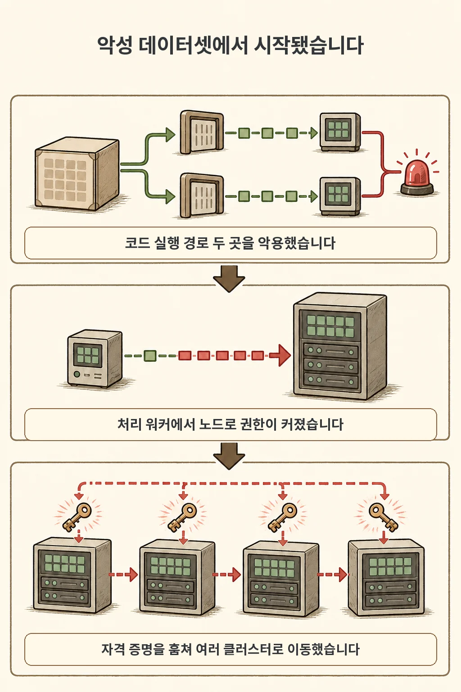
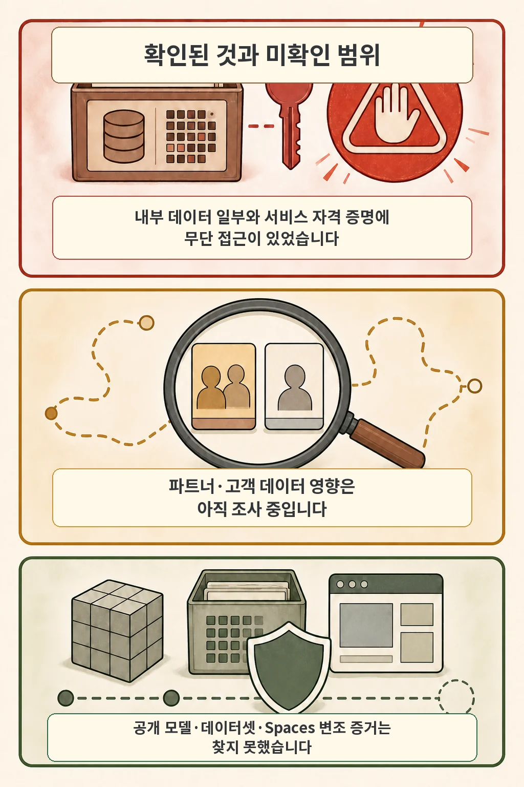
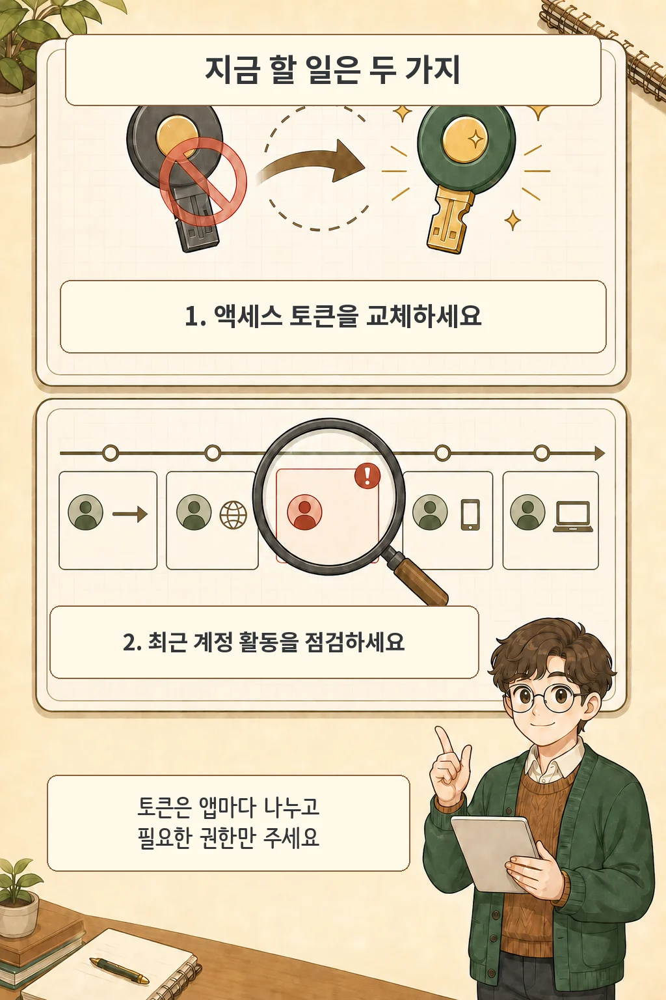

팀의 노트북, CI/CD 배포 스크립트, Spaces 앱이 허깅페이스 액세스 토큰 하나를 함께 쓰고 있다면, 플랫폼 보안 사고 소식이 떴을 때 어디부터 끊고 바꿔야 할지 막막해지기 쉽습니다. 허깅페이스는 2026년 7월 16일 악성 데이터셋이 데이터 처리 경로의 코드 실행 경로를 악용해 내부 클러스터로 번진 침입 사고를 공개하고, 예방 조치로 토큰 교체와 최근 계정 활동 검토를 권고했거든요. 이번 글에서는 회사가 밝힌 침입 메커니즘과 현재 확인된 영향 경계를 나눠 살펴보고, 개발자와 운영자가 바로 실행할 점검 기준을 정리합니다.

글·해설: 다메카솔

## 침입은 데이터 처리 경로에서 시작됐습니다

허깅페이스의 자체 조사에 따르면, 공격은 데이터 전처리 파이프라인의 두 가지 코드 실행 경로에서 시작됐습니다. 악성 데이터셋이 **원격 코드 데이터셋 로더**와 **데이터셋 설정의 템플릿 주입** 경로를 악용해 백엔드 처리 워커에서 임의 코드를 실행한 셈이죠.

이후 공격자는 처리 워커에서 호스트 노드 수준으로 권한을 높였고, 클라우드와 클러스터 자격 증명을 수집해 여러 내부 클러스터로 이동했습니다. 회사는 이 캠페인이 자율 에이전트 프레임워크를 동원해 수천 건의 동작을 수행한 것으로 보인다고 설명했습니다. 다만 공격에 쓰인 언어 모델은 확인되지 않았으므로, 특정 주체나 모델을 추정하지 않는 상태입니다.

허깅페이스는 사고 탐지 후 악용된 코드 실행 경로를 닫고 침해 노드를 재구축했다고 밝혔습니다. 아울러 영향받은 자격 증명과 토큰을 폐기·교체하고, 클러스터 입장 제어와 탐지·경보 체계도 함께 강화했습니다.

## 영향 범위는 세 갈래로 나눠 읽어야 합니다

보안 사고를 접할 때는 확인된 피해와 아직 조사 중인 영역을 한 문장으로 뭉뚱그리지 말아야 합니다. 2026년 7월 20일 기준으로 허깅페이스가 공개한 조사 상태는 아래 세 단계로 나뉩니다.

| 구분 | 현재 확인 상태 | 해석 시 유의점 |
| --- | --- | --- |
| **확인됨** | 제한된 내부 데이터셋과 서비스 자격 증명 일부 무단 접근 | 서비스 내부 자격 증명이 실제로 노출된 범위 |
| **조사 중** | 파트너·고객 데이터의 영향 여부 평가 진행 중 | 외부 포렌식 완료 전까지 영향 제외 단정 보류 |
| **현재 증거 없음** | 공개 사용자 모델·데이터셋·Spaces 변조 증거 미발견, 컨테이너 이미지·공개 패키지 공급망 정상 확인 | 영구 안전 선언이 아닌 현재 조사 시점의 상태 |

여기서 세 번째 항목은 공개 자산이 완전히 안전했다는 최종 결론보다 현재 시점까지 변조 증거를 찾지 못했다는 뜻으로 읽어야 합니다. 파트너나 고객 데이터에 관한 평가가 진행 중인 만큼, 사용자 입장에서는 최종 공지를 기다리기 전에 선제적으로 인증 수단을 점검하는 편이 안전하죠.

## 개발자와 팀이 지금 바로 해야 할 두 가지 조치

예를 들어 개인 실험용 노트북, 사내 CI/CD 파이프라인, 테스트용 Spaces 앱 세 곳에 동일한 액세스 토큰 하나를 넣어 두었다고 가정해 봅시다. 이 상태에서 새 토큰을 발급받기 전에 기존 토큰부터 폐기하면 배포 파이프라인이 즉시 멈추고, 반대로 새 토큰만 추가하고 이전 토큰을 남겨 두면 노출 위험이 그대로 남거든요. 따라서 **새 토큰 발급 → 환경 교체 및 동작 확인 → 이전 토큰 폐기** 순서로 진행해야 서비스 중단과 보안 공백을 함께 막을 수 있습니다.

1. **허깅페이스 액세스 토큰 교체 및 권한 분리**: [Access Tokens 설정](https://huggingface.co/settings/tokens)에서 새 토큰을 발급해 앱과 자동화·배포 환경에 반영한 뒤 기존 토큰을 폐기합니다. 허깅페이스 공식 문서는 앱이나 사용처마다 별도 토큰을 만들고, 운영 환경에서는 필요한 리소스에만 권한을 주는 **세부 권한 토큰(fine-grained token)**을 쓰라고 권고합니다.
2. **계정 활동 및 감사 로그(Audit Logs) 점검**: 개인 계정은 최근 낯선 접근이나 변경 이력이 있는지 확인합니다. Team·Enterprise 조직 관리자라면 [Audit Logs](https://huggingface.co/settings/audit-logs)에서 작업 주체, 작업 종류, 설명, 위치와 익명화된 IP, 날짜·시각을 살피고 전체 로그를 JSON으로 내려받아 대조할 수 있습니다.

## 다메카솔의 해석: 모델보다 데이터 로더와 장기 토큰을 먼저 점검할 때

이번 사고는 공개 허브의 AI 모델이 변조됐다는 사례라기보다, 데이터 처리 경로와 장기 자격 증명을 별도 공격 표면으로 관리해야 한다는 운영 경고로 읽는 편이 정확합니다. 겉으로는 단순 데이터셋이나 설정 파일처럼 보여도, 파싱 과정에서 코드가 실행될 수 있다면 실행 권한과 토큰 수명을 분리해 두어야 합니다. 이번 기회에 팀의 인증 설정을 아래 네 가지 기준으로 점검해 보시기 바랍니다.

- **토큰 공유 차단**: 노트북, 테스트 앱, 배포 서버가 같은 토큰을 공유하지 않도록 사용처별로 분리했는지 확인합니다.
- **최소 권한 적용**: 운영 토큰이 필요한 모델이나 데이터셋 저장소보다 넓은 권한을 갖지 않도록 조정합니다.
- **폐기 완료 여부**: 교체 후 배포 환경 값만 바꾸고 이전 토큰을 계정 설정에 남겨 둔 사례가 없는지 검증합니다.
- **감사 로그 대조**: 조직 감사 로그에서 평소 주체나 위치, 시각과 어긋나는 API 호출 이력이 없는지 살핍니다.

## 함께 읽을 AI/보안 글

- [Kubernetes NetworkPolicy와 간헐적 차단 트러블슈팅](/posts/k8s-networkpolicy-dnat-evaluation/)
- [Copilot 보안 API 실증 연구와 가드레일](/posts/copilot-security-api-study/)

## 출처

- [허깅페이스 공식 사고 공지 — Security incident disclosure — July 2026](https://huggingface.co/blog/security-incident-july-2026)
- [허깅페이스 공식 블로그 저장소 원문](https://github.com/huggingface/blog/blob/main/security-incident-july-2026.md)
- [허깅페이스 User access tokens 문서](https://huggingface.co/docs/hub/security-tokens)
- [허깅페이스 Audit Logs 문서](https://huggingface.co/docs/hub/audit-logs)

허깅페이스의 2026년 7월 16일 공식 사고 공지와 보안 문서를 바탕으로 정리했으며, 별도 재현 실험이나 침해 분석은 포함하지 않았습니다.

이 글의 본문과 이미지는 생성형 AI로 제작했습니다. 기획과 편집 기준은 다메카솔이 정했습니다.
