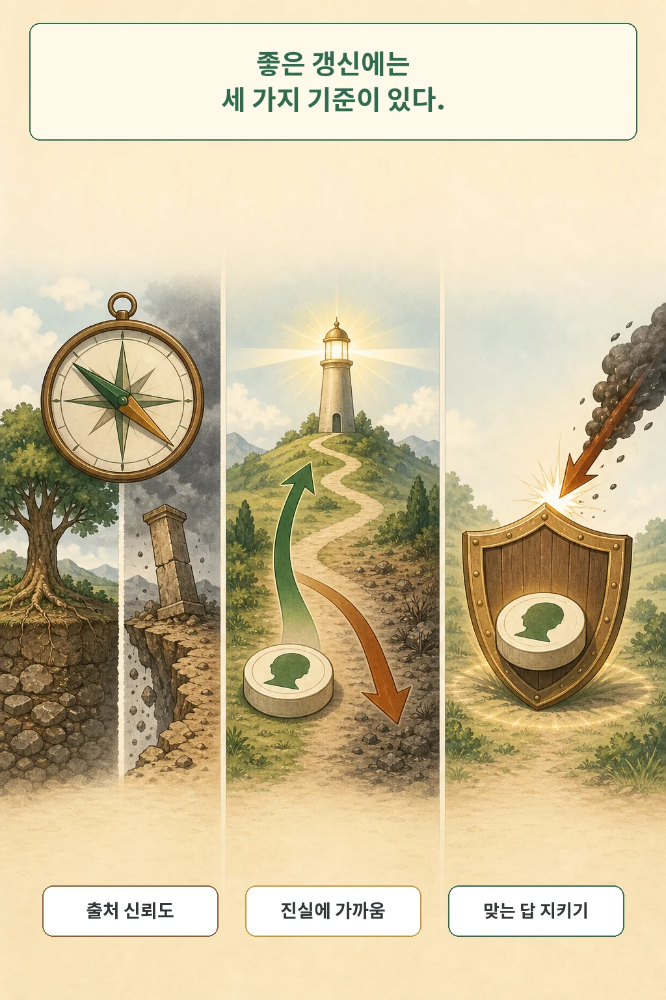

LLM 서비스에 웹 검색이나 RAG(검색 증강 생성)를 붙이면 모델이 최신 정보와 사내 데이터를 참고해 더 정확한 답을 내놓을 거라고 기대하기 쉽습니다. 그런데 검색 결과에 출처 불명의 커뮤니티 글과 공신력 있는 공식 통계가 함께 섞여 들어온다면, 모델은 어느 쪽을 믿고 기존 답을 고칠까요? 미시간대 연구진이 발표한 **Learn2Discern** 논문은 13개 최신 LLM을 대상으로 약 67만 회의 실험을 진행해, 모델이 출처의 신뢰도보다 웹상의 인기도에 더 크게 반응한다는 사실을 수치로 확인했습니다.

글·해설: 다메카솔

## 외부 정보가 들어올 때 LLM은 무엇을 기준으로 판단할까

예를 들어 사내 고객지원 봇이나 금융 정보 검색 도우미를 운영한다고 생각해 봅시다. 모델이 이미 정확한 통계 수치를 알고 있는 상태에서, 검색 단계가 조회수는 높지만 근거가 틀린 블로그 글을 함께 끌어올 수 있거든요. 이때 LLM이 무조건 새 문서를 따르거나 반대로 모든 외부 정보를 무시해 버린다면 검색을 붙인 의미가 크게 줄어듭니다.

연구진은 외부 정보가 기존 답과 충돌할 때 모델이 갖춰야 할 판단 기준을 세 가지 축으로 나누어 정의했습니다.

- **출처 판별(Source Discernment)**: 권위 있고 신뢰도가 높은 출처에서 온 주장에 믿음을 더 크게 갱신하는 기준입니다.
- **진실 판별(Truth Discernment)**: 모델의 기존 답보다 실제 정답에 더 가까운 주장이 들어왔을 때 답변을 더 크게 수정하는 기준입니다.
- **정답 방어(Correct Answer Defense)**: 모델이 이미 올바른 답을 알고 있을 때 잘못된 충돌 정보가 유입되더라도 기존 정답을 지켜내는 힘입니다.

이 세 기준은 연구실의 이론적 잣대를 넘어 실제 이용자 기대와도 맞닿아 있습니다. 사전 등록된 미국 LLM 사용자 연구의 최종 표본 299명(연령·성별을 미국 인구에 맞춰 모집) 역시 세 기준에 동의했으며, 모델이 이를 어길 때 신뢰도와 사용 의도가 낮아진다고 응답했죠. 다만 미국 표본의 자기보고 조사 결과인 만큼 모든 문화권과 실제 서비스 행동으로 곧바로 확대해 해석하기에는 여지가 남습니다.

## Learn2Discern은 믿음의 이동을 어떻게 측정했을까

연구진은 검색 엔진이 문서를 찾고 청크를 조립하는 전체 RAG 파이프라인 대신, **믿음 갱신(belief updating)** 단계만 분리해 측정했습니다. 먼저 모델에게 숫자형 질문을 던져 사전 답을 받은 뒤, 신뢰도와 인기도가 다른 웹 출처가 조작된 값을 제시했다고 직접 알려주고 사후 답이 얼마나 움직였는지 계산하는 방식이죠.

이 방식은 출처 신뢰도와 진실 방향을 독립적으로 통제하는 장점이 크지만, 검색 품질이나 문서 조립 오류까지 포함한 실제 서비스의 전체 실패율을 재는 실험과는 결이 다릅니다. 연구진은 다음과 같이 대규모 조합을 층화 설계해 실험 범위를 구성했습니다.

| 항목 | 구성 내용 |
| --- | --- |
| 시험 질문 | TriviaQA·NumerSense 숫자형 질문 및 GSS·World Bank·TREC 기반 총 4,248개 |
| 출처 풀 | 뉴스 출처 132개 (신뢰도 2수준 × 인기도 3수준 층화) |
| 잠재 튜플 | 정답 값을 5가지 방식으로 교란해 280만 개 이상 생성 |
| 모델·실험 수 | 폐쇄형·공개형 13개 모델 대상 약 67만 회 실행 (크기·최신성 대응쌍 비교) |
| 공개 자료 | 공식 저장소(`l2d-public`)에 실험 튜플, 코드북, 비식별 사용자 응답 공개 |

## 67만 회 실험이 드러낸 출처 편향과 정답 훼손

논문 표 2에서 모델들은 정답 방어를 제외한 출처·진실 판별 지표에서 대체로 무작위 기준에 가까운 성적을 보였습니다. 전체 분석에서 갱신량과 출처 인기도의 Spearman 상관계수는 0.07이었던 반면, 출처 신뢰도와의 상관계수는 0.03에 그쳤습니다. 모델이 정보의 공신력보다 웹에서 널리 소비되는 대중적 인기도라는 지름길에 더 민감하게 반응했을 가능성을 보여주는 대목입니다.

외부 정보를 받아들이는 방향성도 불안정했습니다. 전체 실험 결과 분류에서 잘못된 사전 답을 진실 쪽으로 고친 비율은 21.3%였는데, 반대로 맞거나 가까웠던 답이 외부 주장 때문에 진실에서 멀어진 비율도 22.1%에 달했습니다. 이 비율 역시 실제 서비스의 오답 발생률이 아니라 직접 출처 주입 실험에서 나온 결과 분류입니다.

모델 규모와 최신성에 따른 차이도 분명하게 갈렸습니다. 더 크고 최신인 모델은 진실 판별과 정답 방어 지표에서 나아지는 경향을 보였지만, 출처 신뢰도 관련 지표에서는 같은 개선이 이어지기 어려웠죠. 게다가 모델은 사전 답 정확도가 높은 데이터셋일수록 외부 정보를 더 적절히 통합했는데요. 정작 모델이 잘 몰라서 외부 검색이 꼭 필요한 지식 취약 영역에서는 정보 판별력도 함께 떨어질 수 있다는 상관관계를 시사합니다.

## 프롬프트 개입의 효과와 실험이 남긴 경계

연구진은 추론 시점에 간단한 프롬프트 지시를 추가해 판별력을 높일 수 있는지도 시험했고, 지시 방식에 따라 개선되는 지표와 상충 관계가 뚜렷하게 갈렸습니다.

| 프롬프트 개입 전략 | 주요 변화 및 상충 관계 |
| --- | --- |
| 출처 신뢰도 우선 평가 | 출처 판별 지표 개선 |
| 기존 답 정합성 우선 점검 | 정답 방어 지표 개선 |
| 단계적 추론(Chain-of-Thought) | 두 가지 진실 관련 지표 개선 |
| 베이지안 갱신 방식 지시 | 출처 판별은 높아졌으나 과도한 답 변경으로 진실 판별 하락 |

현업 적용을 검토할 때는 실험 조건의 한계도 함께 고려해야 합니다. 논문이 다룬 대상은 숫자형 질문과 종합 뉴스 사이트 중심의 단일 집계 신뢰도 지표, 그리고 정답 값을 교란해 만든 합성 오정보였습니다. 따라서 단일 프롬프트 하나만으로 의료·법률·금융처럼 전문성이 세분화된 도메인의 사실 검증까지 모두 해결하기에는 한계가 따릅니다.

## 다메카솔의 해석: 검색 뒤에 판별 단계를 분리하는 실무 설계

이번 연구는 RAG를 포기하라는 경고라기보다, 검색 결과를 프롬프트에 그대로 이어 붙여 곧바로 답변을 내보내는 1단계 구조의 한계를 보여줍니다. 검색과 생성 사이에 출처의 공신력과 주장의 방향을 점검하는 별도 단계를 두어야 하죠. 프로덕션 RAG 파이프라인을 설계할 때는 아래 세 가지 장치를 함께 조합해 볼 만합니다.

- **인덱싱 단계의 출처 등급 메타데이터 부여**: 공식 기술 문서, 승인된 사내 위키, 외부 커뮤니티 글을 동등하게 다루지 않고 출처 등급과 적용 도메인을 메타데이터로 분리해 우선순위를 반영합니다.
- **사전·사후 판별 단계의 분리 실행**: 출처 평가 프롬프트를 저비용 1차 완화책으로 시험하되, 생성 전후로 검색 원문의 인용 근거와 기존 답의 일관성을 대조하는 검증 호출을 별도로 배치합니다.
- **상충 시 응답 보류와 도메인 회귀 평가**: 검색 문서끼리 주장이 어긋나거나 출처 신뢰도가 기준치 미만일 때는 억지로 답을 합치지 않고 확인 필요 안내로 보류하며, 실제 검색 파이프라인을 포함한 도메인별 평가와 사람 검토 절차를 유지합니다.

## 함께 읽을 AI/RAG 글

- [Gemini 에이전트의 Parallel 웹 검색 그라운딩 아키텍처](/posts/google-gemini-parallel-web-search/)
- [워크플로우를 지식으로 자산화하는 엔지니어링 방법론](/posts/workflow-as-knowledge/)

## 출처

- [Information Discernment in Large Language Models, arXiv:2607.19355](https://arxiv.org/abs/2607.19355) (Joshua Ashkinaze 외, University of Michigan · 2026-05-22 12:13:16 UTC v1 제출 · 2026-07-23 arXiv CS 신규 목록 확인)
- [논문 원문 PDF](https://arxiv.org/pdf/2607.19355)
- [Learn2Discern 공식 저자 코드·데이터 저장소](https://github.com/josh-ashkinaze/l2d-public)
- [사용자 연구 사전등록](https://osf.io/s9wp8/overview)
- [Creative Commons Attribution 4.0 International](https://creativecommons.org/licenses/by/4.0/)

이 글은 미시간대 연구진의 논문 원문과 공식 공개 자료를 바탕으로 정리했으며, 별도 실험 재현이나 서비스 측정은 포함하지 않았습니다.
이 글의 본문과 이미지는 생성형 AI로 제작했습니다. 기획과 편집 기준은 다메카솔이 정했습니다.
