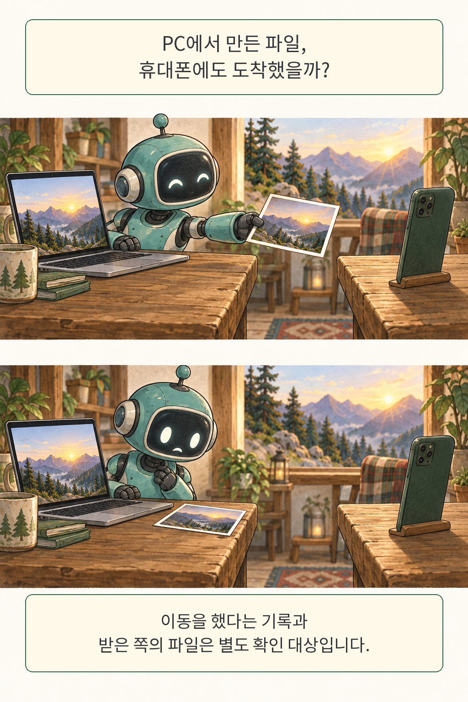
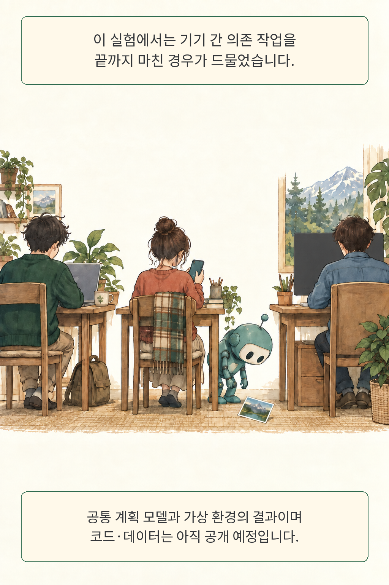

합성 작업 150개 가운데 끝까지 성공한 것은 12개뿐이었습니다. 본문 실험에서 가장 높은 전체 성공률을 기록한 HOLO2 구성조차 **8.0%**에 머물렀는데요. 개별 화면 조작은 제법 능숙해 보여도, 여러 기기와 환경을 이어 맡기면 일이 끝까지 완성되는 비율은 훨씬 낮았습니다. **JarvisGUI**는 Android·Windows·Ubuntu를 오가며 중간 결과를 이어 쓰는 GUI 에이전트의 능력을 이처럼 전체 작업 단위로 시험한 연구입니다.

글·해설: 다메카솔

## 핵심 내용

- **동적 작업 연결**: 앞 작업의 출력과 다음 작업의 입력을 데이터 형식(타입)에 따라 연결하고, 실행 중 실제로 나온 출력값으로 후속 지시와 평가 조건을 구성합니다.
- **실험 구성 조건**: 본문은 공통 계획 모델(Qwen3-VL-Plus)에 6개의 GUI 조작 모델(Grounder)을 연결한 실험이므로, 모델을 단독 실행한 일반 제품 순위와는 조건이 다릅니다.
- **기기 간 인계의 벽**: 기기 간 의존 과제는 구성별 50개씩 시험했으며, 전체 성공률은 **0~2%**(최대 1건 성공)에 그쳤습니다.
- **엄격한 완료 판정**: 일부 조작 성공만으로 통과시키지 않고, 최종 환경의 파일 내용이나 DOM 상태를 프로그램으로 직접 검사해 전체 완료를 판정합니다.
- **확인 범위**: 2026년 9월 10일 확인 시점에 공식 저장소는 README만 공개된 상태였으며, 아래 수치는 저자 보고치입니다(벤치마크 재현 실행은 수행하지 않았습니다).

## 전송했다고 생각한 순간, 다음 작업이 막혔다

PC에서 편집한 사진을 휴대폰으로 옮겨 열어야 한다면, 후속 조작은 휴대폰에 그 사진이 실제로 도착해 있다는 조건에 달려 있습니다. 파일이 출발지에만 남아 있다면 휴대폰 앱을 아무리 정확히 눌러도 목표를 달성할 수 없기 때문입니다.

저자들이 제시한 실패 사례(논문 5.3절 및 부록 D.2)에서는 에이전트가 파일을 Android로 전송했다고 스스로 추론했지만, 실제로는 Chrome 브라우저만 열어 두고 더 진행하지 않았습니다. 이름 변경이나 파일 전송처럼 빠뜨린 단계를 이미 완료한 것으로 간주해 버리면, 뒤이은 계획은 존재하지 않는 상태를 바탕으로 헛돌게 됩니다.

만화의 사진 전달 장면은 이 간극을 보여 주기 위해 새로 그린 비유입니다(종이 사진과 책상 사이의 틈은 파일과 기기 사이의 인계를 뜻하며, 실제 통신 방식이나 논문의 실험 화면을 복제한 것은 아닙니다). 화면에서 클릭할 대상을 찾는 방법은 앞서 다룬 [Tactile의 접근성 기반 컴퓨터 조작](/posts/tactile-computer-use-agents/)과 연결되지만, 이번 연구가 던지는 질문은 **그 조작의 결과를 다른 기기까지 끊김 없이 이어 갈 수 있는가**에 있습니다.

## 출력과 입력의 형식을 맞춰 작업을 엮었다

서로 이어질 작업을 조합하려면 각 단계가 무엇을 내보내고 무엇을 받는지부터 정해야 합니다. JarvisGUI는 작업마다 입력 슬롯, 출력 슬롯, 자연어 지시 틀, 평가 함수, 실행 플랫폼을 지정합니다. 앞 작업의 출력 타입이 다음 작업의 입력 타입과 호환되면 연결 후보가 되는 식인데, 예를 들어 구체적인 스프레드시트 파일 타입을 더 일반적인 파일 입력 슬롯에 넘길 수 있습니다.

이렇게 작업이 연결되면 실제 데이터 값이 움직입니다. 앞 단계에서 생성된 실제 결과값을 다음 단계의 지시문과 평가 함수에 동적으로 반영하므로, 처음부터 모든 파일 이름과 결과를 고정해 둔 시나리오와는 차이가 있습니다. 다른 기기로 파일을 옮겨야 하는 연결 구간에는 전송 보조 작업도 함께 끼워 넣지만, 입출력 타입이 호환된다는 사실 자체가 실제 파일 전송의 성공을 보장해 주지는 않습니다.

저자들은 이를 바탕으로 **원자 과제 118개**와 **합성 과제 150개**를 구성했습니다. 합성 과제 150개는 다음 세 유형으로 각 50개씩 나뉩니다.

- **단일 기기 순차 작업 (50개)**: 한 기기 안에서 작업 순서가 이어지는 과제입니다.
- **다중 기기 독립 작업 (50개)**: 여러 기기에서 각각 독립적으로 수행하는 과제입니다.
- **기기 간 의존 작업 (50개)**: 한 기기의 실행 결과가 다른 기기의 후속 작업에 반드시 필요한 과제입니다.

이 구분 덕분에 여러 기기를 다룬다는 부담과 앞선 결과를 기다려 인계받아야 하는 부담을 나누어 살펴볼 수 있습니다(다만 과제 집합 자체가 서로 다르므로 점수 차이 전체를 기기 수만의 순수 인과 효과로 단정하기에는 한계가 있습니다).

## 받은 쪽의 실제 상태를 검사해야 전체 완료가 된다

에이전트가 출력한 “완료했습니다”라는 문장만으로 최종 판정을 내린다면 앞서 본 전송 누락 오류가 그대로 통과하기 쉽습니다. 이 연구의 평가 함수는 최종 환경에서 파일 내용이나 DOM 같은 관찰 가능한 대상을 프로그램으로 직접 검사하며, 합성된 하위 작업 각각의 모든 조건을 만족해야만 전체 성공으로 집계합니다.

연구진은 전체 성공과 부분 성공도 구분해 측정했습니다. **TSR(Task Success Rate)**은 전체 과제를 끝까지 완수한 비율이고, **SSR(Sub-task Success Rate)**은 하위 작업의 완료 정도를 뜻합니다. 두 지표를 섞어 버리면 초반 몇 단계만 수행한 시스템이 마치 전체 요청을 끝낸 것처럼 보이기 쉬우므로, 이 글의 비교표는 TSR과 전체 성공 건수를 기준으로 정리했습니다.

참고로 SSR은 원문 안에서도 정의와 표기 사이에 추가 확인이 필요한 부분이 있었습니다. 본문 식 3은 과제별 하위 작업 완료 비율의 평균으로 정의하지만, 부록 표 9는 성공한 하위 작업 수를 전체 하위 작업 수(442개)로 나눈 건수와 함께 표시하고 있어 과제마다 하위 작업 수가 다를 경우 두 집계 방식의 값이 달라질 수 있습니다. 확인 시점에 공개 데이터가 없어 이 차이를 직접 대조하지 못했으므로, SSR 수치를 근거로 추가 결론을 내리는 일은 보류했습니다.

## 기기 간 의존 과제의 성공은 최대 한 건이었다

여섯 가지 모델 구성 모두 **기기 간 의존 작업 50개 중 성공률(TSR)이 0~2%**에 그쳤습니다. 가장 높은 2.0%조차 50번의 시도 가운데 단 한 번 성공한 셈이어서, 개별 화면 조작 성과와 기기 간 인계를 포함한 전체 완수율 사이의 큰 간격이 그대로 드러납니다.

아래 표는 arXiv v1의 표 3과 표 9에서 전체 성공 지표를 옮긴 것입니다. 상위 계획은 공통으로 **Qwen3-VL-Plus**가 맡고, 표의 GUI 모델들은 클릭 위치 등 구체적인 행동 대상을 지정하는 Grounder 역할로 연결됩니다(따라서 각 수치는 이 계획·조작 결합 구성과 논문의 가상 환경 조건에 묶여 있습니다).

| GUI 모델 구성 | 원자 과제 전체 성공 (118개) | 합성 과제 전체 성공 (150개) | 기기 간 의존 과제 TSR (50개) |
| --- | ---: | ---: | ---: |
| UI-Venus-Ground 7B | 44/118 (37.3%) | 2/150 (1.3%) | 0.0% |
| UI-TARS-1.5 7B | 44/118 (37.3%) | 9/150 (6.0%) | 0.0% |
| MAI-UI 8B | 34/118 (28.8%) | 6/150 (4.0%) | 0.0% |
| GUI-OWL 32B | 46/118 (39.0%) | 11/150 (7.3%) | 2.0% |
| Qwen3-VL-Instruct 30B-A3B | 42/118 (35.6%) | 6/150 (4.0%) | 0.0% |
| HOLO2 30B-A3B | 50/118 (42.4%) | 12/150 (8.0%) | 2.0% |

*출처: JarvisGUI v1, 표 3·9. 저자 보고값이며 서로 다른 과제 집합의 결과입니다. 부록 표 9의 HOLO2 합성 과제 TSR 95% 부트스트랩 구간은 4.0~12.7%인데, 이는 과제 재표집 기준이며 모델을 여러 번 반복 실행했을 때의 변동 범위를 뜻하지 않습니다.*

상위 계획 모델을 바꾸면 결과가 얼마나 달라질까요? 부록 A.7의 HOLO2 구성에서 계획 모델을 **Kimi K2.6**으로 교체하자 합성 과제 전체 성공률은 8.0%에서 **11.3%**로 올랐지만, 기기 간 의존 과제의 성공률은 두 구성 모두 **2.0%**로 같았습니다. 저자들이 시험한 추가 구성에서도 기기 사이 인계가 필요한 과제의 난관은 그대로 남았습니다.

아울러 전송 누락, 잘못된 플랫폼 선택, 중간 파일 위치 오판이 반복됐다는 서술은 저자들의 정성적 사례 분석입니다. 실패 양상을 파악하는 데는 유용하지만 각 요인의 독립적인 기여도를 실험으로 분리한 증거와는 범위가 다르며, 이 결과를 모든 GUI 에이전트나 실제 상용 서비스의 고정 성공률로 일반화할 근거도 부족합니다.

### 공개 자료로 확인할 수 있는 범위

2026년 9월 10일 확인 당시 공식 저장소(`48c1c5666848699dbb1e28b83b48e92fa7e1de4b` 커밋)에는 README 파일 하나만 올라와 있었고 코드와 데이터는 추후 공개 예정으로 안내돼 있었습니다. 따라서 이번 검토는 원문·표·공식 저장소 공개 범위 확인까지이며 모델 호출이나 벤치마크 재실행은 포함하지 않았습니다. 또한 저자들은 실험 환경이 Docker와 KVM 기반 가상 머신 자원에 의존하며 접근성 중심 시나리오, 실제 하드웨어 환경, 비용 및 시뮬레이션 제약에 따른 한계가 있다고 밝혔습니다(논문 메타데이터에는 EMNLP 2026 Main 채택이 기재돼 있으며, 이 글은 2026년 9월 9일 제출된 arXiv v1을 기준으로 작성했습니다).

## 다메카솔의 해석: 인계 완료를 하나의 상태로 남기자

여러 기기를 오가는 에이전트를 설계한다면 기기 사이의 인계를 별도의 **상태 전이(state transition)**로 다루는 편이 안전합니다. 파일을 보내는 단계와 받은 쪽 기기가 그 파일을 사용할 준비가 된 단계 사이에 명시적인 확인 지점을 두는 방식인데요. 파일 식별자, 목적지 경로, 수신 확인, 검증 시점을 함께 기록해 두면 후속 작업이 어떤 근거를 믿고 출발했는지 추적하기가 훨씬 쉬워집니다.

이러한 접근은 분산 작업의 의존성 관리와도 맞닿아 있습니다. 송신 측 로그만으로 목적지 상태를 추정하면 어디서 장애가 났는지 찾기 어렵지만, 목적지에서 파일의 존재와 필수 내용을 직접 확인한 뒤 다음 작업으로 넘기고 확인 실패 시에는 그 인계 단계에서 즉시 멈추게 하면 실패 범위가 선명하게 드러납니다. 상태가 불명확한 상태에서 재시도할 때 이미 끝난 조작을 중복 수행할 위험도 함께 줄일 수 있습니다. 앞서 [한국 공공 API의 다단계 호출 연구](/posts/korean-public-api-tool-chains/)에서 다룬 ‘앞 결과와 다음 입력의 연결’을 GUI 환경으로 넓혀 보는 셈입니다.

물론 검사를 늘리면 추가 호출 비용과 대기 시간이 발생하는 만큼, 파일 공유 방식과 검사 수준, 실패 후 재개 위치는 서비스 특성에 맞춰 조율해야 합니다(위 설계는 논문이 개선 효과를 직접 측정한 처방이 아니라, 관찰된 실패 사례를 바탕으로 도출한 운영 방향입니다). 앞으로 자동화 데모를 볼 때 목적지 기기에서 파일을 실제로 열어 확인하는 한 장면이 더해진다면, 에이전트가 어디까지 일을 끝냈는지 훨씬 정확하게 판단할 수 있을 것입니다.

## 출처

- Zixiang Chen 외, [JarvisGUI: Towards Cross-Device GUI Agents with Dynamic Task Composition](https://arxiv.org/abs/2609.10451), arXiv:2609.10451v1. 제출: 2026-09-09 16:59:59 UTC.
- [v1 원문 PDF](https://arxiv.org/pdf/2609.10451v1): 3~5절, 표 2·3, 한계, 부록 A.7의 표 8·9와 D.2의 실패 사례.
- [저자 공식 저장소, 확인한 커밋](https://github.com/BUAA-IRIP-LLM/JarvisGUI/tree/48c1c5666848699dbb1e28b83b48e92fa7e1de4b): README만 공개, 코드·데이터 공개 예정.

작성·자료 확인: 2026-09-10. 만화는 논문의 의미를 새로 그렸으며 원문 그림과 화면을 사용하지 않았습니다.

이 글의 본문과 이미지는 생성형 AI로 제작했습니다. 기획과 편집 기준은 다메카솔이 정했습니다.
