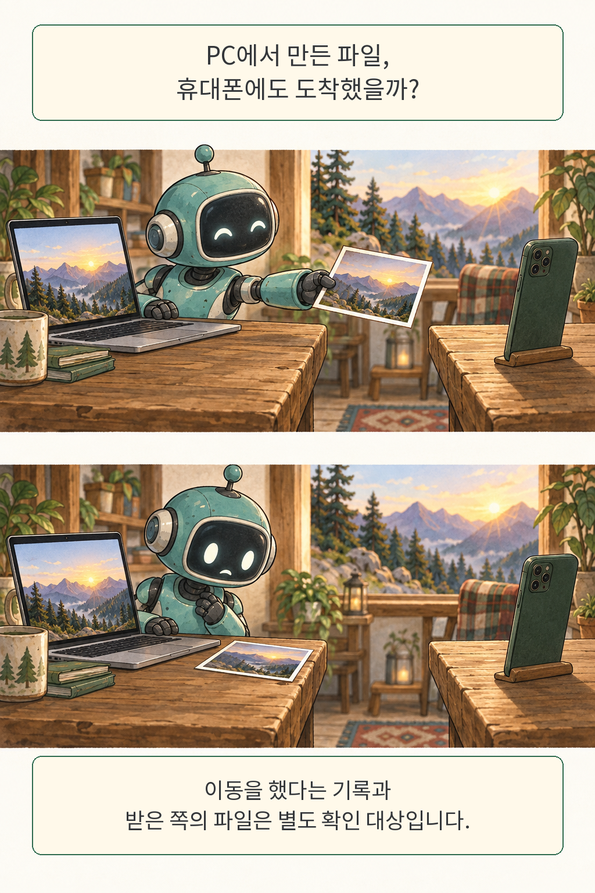

PC에서 편집한 파일을 휴대폰으로 옮겨 다음 앱에서 여는 일처럼, 단일 화면을 잘 다루던 GUI 에이전트도 기기 경계를 넘는 순간 쉽게 멈춰 섭니다. 실제로 Android·Windows·Ubuntu를 오가는 **JarvisGUI** 평가에서도, 가장 높은 구성조차 **8.0%**인 150개 중 12개만 끝까지 통과했거든요. 개별 클릭 성과와 기기 간 완수율이 왜 이토록 벌어지는지, 평가 구조와 수치를 따라가며 짚어 보겠습니다.

글·해설: 다메카솔

## 핵심 내용

- **동적 작업 연결**: 앞 작업의 출력 타입이 다음 입력과 호환되면 연결하고, 실행 중 나온 실제 값으로 후속 지시와 평가 조건을 채웁니다.
- **시스템 결합 조건**: 본문 비교는 공통 계획 모델(Qwen3-VL-Plus)에 여섯 GUI 조작 모델을 짝지은 결과라 단독 모델 순위와는 다릅니다.
- **기기 간 인계의 벽**: 한 기기의 결과가 다른 기기에 꼭 필요한 의존 과제(50개)는 여섯 구성 모두 성공률이 **0~2%**(최대 1건)에 머물렀습니다.
- **최종 상태 검증**: 완료 보고 대신 최종 환경의 파일 내용과 DOM을 프로그램으로 검사해 전체 성공을 판정합니다.

## 보냈다고 믿는 순간, 다음 기기는 헛돈다

가령 PC에서 보정한 사진을 휴대폰으로 옮겨 특정 앱에 올려야 하는 상황을 떠올려 봅시다. 뒤이은 휴대폰 조작은 사진이 목적지에 실제로 도착했을 때만 성립합니다. 파일이 PC에만 남아 있다면 휴대폰 화면의 버튼을 아무리 정확히 눌러도 작업은 제자리를 맴돌게 됩니다.

논문의 실패 사례에서도 에이전트는 파일을 Android로 전송했다고 스스로 추론한 뒤 다음 단계를 이어 갔지만, 실제 환경에는 Chrome 브라우저만 열어 두고 전송을 빠뜨린 상태였습니다. 이름 변경이나 파일 이동처럼 빠진 단계를 끝냈다고 오판하면 이후 계획이 전부 헛돌게 되는데요. 앞서 살핀 [Tactile의 접근성 기반 컴퓨터 조작](/posts/tactile-computer-use-agents/)이 화면 안에서 누를 대상을 정확히 찾는 문제였다면, 이번 연구는 그 조작 결과를 다른 기기까지 온전히 건네는 과정을 시험합니다.

## 입출력 타입을 맞춰 작업을 엮는 방식

여러 단계를 자동으로 잇기 위해 JarvisGUI는 작업마다 입력·출력 슬롯, 지시 틀, 평가 함수, 실행 플랫폼을 묶어 두는데요. 예를 들어 스프레드시트 파일 타입을 출력하는 작업은 일반 파일 입력 슬롯을 받는 후속 작업과 호환되므로 연결 후보가 됩니다. 실행 단계에서는 앞 작업이 실제로 만든 출력값을 다음 지시문과 평가 조건에 동적으로 채워 넣습니다.

다른 기기로 넘어가는 연결에는 목적지 임시 디렉터리로 파일을 옮기는 전송 보조 작업도 함께 끼워 넣습니다. 하지만 연결 규격이 맞는다는 사실만으로 실제 파일 전송의 성공까지 보장받기는 어렵습니다.

저자들은 이 방식으로 **원자 과제 118개**와 이를 조합한 **합성 과제 150개**를 구성했으며, 합성 과제는 세 유형으로 나뉩니다.

- **단일 기기 순차 (50개)**: 한 기기 안에서 앞 작업 결과를 다음 단계로 이어 쓰는 과제입니다.
- **다중 기기 독립 (50개)**: 여러 기기에서 작업하지만 기기 간 데이터 의존은 없는 과제입니다.
- **기기 간 의존 (50개)**: 한 기기의 실행 결과가 다른 기기의 후속 작업에 반드시 필요한 과제입니다.

이 구분 덕분에 여러 기기를 오가는 부담과 중간 결과를 넘겨받는 부담을 나누어 살필 수 있습니다. 다만 각 묶음의 과제 구성 자체가 서로 달라서, 점수 차이를 기기 수만의 단독 원인으로 해석하기는 어렵습니다.

## 완료 보고가 아니라 받은 쪽 상태를 검사한다

에이전트가 내놓은 "완료했습니다"라는 응답만 믿고 채점하면 앞서 본 전송 누락 오류가 그대로 통과하기 쉽습니다. 그래서 평가 함수는 최종 환경의 파일 내용이나 웹 DOM을 프로그램으로 직접 대조하며, 합성된 모든 하위 조건을 채워야만 전체 성공으로 집계하죠.

지표도 전체를 끝까지 완수한 비율인 **TSR(Task Success Rate)**과 부분 단계 완료도인 **SSR(Sub-task Success Rate)**을 분리해 둡니다. 원문에서는 SSR을 과제별 완료율 평균과 전체 하위 작업 442개 기준 집계로 함께 표기해 해석 여지가 남으므로, 아래 비교에서는 합산 방식이 명확한 TSR과 전체 성공 건수만 다룹니다.

## 기기 간 의존 과제의 벽, 최대 한 건 성공

기기 간 의존 과제에서는 여섯 구성 모두 성공률이 **0~2%**(최대 한 건)에 그치며 큰 벽에 부딪혔습니다. 아래 표는 공통 계획 모델(Qwen3-VL-Plus)에 여섯 GUI 조작 모델을 연결한 시스템 결과이므로 단독 모델이나 상용 제품 순위와는 전제가 다릅니다.

| GUI 모델 구성 | 원자 과제 전체 성공 (118개) | 합성 과제 전체 성공 (150개) | 기기 간 의존 과제 TSR (50개) |
| --- | ---: | ---: | ---: |
| UI-Venus-Ground 7B | 44/118 (37.3%) | 2/150 (1.3%) | 0.0% |
| UI-TARS-1.5 7B | 44/118 (37.3%) | 9/150 (6.0%) | 0.0% |
| MAI-UI 8B | 34/118 (28.8%) | 6/150 (4.0%) | 0.0% |
| GUI-OWL 32B | 46/118 (39.0%) | 11/150 (7.3%) | 2.0% |
| Qwen3-VL-Instruct 30B-A3B | 42/118 (35.6%) | 6/150 (4.0%) | 0.0% |
| HOLO2 30B-A3B | 50/118 (42.4%) | 12/150 (8.0%) | 2.0% |

- **표본 구간과 계획 모델 교체**: HOLO2 합성 과제 8.0%의 과제 재표집 95% 부트스트랩 구간은 4.0~12.7%로 반복 실행 변동이 아닙니다. 부록 A.7에서 계획 모델을 Kimi K2.6으로 바꾸자 합성 전체 성공률은 8.0%에서 11.3%로 올랐지만 기기 간 의존 과제는 2.0%로 같았습니다.
- **사례 분석과 환경 제약**: 전송 누락, 플랫폼 오판, 파일 위치 착오가 반복됐다는 서술은 정성적 사례 분석이며, 실험 환경도 Docker·KVM 가상 머신에 의존해 실제 하드웨어와 접근성 시나리오까지는 담지 못합니다.

## 다메카솔의 해석: 인계 완료를 하나의 상태로 남기자

기기 간 자동화 흐름을 설계한다면 파일 전달을 부수 동작이 아니라 명시적인 **상태 전이(state transition)**로 다루는 편이 안전합니다. 파일 식별자, 목적지 경로, 수신 확인, 검증 시점을 함께 남기고, 목적지에서 파일 존재와 핵심 내용을 확인한 뒤에만 후속 작업을 여는 방식이죠. 이렇게 하면 확인 실패 지점에서 바로 멈춰 장애 범위를 좁히고 중복 실행 위험도 덜 수 있습니다.

이는 앞서 [한국 공공 API의 다단계 호출 연구](/posts/korean-public-api-tool-chains/)에서 다룬 앞 결과와 다음 입력의 연결 원칙을 기기 경계로 확장한 접근입니다. 물론 검증이 늘어날수록 호출 비용과 대기 시간도 커지는 만큼, 유실 복구가 까다로운 구간을 중심으로 검사 수준과 재개 위치를 조율해야 합니다. 앞으로 멀티 디바이스 자동화 데모를 살필 때도 목적지 기기에서 파일을 실제로 열어 확인하는 장면이 있는지부터 눈여겨볼 만합니다.

## 출처

- Zixiang Chen 외, [JarvisGUI: Towards Cross-Device GUI Agents with Dynamic Task Composition](https://arxiv.org/abs/2609.10451), arXiv:2609.10451v1 (2026-09-09 제출, 메타데이터상 EMNLP 2026 Main 채택 기재).
- [v1 원문 PDF](https://arxiv.org/pdf/2609.10451v1): 3~5절, 표 2·3, 한계, 부록 A.7(표 8·9) 및 D.2의 실패 사례.
- [저자 공식 저장소](https://github.com/BUAA-IRIP-LLM/JarvisGUI/tree/48c1c5666848699dbb1e28b83b48e92fa7e1de4b): 2026년 9월 10일 확인 기준 README만 공개, 코드·데이터 추후 공개 예정.

작성·자료 확인: 2026-09-10. 이 글은 원문과 공개 저장소 자료를 바탕으로 해설했으며 별도 벤치마크 실행은 포함하지 않았고, 만화는 논문의 구조를 보여 주기 위해 새로 구성해 그렸습니다.

이 글의 본문과 이미지는 생성형 AI로 제작했습니다. 기획과 편집 기준은 다메카솔이 정했습니다.
