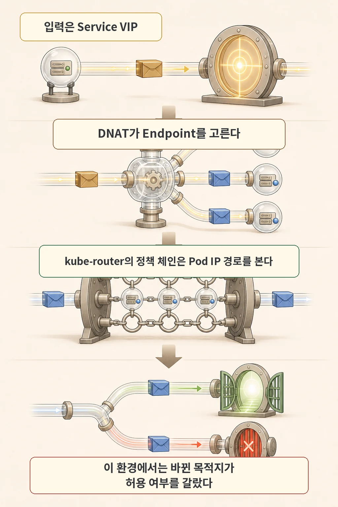
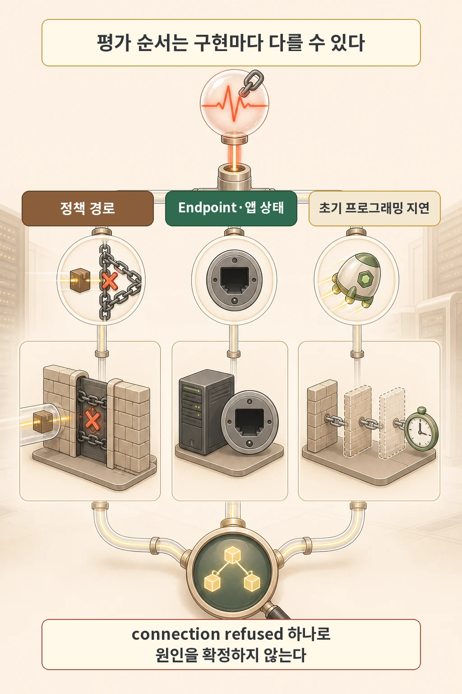

같은 파드에서 똑같은 쿠버네티스 Service 주소를 호출했는데, 한 번은 정상 연결되고 다음 호출에서는 `connection refused`로 튕겨 나갈 때가 있습니다. NetworkPolicy YAML을 다시 훑어봐도 Service VIP와 포트는 분명히 열어 두었으니 답답할 수밖에 없죠. 이럴 때는 선언한 가상 주소 대신, 커널의 DNAT 주소 변환 뒤에서 방화벽이 실제로 검사하는 목적지 IP를 확인해 봐야 합니다.

글·해설: 다메카솔

## 핵심 내용

- **단발 성공의 함정**: 2026년 7월 17일 k3s(v1.36 3노드·kube-router) 환경에서 같은 파드로 12회 호출하자 6회 통과, 6회 거부가 나왔습니다. 한 번의 성공이 정책 정상의 증거가 되지 못한다는 관찰입니다.
- **DNAT 뒤 목적지 평가**: iptables 모드의 Service는 ClusterIP 패킷을 백엔드 Endpoint IP로 DNAT하며, kube-router는 이렇게 바뀐 목적지 기준으로 방화벽 체인을 평가합니다.
- **구현체별 순서 차이**: Kubernetes 문서는 주소 재작성과 정책 평가 선후를 고정하지 않고 CNI와 Service 구현 조합에 맡깁니다.
- **대상별 정책 선택**: 내부 Pod는 `namespaceSelector`와 `podSelector` 조합을, 노드나 외부 주소는 범위를 좁힌 `ipBlock` CIDR을 우선 검토합니다.

## 한 번 성공했는데도 정책을 의심한 이유


첫 요청이 통과하면 정책도 정상이라고 넘어가기 쉽습니다. 하지만 홈랩 클러스터를 운영하던 중 하루 사이에 성격이 다른 두 경로가 똑같은 패턴으로 막히는 일이 벌어졌습니다.

첫 번째 사고에서는 CI 러너(ARC listener)가 기동 직후 API 서버의 Service 주소를 호출하다 `connection refused`를 남기고 재시작을 반복했습니다. VIP는 허용했지만 DNAT 뒤 실제 목적지인 노드의 API 엔드포인트와 6443 포트가 막혀 있었던 셈이죠. 같은 날 이미지 푸시(BuildKit) 경로에서도 로드밸런서(Traefik LB) VIP는 열려 있었으나, 실제 목적지인 프록시 Pod와 `targetPort` 구간에서 연결이 거부됐습니다.

단순 링크 장애인지 가려내려고 같은 출발 파드에서 외부 공개 API를 호출해 보니 문제없이 통과했습니다. 이어서 문제가 난 주소를 12번 연속 호출하자 6번은 붙고 6번은 거부됐는데요. 물론 작은 표본의 현장 기록이라 실패율을 특정 비율로 일반화할 수는 없지만, 단발 테스트만 믿고 넘어가면 반복 호출에서 드러나는 거부를 놓치기 쉽다는 점이 분명해졌습니다.

가령 요청 횟수만 세고 어느 백엔드가 골라졌는지 남기지 않으면 원인을 좁히기 어렵습니다. 내부 분석에서도 통과한 연결이 같은 노드의 백엔드였을 가능성이 제기됐지만 이는 추론이므로, 직접 확인할 때는 회차와 선택된 Endpoint를 함께 기록해야 합니다. 두 값을 나란히 묶는 기록 형식은 아래처럼 간단합니다.

```text
attempt  source_pod  service  selected_endpoint  result
01       test-pod    api      endpoint-a         OK
02       test-pod    api      endpoint-b         REFUSED
```

## Service VIP 뒤에서 일어나는 DNAT과 kube-router 평가



Service ClusterIP는 물리 인터페이스에 붙은 주소가 아니라 커널 규칙이 받아 주는 가상 진입점입니다. Kubernetes 공식 문서에 따르면 iptables 모드의 Service는 ClusterIP로 들어온 패킷을 백엔드 `EndpointSlice` 목록 중 하나로 목적지 주소 변환(DNAT)해 넘깁니다.

한편 kube-router의 NetworkPolicy 컨트롤러는 `filter` 테이블의 `FORWARD` 체인에서 출발지나 목적지 Pod IP에 맞는 방화벽 체인으로 패킷을 보냅니다. 이 환경에서는 패킷이 방화벽 체인에 닿기 전에 이미 DNAT을 거쳐 목적지가 VIP에서 실제 Endpoint IP로 바뀐 상태였거든요.

그래서 정책에 가상 주소만 열어 두고 실제 백엔드 Pod나 노드 IP를 빠뜨리면, 특정 Endpoint로 라우팅되는 순간 `connection refused`가 돌아옵니다. 반대로 이 순서를 짚고 나면 같은 Service 주소가 왜 Endpoint에 따라 엇갈리는지 바로 설명되죠.

다만 모든 환경이 항상 DNAT 뒤에 정책을 평가한다고 단정하기는 어렵습니다. Kubernetes 공식 문서도 주소 재작성과 정책 처리 선후를 규정하지 않으며 CNI 플러그인, 클라우드 공급자, Service 구현 조합에 따라 달라질 수 있다고 설명합니다.

## connection refused를 세 갈래로 감별하기



`connection refused`가 떴다고 곧바로 방화벽 탓으로 결론 내리면 다른 장애를 놓치기 쉽습니다. 같은 오류를 내는 세 가지 경로를 순서대로 분리해 봐야 하는 이유입니다.

- **정책 경로 차단**: DNAT 뒤 목적지 주소나 `targetPort`가 NetworkPolicy 허용 범위 밖에 있어 노드 방화벽이 연결을 거부하는 경우입니다.
- **Endpoint와 앱 상태**: Service에 `Ready` 상태의 Endpoint가 없거나, 대상 프로세스가 `targetPort`에서 수신 대기하지 않아 커널이 거절하는 경우입니다.
- **초기 프로그래밍 지연**: 새 파드가 먼저 통신을 시작했지만 노드의 `ipset`이나 방화벽 체인 반영이 늦어 잠깐 거부가 생기는 타이밍 문제입니다.

점검은 Service와 실제 백엔드 구성을 맞추어 보는 일부터 시작합니다. 아래 명령으로 가상 포트와 `EndpointSlice`의 IP·포트를 먼저 확인해 둡니다.

```bash
kubectl get svc -n <namespace> <service> -o wide
kubectl get endpointslice -n <namespace> -l kubernetes.io/service-name=<service> -o wide
```

그다음 같은 출발 파드에서 Service 주소와 개별 Endpoint를 구분해 반복 호출합니다. 운영 트래픽에 부담을 주지 않는 간격으로 시각과 결과를 함께 남겨야 어느 경로에서 튕기는지 보입니다.

```bash
kubectl exec -n <namespace> <source-pod> -- sh -c \
  'for i in $(seq 1 12); do date -Iseconds; <connection-command>; done'
```

마지막으로 실패가 재현된 노드에서 `filter` 체인과 `ipset`을 살펴봅니다. 배포판마다 체인 접두사가 다를 수 있으니 노드에 실제로 올라간 체인 이름부터 확인하는 편입니다.

```bash
sudo iptables-save -t filter | grep -E 'KUBE-ROUTER|KUBE-POD-FW|KUBE-NWPLCY'
sudo ipset list | grep -E 'KUBE-(SRC|DST)'
```

## 실제 목적지 성격에 맞춰 정책 고치기


실제 목적지 IP를 찾았다고 그 주소를 그대로 허용 목록에 넣으면 다음 파드 재시작 때 다시 막힙니다. 그 IP가 클러스터 내부 파드인지, 노드나 외부 주소인지 구분해야 재배포에도 버티는 정책을 고를 수 있거든요.

| 실제 평가 대상 | 우선 검토할 정책 표현 | 피해야 할 실수 |
| --- | --- | --- |
| **클러스터 내부 Pod** | `namespaceSelector`와 `podSelector` 조합 | 바뀌는 Pod IP를 `ipBlock`에 정적 등록 |
| **노드 또는 외부 IP** | 필요한 범위만 좁힌 `ipBlock` CIDR | 전체 사설망이나 `0.0.0.0/0` 통째 허용 |
| **포트가 다른 Endpoint** | 실제 백엔드의 프로토콜과 `targetPort` | Service 앞단의 `port` 번호만 선언 |

Kubernetes 공식 문서도 `ipBlock`은 주로 클러스터 외부 IP 범위를 고르는 용도로 설명합니다. 파드 IP는 수시로 바뀌므로, 예를 들어 내부 파드로 나가는 Egress 규칙을 열 때는 아래처럼 네임스페이스·파드 셀렉터와 실제 `targetPort`를 짝지어 두는 편이 안정적입니다.

```yaml
apiVersion: networking.k8s.io/v1
kind: NetworkPolicy
metadata:
  name: allow-to-target-pod
spec:
  podSelector:
    matchLabels:
      app: <source-app>
  policyTypes:
    - Egress
  egress:
    - to:
        - namespaceSelector:
            matchLabels:
              kubernetes.io/metadata.name: <target-namespace>
          podSelector:
            matchLabels:
              app: <target-app>
      ports:
        - protocol: TCP
          port: <target-port>
```

정책을 수정한 뒤에는 처음과 같은 출발 파드에서 반복 호출을 다시 돌려야 합니다. 의도한 모든 Endpoint가 고르게 통과하는지와 비인가 경로가 여전히 차단되는지를 함께 확인해야 검증이 끝납니다.

## 함께 읽을 네트워크·인프라 글

- [홈랩 쿠버네티스 구축기 3편: CoreDNS를 두 대 띄우고도 재구축이 위험했던 이유](/posts/dns-bootstrap-loop/)
- [홈랩 쿠버네티스 구축기 2편: 3노드여야 하는 이유, 그리고 빈 결과의 함정](/posts/three-node-etcd-quorum-context/)

## 출처

- [Kubernetes Documentation — Network Policies](https://kubernetes.io/docs/concepts/services-networking/network-policies/)
- [Kubernetes Documentation — Virtual IPs and Service Proxies](https://kubernetes.io/docs/reference/networking/virtual-ips/)
- [kube-router Official GitHub Repository](https://github.com/cloudnativelabs/kube-router) ([Network Policy Controller source](https://github.com/cloudnativelabs/kube-router/blob/master/pkg/controllers/netpol/network_policy_controller.go))
- 내부 운영 기록: 실패 패턴 I-39, 인프라 CHANGELOG 2026-07-17(특정 IP, namespace, 사설 호스트명은 제외).

이 글의 사례는 2026년 7월 홈랩 k3s v1.36(내장 kube-router) 환경에서 겪은 실제 운영 기록과 공식 문서를 바탕으로 정리했으며, 만화 도식은 이해를 돕기 위해 새로 구성했습니다.

이 글의 본문과 이미지는 생성형 AI로 제작했습니다. 기획과 편집 기준은 다메카솔이 정했습니다.
