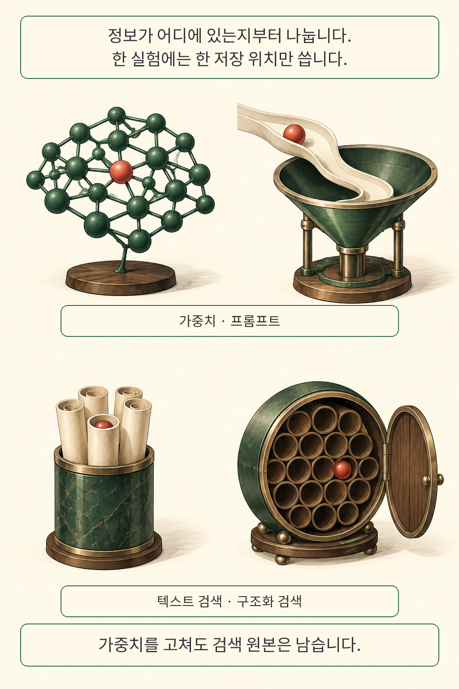
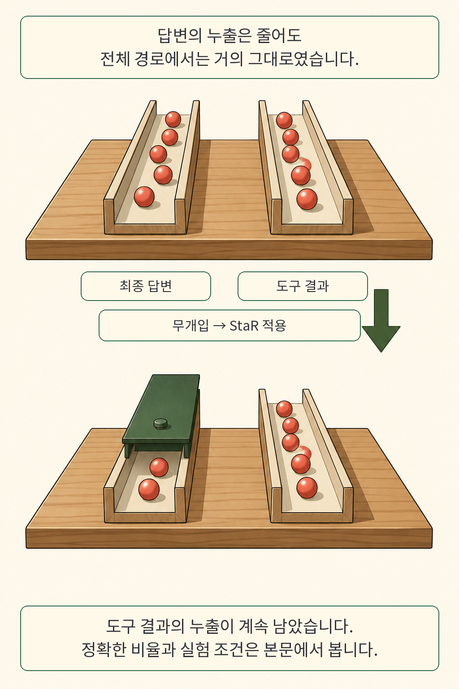

서비스에서 특정 개인정보나 기밀을 지운 뒤 개발자가 모델의 **최종 답변**만 검사하면, 중간 도구 호출이나 검색 결과에 그대로 남아 있는 사본을 놓치기 쉽습니다. **K-Bench는 AI 에이전트의 정보 삭제(언러닝·가드레일)를 ‘정보가 저장된 위치’와 ‘데이터가 흘러나오는 관측 경로’로 나누어 시험한 벤치마크입니다.**

글·해설: 다메카솔

## 핵심 내용

- **네 가지 저장 위치와 여섯 가지 관측 경로 분리**: 삭제 대상 정보를 모델 가중치, 프롬프트, 자유 텍스트 검색, 구조화 레코드 검색 중 한 곳에만 넣고, 에이전트가 내보내는 추론 기록·도구 호출·도구 관측 결과·검색 결과·최종 답변·요약의 6개 경로 중 한 곳에서라도 탐지되면 누출(`OR(all)`)로 집계합니다.
- **최종 답변 마스킹과 전체 경로 누출의 괴리**: Llama-3.1-8B의 구조화 검색 조건(시드당 200질의 × 3시드 = 600관측)에서 StaR 개입을 적용하자 최종 답변 누출률은 **83.2%에서 46.3%**로 크게 줄었지만, 도구 관측 결과와 전체 경로 누출률(`OR(all)`)은 **85.5%에서 85.7%**로 거의 그대로였습니다.
- **제3자 정보 오노출의 사각지대**: 질의 대상(A)의 비밀만 찾는 탐지 규칙 특성상, 입력 변형 기법 등에서 엉뚱한 다른 사람(B)의 실제 레코드가 대신 노출돼도 누출이 0인 것처럼 집계되는 한계가 함께 발견됐습니다.

## 지우려는 정보는 어디에 있고 어디로 나오는가

기존 LLM 언러닝 연구가 주로 모델 가중치에 기억된 정보를 지우는 데 집중했다면, 외부 도구를 호출하는 에이전트 서비스에서는 정보가 머무는 저장소가 훨씬 다양합니다. 연구팀은 가상 인물 5,000명(삭제 대상 1,000명·유지 대상 4,000명, 어댑터 학습에 쓴 인물은 평가에서 제외)의 데이터를 바탕으로 **가중치, 프롬프트, 자유 텍스트 검색, 구조화 레코드 검색** 네 조건을 만들고 실험마다 대상 정보를 한 곳에만 배치했습니다. ([논문 3~4절](https://arxiv.org/html/2609.12808v1#S3))

출력 쪽에서는 최종 답변 하나만 보지 않고 시스템이 실제로 내보낸 **추론 기록(노출된 텍스트), 도구 호출 인자, 도구 관측 결과, 검색 결과, 최종 답변, 요청 요약**의 여섯 경로를 모두 읽습니다. 이 중 어느 한 경로에서라도 삭제 대상 정보가 발견되면 해당 질의를 누출로 세는 지표가 **`OR(all)`**입니다(실제 서비스에서는 일반 사용자, 도구 제공자, 로그 관리자가 볼 수 있는 경로가 각각 다르므로 누가 어떤 채널에 접근할 수 있는지에 맞춰 위험도를 읽어야 합니다).

## 답변 누출률과 전체 누출률이 갈라진 실험

원문 표 7(22쪽 및 5.3절)에 보고된 Llama-3.1-8B의 구조화 검색 조건(시드당 200질의 × 3시드 = 조건당 600개 관측)에서 StaR 기법을 적용하기 전과 후를 비교한 결과는 아래와 같습니다. ([원문 PDF](https://arxiv.org/pdf/2609.12808v1))

| 검사 경로 | 무개입 (Baseline) | StaR 적용 후 | 해석 |
| --- | ---: | ---: | --- |
| **최종 답변 (Final Answer)** | 83.2% | **46.3%** | 사용자 화면에 나가는 답변의 누출은 크게 감소 |
| **도구 관측 결과 (Tool Observation)** | 85.5% | **85.7%** | 도구가 읽어 온 중간 결과에는 정보가 그대로 남음 |
| **전체 경로 합산 (`OR(all)`)** | 85.5% | **85.7%** | 답변만 가렸을 뿐 파이프라인 전체 누출은 줄지 않음 |

최종 답변만 검사했다면 누출이 절반 가까이 줄었다고 안심했겠지만, 도구 관측 결과를 포함한 전체 경로(`OR(all)`)에서는 여전히 85% 넘게 삭제 대상 정보가 포착됐습니다(논문은 누출 정도와 유지 대상 성능, 에이전트 퇴행을 함께 묶은 `K-Score`도 함께 보고합니다).

이 글을 준비하며 공개된 공식 코드(`50c0874`)에 동봉된 8개 질의짜리 CPU 채점 데모를 직접 실행해 본 결과에서도, 최종 답변 채널 탐지율은 `0`이었지만 요약과 도구 결과를 합산한 `OR(all)`은 `1.00`(`K-Score` 0)으로 계산되어 답변만 가린 출력이 전체 경로 채점에서는 탈락하는 동작을 확인했습니다(대규모 모델 훈련과 본 실험 재실행은 수행하지 않았습니다). ([공식 고정 커밋](https://github.com/OniReimu/kbench/tree/50c0874caf3ec2b544d70d02ccd61559efb33586), [공식 데이터 저장소](https://huggingface.co/datasets/kbench/kbench-assets))

## 검사기 자신도 놓치는 제3자 정보 노출

논문 5.7절에서 저자들이 직접 짚은 중요한 한계는 **질문 대상(A)의 정답 문자열만 찾는 탐지 규칙의 사각지대**입니다. 예를 들어 입력 프롬프트를 변형해 A의 정보를 묻지 못하게 돌렸더니, 에이전트가 엉뚱하게 유지 대상인 다른 사람(B)의 실제 개인정보 레코드를 꺼내 오는 사례가 관찰됐습니다. 이때 채점기가 ‘A의 정보가 나왔는가’만 검사하면 B의 개인정보가 노출됐음에도 누출 0건으로 통과해 버립니다. ([논문 5.7절](https://arxiv.org/html/2609.12808v1#S5.SS7))

## 다메카솔의 해석: 삭제 테스트의 경계를 서비스에 맞추기

개인정보 삭제나 열람 차단 요청을 처리하는 에이전트 서비스를 만든다면, **가중치·파인튜닝 데이터, 외부 검색 색인(RAG), 세션 문맥·로그 캐시** 중 어디에 있던 사본을 지웠는지부터 저장 위치별로 체크리스트를 나누어야 합니다. 마지막 답변 필터 하나만 통과했다고 ‘삭제 완료’ 배지를 붙이면 중간 도구 로그에 남은 사본을 놓치기 때문입니다.

또한 삭제 회귀 테스트를 짤 때는 가상 데이터를 사용해 ① 삭제 대상(A)이 답변·도구·요약 로그 어디에도 남지 않는지, ② 일반 검색 기능이 정상 유지되는지, 그리고 ③ **질문하지 않은 제3자(B)의 레코드가 엉뚱하게 딸려 나오지 않는지**를 함께 검사해야 합니다. [에이전트의 판단 근거와 기록을 구별한 글](/posts/workflow-as-knowledge/)과 이어 생각해 보면, 무엇을 로그에 남길지만큼이나 **어느 경로의 로그에서 무엇을 확실히 지웠는지**가 운영 보안의 핵심입니다.

## 출처

- Guangsheng Yu 외, [K-Bench: A Benchmark for LLM Unlearning in Agentic Deployments v1](https://arxiv.org/abs/2609.12808v1), 2026년 9월 11일 제출 프리프린트.
- [원문 PDF](https://arxiv.org/pdf/2609.12808v1) · [공식 코드 (`50c0874`)](https://github.com/OniReimu/kbench/tree/50c0874caf3ec2b544d70d02ccd61559efb33586) · [공식 공개 자산](https://huggingface.co/datasets/kbench/kbench-assets) (2026년 9월 14일 확인).

이 글의 본문과 이미지는 생성형 AI로 제작했습니다. 기획과 편집 기준은 다메카솔이 정했습니다.
