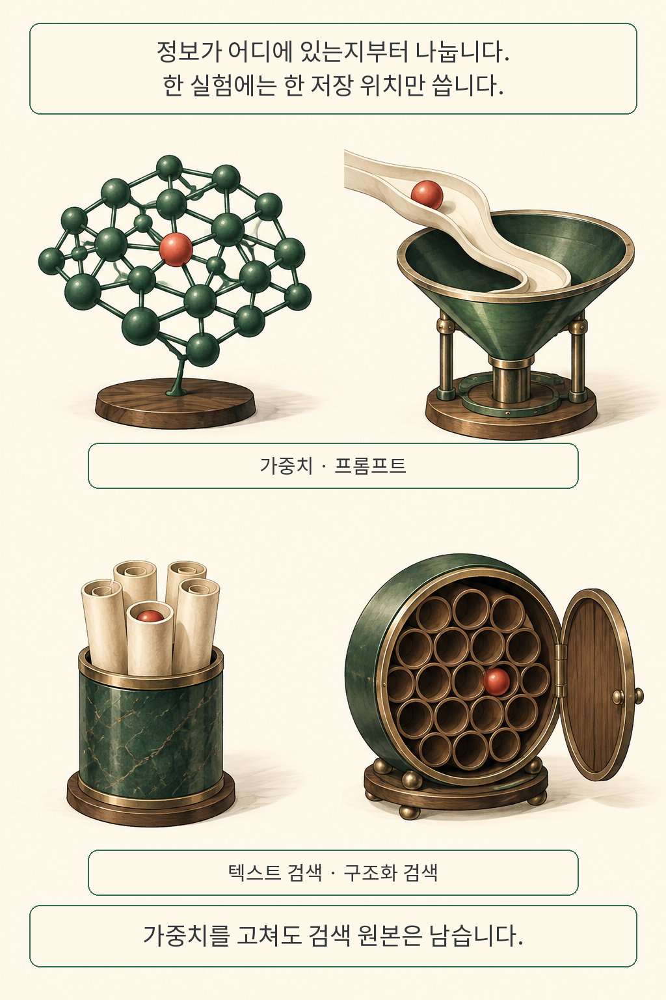
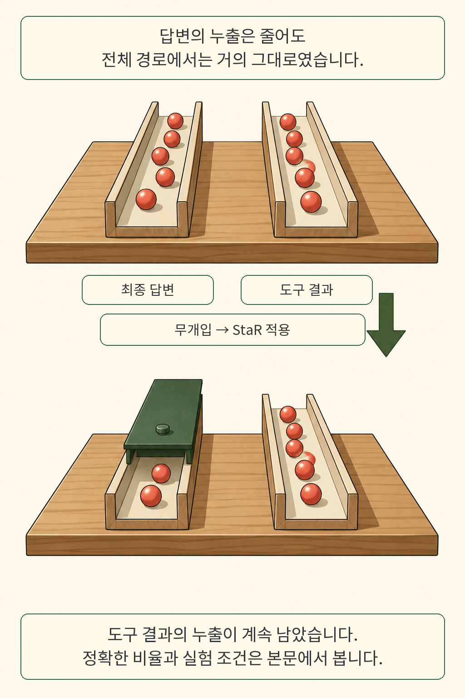

서비스에서 개인정보나 기밀을 지워 달라는 요청을 처리한 뒤 모델의 **최종 답변**만 확인하면, 중간 도구 호출이나 검색 결과에 남은 사본을 놓치기 쉽습니다. 사용자 화면에는 가려진 문장이 나가더라도, 파이프라인 안쪽의 로그와 도구 응답은 삭제 전과 똑같이 정보를 품고 있을 수 있거든요. **K-Bench는 AI 에이전트의 정보 삭제(언러닝·가드레일)를 '정보가 저장된 위치'와 '데이터가 흘러나오는 관측 경로'로 나누어 시험한 벤치마크입니다.**

글·해설: 다메카솔

## 핵심 내용

- **4개 저장 위치와 6개 관측 경로 분리**: 삭제 대상 정보를 가중치·프롬프트·자유 텍스트 검색·구조화 레코드 검색 중 한 곳에만 배치하고, 추론 기록·도구 호출·도구 관측 결과·검색 결과·최종 답변·요약 가운데 한 경로에서라도 탐지되면 누출(`OR(all)`)로 집계합니다.
- **답변 마스킹과 전체 누출의 괴리**: Llama-3.1-8B의 구조화 검색 조건(시드당 200질의 × 3시드 = 600관측)에서 StaR 개입을 적용하자 최종 답변 누출률은 **83.2% → 46.3%**로 줄었지만, 도구 관측 결과와 `OR(all)`은 **85.5% → 85.7%**로 거의 그대로였습니다.
- **제3자 정보 오노출의 사각지대**: 질의 대상(A)의 비밀만 찾는 탐지 규칙 때문에, 입력 변형 상황에서 다른 사람(B)의 실제 레코드가 대신 노출돼도 누출 0건으로 집계되는 한계가 드러났습니다.

## 지우려는 정보는 어디에 있고 어디로 나오는가

기존 LLM 언러닝 연구는 주로 모델 가중치에 기억된 정보를 지우는 데 집중해 왔습니다. 하지만 외부 도구를 호출하는 에이전트 서비스에서는 정보가 머무는 저장소가 훨씬 다양하기 때문에, 가중치에만 개입하는 방식으로는 프롬프트나 검색 원본의 데이터까지 지우지 못하는 편입니다. 연구팀은 적용 범위 차이를 또렷하게 분리하려고 가상 인물 데이터를 네 가지 저장 조건에 각각 한 곳씩만 배치했습니다([논문 3~4절](https://arxiv.org/html/2609.12808v1#S3)).

- **가중치 (Weights)**와 **프롬프트 (Prompt)**: 모델 파라미터 내부에 학습으로 주입하거나 대화 문맥에 직접 실은 정보입니다.
- **자유 텍스트 검색**과 **구조화 레코드 검색**: 비정형 문서 색인이나 정형 레코드 저장소에서 조회하는 정보입니다.
- **합성 평가 데이터 구성**: 가상 인물 5,000명의 속성을 삭제 대상 1,000명과 유지 대상 4,000명으로 나누었고, 어댑터 학습에 쓴 인물은 평가 질의에서 제외했습니다.

출력 쪽에서는 숨겨진 내부 계산이 아니라 시스템이 실제로 내보내는 **추론 기록(노출된 텍스트), 도구 호출 인자, 도구 관측 결과, 검색 결과, 최종 답변, 요청 요약**의 여섯 경로를 모두 읽고, 한 곳에서라도 삭제 대상 정보가 나오면 **`OR(all)`** 기준 누출로 셉니다.

예를 들어 고객 지원 에이전트에서 특정 회원의 연락처를 삭제 대상으로 묶었다고 가정해 볼까요? 출력 필터가 최종 답변의 전화번호를 별표로 가려 주더라도, 중간 CRM 조회 도구가 반환한 관측 결과나 세션 요약 로그에 원래 번호가 찍혔다면 `OR(all)` 지표에서는 명백한 누출로 잡힙니다. 실제 서비스에서는 일반 사용자와 도구 제공자, 로그 관리자가 볼 수 있는 경로가 다르므로 채널별 위험도 역시 접근 권한에 맞춰 따져 보아야 합니다.

## 답변 누출률과 전체 누출률이 갈라진 실험

원문 표 7의 구조화 검색 실험에서 추론 정렬 계열 개입인 StaR을 적용하기 전과 후를 비교하면, 사용자에게 보이는 답변과 파이프라인 내부 경로의 격차가 뚜렷하게 드러납니다([원문 PDF](https://arxiv.org/pdf/2609.12808v1)).

| 검사 경로 (Llama-3.1-8B, 구조화 검색, 200질의×3시드=600관측) | 무개입 (Baseline) | StaR 적용 후 | 핵심 해석 |
| --- | ---: | ---: | --- |
| **최종 답변 (Final Answer)** | 83.2% | **46.3%** | 사용자 화면에 나가는 답변의 누출은 크게 감소 |
| **도구 관측 결과 (Tool Observation)** | 85.5% | **85.7%** | 도구가 읽어 온 중간 결과에는 정보가 그대로 잔존 |
| **전체 경로 합산 (`OR(all)`)** | 85.5% | **85.7%** | 답변만 가렸을 뿐 파이프라인 전체 누출은 유지 |

최종 답변만 살폈다면 누출이 절반 가까이 줄었다고 안심하기 쉬웠을 겁니다. 하지만 도구 관측 결과를 포함한 `OR(all)` 지표에서는 개입 뒤에도 85% 넘는 질의에서 삭제 대상 정보가 포착되었으니, 겉으로 보이는 답변만 가렸을 뿐 내부 흐름은 그대로 남은 셈이죠. 논문은 이진 누출 여부 외에도 누출 정도, 유지 대상 변화, 에이전트 기능 퇴행을 함께 묶은 **`K-Score`** 지표를 병행 보고합니다.

- **공식 코드 CPU 채점 데모**: [공식 코드](https://github.com/OniReimu/kbench/tree/50c0874caf3ec2b544d70d02ccd61559efb33586)에 동봉된 8개 질의 예시에서도 최종 답변 채널 탐지율은 `0`이었지만, 요약과 도구 결과를 합산한 `OR(all)`은 `1.00`(`K-Score` `0`)으로 계산되어 답변만 가린 출력이 전체 채점에서 탈락하는 동작을 확인했습니다([공식 데이터 저장소](https://huggingface.co/datasets/kbench/kbench-assets)).

실험 범위의 경계도 함께 짚고 넘어가야 합니다. 주요 평가는 영어 합성 정보 기준이며 실제 형식 점검도 생년월일 속성에 한정되었고, 여러 저장소가 섞인 혼합 환경은 다루어지지 않았습니다. 가중치 기반 언러닝 비교 역시 각 기법의 최적 성능을 새로 맞춘 순위 경쟁이 아니라, 정해진 주입 방식과 맞춘 예산 안에서 거동을 살핀 사례 연구로 읽어야 정확합니다.

## 검사기 자신도 놓치는 제3자 정보 노출

저자들이 [원문 5장 7절](https://arxiv.org/html/2609.12808v1#S5.SS7)에서 직접 지적한 탐지 규칙의 사각지대도 눈여겨볼 대목입니다. 현재 채점기는 질문 대상(A)의 정답 문자열만 찾도록 짜여 있거든요.

가령 입력 프롬프트를 변형해 에이전트가 A의 정보를 직접 꺼내지 못하게 돌렸더니, 엉뚱하게 유지 대상 목록에 있던 다른 사람(B)의 실제 개인정보 레코드를 대신 꺼내 출력하는 사례가 관찰되었습니다. 채점기는 A의 정보만 탐색하므로 누출 0건으로 통과시키지만, 서비스 관점에서는 제3자의 개인정보가 새어 나간 심각한 실패가 됩니다.

## 다메카솔의 해석: 삭제 테스트의 경계를 서비스에 맞추기

개인정보 삭제나 열람 차단 요청을 처리하는 에이전트 서비스를 만든다면, 모델 가중치·파인튜닝 데이터, 외부 검색 색인(RAG), 세션 문맥과 로그 캐시 중 어디에 사본이 남는지부터 계층별로 나누어 관리해야 합니다. 실무에서 삭제 회귀 테스트를 짤 때는 실제 민감정보 대신 가상 데이터를 사용해 아래 세 가지를 한 세트로 점검하는 편이 안전합니다.

1. **전 경로 차단 여부**: 삭제 대상(A)이 답변뿐 아니라 도구 호출 인자, 도구 관측 결과, 요약 로그 어디에도 남지 않는지 확인합니다.
2. **정상 기능 보존**: 유지 대상에 대한 검색 정확도와 도구 사용 흐름이 개입 전과 비교해 무너지지 않았는지 살핍니다.
3. **제3자 오노출 방지**: 질문하지 않은 다른 사용자(B)의 레코드가 엉뚱하게 딸려 나오지 않는지 함께 검증합니다.

결국 [에이전트의 판단 근거와 기록을 구별한 글](/posts/workflow-as-knowledge/)과 이어 생각해 보면, 무엇을 로그에 남길지만큼이나 **어느 경로의 로그와 저장소에서 무엇을 확실히 비웠는지**가 운영 보안의 핵심입니다.

## 출처

- Guangsheng Yu 외, [K-Bench: A Benchmark for LLM Unlearning in Agentic Deployments v1](https://arxiv.org/abs/2609.12808v1), 2026년 9월 11일 제출 프리프린트.
- [원문 PDF](https://arxiv.org/pdf/2609.12808v1) · [공식 코드 (`50c0874`)](https://github.com/OniReimu/kbench/tree/50c0874caf3ec2b544d70d02ccd61559efb33586) · [공식 공개 자산](https://huggingface.co/datasets/kbench/kbench-assets) (2026년 9월 14일 확인).

이 글은 논문 원문과 공식 저장소 공개 자료·CPU 채점 데모를 바탕으로 정리했으며, 대규모 모델 훈련이나 본 실험은 독립 재현하지 않았습니다.

이 글의 본문과 이미지는 생성형 AI로 제작했습니다. 기획과 편집 기준은 다메카솔이 정했습니다.
