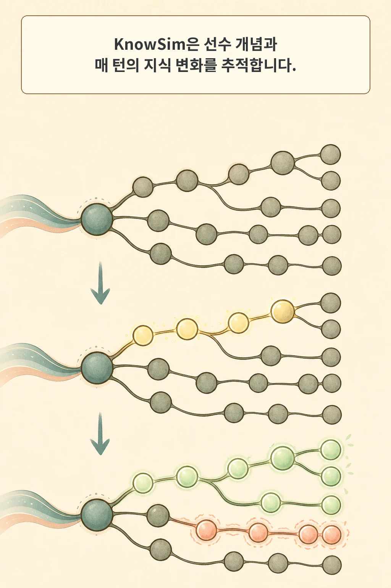
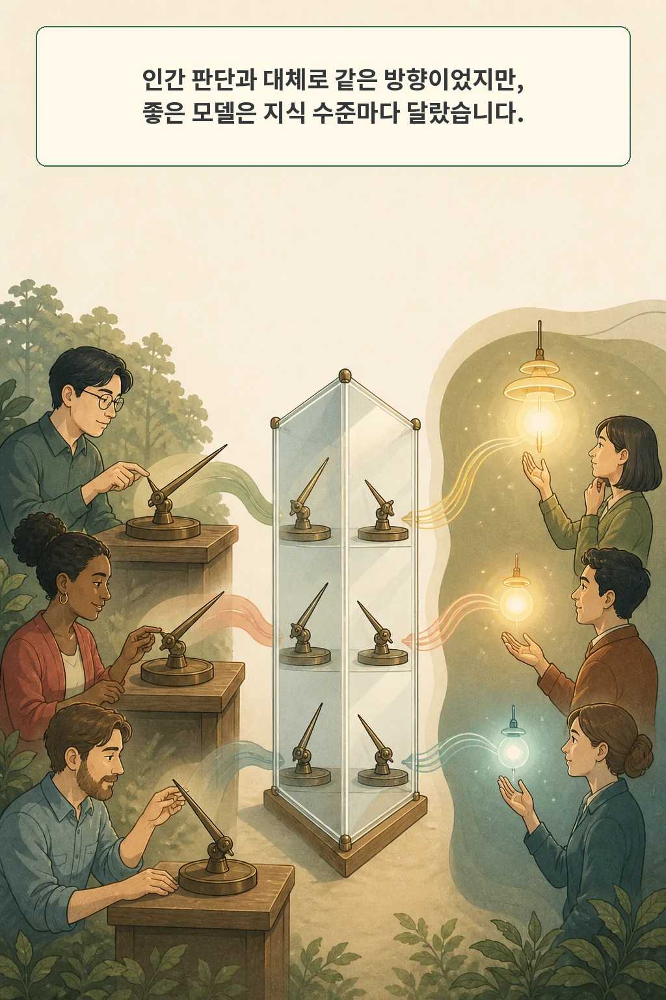

AI가 더 자세하게 설명할수록 사용자가 더 잘 배울 것 같지만, 똑같은 답변이 초보자에게는 인지 과부하가 되고 숙련자에게는 이미 아는 내용의 지루한 반복이 될 수 있습니다. 설명의 품질은 절대적인 정보량이 아니라 사용자가 지금 무엇을 알고 있고, 새 정보를 받아들일 처리 여유가 얼마나 있으며, 대화 중에 지식이 어떻게 바뀌는지가 함께 결정하기 때문입니다. **「KnowSim: Evaluating Information Calibration in LLM Assistants with User Simulators that Learn」**은 이 문제를 정보 보정(information calibration)으로 정의하고, 사용자의 지식 상태가 매 턴 변하는 시뮬레이터를 만들어 인간-AI 대화와의 방향 일치도를 검증한 뒤 9개 LLM의 설명을 지식 수준별로 비교했습니다.

글·해설: 다메카솔

## 핵심 내용

- `KnowSim`은 질문을 선수 관계가 있는 개념 그래프로 나누고, 사용자의 개념별 지식 상태를 대화 턴마다 갱신합니다.
- 새 정보인지, 선수 개념으로 이해할 수 있는지, 현재 처리 용량을 넘는지를 함께 보고 지식 증가와 인지 과부하를 계산합니다.
- 참가자 245명이 만든 인간-AI 대화 705개와 비교했을 때, 효과가 뚜렷한 조건에서 전략 차이의 방향을 MathQA 73%, ExpertQA 74%로 맞췄습니다.
- 9개 LLM 비교에서는 초보자·중간 수준·숙련자 모든 수준과 지표에서 늘 가장 좋은 단일 모델이 없었습니다.
- 저자들은 이 시뮬레이터가 평가 대리자일 뿐 실제 인간 연구를 대신해서는 안 된다고 명시했습니다.

## 같은 답변이 왜 반대 효과를 낼까

초보자에게는 최종 결론보다 먼저 짚어야 할 선행 개념이 있습니다. 그 바탕 없이 전문 용어와 예외 조항을 한꺼번에 쏟아내면 새 정보가 아무리 많아도 흡수하기 어렵습니다. 반대로 숙련자에게 기초 정의부터 길게 되풀이하면 틀린 설명은 아니더라도 새로 얻는 정보가 거의 없습니다.

`KnowSim`이 겨냥한 정보 보정은 단순히 답변을 짧게 줄이는 기술과 다릅니다. 좋은 답변은 사용자에게 새로워야 하고, 이미 아는 선수 개념으로 이해할 수 있어야 하며, 한 번에 처리할 수 있는 인지 용량 안에 들어와야 합니다. 같은 답변이 서로 다른 사용자에게 정반대의 실패를 부를 수 있으므로, 평균 만족도 하나만으로는 설명 품질을 온전히 판단하기 어렵습니다.

## 질문을 선수 개념 그래프로 바꾼다

`KnowSim`은 한 질문에 필요한 정보를 개념 단위(`Information Unit`)로 쪼개고, 어떤 개념을 이해하려면 무엇을 먼저 알아야 하는지 선수 관계를 가진 그래프로 연결합니다. 각 개념은 `unaware`, `struggling`, `partial`, `knows_well`의 네 상태 중 하나를 가지며, 시뮬레이터는 매 턴 AI 답변이 새 개념을 얼마나 잘 가르쳤는지, 선수 개념이 준비됐는지, 인지 부하가 처리 용량을 넘었는지를 반영해 상태를 갱신합니다.

평가 지표도 이 변화 궤적에서 도출됩니다.

- **지식 증가(KG)**: 대화 뒤 실제로 얼마나 배웠는지 측정합니다.
- **전달 보정(DC)**: 사용자의 현재 지식 상태에 맞는 정보를 주었는지 봅니다.
- **인지 과부하(CO)**: 한 턴에 수용 가능한 처리 용량을 넘겼는지 계산합니다.
- **상호작용 품질(IQ)**: 위 결과들을 종합해 학습 경험을 비교하는 축입니다.

## 인간 대화와 무엇을 비교했나

연구진은 Prolific 참가자 245명에게 세 번씩 AI와 대화하게 해 총 705개 세션을 모았습니다. 과제는 사전·사후 지식 검사가 포함된 수학 문제(`MathQA`)와 정답 범위가 더 열린 `ExpertQA`(사전·사후 검사 없음) 두 영역이었고, 답변 전략과 모델을 바꾸는 네 연구군으로 구성됐습니다.

효과 크기가 $|\text{Cliff's delta}| \ge 0.15$로 뚜렷한 조건 쌍에서 인간 세션의 우열 방향과 시뮬레이터 예측 방향을 비교한 결과, `KnowSim`의 방향 일치율은 MathQA에서 73%(27/37), ExpertQA에서 74%(26/35)였으며 두 합산 검정의 $p$값은 0.003이었습니다. 공통 비교 축인 상호작용 품질(IQ)에서는 네 연구군 전체의 인간 순위 방향과 77% 일치했습니다. 물론 이는 효과가 뚜렷한 조건 간 우열 방향을 잡았다는 뜻이지, 개별 사용자의 다음 반응을 맞히거나 장기 학습·제품 유지율까지 재현했다는 증거는 아닙니다.

## 좋은 모델은 지식 수준마다 달랐다

검증된 `KnowSim`으로 호스팅 API 기반 9개 LLM(non-thinking 설정)을 비교해 보니, 초보자·중간 수준·숙련자 모두에게 모든 지표에서 1위인 단일 모델은 없었습니다.

| 학습자 조건 | 두드러진 모델과 지표 | 시사점 |
| --- | --- | --- |
| 초보자 조건 | **DeepSeek V4**: 지식 증가 1위(15.5), 인지 과부하 뒤에서 2위(0.945) **Gemini 3.1 Pro**: 인지 과부하 최저(0.875)·상호작용 품질 1위(8.39), 지식 증가 6위 | 많이 가르치려다 벅찬 설명이 되거나, 부담은 줄였지만 전달량이 적어지는 상충이 발생함 |
| 숙련자 조건 | **Gemini 3.1 Pro**: 네 지표 평균 순위 1.75로 가장 잘 보정됨 | 초보자에게 지식을 가장 많이 늘린 모델과 숙련자에게 균형 잡힌 모델이 서로 다름 |

이 결과는 특정 시점의 9개 모델과 두 과제 영역에 묶여 있으므로 숫자를 모델의 영구적 성격으로 일반화할 수는 없지만, “벤치마크 평균 1위 모델” 하나만 고르는 방식이 사용자 수준별 실패를 가릴 수 있음을 분명하게 보여 줍니다.

## 공개 데이터와 시뮬레이터의 한계

공식 프로젝트 페이지와 연결된 `KnowChat` 저장소(CC BY-NC 4.0)에는 705개 인간 대화 세션(고정 리비전 14개 파일)이 공개되어 있어 데이터를 보존·감사할 수 있었으나, 시뮬레이터 코드 저장소(`yjo2lee/knowsim`)는 2026년 8월 19일 기준 HTTP 404를 반환해 실행 파이프라인을 독립 재현하지는 않고 원문과 공개 데이터를 대조했습니다.

논문 스스로 밝힌 한계도 명확합니다. 좌절이나 지루함 같은 감정·동기 역학을 충분히 모델링하지 못하고, 평가 영역이 두 가지뿐이며, 실제 서비스에서는 관찰 행동만으로 개인의 초기 지식 상태를 정확히 추정하기 어렵고 다중 LLM 호출 비용도 큽니다. 저자들이 윤리 영향 항목에서 `KnowSim`을 인간 연구의 대체물로 쓰지 말라고 못 박은 이유입니다.

## 다메카솔의 해석

실제 AI 제품에 이 관점을 적용한다면 평균 품질 점수 하나를 초보자·중간 수준·숙련자별 대시보드로 쪼개어 지식 증가와 과부하를 따로 모니터링해야 합니다. 같은 모델을 쓰더라도 사용자 수준에 따라 설명 길이와 선수 개념 제시 순서를 다르게 실험하는 편이 효과적입니다.

시뮬레이터는 배포 전에 수많은 프롬프트·전략 후보를 빠르게 걸러내는 용도로 쓰고, 최종 결정은 소규모 인간 연구와 실제 이탈·열독 로그로 확인해야 합니다. `KnowSim`이 던지는 가장 날카로운 질문은 어떤 모델이 1위인가가 아니라, **우리 서비스가 가상의 평균 사용자 한 명에게만 맞춰져 있는지 아니면 서로 다른 지식 상태를 실제로 구분하고 있는지**입니다.

## 논문 정보

| 항목 | 내용 |
| --- | --- |
| 제목 | KnowSim: Evaluating Information Calibration in LLM Assistants with User Simulators that Learn |
| 저자 | Yoonjoo Lee, Hyoungwook Jin, Tae Soo Kim, Shaoyang Zhang, Philippe Laban, Q. Vera Liao |
| arXiv v1 제출 | 2026-08-17 21:33:26 UTC |
| 분야 | Artificial Intelligence (cs.AI), Computation and Language (cs.CL), Human-Computer Interaction (cs.HC) |
| 이 글의 분류 | empirical paper |

## 출처

- [KnowSim — arXiv:2608.17150](https://arxiv.org/abs/2608.17150)
- [공식 arXiv PDF](https://arxiv.org/pdf/2608.17150)
- [KnowSim 공식 프로젝트 페이지](https://yoonjoolee.com/knowsim/)
- [저자가 연결한 GitHub 저장소](https://github.com/yjo2lee/knowsim)
- [KnowChat 다중 턴 대화 데이터셋](https://huggingface.co/datasets/yjlee36/knowchat-multi-turn-dialogues)

이 글의 본문과 이미지는 생성형 AI로 제작했습니다. 기획과 편집 기준은 다메카솔이 정했습니다.

논문 그림과 프로젝트 시각물은 복제하지 않고, 검증한 주장만 자체 시각 언어로 재구성했습니다.

Updated: 2026-08-19
