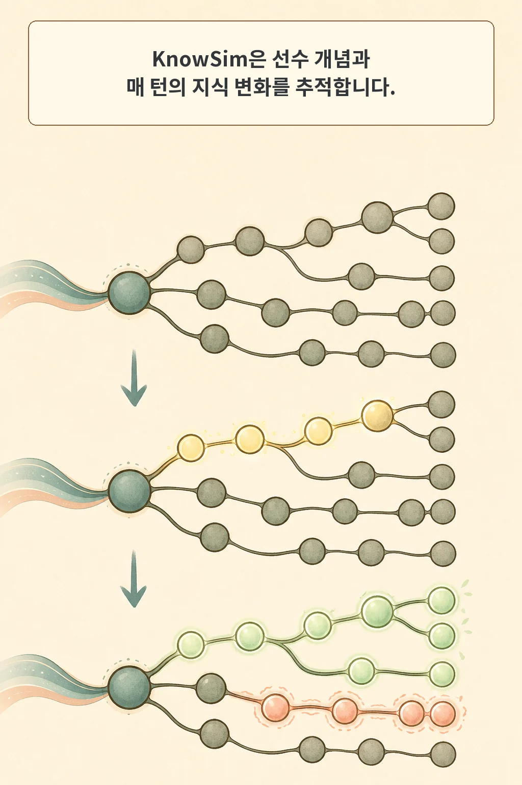

AI 답변을 더 길고 자세하게 만들었는데도, 초보자는 시작부터 벅차하고 숙련자는 이미 아는 설명만 이어진다며 지루해하는 경우가 많습니다. 설명의 품질은 절대적인 정보량이 아니라 사용자가 지금 무엇을 알고, 한 번에 얼마나 받아들일 수 있는지에 따라 달라지기 때문이죠. **「KnowSim」** 연구는 이 문제를 정보 보정(information calibration)으로 정의하고, 매 턴 학습자의 지식 상태를 추적하는 시뮬레이터를 검증한 뒤 9개 LLM을 수준별로 비교했습니다.

글·해설: 다메카솔

## 핵심 내용

- **개념 그래프 추적**: 질문을 선수 관계 개념 단위로 나누고 매 턴 이해 상태를 갱신합니다.
- **세 가지 보정 기준**: 새 정보 여부, 선수 개념 준비도, 인지 용량 한계를 함께 계산합니다.
- **인간 대화 검증**: 245명의 705개 세션 대비에서 고신호 조건 쌍 방향을 `MathQA` 73%, `ExpertQA` 74%로 맞췄습니다.
- **수준별 모델 상충**: 9개 LLM 비교에서 전 수준·전 지표를 휩쓴 단일 모델은 나오지 않았습니다.
- **대체 불가 경계**: 저자들은 `KnowSim`이 평가 대리자일 뿐 인간 연구를 대신할 수 없다고 명시했습니다.

## 같은 답변이 왜 정반대 결과를 부를까

초보자에게는 결론보다 먼저 짚어야 할 선행 개념이 필요합니다. 예를 들어 데이터베이스 인덱스를 막 익히는 초보자와 실무자에게 똑같은 B-Tree 리밸런싱 설명을 보낸다고 가정해 보죠. 기본 탐색 원리를 모르는 초보자는 용어와 예외에 벅차고, 이미 구조를 아는 숙련자는 기초 정의만 되풀이 읽느라 시간만 쓰게 됩니다.

`KnowSim`이 겨냥한 정보 보정은 답변을 무조건 줄이는 기술과 다릅니다. 좋은 설명은 새롭고, 선수 개념으로 이해 가능하며, 인지 용량 안에 들어와야 하거든요. 같은 답변도 상대에 따라 정반대의 실패를 부르므로 평균 만족도만 보면 이런 엇갈림을 놓칩니다.

## 질문을 선수 개념 그래프로 추적하는 방법

`KnowSim`은 질문에 필요한 지식을 개념 단위(`Information Unit`)로 나누고 선수 관계 그래프로 연결합니다. 각 개념은 `unaware`, `struggling`, `partial`, `knows_well` 네 상태 중 하나를 갖는데요. 시뮬레이터는 매 턴 답변이 새 개념을 얼마나 잘 설명했는지, 선수 개념이 준비됐는지, 인지 부하가 용량을 넘었는지 따져 상태를 갱신합니다.

상태 변화 궤적에서 도출되는 평가 지표는 네 가지입니다.

- **지식 증가(KG)**: 대화 뒤 새로 익힌 개념의 양을 측정합니다.
- **전달 보정(DC)**: 현재 이해 수준과 선수 개념에 맞게 전달했는지 봅니다.
- **인지 과부하(CO)**: 한 턴의 처리 용량을 넘겼는지 계산합니다.
- **상호작용 품질(IQ)**: 위 지표를 종합해 학습 경험을 비교합니다.

## 인간 대화 705개와 무엇을 맞췄나

연구진은 Prolific 참가자 245명에게 세 번씩 대화하게 해 총 705개 세션을 모았습니다. 과제는 사전·사후 지식 검사가 있는 `MathQA`와 정답이 열린 `ExpertQA`(사전·사후 검사 없음) 두 영역이며, 답변 전략과 모델을 바꾼 네 연구군으로 실험을 구성했습니다.

| 검증 항목 | 비교 대상 및 조건 | 결과 | 해석 범위 |
| --- | --- | --- | --- |
| **과제별 방향 일치율** | 효과 크기가 뚜렷한 조건 쌍 ($\lvert\text{Cliff's delta}\rvert \ge 0.15$) | `MathQA` 73%(27/37) `ExpertQA` 74%(26/35) 합산 검정 $p = 0.003$ | 조건 간 우열 방향 일치 |
| **공통 순위 일치율(IQ)** | 네 연구군 전체 인간 순위 vs 기준 시뮬레이터 | `KnowSim` **77%** (`ZS-CoT-Prof` 73%, `ZS` 68%, `ZS-CoT` 64%) | 상호작용 품질 순서 비교 |

효과가 뚜렷한 조건 쌍에서 `KnowSim`은 인간 세션의 우열 방향을 70%대 초중반으로 따라갔습니다. 다만 이는 조건 간 상대적 우열 방향을 잡았다는 뜻이며, 개별 사용자의 다음 발화나 장기 학습·유지율까지 재현했다고 보기는 어렵습니다.

## 지식 수준에 따라 1위 모델이 갈렸다

검증된 `KnowSim`으로 호스팅 API 기반 9개 LLM(`non-thinking` 설정)을 비교해 보니, 학습자 수준마다 강점이 갈렸습니다. 초보자에게 지식을 가장 많이 늘린 모델과 숙련자에게 균형 잡힌 설명을 건넨 모델이 서로 달랐거든요.

| 학습자 조건 | 두드러진 모델과 지표 | 확인된 상충점 |
| --- | --- | --- |
| **초보자 조건** | **DeepSeek V4**: 지식 증가 1위(15.5), 과부하 뒤에서 2위(0.945) **Gemini 3.1 Pro**: 과부하 최저(0.875)·IQ 1위(8.39), 지식 증가 6위 | 많이 가르치려다 벅차지거나, 부담을 줄이면 전달량이 줄어듦 |
| **숙련자 조건** | **Gemini 3.1 Pro**: 네 지표 평균 순위 1.75로 최고 보정 | 초보자 지식 증가(6위)와 숙련자 전반 균형 보정(1위)이 엇갈림 |

실험이 특정 시점의 9개 모델과 두 과제에 묶여 있어 숫자를 모델의 영구적 성질로 일반화할 수는 없지만, 평균 1위 모델만 고르는 방식이 수준별 실패를 가린다는 점만큼은 분명합니다.

## 시뮬레이터의 한계와 인간 연구의 자리

저자들도 `KnowSim`을 인간 평가의 대체재로 보지 않습니다. 좌절이나 지루함 같은 감정·동기 변화를 아직 충분히 모델링하지 못하고, 평가 영역도 수학과 `ExpertQA` 두 가지에 머물러 있거든요.

실제 서비스에 적용할 때의 제약도 뚜렷합니다. 관찰 행동만으로 개인의 초기 지식 상태를 정확히 추정하기 어렵고, 매 턴 상태를 추론하느라 여러 번의 LLM 호출 비용이 듭니다. 윤리 영향 항목에서 `KnowSim`을 평가 대리자로만 쓰고 인간 연구를 대체하지 말라고 못 박은 이유입니다.

## 다메카솔의 해석

실제 AI 제품에서는 평균 만족도 점수를 초보자·중간 수준·숙련자별 대시보드로 쪼개어 지식 증가와 과부하를 따로 살펴야 합니다. 같은 모델을 쓰더라도 숙련도에 따라 설명 길이와 선수 개념 순서를 다르게 실험하는 편이 효과적이죠.

시뮬레이터는 배포 전 프롬프트와 설명 전략 후보를 빠르게 거르는 1차 체로 활용하고, 최종 결정은 소규모 인간 검증과 이탈·열독 로그로 확인해야 합니다. 결국 중요한 질문은 어떤 모델이 1위인가보다, 우리 서비스가 평균 사용자 한 명만 상정하는지 아니면 서로 다른 지식 상태를 실제로 구분하고 있는지입니다.

## 논문 정보

| 항목 | 내용 |
| --- | --- |
| 제목 | KnowSim: Evaluating Information Calibration in LLM Assistants with User Simulators that Learn |
| 저자 | Yoonjoo Lee, Hyoungwook Jin, Tae Soo Kim, Shaoyang Zhang, Philippe Laban, Q. Vera Liao |
| arXiv v1 제출 | 2026-08-17 21:33:26 UTC |
| 분야 | Artificial Intelligence (cs.AI), Computation and Language (cs.CL), Human-Computer Interaction (cs.HC) |
| 이 글의 분류 | empirical paper |

## 출처

- [KnowSim — arXiv:2608.17150](https://arxiv.org/abs/2608.17150)
- [공식 arXiv PDF](https://arxiv.org/pdf/2608.17150)
- [KnowSim 공식 프로젝트 페이지](https://yoonjoolee.com/knowsim/)
- [저자가 연결한 GitHub 저장소](https://github.com/yjo2lee/knowsim)
- [KnowChat 다중 턴 대화 데이터셋](https://huggingface.co/datasets/yjlee36/knowchat-multi-turn-dialogues)

이 글의 본문과 이미지는 생성형 AI로 제작했습니다. 기획과 편집 기준은 다메카솔이 정했습니다.

논문 원문과 공개된 KnowChat 데이터셋(CC BY-NC 4.0)을 바탕으로 해설했으며, 링크된 코드 저장소(`yjo2lee/knowsim`)는 2026년 8월 19일 확인 시점 기준 HTTP 404 상태여서 실행 파이프라인을 독립 재현하지 않았고 논문 그림은 자체 시각 언어로 새로 구성했습니다.

Updated: 2026-08-19
