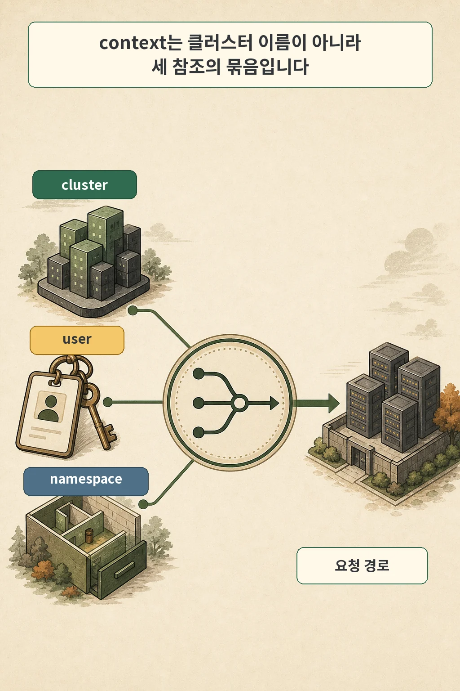
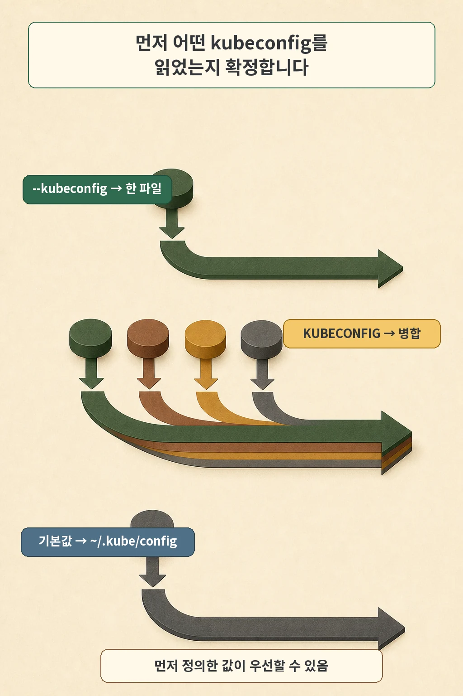
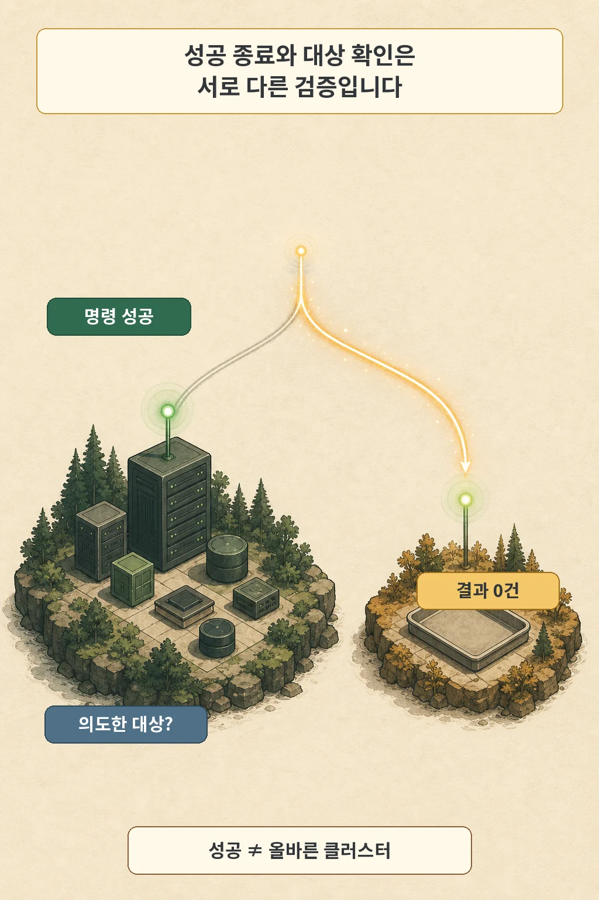
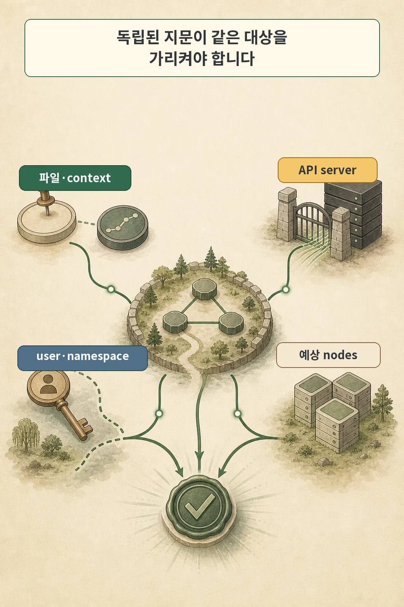

`kubectl get svc -A`가 오류 없이 끝났는데 목록이 비어 있다면, 새 클러스터가 비어 있는 게 아니라 다른 클러스터를 보고 있을 가능성이 큽니다. 실제로 홈랩에서 ServiceAccount JWT를 꺼내 Vault 인증에 쓰기 직전, WSL 기본 `context`가 로컬 `kind` 클러스터를 가리키고 있던 사실을 발견해 기존 인증 설정을 건드리지 않고 멈춘 적이 있거든요. `exit code 0`과 대상 확인은 별개이므로, `kubeconfig`와 `context`를 고정한 뒤 네 가지 지문을 대조하는 절차를 정리해 보겠습니다.

글·해설: 다메카솔

## context는 클러스터가 아니라 세 참조의 묶음입니다



`kubectl`은 `kubeconfig`에서 API server와 인증 정보를 찾아 요청하며, `context`는 아래 세 참조를 묶는 이름표에 해당합니다.

| context 구성 | 답하는 질문 |
| --- | --- |
| `cluster` | 어느 API server와 TLS 설정을 쓰는가 |
| `user` | 어떤 자격과 사용자로 인증하는가 |
| `namespace` | namespace 생략 시 기본 범위는 어디인가 |

`current-context`는 기본 선택 이름이지만 `homelab-prod`라는 라벨만으로 실제 환경이 보장되진 않거든요. `kubeconfig`가 바뀌면 같은 이름이 다른 `cluster`나 `user`를 가리킬 수 있으므로 유효 설정을 확인해야 합니다.

```bash
kubectl config get-contexts
kubectl config current-context
kubectl config view --minify
```

`config view --minify`는 미사용 항목을 걸러 보여 주지만 endpoint와 사용자 식별자가 남으므로 공개 로그 전에 가려야 하며, 민감 데이터를 드러내는 `--raw`도 일반 점검에서는 빼고 씁니다.

## 어떤 kubeconfig를 읽었는지부터 확정합니다



`~/.kube/config`만 보고 안심하기 어려운 이유는 `kubectl`의 설정 선택 순서가 세 갈래로 나뉘기 때문입니다.

1. `--kubeconfig`가 있으면 지정한 파일 하나만 읽고 병합하지 않습니다.
2. 플래그 없이 `KUBECONFIG` 변수가 있으면 목록의 파일을 순서대로 병합합니다.
3. 두 조건이 비어 있을 때만 기본 파일인 `$HOME/.kube/config`를 읽습니다.

`KUBECONFIG` 구분자는 Linux·macOS가 콜론, Windows가 세미콜론입니다. 병합 시 중복 키는 앞선 파일 값이 우선하므로, 가령 `KUBECONFIG` 맨 앞에 로컬 `kind` 파일이 있으면 뒤쪽 홈랩 설정 대신 앞 파일의 `current-context`가 적용되는 셈이죠. `--context`는 병합된 `current-context`보다 우선하므로 파일과 `context`를 함께 고정해야 합니다.

```bash
KCFG="$HOME/.kube/homelab.yaml"
CTX="homelab-admin"

kubectl --kubeconfig "$KCFG" --context "$CTX" config view --minify
```

위 이름은 형식 예시이므로 실제 endpoint·`context`·`user`·노드 이름은 공개 로그에 남기지 않도록 관리해야 합니다. 출처를 알 수 없는 `kubeconfig`도 코드 실행이나 파일 노출을 일으킬 수 있다는 Kubernetes 공식 문서의 경고대로 셸 스크립트처럼 검토한 뒤 써야 합니다.

## 빈 결과는 대상 증명이 아닙니다



목록 조회의 0건은 새 `namespace`나 selector 불일치처럼 정상일 수 있지만, 빈 출력만으로 의도한 클러스터에 실제로 0건인지 판별하긴 어렵습니다. 잘못된 클러스터가 빈 목록을 돌려주면 `exit code 0`으로 다음 단계가 열려 버리니, 요청 성공과 대상 신원을 구분해 처리 기준을 정해 두어야 하죠.

| 작업 | 0건의 의미 | 처리 |
| --- | --- | --- |
| 새 namespace 초기 확인 | 허용될 수 있음 | 대상 지문 통과 뒤 계속 |
| 배포 전 필수 controller 확인 | 비정상 | 즉시 중단 |
| token용 ServiceAccount 검색 | 비정상 | 자격 추출 금지 |
| 삭제 대상 조회 | 위험한 모호성 | 대상·namespace 재확인 |

빈 결과 허용 조건을 코드에 명시한 경우가 아니라면, 자동화는 0건을 완료 신호 대신 조사 신호로 다루는 편이 안전합니다.

## 최소 네 가지 지문을 같은 고정 인자 묶음으로 확인합니다



쓰기나 자격 추출 전에는 서로 다른 실패를 거르는 네 가지 지문을 확인해야 합니다.

| 지문 | 확인하는 위험 | 예시 명령 |
| --- | --- | --- |
| kubeconfig와 context | 암묵적 기본값·잘못된 병합 | `--kubeconfig`, `--context` 고정 |
| API server | 같은 이름이 다른 endpoint를 가리킴 | `config view --minify`, `cluster-info` |
| 실효 사용자와 namespace | 올바른 서버에 잘못된 권한·범위로 접근 | `auth whoami`, context namespace |
| 예상 노드 | 다른 클러스터가 정상 응답 | `get nodes -o name` |

스크립트에서는 확인과 본 조회에 같은 인자 배열을 재사용합니다.

```bash
KCFG="$HOME/.kube/homelab.yaml"
CTX="homelab-admin"
K=(kubectl --kubeconfig "$KCFG" --context "$CTX")

"${K[@]}" config view --minify \
  -o jsonpath='{.current-context}{"\n"}{.clusters[0].cluster.server}{"\n"}{.contexts[0].context.user}{"\n"}{.contexts[0].context.namespace}{"\n"}'
"${K[@]}" cluster-info
"${K[@]}" auth whoami
"${K[@]}" get nodes -o name
```

`auth whoami`는 `SelfSubjectReview`로 인식된 실효 사용자를 보여 주며, 버전이나 권한 때문에 쓸 수 없다면 오류를 넘기지 말고 환경에 맞는 인증 확인 절차를 정해야 합니다. `cluster-info`와 노드 목록도 내부 호스트명을 드러낼 수 있으니 CI 로그 공개 범위를 먼저 확인합니다.

노드 지문 기준도 환경마다 다른데요, 예를 들어 노드 3대가 고정된 홈랩에서는 정확한 노드 이름 집합이 확실한 지문이지만 autoscaling이 잦은 클러스터에서는 role·label·개수 범위 계약을 정해야 하거든요. 결국 독립 단서 여러 개가 같은 대상을 가리키게 교차 검증하는 셈이죠.

## fail-closed preflight를 쓰기와 분리합니다


사람의 눈대중은 자동화에서 빠지기 쉬우므로, 지문이 어긋나면 즉시 종료하는 fail-closed preflight를 앞단에 둬야 합니다. 아래는 WSL이나 Bash 기반 CI에서 쓰는 기본 뼈대입니다.

```bash
set -euo pipefail

: "${KCFG:?set KCFG to one trusted kubeconfig file}"
: "${CTX:?set CTX to the approved context}"
: "${EXPECTED_SERVER:?set EXPECTED_SERVER}"
: "${EXPECTED_NODES_FILE:?set EXPECTED_NODES_FILE}"

K=(kubectl --kubeconfig "$KCFG" --context "$CTX")

actual_server="$("${K[@]}" config view --minify \
  -o jsonpath='{.clusters[0].cluster.server}')"
if [[ "$actual_server" != "$EXPECTED_SERVER" ]]; then
  printf 'target mismatch: API server\n' >&2
  exit 42
fi

actual_nodes="$("${K[@]}" get nodes -o name | LC_ALL=C sort)"
expected_nodes="$(LC_ALL=C sort "$EXPECTED_NODES_FILE")"
if [[ "$actual_nodes" != "$expected_nodes" ]]; then
  printf 'target mismatch: node set\n' >&2
  exit 43
fi

"${K[@]}" get svc -A
```

`EXPECTED_NODES_FILE`에는 자격 값 대신 승인된 `node/<name>` 목록만 넣고, 유동적인 환경은 role·label·개수 계약으로 바꿉니다. PowerShell이나 다른 CI에서도 모든 `kubectl` 호출에 같은 두 인자를 끝까지 넘겨야 하죠. 이 예시는 읽기(`get svc -A`)만 수행하므로 token 추출, Secret 수정, 삭제·배포는 별도 승인 관문으로 분리해야 합니다.

## 운영에서 남길 규칙

1. 모든 `kubectl` 호출에 동일한 `--kubeconfig`와 `--context` 인자를 전달합니다.
2. API server나 예상 노드 지문이 다르면 자격 추출·삭제·쓰기를 즉시 멈춥니다.
3. 빈 결과를 정상으로 허용할 조건과 예상 개수를 작업마다 선언합니다.
4. `kubeconfig` 원문, token, client key, `--raw` 출력은 일반 로그에 남기지 않습니다.

이 홈랩에서는 로컬 `kubeconfig`에 운영 대상을 섞지 않으려고 SSH 접속 뒤 `sudo k3s kubectl`을 쓰는 정책을 택했습니다. 별도 `kubeconfig`, 명시적 `context`, 최소 권한 사용자, CI 환경 분리로도 같은 안전선을 만들 수 있으니 지문 불일치 시 중단하는 원칙을 유지해야 합니다.

## 자주 묻는 질문

### `--context`만 붙이면 충분한가요?

실수를 줄여 주지만 `context`가 가리키는 `cluster`와 `user`는 읽혀 들어온 `kubeconfig`에 달려 있으므로 `--kubeconfig`와 API server 지문을 함께 확인하는 편이 안전합니다.

### 노드 목록을 볼 권한이 없으면 어떻게 하나요?

권한을 넓히기보다 현재 계정으로 읽을 수 있는 sentinel이나 metadata 계약을 활용해 `context`·endpoint·실효 사용자 확인을 보완하면 됩니다.

자격 정보를 꺼내기 직전에 잘못된 클러스터를 발견했던 전체 맥락은 [홈랩 쿠버네티스 구축기 2편: 3노드여야 하는 이유, 그리고 빈 결과의 함정](/posts/three-node-etcd-quorum-context/)에서 이어집니다.

## 출처

- [Kubernetes: The kubectl command-line tool](https://kubernetes.io/docs/concepts/overview/kubectl/)
- [Kubernetes: kubeconfig v1 API](https://kubernetes.io/docs/reference/config-api/kubeconfig.v1/)
- [Kubernetes: Organizing Cluster Access Using kubeconfig Files](https://kubernetes.io/docs/concepts/configuration/organize-cluster-access-kubeconfig/)
- [Kubernetes: kubectl config view](https://kubernetes.io/docs/reference/kubectl/generated/kubectl_config/kubectl_config_view/)
- [Kubernetes: kubectl config current-context](https://kubernetes.io/docs/reference/kubectl/generated/kubectl_config/kubectl_config_current-context/)
- [Kubernetes: kubectl cluster-info](https://kubernetes.io/docs/reference/kubectl/generated/kubectl_cluster-info/)
- [Kubernetes: Authenticating](https://kubernetes.io/docs/reference/access-authn-authz/authentication/)

이 글의 기술 설명은 2026년 7월 25일 확인한 Kubernetes 공식 문서를 기준으로 하며, kubectl 버전과 인증 방식에 따라 명령과 출력이 달라질 수 있습니다.

이 글의 본문과 이미지는 생성형 AI로 제작했습니다. 기획과 편집 기준은 다메카솔이 정했습니다.
