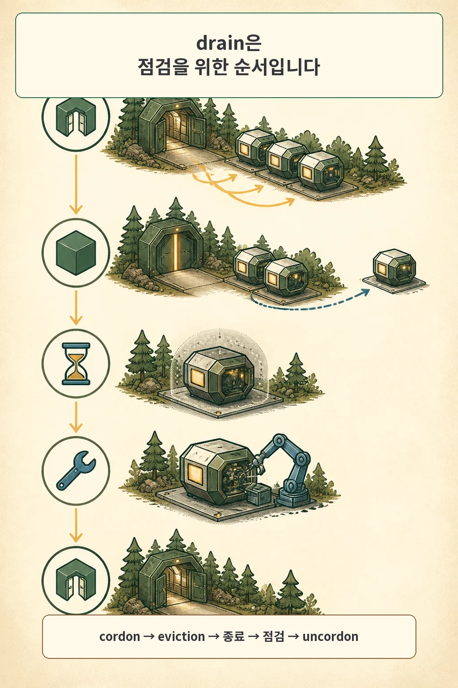

`kubectl drain`이 같은 파드 이름만 반복해 출력하며 멈춰 서면 강력한 강제 옵션부터 붙이고 싶어집니다. 하지만 멈춘 이유를 네 갈래로 먼저 나누어 보면 지금 필요한 옵션과 감수해야 할 위험이 분명해집니다. 이름은 비슷하게 거칠어 보여도 `--force`와 `--disable-eviction`은 전혀 다른 보호 장치를 건드리거든요.

글·해설: 다메카솔

## 핵심 내용

- **멈춘 단계부터 구분하기**: 명령 시작 직후 거부된다면 DaemonSet·단독 파드(unmanaged Pod)·`emptyDir` 같은 사전 조건 문제이고, `evicting pod` 메시지에서 기다린다면 PDB·대체 파드 준비·종료 유예(graceful termination) 문제입니다.
- **`--force`와 `--disable-eviction`의 역할 차이**: `--force`는 컨트롤러 없는 파드 삭제를 허용할 뿐 PDB를 우회하지 않으며, `--disable-eviction`이 eviction API 대신 `delete`를 호출해 PDB 가용성 검사를 건너뜁니다.
- **우회 전 점검 순서**: 파드 소유자, PDB `disruptionsAllowed`, 대체 replica `Ready` 여부, `emptyDir` 및 종료 유예 시간을 차례로 확인한 뒤 꼭 필요한 옵션 하나만 선택해야 합니다.

## drain이 하는 일과 네 갈래 원인 진단

`drain`은 노드 유지보수를 시작할 때 기존 워크로드를 안전하게 비우는 절차입니다. 먼저 노드를 `unschedulable` 상태로 표시해 새 파드 유입을 막고, 기존 파드를 eviction API(또는 `delete`)로 내보낸 뒤 정상 종료(graceful termination)가 끝날 때까지 기다립니다. 유지보수 작업을 마친 뒤에는 `kubectl uncordon`을 실행해 노드를 다시 스케줄 가능 상태로 되돌려야 합니다.

```bash
kubectl drain <node> --ignore-daemonsets
# 유지보수 수행
kubectl uncordon <node>
```



실제 현장에서 `drain`이 멈추는 지점을 보면 크게 두 시점으로 나뉩니다. 명령을 실행하자마자 거부 메시지를 띄우며 멈춘다면 DaemonSet이나 단독 파드, `emptyDir` 같은 사전 조건이 걸린 셈입니다. 반대로 `evicting pod` 상태에서 로그가 멈춰 기다린다면 PDB의 가용성 제한이나 종료 유예가 길어지는 중이라고 볼 수 있습니다.

원인을 빠르게 좁히려면 아래 네 갈래를 순서대로 짚어 보는 편이 좋습니다.

1. **이 파드는 누가 관리하는가 (`--ignore-daemonsets`, `--force`)**: 노드마다 하나씩 뜨는 DaemonSet 파드는 `drain`이 지우지 않으며, `--ignore-daemonsets`는 이를 건너뛰고 나머지 파드만 비우라는 뜻입니다. 반면 ReplicaSet·StatefulSet·Job 같은 컨트롤러가 없는 단독 파드(unmanaged Pod)는 지우면 다시 생성해 줄 주체가 없어 진행이 멈추는데, `--force`는 이 파드의 삭제를 허용합니다.
   ```bash
   kubectl get pod <pod> -n <namespace> \
     -o jsonpath='{.metadata.ownerReferences[*].kind}'
   ```
2. **PDB가 지금 몇 개의 중단을 허용하는가**: `disruptionsAllowed`가 0이면 eviction API가 파드를 내보내지 않고 대기하는 것이 정상입니다. 대체 replica가 아직 `Ready` 상태에 도달하지 못했거나 정책 자체가 `maxUnavailable: 0`으로 잠겨 있을 수 있으므로 라벨 선택자와 파드 상태를 함께 살펴봐야 합니다.
   ```bash
   kubectl get pdb -A
   kubectl describe pdb <pdb> -n <namespace>
   ```
3. **노드 로컬 데이터(`emptyDir`)가 있는가 (`--delete-emptydir-data`)**: `emptyDir` 볼륨을 쓰는 파드는 노드를 떠나는 순간 그 안에 쌓인 내용을 잃습니다. 영구 볼륨(PVC) 데이터와는 별개이므로, 해당 디렉터리가 다시 만들어지는 단순 캐시인지 미처리 작업 큐인지 확인한 뒤 플래그를 붙여야 합니다.
4. **종료 유예가 길어지는 중인가**: 파드가 이미 종료 신호를 받아 `Terminating` 상태라면 `terminationGracePeriodSeconds`, `preStop` 훅, 애플리케이션의 연결 정리·데이터 flush 로그를 확인하는 편이 빠릅니다. 이미 축출이 시작된 뒤라면 PDB를 지우더라도 파드 자체의 종료 시간은 줄어들지 않거든요.


## force는 PDB 우회가 아닙니다

명령이 멈췄을 때 급한 마음에 `--force`와 `--disable-eviction`, `--delete-emptydir-data`를 한꺼번에 붙이는 경우가 종종 있습니다. 하지만 세 옵션은 건너뛰는 보호 장치가 서로 완전히 다르기 때문에 섞어 쓰면 의도치 않은 데이터 손실이나 서비스 중단이 따라옵니다.

| 옵션 | 해결하는 조건 | 건너뛰는 보호 |
| --- | --- | --- |
| `--force` | 컨트롤러가 없는 unmanaged Pod | 재생성 소유자가 없다는 경고 |
| `--disable-eviction` | eviction API 대신 `delete` 사용 | PDB의 가용성 검사 |
| `--delete-emptydir-data` | `emptyDir` 데이터가 있는 Pod | 노드 로컬 임시 데이터 보존 |

예를 들어 StatefulSet으로 관리되는 데이터베이스 파드가 PDB에 걸려 멈췄을 때 `--force`를 붙여도 `drain`은 여전히 대기 상태에 머뭅니다. `--force`는 컨트롤러 없는 단독 파드 삭제만 허용할 뿐 PDB의 가용성 규칙을 건드리지 않기 때문이죠.

실제로 제 홈랩에서도 2026년 7월 `drain`이 `vault-0` 축출에서 멈춘 적이 있습니다. 원인은 단일 Vault를 가리킨 PDB의 `maxUnavailable: 0` 설정이었는데요. 컨트롤러가 있는 파드였기에 `--force`로는 풀리지 않았고, 서비스 중단을 감수하며 PDB를 잠시 제거하거나 `--disable-eviction`을 써야 했습니다.


이 일을 계기로 이후에는 노드 한 대를 비워도 중단 여유가 남도록 클러스터와 Vault 구성을 3노드·3멤버 구조로 늘렸습니다. 우회 옵션을 쓰기 전에는 이 파드를 지웠을 때 어떤 기능이 얼마나 멈추는지, 또 유실되는 데이터가 어느 계층에서 복구되는지부터 따져 보는 편이 안전합니다. 가령 임시 캐시만 날아가는 수준인지, 아니면 단일 인스턴스라 복구까지 서비스가 끊기는지 확인해 두어야 장애 대응 시간을 줄일 수 있거든요. 점검이 끝났다면 아래 흐름처럼 꼭 필요한 옵션 하나만 골라 적용하고, 작업 뒤에는 `uncordon`으로 노드를 복귀시키는 순서로 마무리합니다.

```text
대상 파드와 소유자 확인
→ PDB 선택자와 disruptionsAllowed 확인
→ 대체 replica의 Ready 및 배치 노드 확인
→ emptyDir와 종료 유예 확인
→ 예상 중단과 복구 절차 기록
→ 필요한 옵션 하나만 선택
→ 점검 후 uncordon과 워크로드 상태 확인
```

## 함께 읽을 글

- [PodDisruptionBudget는 무엇을 보장하나: maxUnavailable 0의 의미](/posts/poddisruptionbudget-zero-eviction/): `disruptionsAllowed`가 만들어지는 범위를 설명합니다.
- [replica 1은 같은 뜻이 아니었습니다: Vault PDB 앞에서 멈춘 drain](/posts/replica-layer-pdb-drain/): 이 체크리스트가 나온 실제 홈랩 사건입니다.

## 출처

- [Kubernetes: kubectl drain](https://kubernetes.io/docs/reference/kubectl/generated/kubectl_drain/)
- [Kubernetes: Specifying a Disruption Budget for your Application](https://kubernetes.io/docs/tasks/run-application/configure-pdb/)
- [Kubernetes: Disruptions](https://kubernetes.io/docs/concepts/workloads/pods/disruptions/)
- 개인 인프라 실패 패턴 원장 H-05, 2026-07-14

옵션 의미는 2026년 8월 9일 Kubernetes 공식 문서에서 다시 확인했습니다. 배포판과 버전에 따라 지원 옵션과 기본 동작을 확인해야 합니다.

이 글의 본문과 이미지는 생성형 AI로 제작했습니다. 기획과 편집 기준은 다메카솔이 정했습니다. 만화 이미지는 텍스트 없는 원화에 결정적 레터링을 합성해 만들었습니다. 공식 로고·UI·문서 도표 등 외부 이미지 자산은 사용하지 않았습니다.
