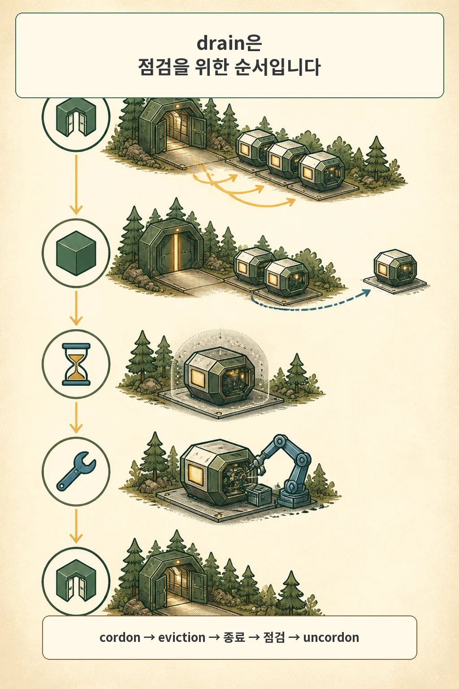

---
title: "kubectl drain이 멈췄을 때 PDB를 우회하기 전에 확인할 것"
description: "drain 정체를 파드 소유자, PDB, 로컬 데이터, 종료 유예로 나누고 force와 eviction 우회 옵션의 차이를 정리합니다."
searchTitle: "kubectl drain 멈춤 PDB 확인 순서"
slug: "kubectl-drain-pdb-checklist"
publishedAt: 2026-08-26
updatedAt: "2026-10-18"
track: tech_column
subtype: how_to
category: infrastructure
tags:
  - "Kubernetes"
  - "운영 자동화 안전"
  - "고가용성"
audience: developer
readerOutcome: "drain 정체를 원인별로 진단하고 --disable-eviction의 영향 범위를 확인한 뒤에만 중단을 승인한다."
contentFormats:
  - article
  - comic
  - diagram
  - checklist
freshnessStatus: current
reviewedAt: 2026-08-09
reviewAfter: 2027-02-09
cover: "./cover.webp"
coverAlt: "남성 카솔이 멈춘 drain 흐름과 네 갈래 진단 경로를 살피는 표지"
sourceUrl: "https://kubernetes.io/docs/reference/kubectl/generated/kubectl_drain/"
featured: false
draft: false
---

글·해설: 다메카솔

`kubectl drain`이 같은 파드 이름을 반복해 출력하며 멈춰 서면 강력한 강제 옵션부터 붙이고 싶어집니다. 하지만 멈춘 이유를 네 갈래로 먼저 나누어 보면 필요한 옵션과 감수해야 할 위험이 분명해집니다. 이름은 비슷하게 거칠어 보여도 `--force`와 `--disable-eviction`은 서로 전혀 다른 보호 장치를 건드립니다.


## 핵심 내용

- **`drain`의 진행 단계 구분**: 시작 전에 거부되면 DaemonSet·단독 파드(unmanaged Pod)·`emptyDir` 같은 사전 조건 문제이고, `evicting pod`에서 멈춰 기다린다면 PDB·대체 파드 준비·종료 유예(graceful termination) 문제입니다.
- **강제 옵션의 역할 차이**: `--force`는 컨트롤러 없는 파드 삭제를 허용할 뿐 PDB를 우회하지 않으며, `--disable-eviction`이 eviction API 대신 `delete`를 호출해 PDB 가용성 검사를 건너뜁니다.
- **우회 전 점검 순서**: 파드 소유자 → PDB `disruptionsAllowed` → 대체 replica `Ready` 여부 → `emptyDir` 및 종료 유예 시간을 차례로 확인한 뒤 필요한 옵션 하나만 선택해야 합니다.

## drain이 하는 일과 네 갈래 원인 진단

`drain`은 노드를 `unschedulable`로 표시해 새 파드 유입을 막고, 기존 파드를 eviction API(또는 `delete`)로 내보낸 뒤 정상 종료(graceful termination)가 끝날 때까지 기다리는 유지보수 절차입니다. 작업이 끝나면 `kubectl uncordon`으로 스케줄 가능 상태를 되돌려야 합니다.

```bash
kubectl drain <node> --ignore-daemonsets
# 유지보수 수행
kubectl uncordon <node>
```



명령이 멈췄을 때는 다음 네 갈래로 원인을 좁힙니다.

1. **이 파드는 누가 관리하는가 (`--ignore-daemonsets`, `--force`)**: 노드마다 뜨는 DaemonSet 파드는 `drain`이 지우지 않으며 `--ignore-daemonsets`는 이를 건너뛰고 진행하라는 뜻입니다. 반면 ReplicaSet·StatefulSet·Job 같은 컨트롤러가 없는 단독 파드(unmanaged Pod)가 있으면 삭제 후 재생성할 주체가 없어 멈추는데, `--force`는 이 파드의 삭제를 허용합니다.
   ```bash
   kubectl get pod <pod> -n <namespace> \
     -o jsonpath='{.metadata.ownerReferences[*].kind}'
   ```
2. **PDB가 지금 몇 개의 중단을 허용하는가**: `disruptionsAllowed`가 0이면 eviction API는 대기하는 것이 정상입니다. 대체 replica가 아직 `Ready`가 되지 못했거나 정책 자체가 `maxUnavailable: 0`일 수 있으므로 라벨 선택자와 파드 상태를 함께 봅니다.
   ```bash
   kubectl get pdb -A
   kubectl describe pdb <pdb> -n <namespace>
   ```
3. **노드 로컬 데이터(`emptyDir`)가 있는가 (`--delete-emptydir-data`)**: `emptyDir`을 쓰는 파드는 노드를 떠나면 그 내용을 잃습니다. PVC 데이터와는 별개이며, 단순 캐시인지 미처리 작업인지 확인한 뒤 플래그를 붙여야 합니다.
4. **종료 유예가 길어지는 중인가**: 파드가 이미 종료 신호를 받았다면 `terminationGracePeriodSeconds`, `preStop` 훅, 애플리케이션의 연결 정리·데이터 flush 로그를 확인해야 합니다(이 경우 PDB를 지워도 종료 시간은 줄지 않습니다).


## force는 PDB 우회가 아닙니다

실무에서 가장 자주 헷갈리는 세 가지 강제 옵션의 차이는 다음과 같습니다.

| 옵션 | 해결하는 조건 | 건너뛰는 보호 |
| --- | --- | --- |
| `--force` | 컨트롤러가 없는 unmanaged Pod | 재생성 소유자가 없다는 경고 |
| `--disable-eviction` | eviction API 대신 `delete` 사용 | PDB의 가용성 검사 |
| `--delete-emptydir-data` | `emptyDir` 데이터가 있는 Pod | 노드 로컬 임시 데이터 보존 |

제 홈랩에서도 2026년 7월 `drain`이 `vault-0` 축출에서 멈췄을 때 원인은 단일 Vault를 가리킨 PDB의 `maxUnavailable: 0`이었습니다. `--force`를 붙여도 풀리지 않는 문제였고, 서비스 중단을 감수하며 PDB를 잠시 제거하거나 `--disable-eviction`을 써야 했습니다(이후 3노드·3멤버로 늘려 중단 여유를 확보했습니다).


우회 옵션을 쓰기 전에는 이 파드를 지우면 어떤 기능이 얼마나 멈추는지, 데이터는 어느 계층에서 복구되는지부터 확인하고 다음 순서대로 진행하는 편이 안전합니다.

```text
대상 파드와 소유자 확인
→ PDB 선택자와 disruptionsAllowed 확인
→ 대체 replica의 Ready 및 배치 노드 확인
→ emptyDir와 종료 유예 확인
→ 예상 중단과 복구 절차 기록
→ 필요한 옵션 하나만 선택
→ 점검 후 uncordon과 워크로드 상태 확인
```

## 함께 읽을 글

- [PodDisruptionBudget는 무엇을 보장하나: maxUnavailable 0의 의미](/posts/poddisruptionbudget-zero-eviction/): `disruptionsAllowed`가 만들어지는 범위를 설명합니다.
- [replica 1은 같은 뜻이 아니었습니다: Vault PDB 앞에서 멈춘 drain](/posts/replica-layer-pdb-drain/): 이 체크리스트가 나온 실제 홈랩 사건입니다.

## 출처

- [Kubernetes: kubectl drain](https://kubernetes.io/docs/reference/kubectl/generated/kubectl_drain/)
- [Kubernetes: Specifying a Disruption Budget for your Application](https://kubernetes.io/docs/tasks/run-application/configure-pdb/)
- [Kubernetes: Disruptions](https://kubernetes.io/docs/concepts/workloads/pods/disruptions/)
- 개인 인프라 실패 패턴 원장 H-05, 2026-07-14

옵션 의미는 2026년 8월 9일 Kubernetes 공식 문서에서 다시 확인했습니다. 배포판과 버전에 따라 지원 옵션과 기본 동작을 확인해야 합니다.

이 글의 본문과 이미지는 생성형 AI로 제작했습니다. 기획과 편집 기준은 다메카솔이 정했습니다. 만화 이미지는 텍스트 없는 원화에 결정적 레터링을 합성해 만들었습니다. 공식 로고·UI·문서 도표 등 외부 이미지 자산은 사용하지 않았습니다.
