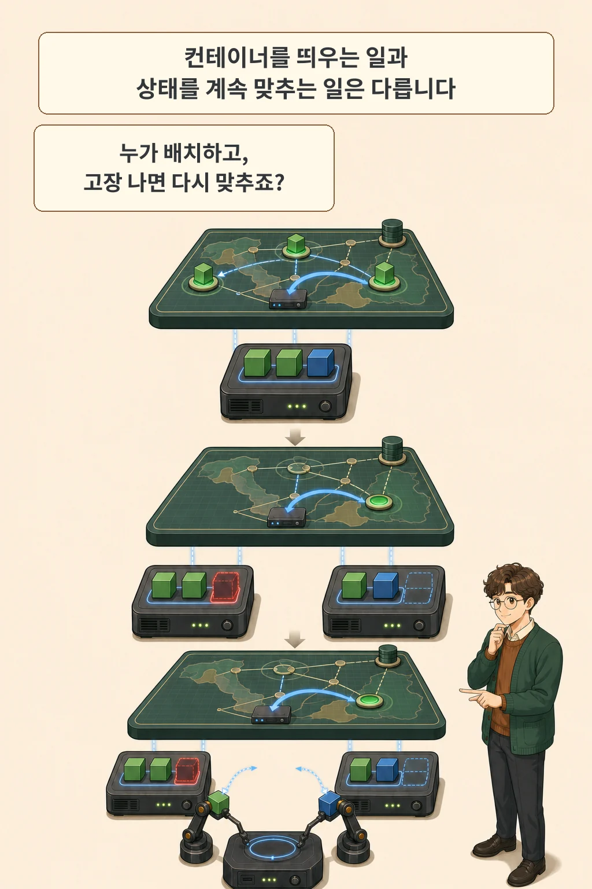
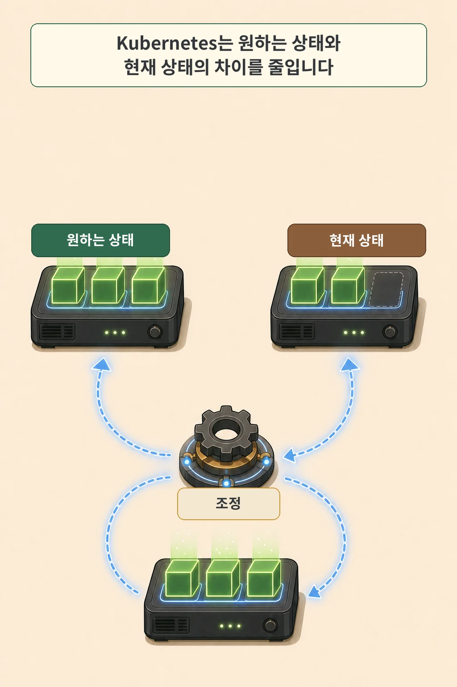
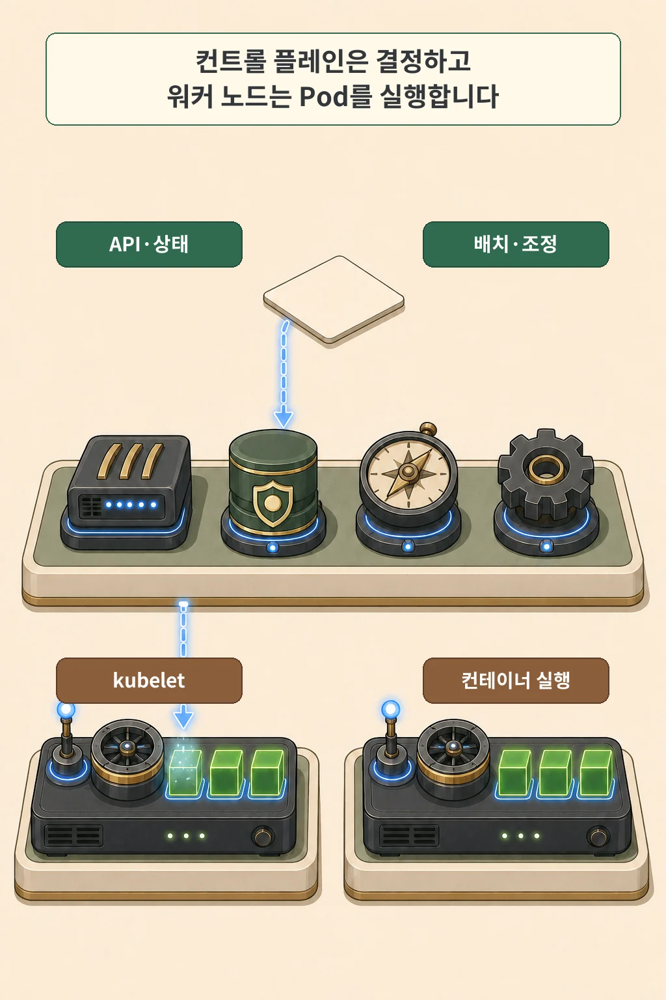
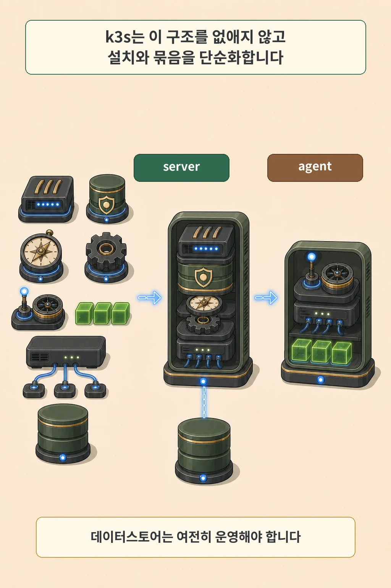
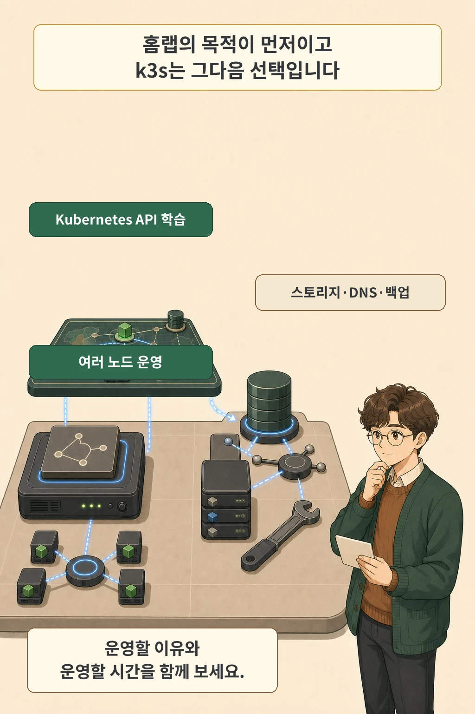

시놀로지 NAS 한 대에 k3s를 올려 배포와 스토리지를 익힐 때, 처음에는 32GB RAM만 보고 여유가 충분하다고 생각하기 쉽습니다. 하지만 Airflow 작업과 k3s 시스템 구성요소가 적은 CPU 코어를 나눠 쓰자 병목이 생겼고, 밤에 NAS를 끄면 메타데이터 DB와 오브젝트 스토리지까지 함께 사라졌죠. 결국 핵심 질문은 '띄울 수 있는가'에서 '컨테이너 실행과 클러스터 제어를 어떻게 나누고 어떤 장애까지 견딜 것인가'로 옮겨 갑니다.

글·해설: 다메카솔

## 컨테이너를 실행하는 일과 클러스터를 운영하는 일

컨테이너 런타임의 책임은 컨테이너 프로세스를 실제로 시작하고 격리하는 데 있습니다. Kubernetes 노드에도 containerd나 CRI-O처럼 CRI와 호환되는 런타임이 필요하며, Kubernetes는 런타임을 대체하기보다 그 위에서 여러 노드의 운영 상태를 조율합니다. k3s 역시 이 모델을 없앤 별도 도구가 아니라 설치와 기본 구성요소를 하나로 묶은 Kubernetes 배포판인 셈이죠.

| 계층 | 핵심 질문 | 대표 구성요소 |
| --- | --- | --- |
| 컨테이너 실행 | 프로세스를 어떻게 시작하고 격리할까? | containerd, CRI-O |
| 클러스터 제어 | 어느 노드에 배치하고 장애 뒤 복구할까? | Kubernetes API, 스케줄러, 컨트롤러 |
| 애플리케이션 | 요청을 어떻게 처리하고 데이터 오류를 막을까? | 서비스 코드, 데이터베이스 |

이 세 계층을 나눠 보면 자가 복구 기능의 한계도 분명해집니다. Kubernetes는 실패한 컨테이너를 재시작하거나 사라진 복제본을 대체하지만, 같은 결함을 품은 컨테이너를 다시 띄우면 동일한 버그가 반복되거든요. 접근할 수 없어진 스토리지나 손상된 데이터도 별도의 복구 설계가 필요합니다.

## 원하는 상태를 계속 맞추는 제어 시스템

Kubernetes를 이해하는 가장 빠른 길은 객체의 `spec`과 `status`를 나눠 보는 것입니다. 사용자는 `spec`에 원하는 상태를 적고, 컨트롤 플레인은 관찰한 현재 상태를 `status`로 기록하며 둘 사이의 차이를 컨트롤러가 줄이거든요.

예를 들어 Deployment에 복제본 3개를 선언했는데 2개만 준비됐다면 컨트롤러가 새 Pod를 만들어 맞춥니다. 일회성 배치 스크립트와 달리 상태를 계속 관찰하고 조정하는 제어 루프인 셈입니다.

이 루프가 원활히 돌려면 기반 자원이 받쳐 주어야 합니다. 새 Pod를 놓을 노드의 CPU·메모리가 부족하면 스케줄링이 멈추고, PersistentVolume을 다시 붙일 수 없으면 Pod만 교체해도 서비스가 살아나기 어렵습니다. 그래서 Kubernetes가 제어하는 범위와 외부 의존성을 함께 살펴야 합니다.

## 컨트롤 플레인과 워커 노드의 역할

클러스터는 크게 컨트롤 플레인과 워커 노드로 나뉘는데, 이름보다 책임을 먼저 잡으면 구조가 선명해집니다.

- **`kube-apiserver`**: Kubernetes API 요청이 드나드는 입구입니다.
- **상태 저장 계층**: 클러스터 상태를 보존하며 일반 Kubernetes에서는 etcd가 맡습니다.
- **`kube-scheduler`**: 노드가 정해지지 않은 Pod에 적합한 노드를 고릅니다.
- **`kube-controller-manager`**: 선언 상태와 실제 상태의 차이를 줄입니다.
- **워커 `kubelet`과 런타임**: `kubelet`이 Pod 실행을 관리하고 런타임이 실제 컨테이너를 띄웁니다.

이 구분은 논리적 역할에 관한 것이어서 물리 서버 구성과는 별개입니다. 단일 노드 학습 환경에서는 서버 한 대가 컨트롤 플레인과 워커 역할을 동시에 맡기도 하죠. 논리적 경계와 물리 장비 수를 구분해 두어야 다중 노드로 확장할 때도 구조를 헷갈리지 않습니다.

## k3s가 줄이는 것과 그대로 남는 것

k3s는 Kubernetes 적합성을 갖춘 배포판으로, 단일 바이너리에 containerd, Flannel, CoreDNS, Ingress 같은 기본 구성요소를 묶어 제공합니다. 덕분에 각 부품을 따로 골라 연결하는 초기 부담이 줄어듭니다.

하지만 역할 구조 자체는 그대로 남습니다. `k3s server`가 컨트롤 플레인과 데이터스토어를 맡고 `k3s agent`가 워커로 참여하며, 양쪽 모두 kubelet, 컨테이너 런타임, CNI를 실행합니다. 특히 데이터스토어 구성이 가용성을 좌우합니다.

| 구성 | 데이터스토어 | 운영상 특징 |
| --- | --- | --- |
| 단일 server | embedded SQLite | 단순하지만 server 장애 시 컨트롤 플레인이 중단됩니다. |
| 다중 server (HA) | embedded etcd (3대 이상) | 가용성이 높아지는 대신 쿼럼과 디스크 지연을 관리해야 합니다. |
| 다중 server (외부 DB) | MySQL·PostgreSQL·etcd 등 (2대 이상) | 외부 DB 가용성과 백업까지 운영 범위에 들어옵니다. |

설치 진입점은 낮아져도 DNS, 네트워크, 인증서, 영구 스토리지, 백업, 업그레이드는 여전히 운영자가 설계해야 할 과제로 남습니다.

## 최소 요구사항은 설치 하한선입니다

K3s 공식 문서가 2026년 7월 23일 기준으로 제시한 최소 요구사항은 소박한 편입니다. 이 수치는 바이너리 자체가 구동되는 하한선이므로 실제 장비를 고를 때는 워크로드 자원을 따로 더해야 합니다.

| 노드 역할 | 공식 최소 CPU | 공식 최소 RAM |
| --- | ---: | ---: |
| server | 2코어 | 2GB |
| agent | 1코어 | 512MB |

실제 운영에서는 이미지 다운로드와 압축 해제가 CPU와 디스크 I/O를 쓰고, Operator가 많거나 상태 변경이 잦으면 server 부하도 커집니다. 데이터스토어, 이미지 저장소, 워크로드 볼륨이 느린 디스크를 함께 쓰면 RAM이 남아도 클러스터가 버벅거리기 쉽죠. 장비 사양에는 워크로드 자원, 디스크 IOPS, 애드온, 복제본 수, 장애 여유까지 함께 반영해야 합니다.

## 홈랩에서 k3s가 필요한지 판단하는 기준

내 홈랩에 k3s가 필요한지부터 짚어 볼까요? 서버 한 대에서 소수의 컨테이너만 실행한다면 Compose나 OS 서비스 관리자가 더 단순합니다. 반대로 Kubernetes API, 선언형 배포, 스케줄링, Operator, 다중 노드 장애 복구를 배우려는 목적이라면 단일 노드 k3s도 충분한 학습장이 되어 주죠.

- **학습 목표**: Kubernetes API와 제어 모델을 배울 분명한 이유가 있는가?
- **확장·구조**: 노드 확장이나 워크로드 이동이 필요하고 `server`·`agent`·데이터스토어 구조를 설명할 수 있는가?
- **스토리지·백업**: 영구 스토리지와 백업을 단순 복제와 분리해 설계할 수 있는가?
- **운영 시간**: DNS·CNI·Ingress·인증서 관리와 정기 업그레이드, 복구 연습을 감당할 수 있는가?

모든 항목에 당장 답하지 못해도 설치를 미룰 필요는 없습니다. 다만 학습용 단일 노드와 24시간 서비스를 맡기는 운영 클러스터의 안전 기준은 처음부터 분리해 두는 편이 좋습니다.

## 자주 묻는 질문

### k3s는 Kubernetes와 다른 기술인가요?

별도의 오케스트레이션 모델이 아니라 Kubernetes 적합성을 갖춘 배포판입니다. 동일한 API와 컨트롤러 모델을 쓰며, 설치 방식과 기본 데이터스토어, 묶어 제공하는 구성요소에만 차이가 있습니다.

### 단일 노드 k3s에도 의미가 있나요?

학습 목적이라면 작은 환경에서도 충분히 의미가 있습니다. Deployment, Service, Ingress, PersistentVolume, Operator 같은 핵심 개념을 장비 한 대에서 빠짐없이 익힐 수 있거든요. 고가용성은 그다음 단계에서 노드를 늘려 구성하면 됩니다.

### NAS에 k3s를 바로 설치해도 되나요?

장비 이름보다 OS와 커널 조건을 먼저 확인해야 합니다. K3s는 현대적인 Linux와 cgroup을 전제로 하므로 전용 NAS OS에서는 커널 모듈이나 네트워크 설정, 업데이트가 걸림돌이 될 수 있습니다. 이럴 때는 NAS 위의 Linux VM이나 별도 미니 PC를 쓰는 편이 경계를 깔끔하게 지켜 줍니다.

이 개념 글이 나온 실제 구축 배경은 [홈랩 쿠버네티스 구축기 1편: RAM은 32GB인데 Airflow DAG가 계속 실패한 이유](/posts/why-homelab-kubernetes/)에서 이어집니다.

## 출처

- Kubernetes, [Overview](https://kubernetes.io/docs/concepts/overview/)
- Kubernetes, [Kubernetes Components](https://kubernetes.io/docs/concepts/overview/components/)
- Kubernetes, [Objects In Kubernetes](https://kubernetes.io/docs/concepts/overview/working-with-objects/)
- Kubernetes, [Container Runtimes](https://kubernetes.io/docs/setup/production-environment/container-runtimes/)
- Kubernetes, [Kubernetes Self-Healing](https://kubernetes.io/docs/concepts/architecture/self-healing/)
- K3s, [K3s - Lightweight Kubernetes](https://docs.k3s.io/)
- K3s, [Architecture](https://docs.k3s.io/architecture)
- K3s, [Cluster Datastore](https://docs.k3s.io/datastore)
- K3s, [Requirements](https://docs.k3s.io/installation/requirements)
- K3s, [Resource Profiling](https://docs.k3s.io/reference/resource-profiling)

이 글의 본문과 이미지는 생성형 AI로 제작했습니다. 기획과 편집 기준은 다메카솔이 정했습니다.
